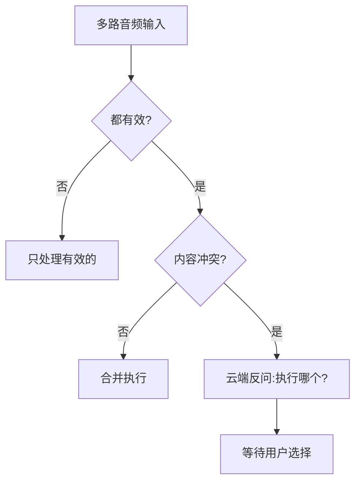

# 豆包汽车语音全链路入职指南

> **目标读者**: 刚入职的产品经理/工程师,需要快速理解豆包汽车语音系统的完整链路
> **文档日期**: 2026-10-22
> **知识来源**: 飞书内部文档汇总

---

## 一、一句话理解豆包汽车语音

**用户说"我有点冷"**，从麦克风到播报的完整旅程:

```
用户开口 
→ 车端麦克风采集音频
→ 降噪/回声消除
→ 判断音区(主驾/副驾/二排)
→ VAD判断说完了没
→ 音频上传到座舱云AIDV
→ Speech云ASR(语音转文字)
→ 拒识模型判断(是否在跟车说话)
→ 离在线仲裁(走端侧还是云端)
→ 豆包云(风控、安审、打断判定)
→ AIDV的Planner理解意图+调Agent查车况
→ 生成回复文本
→ TTS合成为"桃子"音色音频
→ 客户端拉流播放
→ (中途打断?判断是否续播)
```

**关键数据形态转换**: 用户音频 → ASR文本 → 待播报文本 → TTS音频

---

## 二、四方系统协作架构

### 2.1 系统分工

| 系统 | 职责 | 关键能力 |
|------|------|---------|
| **客户端(车机)** | 采集音频、发起请求、展示回复、播放音频 | 上报端状态、承接车控执行指令 |
| **豆包云** | 对话入口、通用能力 | 环境风控、内容安审、打断判定 |
| **AIDV(座舱云)** | 汽车场景业务处理 | 结合上下文组织业务+工具调用 |
| **Speech云** | 语音能力底座 | ASR(语音转文字)、TTS(文字转语音) |

### 2.2 数据流转路径

**上行(用户说话)**:
1. 客户端 → AIDV: 用户音频(WS长链)
2. AIDV → Speech云: ASR识别
3. AIDV → 客户端: ASR文本
4. 客户端 → 豆包: 文本对话(HTTP短链)
5. 豆包 → AIDV: 业务请求

**下行(系统回复)**:
1. AIDV → Speech云: TTS合成
2. AIDV → 豆包 → 客户端: 回复文本 + TTS标识
3. 客户端 → AIDV: 拉取音频(WS长链)

---

## 三、六个关键判断环节

### 判断① 听谁说、多人分区

**场景**: 主驾说"空调最大" + 副驾同时说"有点冷关空调"

**判断逻辑**:


**边界规则**:
- 乘客间闲聊 → 不回应
- 有效指令/问题/讲笑话 → 必须回应

📄 **来源文档**: [多人同时语音交互PRD](https://bytedance.larkoffice.com/wiki/U4xLwmQNki1Pu5kpyAGcHWtmngf)

---

### 判断② 停顿说完、取字纠错

**核心机制**: 
- 车持续收音
- VAD(Voice Activity Detection)判断停顿
- 流式识别 + 语义二遍修正

**VAD分级**:
- **Soft VAD**: 300ms阈值 → 触发预请求(可多次触发,不结束ASR)
- **Hard VAD**: 600ms阈值 → 确认说完,音频分段,发起正式请求

**纠错示例**: "虹煤" → "虹梅"(PRD设计示例,非量产效果)

📄 **来源文档**: [语音基础体验链路OnePager](https://bytedance.larkoffice.com/wiki/GBcCw5c6xiWvGukPMQgcMiuKnEc)

---

### 判断③ 该不该回应(拒识)

**两层拒识**:
1. **流式拒识**: 基于partial文本,决定是否提前打断当前TTS
2. **最终拒识**: 基于final Query,决定是否进入正式链路

**触发流式拒识前提**(4个条件同时满足):
- 多人场景
- ASR ≥ 2个字
- ASR前缀不包含"豆包"
- TTS正在播放

**结果**: 
- 人机交互 → 接受并处理
- 人人闲聊 → 不回应(但不停正在播的TTS)

📄 **来源文档**: [1.0对话需求](https://bytedance.larkoffice.com/docx/PX9dd8Lk2oQNb1xBeM5c7D3pnUc)

---

### 判断④ 无网/有网仲裁

**无网三层处理**:
```
本地能理解 → 直接执行
必须联网 → 提示能力限制
本地不理解 → 离线兜底话术
```

**有网优先级**: 
```
离线白名单 > 在线 > 离线非白名单 > 离线通用兜底
```

**关键理解**: 
- 白名单 = "更快的优先权",不是"无网唯一可用"
- "我有点冷"必须上云(需查车况/天气/乘员),不能本地白名单直接开空调

📄 **来源文档**: [离在线仲裁PRD](https://bytedance.larkoffice.com/docx/Nvj1dvkl8oOTAhxOjxAc0bn0nS0)

---

### 判断⑤ 简单/模糊/组合指令分流

**三类指令**:
1. **简单车控**: 命中白名单 → 本地快路执行
2. **模糊诉求**: "我有点冷" → 必须上云,结合场景理解
3. **组合指令**: "打开空调顺便讲个笑话" → Planner拆成多步执行

**反馈原则**:
- 成功 = 服务真实返回 + 车辆状态真的变化
- 失败 = 明确提示原因(具体话术待确认)

📄 **来源文档**: [1.0对话需求](https://bytedance.larkoffice.com/docx/PX9dd8Lk2oQNb1xBeM5c7D3pnUc)

---

### 判断⑥ 播报插话与主动服务

**播报中插话判断**:
```
用户开口 → 语义判断人机/人人
  ├─ 人机 → 停播,办新事
  └─ 人人/拒识 → 继续播
```

**主动提醒**: 独立入口,抢占规则待确认(TTS六档优先级为参考,非量产现状)

📄 **来源文档**: [打断策略PRD](https://bytedance.larkoffice.com/wiki/FLlSwl1GoicNugkWWLCcFxtmnhl)

---

## 四、核心模块详解

### 4.1 ASR热词处理

**热词类型与数据来源**:

| 热词类型 | 数据来源 | 支持数量 | 是否需要冷热处理 |
|---------|---------|---------|----------------|
| **人名类** | 通讯录+人脸识别身份 | 1000 | ❌ |
| **导航地点类** | 端状态(目的地/途经点) | 500 | ✅ |
| **媒体类** | 端状态(当前播放音频) | 1000 | ✅ |
| **可见即可说类** | 车企页面注册热词 | 500 | ❌ |
| **车控类** | 固定配置(可按车企调整) | 1000 | ❌ |
| **对话历史** | 最近N轮对话 | 5轮 | ❌ |

**注入时机**: ASR建联时 + ASR链路上行信息中

---

### 4.2 预请求机制(抢跑优化)

**目标**: 通过Soft VAD + 语义VAD的预请求换取正式请求耗时降低

**流程**:
```
步骤1: Soft VAD(300ms) → 预请求Query → 无状态任务(拒识、Context)
步骤2: Hard VAD(600ms) + 语义VAD → 最终Query
步骤3: 若"request_id相同" ∧ "正式Query = 预请求Query" 
       → 复用预请求结果
       → 否则重算
```

**关键标识**:
- `request_id`: 端云链路请求唯一标识
- `round_id`: 同一request_id内的请求轮次(每次预请求递增)

---

### 4.3 TTS处理

**情绪化TTS解析**:

Planner输出示例:
```json
{
  "talk_content": "[高兴的说]好嘞,给右后放首中文歌。[小声说]你真帅啊",
  "emoji_id": "listen_music"
}
```

**处理规则**:
- 解析`[xxx]`作为情绪信息
- 无`[]` → 使用用户query作为情绪信息
- 包含"唱" → 调用s2s唱歌

**音频标识**: `tts_audio_id` → 端侧通过TTS WSS拉流

---

### 4.4 打断恢复

**两种恢复方式**:

1. **拒识后恢复**(Event Query):
```json
"event": "副驾(小王)和其他人说话,打断了你正在说的话,
你已经说了:'好的,先调成彩虹的第一个颜色,红色'
然后被打断了没说完的话是:'同时搜一下川菜馆'"
```

2. **Recall融合**(Planner处理):
- 融合新Query + 未播内容
- 生成自然且不重复的新NLG

---

## 五、当前现状(2026-10口径)

### 5.1 最差的三件事(P0级问题)

#### ❌ 问题1: 整体慢
- **云端全流程**: 2550ms
- **识别结束→播报开始**: 3600ms
- **路测反馈**: "比上汽慢很多,等5-6秒以上"

#### ❌ 问题2: 本地对话链路/全时免唤醒通过率 <50%
- 提测后未通过
- 全时免唤醒"不通,拒识升降级也不通"
- 主交互测试通过率84%(185用例: pass126/fail3/block21/NA35)

#### ❌ 问题3: 离线ASR不达标
- 思必驰离线句准实测60.99%
- 导航场景仅41.93%
- 出厂检查点状态: **Fail**
- 有网时偶发切到离线ASR,错得离谱导致后续推理全错

---

### 5.2 资源使用情况

**火山ASR**:
- 火山账号: 2109706047
- 应用名称: doubaoInCar
- APPID: 2117182170
- **并发量**: 400

**SAMI TTS**:
- 类型: BigTTS
- Speaker: zh_female_wenroutaozi_uranus_bigtts
- **QPS**: 50
- **并发量**: 300

---

## 六、作为新人最该做的5件事

### 🎯 任务1: 导出触发条件清单
**目标**: 把"1020约定支持的全部触发条件清单(sls信号库)"导出来
- 这是触发器行唯一明确交付物
- 数据源: sls场景感知状态信号库
- 随端状态更新

### 🎯 任务2: 推进系统预设任务支持率
**当前**: 40%
**目标**: 往上走
- 1013必解表里"系统预设任务"你是负责人
- 除依赖VLM的,其余要尽快推进

### 🎯 任务3: 排查"上车事件主动服务未触发推理"
- 路测P0问题
- 上报给赵益红,但需要触发器排查
- 这是触发器输入(端状态事件) → 语音输出(主动播报)链路的活教材

### 🎯 任务4: 摸清"打断恢复"和"拒识"研发owner空缺
- 高优矩阵这两行只有产品(徐洋/张嘉锋)和PM(李浩然)
- **研发列空着**
- 触发器主动播报会被打断、会走拒识,直接影响主动服务体验

### 🎯 任务5: 申请触发器管理后台权限
- 地址: console.volcengine.com/aidv-admin/trigger/scene
- 权限找: 樊文涛
- 先把触发/触达指标看板跑起来(2026H2 DOING)

---

## 七、核心文档清单

### 7.1 架构与链路类
1. [豆包×AIDV端云链路OnePage](https://bytedance.larkoffice.com/wiki/DBRnwrLFNiPxV5kZZOXcBYxqnCl) - **必读**
2. [语音基础体验链路OnePager](https://bytedance.larkoffice.com/wiki/GBcCw5c6xiWvGukPMQgcMiuKnEc) - **必读**
3. [服务端AIDV架构梳理](https://bytedance.larkoffice.com/wiki/SwaPwKLkNiKDdekvvp5cWwybntb)
4. [AI汽车技术架构](https://bytedance.larkoffice.com/docx/SupzdFrzjoXqhpxiYevcGsO0nXb)

### 7.2 产品与需求类
5. [豆包汽车语音链路详解×语音PM工作地图](https://bytedance.larkoffice.com/docx/T9RAd5dcUoSBY3xbr5tcFvxonJg) - **入职必读**
6. [语音产品经理面试备战手册](https://bytedance.larkoffice.com/docx/QdaXdDVTSopBdJxfnrWczBEYnof)
7. [多人同时语音交互PRD](https://bytedance.larkoffice.com/wiki/U4xLwmQNki1Pu5kpyAGcHWtmngf)
8. [离在线仲裁PRD](https://bytedance.larkoffice.com/docx/Nvj1dvkl8oOTAhxOjxAc0bn0nS0)
9. [打断策略PRD](https://bytedance.larkoffice.com/wiki/FLlSwl1GoicNugkWWLCcFxtmnhl)

### 7.3 问题跟踪类
10. [AIVA高优问题表](https://bytedance.larkoffice.com/wiki/Tp70wuM9YijpZ1kj8pJcgPXKnib) - **必读**
11. [AIVA需求管理台账](https://bytedance.larkoffice.com/wiki/EOQQwWRQ3ig56OkuQx4c3qYrnOg)
12. [ASR测试报告](https://bytedance.larkoffice.com/wiki/AeYjwYhOqi3FCYkpbqNc9FFAnsh)

### 7.4 触发器相关
13. [触发器OnePage](https://bytedance.larkoffice.com/wiki/Xk6xwM3l8iK4oCkXIMlcIo4hnFc) - **你的主战场**

---

## 八、关键术语表

| 术语 | 定义 | 出现位置 |
|------|------|---------|
| **VAD** | Voice Activity Detection,语音活动检测 | 判断用户是否说完 |
| **Soft VAD** | 300ms阈值,触发预请求 | 可多次触发,不结束ASR |
| **Hard VAD** | 600ms阈值,确认说完 | 触发音频分段 |
| **ASR** | Automatic Speech Recognition,语音识别 | Speech云核心能力 |
| **TTS** | Text To Speech,文字转语音 | Speech云核心能力 |
| **拒识** | 判断是否为人机交互 | 流式拒识+最终拒识两层 |
| **Planner** | 对话推理引擎 | AIDV核心模块,负责意图理解+任务规划 |
| **Context** | 上下文管理 | 车况+环境+记忆组装 |
| **request_id** | 端云链路请求唯一标识 | 预请求+正式请求+历史同步 |
| **round_id** | 同一request_id内的请求轮次 | 每次预请求递增 |
| **tts_audio_id** | TTS音频流标识 | 端侧拉流播放 |
| **热词** | ASR识别增强词库 | 人名/地点/媒体/车控/对话历史 |

---

## 九、快速自检清单

入职第一周结束时,你应该能回答:

- [ ] 一次语音请求经过几台机器?各负责什么?
- [ ] 什么是Soft VAD和Hard VAD?各触发什么动作?
- [ ] 流式拒识和最终拒识有什么区别?
- [ ] 离在线仲裁的优先级是什么?
- [ ] 预请求机制的目的是什么?复用条件是什么?
- [ ] 当前最严重的3个P0问题是什么?
- [ ] 你负责的触发器在整个链路的哪个位置?
- [ ] 打断恢复有几种方式?各自适用什么场景?
- [ ] ASR热词有哪几类?数据来源是什么?
- [ ] 触发器管理后台地址是什么?找谁开权限?

---

## 十、联系人速查

| 角色 | 姓名 | 负责模块 |
|------|------|---------|
| 触发器权限 | 樊文涛 | 触发器管理后台 |
| 产品 | 徐洋 | 打断恢复 |
| 产品 | 张嘉锋 | 拒识 |
| PM | 李浩然 | 打断恢复+拒识 |
| 问题上报 | 赵益红 | 路测P0问题 |

---

**文档更新**: 本文档基于2026-10-22飞书文档搜索结果整理,如有链接失效或权限问题,请联系相关负责人。

**下一步**: 
1. 按顺序阅读"核心文档清单"中标记为**必读**的4篇文档
2. 完成"快速自检清单"
3. 申请触发器管理后台权限
4. 加入相关飞书群组(具体群组待补充)
