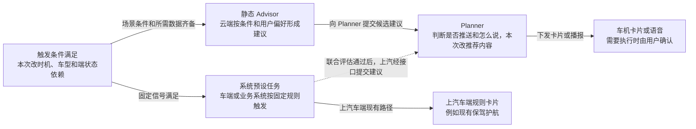

# 11 月 11 日上汽主动服务改表方案

小憩和冥想已确认可用历史偏好做推荐。车机要先通过 FaceID 识别用户身份，再取到该用户的偏好。会上确认小憩覆盖本次讨论车型，冥想和长睡眠的功能只在 BS5PR 上具备。长睡眠单独建候选行。节日关怀和兴趣延伸可以评估行程中的其他推送时机，具体条件仍待双方定。`00:10:42`「用的是历史偏好」 `00:16:41`「faceid 是属于强依赖」 `00:18:00`「冥想其实现在也只有BS5PR有」 `01:06:24`「这个会后我再去找益红沟通一下吧」。 [11 月 11 日会议文字记录](src/meeting-saic-20261111.md)

本会先谈 8838 平台。上汽框架把情感关怀列在 8797，会上同时提出 BS5PR 也有 8838 版本，情感关怀随哪些版本交付要由上汽确认。双方同意沿用一套车机推荐容器，以小卡弱打扰为方向。接入统一推送的上汽车端规则，由上汽判断何时触发，向字节接口提交一句建议，再由 Planner 出卡。需要开模式的场景，还要先确认语音能直接调用该功能。框架描述的画布、缩略图、消息中心和播报是上汽原设计，统一容器的实际承载方式待双方交互团队确认。`00:07:34`「我们先把8838平台上的内容谈好」 `00:25:44`「master agent 就是我们的 planner」 `00:38:02`「共同维护同一套容器的方向」 `00:41:40`「已经被调用的」 `00:44:45`「尽可能还是小的卡片」。 [会议文字记录](src/meeting-saic-20261111.md) · [上汽《座舱智能推荐框架》](src/internal-doc.md)

表格共有 10 条非空场景。表里没有单独的推荐内容字段，改表草案在「触发」格里先写条件，再写用户会看到或听到什么。「端状态依赖」写车机或业务服务需要提供的数据，原有复用率没有新评估值可替换。 [主动服务表格快照](src/records.json) · [字段定义](src/fields.json)

## 现有场景怎么改

### 保驾护航推荐

表里选的是系统预设任务，触发、端状态依赖、主线可复用程度都为空。会议把它所在的既有推荐场景纳入联合价值评估，未逐条讨论雨刮或车速。`00:48:02`「已有推荐如何处理这部分是要看高价值的」。

《保驾护航推荐 · 触发条件》和《保驾护航推荐 · 推荐内容结果》规定，推荐开关打开、没有智能场景运行、车型有四颗环视摄像头、360 全景影像等相关画面不在前台、距离上次退出保驾护航超过 15 分钟，且车速 ≤60 km/h、雨刮高速档持续 ≥10 秒时，车端显示卡片，询问是否开启有补盲能力的保驾护航。用户确认后开启。

**待上汽确认。** 触发从空白补成上述车端固定规则，端状态补推荐开关、智能场景运行状态、环视配置、前台画面、退出时间、车速和雨刮档位及持续时长。上汽要确认各车型是否沿用这套门槛，双方再评估接入统一容器的方式和主线复用程度。

### 情感-重要节日前7天提醒用户

表里写节前 7 天内、P 档且车上有人，依赖 FaceID、座椅占位、档位、车速和乘客身份。主线可复用程度为 0%，备注还列了频繁触发消耗、已采纳建议去重和节日清单三个问题。会上确认个性化节日需要家庭群组关系，后半段上汽提出行程里找到适合的时机即可。`00:21:01`「肯定是家庭群组要告诉我 faceid 这个信息啊」 `01:04:39`「你只要在这个行程里面能提醒到用户就可以了」。

《情感关怀 · 触发条件》原方案是节前 1–7 天，车主登录、联网、打开关怀开关，家庭群组已录人脸与关系，指定节日要能匹配相应关系。安卓开机后，车速 ≤40 km/h 或 P 档且无其他推送时出卡，消息中心有效 1 天。《情感关怀 · 推荐内容结果》把这张卡用作准备入口，点击查看后给节俗、礼物方向和家庭活动建议。

**讨论中观点。** 把「节前 7 天内 P 档有人就推」改成先命中节日与适用家庭关系，再选择适合的车内时机弹出一张节前准备卡。保留框架原时机供对照，评估行程中车速为 0 时推送。端状态补日期日历、车主登录、联网、开关、家庭群组关系和当前推送状态。节前原方案使用已录入的关系，实时识别家人上车是当天提醒的额外条件。节日清单、停车条件和已采纳记录能否用来去重仍待确认。

### 内容-兴趣延伸推荐

表里写每周四或周五 11:00–14:00 或 18:00 后，P 档且车上有人。依赖 FaceID、座椅占位、当前位置、目的地、导航状态、档位、车速和乘客身份，主线可复用程度为 0。会上先说评估无更新，后来讨论改在行程中静止时推，并指出上车即推时依赖 FaceID。`00:23:15`「目前是没有的，还是跟上次沟通是一致的」 `01:04:14`「也是依赖 Face ID 的」 `01:05:08`「就是车速为0的时候」。

《兴趣延伸 · 触发条件》沿用周四、周五的两个时段，要求登录、联网、开关开启，能识别音乐高频用户及喜爱艺人。原规则是上车后车速 ≤40 km/h 或 P 档，每周最多一次，消息中心有效 3 天。《兴趣延伸 · 推荐内容结果》是点击查看后给艺人近一个月的资讯和官宣活动，同一活动或作品不重复推。有定位时优先附近活动，未授权则给宽泛资讯。有可用的购票服务才接购票。

**讨论中观点。** 保留周四、周五时间窗，把推送时机改成评估窗内的车速为 0 时机，是否限 P 档待定。将个性化偏好和数据来源写成明确依赖，补账号、联网、推荐开关、周频控及内容去重。原框架使用 VC 提供的车机使用数据和「用户体验改进计划」埋点授权，能否用豆包长期记忆替代、需要何种身份和授权，仍要一起确认。定位按是否需要附近内容使用，目的地和导航状态按最终展示和导航方案评估。

### 舒适-小憩/冥想模式推荐

表里写 P 档超过 2 分钟且车上有人，依赖冥想/小憩开关、FaceID、座椅占位、车辆位置、导航状态、档位和车速，主线可复用程度为 80%。会上确认 8838 可按历史偏好做，小憩覆盖本次讨论车型，冥想目前只有 BS5PR。`00:10:42`「用的是历史偏好」 `00:16:41`「faceid 是属于强依赖」 `00:18:47`「其他的是都有的」。

《智能场景推荐 · 触发条件》和《智能场景推荐 · 推荐内容结果》要求车辆处于 P 档，推荐开关打开，电源为 RUN 或 Ready（车辆已上电或已就绪），车门关闭、高压正常，纯电或混动车型电量 ≥20%，并匹配地点、时段与历史用过的模式。系统出卡建议打开对应模式。框架还列了一条小憩特有的备选路径，驻车时手动把靠背调到超过 150° 可以单独触发。因座椅可能移动，框架建议评估主驾占位。

**已确认结论。** 把接近「停够时间就推」的写法补上强条件。P 档且车内有人时，先识别用户，查其历史小憩或冥想偏好，再按车型推荐对应模式。用户确认后开启。端状态把 FaceID 与可用历史偏好明确为强依赖，并写清车型可执行能力。

**待上汽确认。** 原表 2 分钟门槛先作为草案基线。地点和时段匹配、电源、电量、车门、高压、主驾占位，以及座椅角度路径能否与历史偏好路径并存，按车型核对。会上未确认座椅角度可放宽 FaceID 要求。

### 情感-法定节假日问候

表里触发只写「待讨论：有人上车？？？」。依赖 FaceID、座椅占位、档位、车速和乘客身份。主线可复用程度为 100%，备注说没有 FaceID 难做父亲节、母亲节等个性化问候。会上明确只认出人脸还不够，家庭群组要提供此人是车主的哪位家人，当时量产方案没有这层关联。`00:21:01`「肯定是家庭群组要告诉我 faceid 这个信息啊」 `00:21:20`「就已经上线量产的情况下，没有关联」。

《情感关怀 · 触发条件》当天分支，在节日当天由车内感知系统 OMS 识别已上车的家人。端午、中秋、春节识别任意家庭成员即可，父亲节、母亲节、情人节、七夕、儿童节要识别对应关系的家人。还需车主登录、联网、关怀开关开启、相机与人脸权限有效、车辆未处于超级节能模式，车速 ≤40 km/h 或 P 档，且无其他推荐卡。《情感关怀 · 推荐内容结果》原方案出卡时带语音祝福，点击查看后可显示祝福文案和图片，也可承接歌曲、出行内容。

**待上汽确认。** 把「有人上车」换成「节日当天已识别到适用家人」，把泛写的乘客身份细化为身份与家庭关系关联。身份确认后能否延至行程中的静止时机再出卡，按车辆信号可用性评估。当前行名「法定节假日」与框架节日范围不完全一致，请上汽定保留的节日和场景名。表内 100% 来自旧评估，需取得关系数据后再评估。

### 出行-节假日前行程推荐

表里写节前 7 天内、P 档且车上有人，依赖 FaceID、座椅占位、导航状态、车辆位置、乘员信息、车速和档位。主线可复用程度为 0，已有餐厅、景点、亲子活动场所的内容方向。会议讨论了情感关怀的共用推送时机，未单独讨论节前行程。`01:04:24`「都不是依赖一定要上车就推出来」。

《情感关怀 · 触发条件》里它使用节前 1–7 天的准备提醒入口。《情感关怀 · 推荐内容结果》给聚餐、短途游、逛展或亲子活动。定位获授权时给地点和距离，按活动需要补路况、限行等提示。无定位时给泛化活动建议。

**讨论中观点。** 把独立的「节前 P 档有人」触发改为共用节前准备卡，用户查看后再提供行程建议。端状态按节前入口补车主账号、关怀开关、联网和适用的家庭关系，附近地点才读取授权定位。导航状态是否用于进一步规划，由双方结合实际内容评估。

### 内容-目标节假日礼物推荐

表里写节前 7 天内、P 档且车上有人，依赖 FaceID、座椅占位、档位、车速和乘客身份。主线可复用程度为 0，备注没有定按谁的身份、谁的人物关系推荐。会上明确家庭关系是个性化前提，未单独确定礼物规则。`00:20:56`「需要，我怎么知道他是我儿子？」。

《情感关怀 · 触发条件》和《情感关怀 · 推荐内容结果》把礼物放在节前准备卡内。用户查看后，按节日和对应家庭成员的偏好给 2–3 个礼物方向，并说明推荐理由。

**讨论中观点。** 把独立触发改成共用节前准备卡，明确礼物给谁取决于适用的家庭关系。端状态补家庭成员关系和可用偏好，复用节前入口的车主、联网、开关与车况条件。缺少该成员偏好时能否给通用礼物方向，待上汽产品确认。

### 内容-目标节假日歌单歌曲推荐

表里写节前 7 天内、P 档且车上有人，依赖 FaceID、座椅占位、档位、车速、乘客身份、上次媒体类型、当前音视频及播放模式和状态。主线可复用程度为 50%，备注要求结合车上乘员关系推荐符合氛围的歌。会议只提到字节主线可做音乐等媒体推荐，未单独确认节日歌单。`01:00:13`「就是音乐啊」。

《情感关怀 · 推荐内容结果》只在当天提醒列出主题歌曲，触发沿用《情感关怀 · 触发条件》的节日当天、识别到适用家人的规则。用户确认后才调用当前音乐应用播放。

**待上汽确认。** 原表节前 7 天和框架当天的口径冲突。建议改成当天卡片查看后的歌曲内容，端状态采用当天身份和关系依赖，补当前音乐应用及播放能力。是否保留独立的节前歌单，以及当前媒体状态怎样影响播放，会上未定。

### 出行-节假日当天行程推荐

表里触发写「待讨论：有人上车？？？」。依赖 FaceID、座椅占位、导航状态、车辆位置、目的地、途经点、乘员信息、车速、档位、充电状态、续航状态，主线可复用程度为 0。会上只讨论情感关怀可以在行程中找时机，未单独定当天行程的触发。`01:06:30`「没有那么强依赖，一定要上车的时候推」。

《情感关怀 · 触发条件》和《情感关怀 · 推荐内容结果》规定当天识别到适用家人后，用户查看关怀卡可以获得餐厅、景点或短途游建议。有定位时附距离、实时路况和天气，支持一键导航，无定位时提供泛化建议。

**讨论中观点。** 把「有人上车」换成共用当天关怀卡，用户查看后按家人关系和授权定位给行程建议。端状态依赖应体现当天识别、关系关联、定位授权和地图导航。目的地、途经点、充电和续航只有做独立行程规划时才需另行核对，本轮框架未把它们列为门槛。

### 出行-兴趣POI延伸推荐

POI 指有具体地址、可以导航的地点。表里写每周四或周五 11:00–14:00 或 18:00 后，P 档且车上有人。依赖 FaceID、座椅占位、导航状态、车辆位置、目的地、途经点、乘员信息、车速、档位、充电和续航状态，主线可复用程度为 0。会议提到兴趣延伸的评估没有更新，后面提出可以增加其他推送时机，但未单独定这条地点推荐。`00:23:15`「还是跟上次沟通是一致的」 `01:06:50`「是不是可以增加其他的场景」。

《兴趣延伸 · 触发条件》的周四或周五时间窗和每周一次适用于整个兴趣推荐。《兴趣延伸 · 用户场景举例》里，艺人活动场馆、联名快闪店、主题餐厅都是用户点开原卡片后看到的地点，附地址、距离，可一键导航。无定位权限的示例给资讯。

**讨论中观点。** 把独立的地点触发改成共用内容兴趣延伸的入口和周频控。用户查看时，有授权定位且查到与偏好相关的可信地点，再展示地点和导航入口。端状态补定位授权与地图能力。既有目的地、途经点、充电和续航是否服务另一个独立路线场景，由上汽确认。

## 建议新增的场景

### 舒适-长睡眠模式推荐

**已确认结论。** 会上确认可根据历史偏好推荐长睡眠，依赖 FaceID，座椅平躺能力目前只在 BS5PR 有。以历史实际开启过的模式区分小憩与长睡眠。《智能场景推荐 · 触发条件》和《智能场景推荐 · 推荐内容结果》提供睡眠模式的车况基线，具体交付的平台版本仍要查车型适配表。`00:11:57`「他开的是睡眠，那后续就推睡眠」 `00:15:14`「现在是不是要开启睡眠模式，是可行的」 `00:16:14`「我必须拿到记忆，也就说你们的 FaceID」 `00:17:30`「只有BS5PR这一个车型是有这个功能的」 `00:17:35`「对的，目前是的」。

- **场景** 舒适-长睡眠模式推荐。**需求来源** 上汽侧提出、主线能力适配。**实现方式** 静态advisor。
- **触发** BS5PR 停在 P 档，识别到当前用户，并能查到与该场合匹配的长睡眠实际开启记录时，推荐开启长睡眠模式。用户确认后开启。地点、时段匹配和其余车况门槛按车型确认。
- **端状态依赖** FaceID 与历史实际开启记录、BS5PR 的睡眠模式硬件和调用能力、档位、当前位置与当前时段。框架列有推荐开关、RUN/Ready、纯电或混动车型电量 ≥20%、车门关闭、高压正常，具体信号及主驾占位待评估。
- **主线可复用程度** 可沿用主线历史偏好推荐策略，历史记录能否区分实际开启的小憩和长睡眠、各车型执行能力及复用比例待评估。

### 功能发现推荐（上汽侧评估）

**待上汽确认。** 字节明确不承接「用户是否用过某功能」的判断，也不接上汽全量用车行为记录。上汽闻文与宋辉另评估由车端或上汽云端判断，再评估把合格建议送入统一卡片。《功能发现 · 触发条件》和《功能发现 · 推荐内容结果》提供双周节奏、去重规则及内容。`00:27:13`「我们不会接你们全量的埋点」 `00:29:38`「要拉内部其他同事一起来看这个事」。

- **场景** 功能发现推荐（上汽侧评估）。**需求来源** 上汽侧提出。**实现方式** 系统预设任务。按固定周期和上汽数据规则暂列，最终部署待评估。
- **触发** 上汽判断用户从未使用过某车型亮点功能。每两周的周六或周日 9:00–18:00，账号登录、联网、开关开启。用户上车后，车速 ≤40 km/h 或处于 P 档，且无其他推荐占位时，推荐一项功能。同车、同用户均不重复推荐同一功能。用户查看后介绍功能用途和特点。
- **端状态依赖** 上汽侧的用户标识、车辆识别码、功能埋点编号及历史使用、推荐记录，车机登录、联网、开关、车速、档位和推荐卡片占位。
- **主线可复用程度** 字节侧不承接未使用判断。上汽内部选出建议后，双方可评估复用 Planner 和统一卡片。

### 智载空间推荐（二排近享/儿童守护）

**待上汽确认。** 《智载空间——11月10日更新：CBG新需求，待评估，BS5PR-8797》是明确的框架条目。会上问及拟做的「精力空间」，结合框架内容暂按智载空间评估，需上汽确认指的是同一场景、交付平台及范围。`00:47:44`「上面我们现在已经要做的这些是精力空间」 `00:48:32`「这个到时候肯定要单聊的，这是新的」。

- **场景** 智载空间推荐（二排近享/儿童守护）。**需求来源** 上汽侧提出。**实现方式** 系统预设任务。按车端感知规则暂列，建议接口和播报接法待评估。
- **触发** BS5PR-8797 已上电或就绪、车门关闭、非超级节能模式，车内感知和摄像头权限可用，且稳定识别第二排两个座位均有儿童、人脸无遮挡时，语音询问是否开启二排近享及儿童守护。用户确认后，按车型可执行条件联动座椅、后排屏、儿童专属桌面、舱外百科与智能场景对话。识别不稳定时不推，开启的开关不自动恢复。
- **端状态依赖** 车型平台、电源、车门、节能模式、OMS 二排占位及儿童识别、摄像头权限、二排座椅位置，以及座椅与后排功能调用状态。框架允许行驶或驻车时判断是否提示，行驶中能否实际移动座椅及座椅位置前提末尾的「或」都待上汽澄清。
- **主线可复用程度** 可评估复用建议推送和确认执行链路。儿童感知、座椅、后排屏与儿童应用能力按车型盘点。

### 哨兵模式推荐（陌生地停车）

**讨论中观点。** 会议用陌生地点停车举例说明上汽如何提交建议，字节以语音能打开哨兵为例解释接入条件，是否作为高价值场景接入仍需联合评估。《业务模块处理场景》与《端状态整理 · 哨兵模式推荐》给出了现状规则。`00:25:04`「需推荐用户开启哨兵功能」 `00:41:40`「就叫打开哨兵模式，它已经是能被调用的」 `00:48:02`「已有推荐如何处理这部分是要看高价值的」。

- **场景** 哨兵模式推荐（陌生地停车）。**需求来源** 上汽侧提出。**实现方式** 系统预设任务。
- **触发** 对应推荐开关开启，在陌生地点停车，停车点距地图中的家和公司均 ≥2 km、本次行程 >1 km 时，推荐开启哨兵模式。用户确认后开启。
- **端状态依赖** 停车状态、车辆位置、地图中的家和公司、本次行程里程、对应推荐开关、哨兵功能及语音调用能力。额外电量和摄像头要求待上汽业务模块确认。
- **主线可复用程度** 可评估复用统一卡片及用户确认后执行的链路，触发沿用上汽规则。按个人或群体停车历史优化属于框架后续方案。

### 记忆泊车巡航推荐

**待上汽确认。** 《业务模块处理场景》与《端状态整理 · 记忆泊车巡航推荐》已有该条。会议约定评估既有五项的接入价值，未单独拍板这条。`00:48:02`「已有推荐如何处理这部分是要看高价值的」 `00:48:27`「就是这五个吧」。

- **场景** 记忆泊车巡航推荐。**需求来源** 上汽侧提出。**实现方式** 系统预设任务。
- **触发** 对应推荐开关开启，已完成记忆泊车路线建图，车辆再次进入该路线的起点匹配范围时，建议使用记忆泊车巡航。确认执行方式和可用状态后再接入统一推荐。
- **端状态依赖** 当前车辆位置、智驾提供的路线建图和起点匹配状态、对应推荐开关。车型上的能力调用与额外安全条件待上汽泊车团队确认。
- **主线可复用程度** 上汽提供路线与触发信号。统一显示和执行链路待评估复用。

### 露营/小憩模式内容推荐（桌面组件）

**讨论中观点。** 《业务模块处理场景》要求已开启露营或小憩后，在车机主界面给音乐、视频。会上明确它用独立的桌面组件，双方还要对需求和容器。这条评估的是模式开启后的媒体内容。`00:49:28`「它是一个生态的 Widget」 `00:50:03`「形态位置上，容器可能都不是一个」。

- **场景** 露营/小憩模式内容推荐（桌面组件）。**需求来源** 上汽侧提出。**实现方式** 系统预设任务。按业务系统的固定展示条件暂列。
- **触发** 对应推荐开关打开，用户已进入露营或小憩模式并进入主界面时，桌面组件展示适合该模式的音乐、视频。
- **端状态依赖** 当前场景状态、车机主界面状态、推荐开关、媒体内容来源与桌面组件的显示能力。
- **主线可复用程度** 当前触发和显示由上汽业务负责，是否纳入统一推荐表及是否复用字节内容能力待双方评估。

会上明确移除「建议开启露营模式」，框架 v1.2 删除了儿童助眠。用户在情景大师设置条件后自动触发，属于用户编排任务，会上的共用组件与后排显示讨论留在交互对接。支付宝停车支付只提到可能接入，框架未列对应场景。`00:15:54`「你把露营去了吧」 `00:50:28`「它实际上不是一个推荐类的功能」 `00:51:27`「只是用了一个交互组件是一样的」 `00:53:24`「这个车型可能还不确定」。 [会议文字记录](src/meeting-saic-20261111.md) · [上汽框架](src/internal-doc.md)

## 待确认问题清单

| 谁来确认 | 带去评审的问题 |
|---|---|
| 上汽闻文、祝志鹏及车型/系统团队 | 按平台和车型给功能与信号清单。BS5PR、BS4EM、S55EM 分别能推和能开哪些模式？请逐项给 FaceID、开关、档位、车门、电源、电量、高压、座椅占位/角度、雨刮信号与环视配置。小憩保留 2 分钟门槛吗？车端保驾护航是否沿用框架规则？ |
| 字节赵益红、Planner 与记忆团队，上汽智能场景/语音团队 | 能否从用户实际开启结果区分小憩与长睡眠？例如只说「我想睡一会」时，最终开启了哪一个模式，记忆记录读到的又是哪一个？用户手动调座椅接近躺平能否单独触发小憩推荐，谁提供车型支持与执行条件？ |
| 上汽闻文、账号与车内感知团队 | 8797、8838 各版本能否提供家庭群组关系及与身份的关联？当天能否获得含权限状态的家人识别结果？提前提醒用已录关系时，需要取哪些字段？ |
| 上汽情感关怀场景产品，字节 Planner 产品 | 节日清单和各提前天数是什么？歌单放当天还是保留节前版本？行程、礼物、歌曲是否共用各自的节前或当天卡？DT 是否能返回同一用户对同一节日建议的采纳记录，缺记录时怎么去重？ |
| 字节赵益红、推荐研发，上汽端状态团队 | 在红灯临停、P 档驻车等不同情况下，能否稳定读到车速为 0、档位和停留时间？哪些时机允许出卡或播报？无法读取身份或错过时机时，是否延后、降级还是结束本次推荐？`01:06:24` 会后由字节继续与赵益红对齐。 |
| 字节内容/出行 Advisor 团队，上汽兴趣、VC 与地图业务团队 | 用上汽音乐标签还是豆包长期记忆判断用户兴趣？选定的数据方案需要哪些用户授权、身份和频控记录？内容与地点是否共用每周一次额度？无定位、无本地官宣活动或无购票服务时，卡上显示什么？ |
| 上汽闻文、宋辉、车型产品与数据团队 | 谁判断亮点功能使用情况，车端还是上汽云端？给出各车型已可使用的亮点功能及对应埋点编号，验证按用户、按车的去重。双方审核哪些建议可进入统一推荐？ |
| 上汽智载空间产品、车身和后排业务团队 | 核实 `00:47:44` 的场景与 BS5PR-8797 范围。补完整座椅位置前置条件，明确低头、遮挡和误识别时的处理，以及行驶状态下能提示和能执行的各项功能。 |
| 双方产品、上汽哨兵/泊车/媒体业务团队 | 用既有使用数据评估哨兵和记忆泊车的价值，逐项核对语音执行能力、开关及接入方式。露营/小憩媒体桌面组件是否纳入本表，是否仍由上汽业务组件承接？ |
| 双方交互设计，字节推荐与接口负责人 | 确认可共用的卡片、语音、画布、消息中心与后排显示能力。规则类子开关和模型总开关入口要容易找到，摆放位置待定（`00:55:07`、`00:57:16`）。确认进入统一接口后，账号未登、离线或语音不可用时由谁返回结果、怎么处理（`00:46:37`、`00:46:59`）。 |

会议暂约字节 11 月 17 日左右提交技术强依赖，上汽系统和架构评估后，双方拟在 20 日或 23 日再次对齐。技术和交互需求并行梳理。`01:09:15`「17号左右可以吗」 `01:10:25`「我这边没问题」 `01:11:22`「技术跟 UE， 就是共并行吧」。 [会议文字记录](src/meeting-saic-20261111.md)
