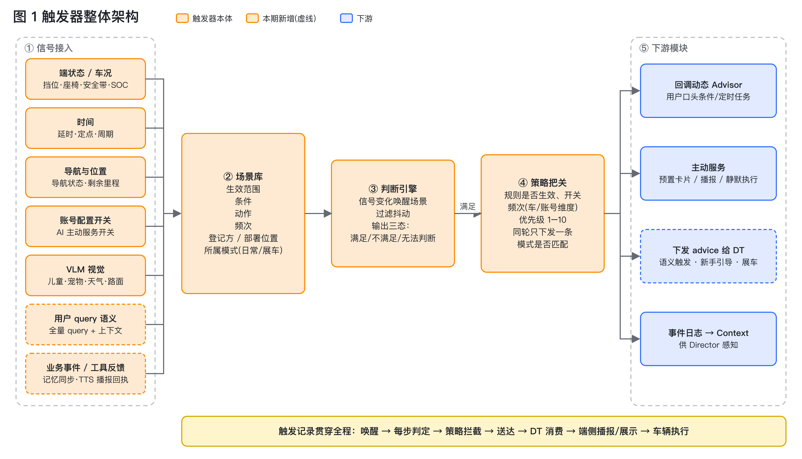
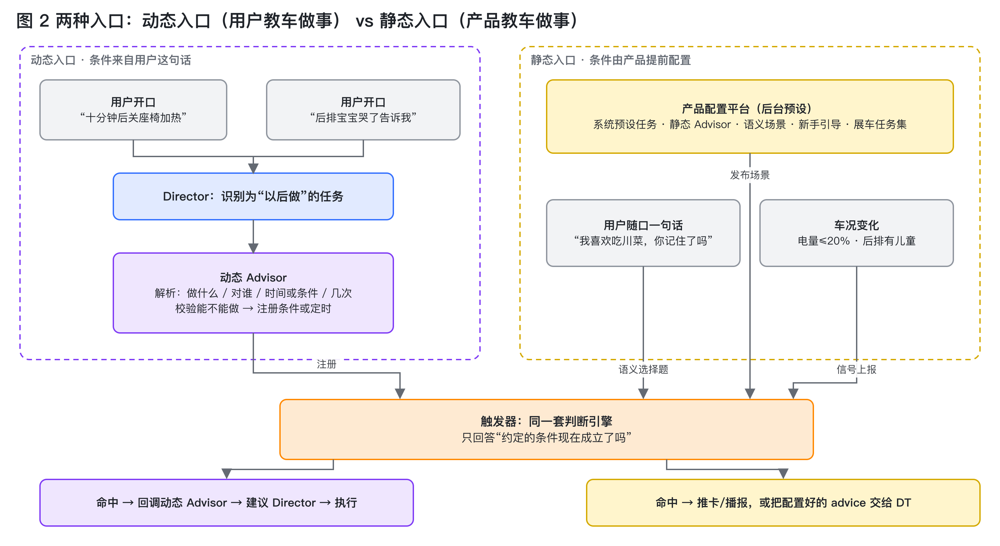
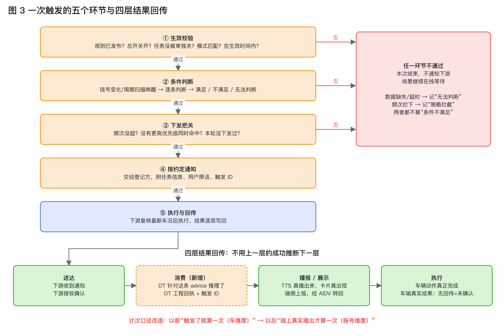
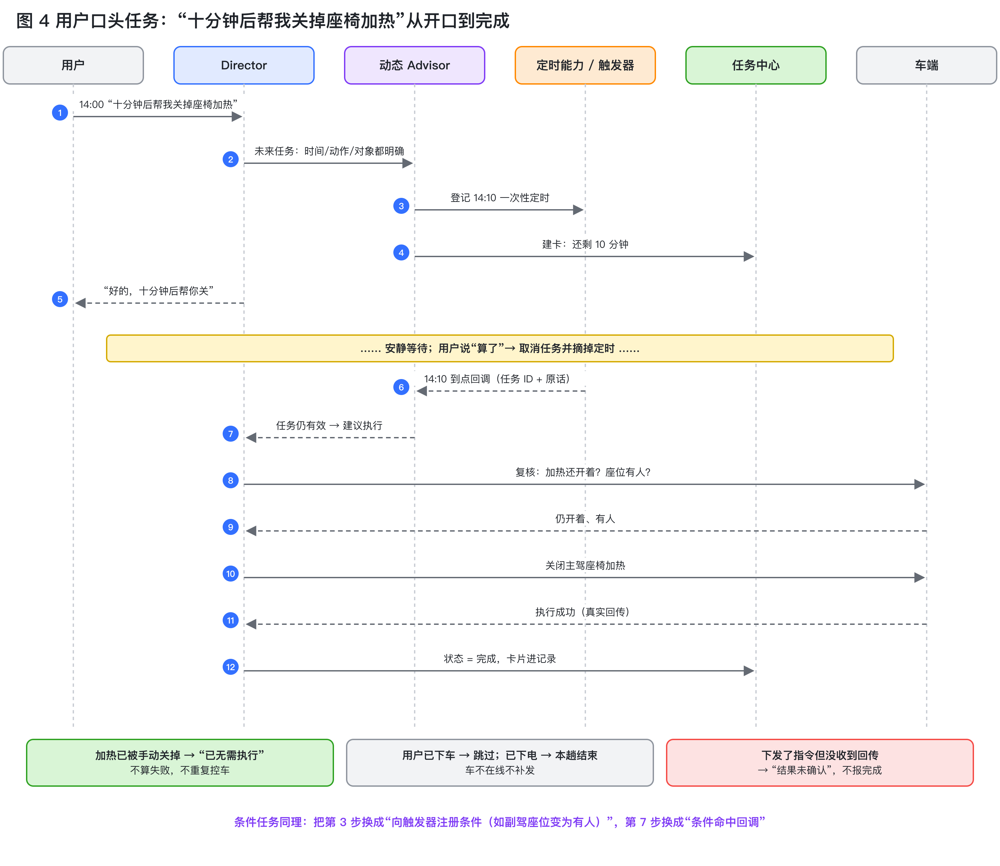
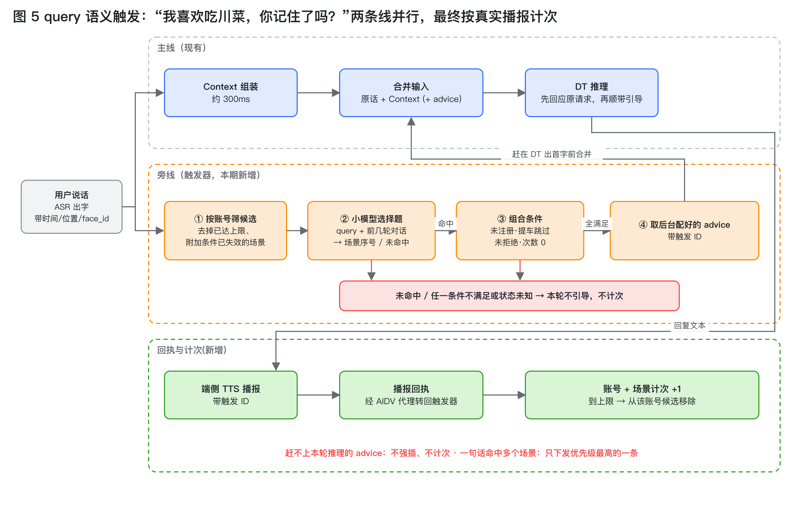
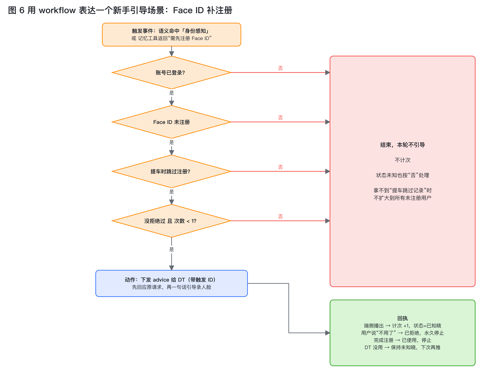
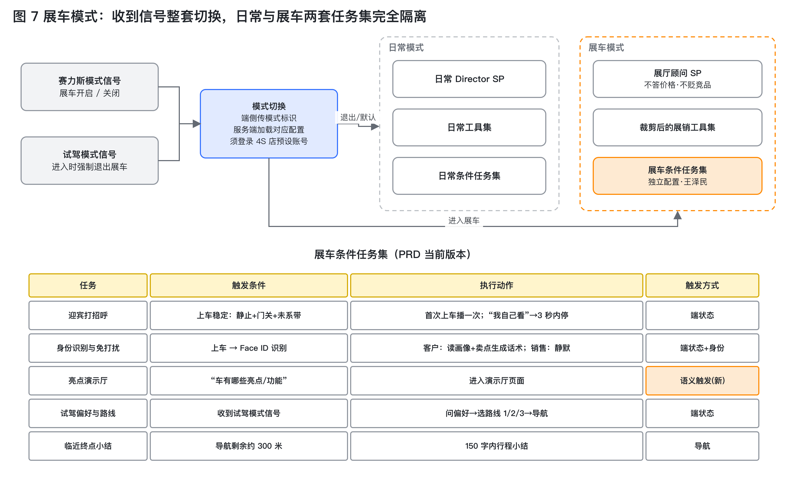
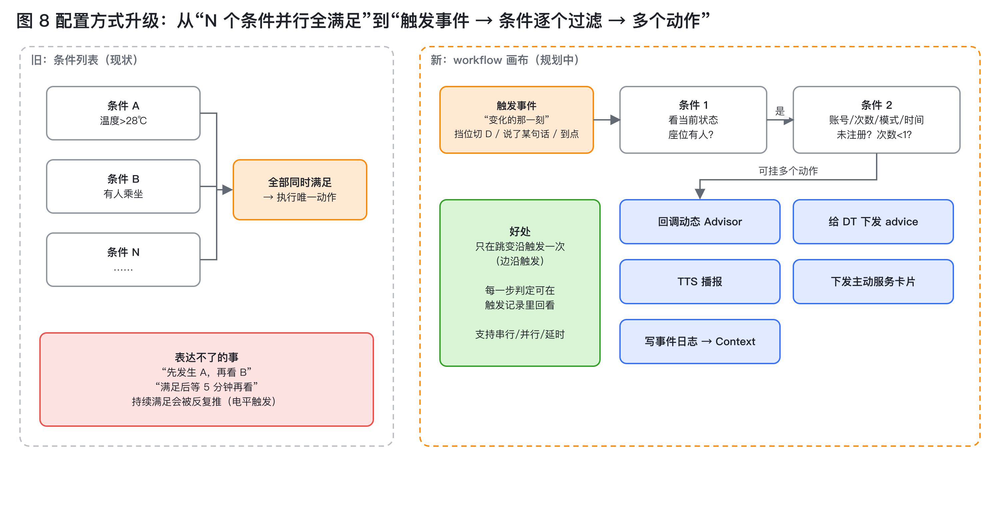

# 触发器平台 · 产品宣讲

| 一句话定位 | 服务对象 | 核心能力 |
|---|---|---|
| 车载主动服务的条件引擎：替用户盯住变化，在对的时刻叫醒对的模块 | 动态 Advisor、系统预设任务、语义场景（新手引导 / 展车 / 运营） | 持续监听 · 条件判断 · 频次与优先级把关 · 结果分层回传 |

## 1. 为什么需要触发器

用户很多需求不用马上做，而是要等条件成立：“十分钟后关座椅加热”“副驾上车提醒系安全带”“后排宝宝哭了告诉我”。大模型会理解，但不会一直盯着车。**触发器把“盯住变化 → 判断条件 → 按约定通知 → 记录结果”做成公共底座**，新场景只需配置，不用每次写代码。

## 2. 定位：只判断，不执行

- 只回答一个问题：**约定的条件现在成立了吗？** 成立就通知登记方，不成立就继续等。
- 不理解意图、不生成话术、不直接控车；怎么说、怎么做由 Director 决定。
- 谁登记，命中后就只通知谁。

## 3. 整体架构

- **信号接入**：车况、时间、导航、账号开关、视觉，本期新增**用户 query 语义**和**业务事件 / 播报回执**。
- **场景库**：每个场景 = 生效范围 + 条件 + 动作 + 频次，并标明所属模式（日常 / 展车）。
- **判断引擎**：输出“满足 / 不满足 / 无法判断”三态，数据缺失不当成不满足。
- **策略把关**：开关、频次、优先级、同轮只下发一条。
- 车端负责低时延、弱网场景；多信号组合、语义和视觉推理放在云端。

**两种入口：谁把任务交给触发器**

| | 动态入口 | 静态入口 |
|---|---|---|
| 条件来源 | 用户这句话，动态 Advisor 实时解析注册 | 产品在配置平台提前配好 |
| 例子 | “十分钟后关座椅加热” | 低电量提醒；聊到个人偏好时引导注册 Face ID |
| 命中后 | 回调动态 Advisor → 建议 Director 执行 | 推卡 / 播报，或给 DT 下发配置好的 advice |

> 【此处粘回原文档的「系统预设任务端云架构图」】

## 4. 一次触发怎么走

- 五个环节任一环节不通过：本次结束，场景继续等待。
- 结果分四层回传：**送达 → DT 消费 → 端侧播报 → 车辆执行**，每层分别确认，不用上一层的成功推断下一层。
- **计次改造**：以前触发了就算一次（按车计），以后**端上真正播出来才算一次**（按账号计）。

## 5. 动态 Advisor：用户口头的条件 / 定时任务

- 链路：Director 识别“以后做” → 动态 Advisor 解析并登记 → 到点或命中后回调 → Director 复核车况再执行。
- 定时有 5 种形态：相对延时（≤24h）、绝对时间（≤7 天）、固定间隔（1 分钟～24h）、每天循环、定时 + 看画面（如每分钟看宝宝）。
- 执行前一定复核：加热已关算“无需执行”；没收到回传算“结果未确认”，不报完成。
- 修改一律删掉旧任务再建新任务；取消时要同时停掉监听。
- 渠道差异：上汽的定时由弋途承接，条件任务注册到触发器。

## 6. 新增：query 语义触发

- **后台预设**的场景，不是用户自定义规则。用户每说一句话，小模型做一道选择题：命中第几个场景，还是都没命中。
- 和 Context 组装并行跑，约 300ms；命中后把配置好的 advice 和用户原话一起交给 DT，复用现有的合并推理能力。
- 先按账号筛掉已用完次数的场景，再判断；一句话命中多个场景时只下发优先级最高的一条；赶不上本轮推理的不插话、不计次。
- 配置内容：判断逻辑 + 至少 3 个正例 + 至少 1 个易混反例 + advice 模板 + 次数上限。
- 排期：11/17 上第一版，最晚 11/20，验收约一周。

## 7. 新增：新手引导

- 目标是让用户**知道**有这个功能，知道了就停；按账号管理。
- 方案选定“语义识别 + 触发器”，不单独做 Agent：Agent 推理太慢，而做成通用能力后运营活动、展车也能复用。
- 四类触发入口：语义、工具反馈、业务事件、端状态；本期先做语义和端状态。
- 规则：不打断用户原来的请求；用户拒绝后永久停止；任一条件状态未知时按不满足处理。

## 8. 新增：展车模式

- 收到赛力斯的展车信号后整套切换：提示词、工具、条件任务三套全部独立，和日常模式互不影响。
- 已注册 Face ID 的销售上车时保持静默；未注册的客户上车时按画像讲解。
- 对触发器的新要求：场景按模式加载和卸载；“亮点演示厅”和“我想体验智驾”需要用到语义触发。

## 9. 新增：workflow 编排

- 从“多个条件同时满足才执行”升级为“**触发事件 → 条件逐个过滤 → 可挂多个动作**”。
- 只在状态跳变的那一刻触发一次，条件持续满足时不会反复推送。
- 每一步的判定结果都能在触发记录里回看。

## 10. 进度

| 能力 | 状态 |
|---|---|
| 条件触发、频控、开关 | 已有 |
| 动态 Advisor 条件 / 定时任务 | 上汽 PRD 已出 |
| query 语义触发 | 11/17 第一版 |
| 播报回执 + 账号计次 | 方向已定，端侧上报方案待确认 |
| 新手引导 / 展车模式 | 场景梳理中 / PRD 内审中 |
| workflow 画布 | 规划中 |
