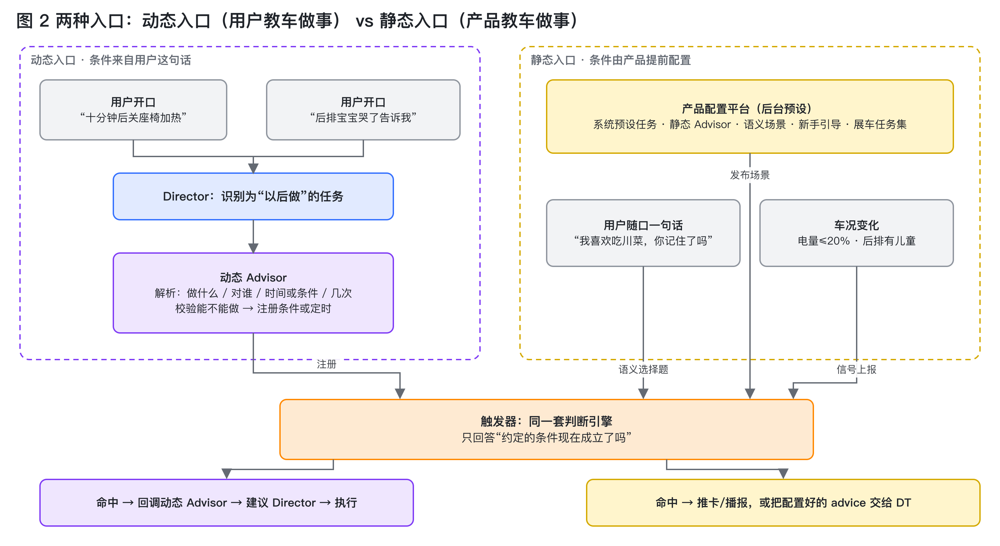
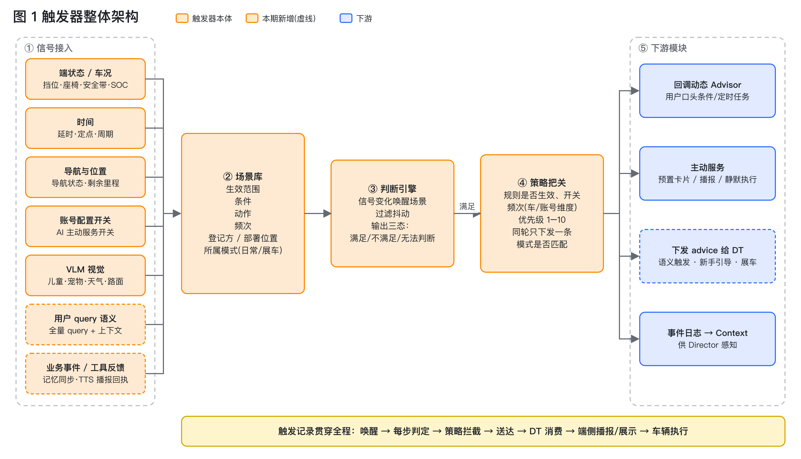
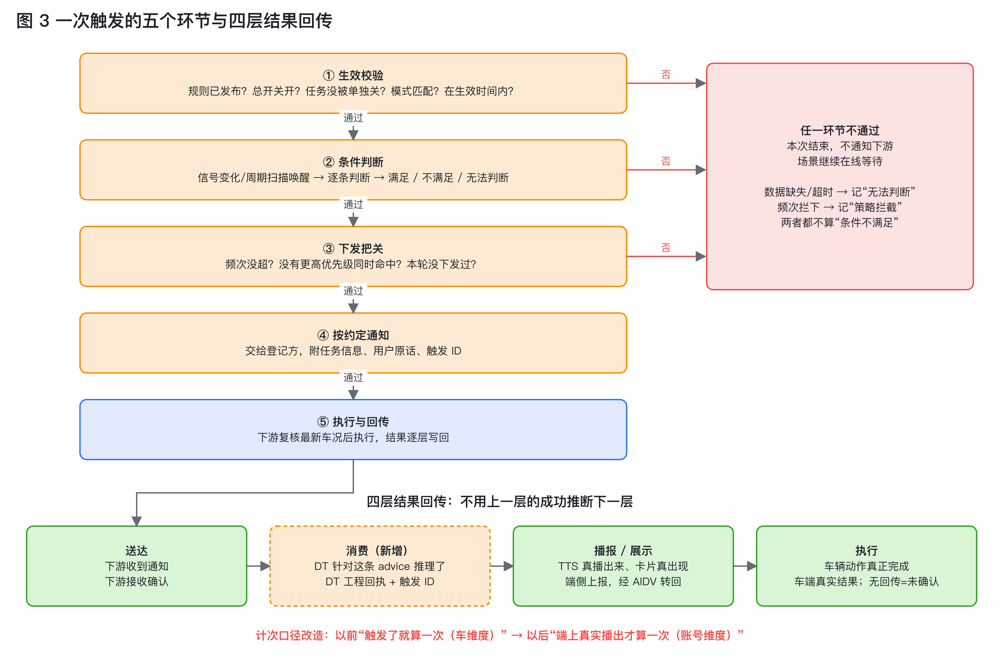
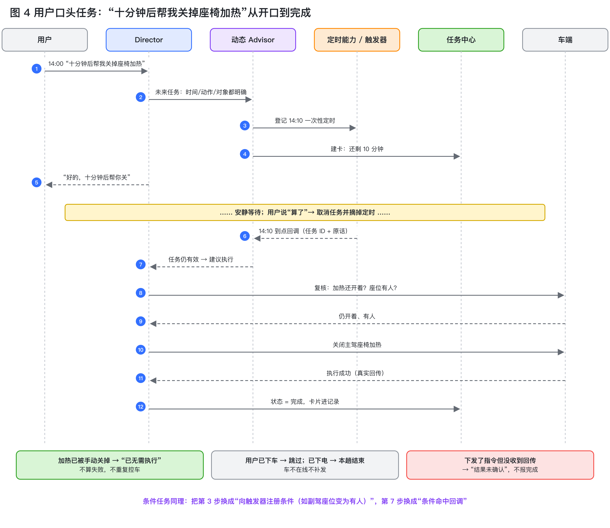
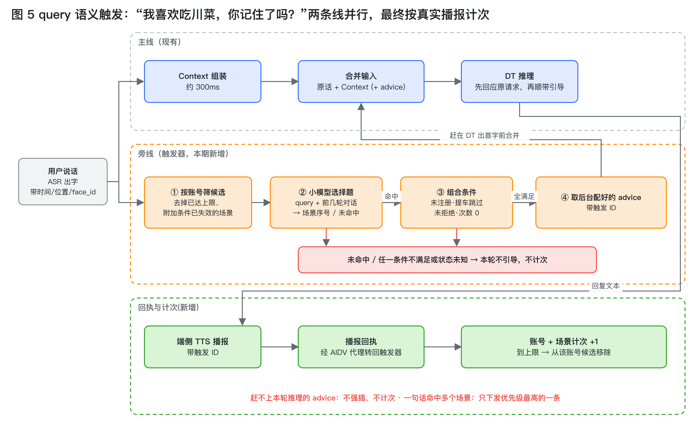
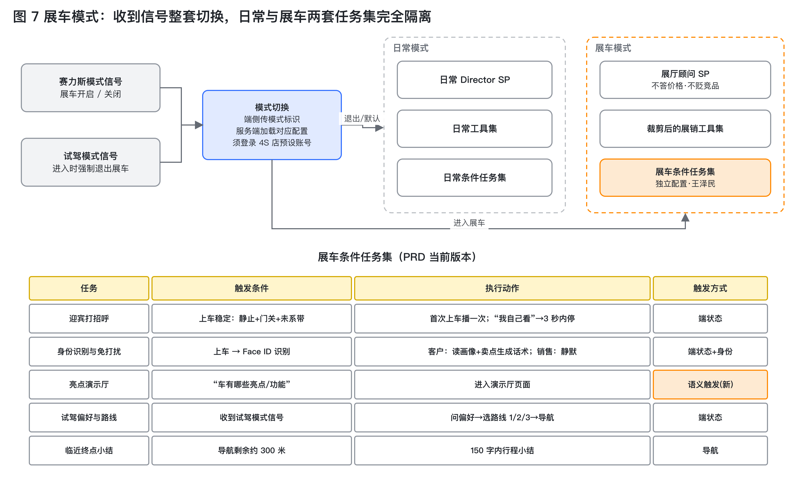
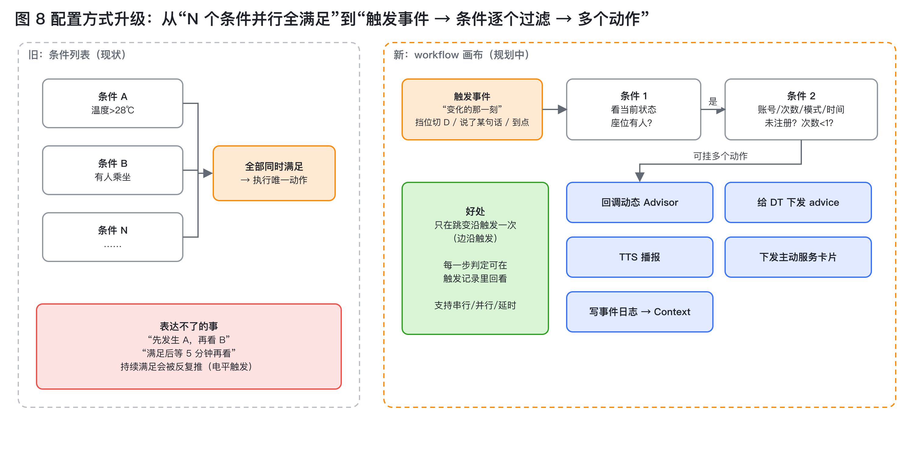
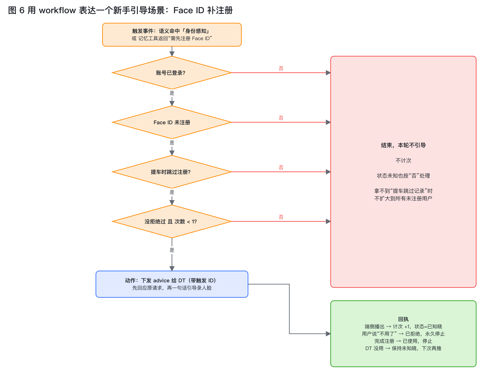

# 触发器平台 · 产品宣讲稿（强化版 v2）

> **怎么用这份稿子**
> - 第 0 章是“讲之前先看”：30 秒版本、这一版比原文档多了什么、原文档里需要改正的几处。
> - 第 1～5 章是原文档内容的加深版（定位、架构、一次触发怎么走），讲给第一次听触发器的人。
> - 第 6～10 章是**新增**：动态 Advisor 的条件 / 定时任务、query 语义触发、新手引导、展车模式、workflow 编排。
> - 第 11～14 章是体验保障、平台能力、当前进度、预判问答，用来答疑。
> - 每个结论后面标了口径：**【已确认】**会上或 PRD 已拍板；**【现状】**当前线上 / 当前能力；**【规划】**定了方向还没上线；**【讨论中】**会上提出、未定；**【待确认】**有明确 owner 在跟。宣讲时按标签说，不要把规划讲成已上线。

---

## 0. 讲之前先看

### 0.1 30 秒讲清触发器

车里很多事，用户说出口时不用马上做，要等“某个条件成立”或“到某个时间”再做。大模型（Director / DT）会理解、会推理，但不会一直盯着车。**触发器就是那个一直盯着车的“哨兵”：它只回答“约定的条件现在成立了吗”，成立了就叫醒登记它的模块，自己不理解意图、不说话、不控车。**

这一期触发器在原来“盯车况、盯时间”的基础上，新增了三件事：

1. **能听懂用户说的话**（query 语义触发）：用户一句话命中后台预设的场景，就给 DT 塞一条配置好的建议。
2. **能确认用户真的听到了**（播报回执 + 账号维度计次）：以前“触发了就算一次”，以后“播出来了才算一次”。
3. **能按模式切换整套任务**（展车模式）：展车状态下加载一套独立的条件任务，跟日常用车完全隔离。

这三件事支撑的业务是：新手引导、展车引导、车企运营活动。

### 0.2 这一版比原文档多了什么

| 新增 / 强化内容 | 原文档 | 这一版 |
|---|---|---|
| 动态 Advisor 的条件任务、定时任务 | 只有一句“DT 登记” | 第 6 章：从用户开口到执行完的 8 步链路、5 种定时形态与上限、时间解析规则、9 种任务状态、改 / 取消策略 |
| query 语义触发 | 一行“规划中”，示例有误 | 第 7 章：静态 vs 动态两种入口、选择题式判断、并行跑 + 合并推理、计次口径改造、排期 |
| 新手引导 | 无 | 第 8 章：定义、四类触发入口、引导状态、全局规则、4 个 Case 逐步走查 |
| 展车（展示）模式 | 无 | 第 9 章：模式切换、独立任务集、5 个展车条件任务、对触发器的新要求 |
| workflow 可视化编排 | 一行“可视化编排” | 第 10 章：原子节点、串行过滤、动作类型、用 Face ID 引导画一条 workflow |
| 结果回传 | 送达 / 展示 / 执行三层 | 新增“消费”层（DT 是否针对这条建议推理），并说明计次挂在哪一层 |
| 当前进度 | 无 | 第 13 章：哪些已有、哪些开发中、哪些在讨论 |
| 宣讲问答 | 无 | 第 14 章：预判 20+ 个问题 |

### 0.3 原文档里建议改正的 5 处

1. **语义触发的示例要换。** 原文写“以后我说生日快乐时，给我唱一首生日歌”——这是**用户自己临时定的规则**，属于动态 Advisor 解析的“动态入口”。11/6 和 11/9 两次会已经对齐：本期 query 语义触发是**后台预设**的“静态入口”，用户不能自己定义。建议换成“用户聊到个人偏好（如‘我喜欢吃川菜，你记住了吗’）时，引导注册 Face ID”。
2. **“登记方”写法前后不一致。** 分工表写“DT 登记”，场景示例写“task agent 登记”，副驾放歌示例又写“触发器通知 task agent 播放歌曲”。按上汽 PRD 口径，用户口头的条件 / 定时任务是 **Director 识别 → 动态 Advisor 解析并注册 → 触发器命中后回调动态 Advisor → 动态 Advisor 给 Director 建议 → Director 执行**。建议全文统一成这条链路，也和“谁登记就只通知谁”的边界一致。
3. **定时任务形态少了一种，也没写上限。** 漏了“定时 + 看画面”（例：每分钟看后排宝宝有没有哭），且没有写每种形态的时间上限（见 6.3）。
4. **“系统预设任务端云架构”小节是空的**（标题下没有内容），讲的时候要么补图，要么删掉标题。
5. **标题里的“对外版”改成“内部宣讲版”。** 本次只面向内部，内容不用删减；但《AI 汽车 SOP 功能清单》把“端云结合触发器”“静态 Advisor”标为**内部预研、不可对外宣传**，文档若被转发给车企或合作方，需先按清单删减端云分工、展车、workflow 等内容。

---

## 1. 为什么需要触发器

车里有一类需求，用户说出口时不用马上执行：

- “十分钟后帮我关掉座椅加热。”（等时间）
- “副驾一上车，提醒他系安全带。”（等车况）
- “每分钟看一下后排宝宝有没有哭，哭了告诉我。”（等画面）
- 用户第一次说“我喜欢吃川菜，你记住了吗”——系统想顺势告诉他“录个人脸我就能记住你”。（等用户说到某个话题）

如果每个场景各写一套“监听 + 判断”的代码：

- 新增一个服务就要改一次代码、发一次版；
- 出了问题说不清是“条件没满足”“消息没送到”还是“播报被打断了”；
- 同一个信号（比如挡位）被十个模块各接一遍。

**触发器把“盯住变化 → 判断条件 → 按约定通知 → 记录结果”做成公共底座**，所有“现在不做、等条件到了再做”的任务都走这一套。

---

## 2. 产品定位：只判断，不执行

### 2.1 触发器只回答一个问题

**约定的条件，现在成立了吗？** 成立了就把事件交给登记它的模块；没成立就安静等。

三个特点：

1. **长期在线**：场景登记后持续运行，只在条件命中时唤醒，其余时间不打扰。
2. **只判断**：不理解用户意图、不生成话术、不直接控车。怎么说、怎么做由下游结合最新车况决定。
   - 一个例外要讲清楚：语义触发、新手引导场景里，触发器会下发一段**后台预先配好的建议文本（advice）**，但这段话是**给 DT 看的要求**，不是直接播给用户的话术，最终说什么仍由 DT 生成。
3. **每一次都可追溯**：被什么唤醒、每一步判成什么、下游是否收到、DT 是否消费、车机是否播出、车辆是否执行，都有记录。

### 2.2 先认识几个角色（第一次出现的词）

| 名词 | 在豆包上车里是什么 | 什么时候出现 | 和触发器的关系 |
|---|---|---|---|
| **Director / DT** | 云端主对话大模型，理解用户、调工具、说话 | 用户每说一句话都会经过它 | 触发器的主要“下游”：最后由它决定怎么说、怎么做 |
| **动态 Advisor** | 帮 Director 托管“未来任务”的模块：解析用户口头的时间 / 条件，登记出去，到点后再提醒 Director | 用户说“十分钟后…”“副驾上车时…” | 触发器的**登记方**之一：它注册条件，触发器命中后回调它 |
| **静态 Advisor / 系统预设任务** | 产品在后台预先配好的主动服务场景，如低电量提醒、上车问候、后排儿童开儿童锁 | 不需要用户开口，车况满足就触发 | 由触发器直接运行，命中后走主动服务链路（推卡 / 播报） |
| **主动推荐链路** | 系统主动给 DT 塞一条建议（advice），DT 把它和用户原话合并推理 | 触发器命中、需要 DT 开口时 | 触发器的输出通道之一 |
| **advice（建议）** | 一段写给 DT 的要求：“你的目标之一是让用户知晓 XX；要求：先回应原请求，再用一句话……” | 语义触发 / 新手引导命中时 | 触发器下发，DT 消费 |
| **端状态** | 车端上报的结构化车况：挡位、车速、座椅占位、安全带、导航状态等 | 持续上报 | 条件触发的主要信号来源 |
| **VLM 信号** | 车内外摄像头经视觉模型产出的描述：乘客年龄段、物品、天气、路面 | 低频 / 高频上报 | 推理触发的信号来源（如“后排有儿童”“下雨”） |
| **任务中心** | 车机上展示任务卡片、倒计时、开关、取消入口的地方 | 用户创建未来任务后 | 展示任务状态；用户在这里关单个任务 |
| **场景** | 触发器里的最小配置单元 = 生效范围 + 条件 + 动作 + 频次 | 配置 / 注册时 | 触发器运行的就是一个个场景 |

### 2.3 两种入口：谁把任务交给触发器

这是这一版最重要的一张表。11/6 会上王泽民和张嘉锋专门对齐过：同样叫“条件”，来源分两种。

| | **动态入口** | **静态入口** |
|---|---|---|
| 代表模块 | 动态 Advisor、长时任务 | 系统预设任务、静态 Advisor、query 语义触发、新手引导、展车条件任务 |
| 条件从哪来 | **模型根据用户这句话实时解析、实时注册** | **产品在配置平台提前配好** |
| 例子 | “后排宝宝哭了告诉我”“十分钟后关座椅加热” | 用户聊到个人偏好时引导注册 Face ID；低电量提醒 |
| 用户能不能自己定规则 | 能（说出来就注册一条） | 不能（只能命中已配好的） |
| 泛化能力 | 高 | 有限，够用于新手引导、车企运营活动 |
| 命中后通知谁 | 回调动态 Advisor | 走主动服务链路 / 给 DT 下发 advice |

一句话：**动态入口是“用户教车做事”，静态入口是“产品教车做事”。** 触发器两种都接，判断引擎是同一套。

### 2.4 与下游模块的分工（替换原文档分工表）

| 登记方 | 登记什么 | 条件成立后触发器做什么 | 谁完成动作 |
|---|---|---|---|
| **动态 Advisor** | 用户口头交代的条件任务、持续关注任务（“副驾上车提醒系安全带”“每分钟看看宝宝”） | 回调动态 Advisor：“你登记的条件成立了”，附任务 ID 与用户原话 | 动态 Advisor 确认任务仍有效 → 给 Director 执行建议 → Director 结合当时车况调工具执行 |
| **定时能力**（见 6.3 渠道差异） | 用户口头交代的定时任务（“十分钟后”“每天 9 点”） | 到点回调动态 Advisor / 任务系统 | 同上 |
| **系统预设任务（静态）** | 产品预设的高频场景：低电量、上车问候、儿童锁、充电口盖 | 发出业务事件 / 下发预置卡片 | 按约定交互：静默执行、告知执行、或推卡请用户确认 |
| **语义触发场景（静态）** | 新手引导、车企运营活动、展车语义场景 | 把配置好的 advice 连同用户原话、上下文交给 DT | DT 合并推理后回应用户；端侧播报后回执给触发器计次 |

**两条产品边界（保留）**

1. 触发器只做“条件何时成立”；意图理解、话术生成、车辆控制都交给下游。
2. 一个场景谁登记，命中后就只通知谁，职责不交叉。

---

## 3. 整体架构

触发器由五个环节串联：**信号接入 → 场景库 → 判断引擎 → 策略把关 → 下游模块**，触发记录贯穿全程。

### 3.1 信号接入（这一版扩成 6 类）

| 信号类型 | 例子 | 判断方式 | 状态 |
|---|---|---|---|
| 车况 / 端状态 | 挡位、车速、座椅占位、安全带、SOC、充电口盖、导航状态 | 规则比较 | 【现状】已有 |
| 时间 | 十分钟后、每天 9 点、每小时 | 定时器 | 【现状】已有（渠道差异见 6.3） |
| 导航与位置 | 剩余里程 300 米、到达某 POI | 规则比较 | 【现状】有导航状态；POI 分类标签【待确认】 |
| 账号配置开关 | AI 主动服务开关 | 规则比较 | 【现状】已接入 |
| 视觉（VLM） | 后排有儿童 / 宠物、下雨、路面湿滑 | 结构化字段走规则；描述文本走模型推理 | 【现状】赛力斯渠道已接入 |
| **用户 query 语义** | “我喜欢吃川菜，你记住了吗”“我想体验一下智驾” | 小模型选择题 | 【规划】11/17 第一版 |
| 业务事件 / 工具反馈 | 记忆同步完成、记忆工具返回“需先注册 Face ID”、TTS 播报完成 | 事件直达 | 【规划】部分事件协议【待确认】 |

一个信号接入一次，可被多个场景复用。

### 3.2 其余四个环节

| 环节 | 负责什么 | 带来的好处 |
|---|---|---|
| 场景库 | 每个场景 = 生效范围 + 条件 + 动作 + 频次，并记录登记方、部署位置（车端 / 云端）、所属模式（日常 / 展车） | 新增场景只需配置 |
| 判断引擎 | 信号变化时唤醒对应场景，判断条件、过滤抖动，输出“满足 / 不满足 / 无法判断” | 数据问题和条件问题一眼可分 |
| 策略把关 | 场景是否生效、频次是否超限、是否轮到它（优先级）、同轮是否已下发过 | 不重复打扰、多场景有序 |
| 下游模块 | 按登记约定交给动态 Advisor / 主动服务 / DT | 判断与执行解耦 |

### 3.3 车端与云端分工

| 判断位置 | 适合的场景 | 例子 |
|---|---|---|
| 车端 | 逻辑完全确定、要求低时延、弱网也要工作 | 车速超过设定值提醒 |
| 云端 | 多信号组合、要结合时间位置、要模型推理（VLM / 语义）、要全局协调 | 温度 > 28℃ 且有人；用户说到个人偏好 |

> 【此处粘回原文档的「系统预设任务端云架构图」】

场景统一在云端配置，按“能否在车端闭环”下发到车端；车机启动、定时同步或收到更新通知时拉取最新场景，新增场景不依赖整车升级。语义触发、VLM 推理只能在云端。

---

## 4. 一次触发的完整过程

### 4.1 五个环节（任一环节不通过，本次结束，不通知下游，场景继续等）

1. **生效校验**：规则已发布、AI 主动服务总开关已开、用户没在任务中心单独关掉、当前模式匹配（日常 / 展车）、在生效时间内。
2. **条件判断**：信号变化或周期扫描时唤醒场景，逐条判断，得出“满足 / 不满足 / 无法判断”。
3. **下发把关**：没超频次、没有更高优先级场景同时命中、同一场景本轮没下发过。
4. **按约定通知**：交给登记方，附任务信息、用户原话、触发 ID（用于后面回执对账）。
5. **执行与回传**：下游复核最新车况后执行；送达、消费、展示（播报）、执行四层结果逐层写回触发记录。

### 4.2 结果分四层回传（原三层 + 新增“消费”）

**“触发器通知了” ≠ “DT 用了” ≠ “用户听到了” ≠ “车辆执行了”。** 不用上一层的成功推断下一层。

| 层级 | 记录什么 | 怎么判定 | 为什么需要 |
|---|---|---|---|
| 送达 | 下游模块收到了 | 下游接收确认 | 排查网络 / 链路问题 |
| **消费（新增）** | DT 针对这条 advice 开始推理了 | DT 工程链路回执，带触发 ID | advice 可能赶不上本轮推理、被合并逻辑丢掉 |
| 展示 / 播报 | 卡片真的出现在车机上；TTS 真的播出来了 | 端侧上报，经 AIDV 代理转回触发器 | 排队、被覆盖、被打断都不算 |
| 执行 | 车辆动作真正完成 | 车端回传真实结果；无回传记“结果未确认” | 不默认成功 |

**计次挂在哪一层？** 这是 11/9 会上争论最久的点：

- 【现状】触发器“推理完成 / 调了 action”就计一次，按**车**维度计。
- 问题：端上被打断、网络异常没播出来，也算了一次。张嘉锋举例：“春节祝福配了推一次，被打断了就再也推不出来，违背了配置人员的目的。”
- 【已确认】改为**以端侧真实播报为准**计次，并新增**账号维度**计次（新手引导按账号管理）。触发器自己读写这张计次表，AIDV 不管。
- 【讨论中】取“开始播报”还是“播报完成”为准，由张嘉锋最终定；《新手引导依赖触发器文档》里还有一个候选口径“DT 开始推理即计次”，需要在技术方案里统一。

---

## 5. 触发方式总览

| 触发方式 | 一句话 | 例子 | 状态 |
|---|---|---|---|
| **条件触发** | 车况、位置、车机事件满足条件 | 温度 > 28℃；副驾有人且安全带插入 | 【现状】已有 |
| **定时触发** | 到某个时间点或按周期 | 十分钟后；每天 9 点 | 【现状】已有（第 6 章） |
| **推理触发** | 视觉描述要用模型判断，规则写不出来 | “后排有宠物”“正在下雨” | 【现状】系统预设任务已支持，可和条件混合；混合判定本期不支持叠加定时 |
| **语义触发** | 用户说的话是否命中后台预设场景 | 聊到个人偏好时引导 Face ID；“我想体验一下智驾” | 【规划】第 7 章 |

条件怎么配（保留原文档）：每条条件 = 信号 + 比较方式 + 目标值，多条按“且 / 或”组合；选定信号后只给出该信号能用的比较方式，从源头避免“挡位大于 D”这种无效条件。

| 条件类型 | 比较方式 | 例子 |
|---|---|---|
| 数值比较 | 等于、不等于、大于、大于等于、小于、小于等于 | 车内温度 > 28℃；电量 ≤ 20% |
| 状态判断 | 属于、不属于 | 挡位属于 P 或 N |
| 变化事件 | 发生变化、变化为某值 | 挡位变化为 D；副驾座位变为“有人” |
| 组合条件 | 且、或 | 副驾有人 且 安全带已插入 |
| **语义条件（新增）** | 命中 / 未命中某个预设语义场景 | 命中“个人偏好 / 认识我”场景 |
| **事件次数（讨论中）** | 用户对某类事件的发生次数 | 用户 7 天内没用过 AI 电台 |

---

## 6. 动态 Advisor：用户口头交代的条件任务和定时任务

> 这一章回答：“用户说一句‘十分钟后帮我关座椅加热’，系统内部到底发生了什么？”

### 6.1 涉及哪些模块

| 模块 | 负责什么 |
|---|---|
| Director | 判断这句话是“现在做”还是“以后做”；信息不全先澄清；触发后真正执行 |
| 动态 Advisor | 从用户话里拆出：做什么、对谁、什么时间 / 什么条件、做几次；校验能不能做；登记出去；被叫醒后给 Director 执行建议 |
| 定时能力 | 登记时间、等到点、循环任务安排下一轮 |
| 触发器 | 登记车况条件、判断、命中后回调 |
| 任务中心 | 展示任务卡片、倒计时、状态；用户取消时回传事件 |
| 车端信号 | 提供车况、乘员状态，回传执行结果 |

### 6.2 完整链路：以“十分钟后帮我关掉主驾座椅加热”为例

1. **用户开口**：14:00，主驾说“十分钟后帮我关掉座椅加热”。
2. **Director 判断**：这是一个“以后做”的任务；时间（十分钟后）、动作（关加热）、对象（主驾，按说话人位置）都明确，不用澄清 → 交给动态 Advisor。
   - 如果用户说“下周提醒我”→ Director 先问“下周哪一天？”
3. **动态 Advisor 解析校验**：
   - 时间：“十分钟后” → 14:10:00，相对延时 · 一次性；
   - 动作：关闭主驾座椅加热；车型支持 → 通过；
   - 如果是“每 5 秒提醒一次” → 拒绝，说明按分钟服务。
4. **分流登记**：明确时间 → 登记定时；车况条件 → 注册触发器场景（指定渠道 / 车辆、回调地址 = 动态 Advisor）。
5. **任务中心建卡**：校验接入资格与容量，展示“关闭主驾座椅加热 · 还剩 10 分钟”。登记成功才说“好的，十分钟后帮你关”；失败要说原因。
6. **等待**：触发器 / 定时器安静等待。用户中途说“算了不用了”→ 精准取消，**同时停掉定时**（只隐藏卡片不算取消）。
7. **到点回调**：14:10 定时器回调动态 Advisor：“任务到点了”，附任务 ID 和用户原话。
8. **复核并执行**：动态 Advisor 确认任务仍有效 → 给 Director 建议 → Director 先查车况：
   - 加热还开着、座位上还有人 → 调车控关闭 → 车端回传成功 → 任务“完成”；
   - 加热已被手动关掉 → “已无需执行”，不算失败；
   - 用户已下车 → 跳过；车辆已下电 → 本趟任务结束；
   - 下发了指令但没收到回传 → “结果未确认”，**不报完成**。

### 6.3 定时任务的 5 种形态与上限

| 形态 | 例子 | 建议上限 | 到点后怎么处理 |
|---|---|---|---|
| 相对延时 · 一次性 | 十分钟后关闭座椅加热 | 最长 24 小时 | 执行一次即结束；提前取消则摘掉定时 |
| 绝对时间 · 一次性 | 明天 9 点提醒出发 | 最远 7 天 | 只在约定时刻触发一次；当时车不在线**不补发** |
| 固定间隔 · 循环 | 每小时开一次座椅按摩 | 间隔 1 分钟～24 小时 | 某一轮座椅没人就跳过本轮，下一轮照常；触发器自动排下一次 |
| 绝对时间 · 每天循环 | 每天早上 9 点提醒喝水 | — | 每次触发后自动排到第二天同一时间；连续多天跳过不补发 |
| **定时 + 看画面 · 循环（原文档漏了）** | 每分钟看后排宝宝有没有哭 | 最长 4 小时【待定】 | 每 60 秒取一次最新画面描述；只有“上次没哭 → 这次哭了”才提醒；持续哭不重复提醒；看不清不更新状态 |

**时间解析规则**（动态 Advisor 负责）：

| 用户说 | 解析为 |
|---|---|
| 当前 19:00，说“8 点” | 最近的未来时间 → 今天 20:00 |
| 当前 19:00，说“6 点” | 明天 06:00 |
| “明天提醒我拿快递”（只有日期没钟点） | 转成条件任务：明天首次有人上车时提醒 |
| “明天下午提醒我” | 明天下午时段首次上车 / 在车上时提醒 |
| “下周 / 下个月提醒我” | 先问具体哪一天 |
| “每 5 秒提醒一次” | 拒绝，说明按分钟服务 |

**渠道差异（宣讲时要讲清楚，避免被问住）**

- 【已确认】**上汽**：定时由**弋途定时能力**承接；用户条件任务由**弋途动态 Advisor 向火山触发器注册**；后台预置场景由触发器运行。
- 【规划】**云端触发器自带定时能力**（《定时任务云端触发器需求文档》）：作为与条件触发、语义触发并列的第三种触发方式，任务系统把“十分钟后”换算成“当前时间 + 600 秒”向触发器注册。具体哪些渠道走云端触发器定时，宣讲前与研发确认。

### 6.4 条件任务：以“副驾上车时提醒他系安全带”为例

1. 动态 Advisor 拆出：条件 = 副驾上车；对象 = 副驾乘客；内容 = 提醒系安全带；次数 = 一次。
2. 校验渠道可用信号。**“副驾上车”不能偷换成“车门打开”**——含义不同的信号宁可澄清或拒绝。
3. 向触发器注册：条件“副驾座位变为有人”，回调 = 动态 Advisor。
4. 车端上报座位信号，触发器判断；未满足继续等。
5. 命中且符合频控 → 回调动态 Advisor → 确认任务有效 → 建议 Director → Director 播报提醒。
6. 一次性任务执行后**停掉监听**；循环任务按再次命中规则继续（“以后每次……都”）。
7. 任务取消、达成或失效时联动停用 / 删除场景。

### 6.5 任务状态（任务中心展示）

| 状态 | 什么时候进入 | 用户看到 |
|---|---|---|
| 创建中 | 请求已收到，登记没完成 | 不展示“创建成功” |
| 待触发 | 定时 / 场景登记成功 | 规则 + 倒计时 |
| 执行中 | 有效唤醒后开始处理 | 处理中 |
| 完成 | 动作达成并拿到结果 | 一次性结束；循环记本轮结果 |
| 失败 | 登记或执行失败，拿到失败信息 | 失败环节与原因 |
| 已无需执行 | 执行前发现目标已达成 | 例：加热已关闭 |
| 结果未确认 | 已发起执行，没可靠结果 | 不报完成 |
| 错过 | 满足错过条件，本轮没机会执行 | 进任务记录 |
| 已取消 | 取消生效 | 卡片更新，停止等待 |

**注意**：任务中心状态和触发器场景状态分开管；后台停用一个场景 ≠ 用户取消了任务。

### 6.6 改、取消怎么处理

【已确认】统一“**删旧建新**”：用户重复说同一任务、改时间、改类型（一次性 ↔ 循环）、改内容、改触发方式（定时 ↔ 条件），一律删除旧规则再创建新规则，任务 ID 变化，不叠加。循环任务每轮自动续期由触发器内部处理，任务 ID 不变。

【待确认】仅取消“今天这一轮”是否支持；关闭再打开开关是“暂停”还是“重建”；跨下电的错过策略。

---

## 7. 新增：query 语义触发

> 这一章回答：“用户随口一句话，触发器怎么知道该插一句引导？会不会拖慢回复？”

### 7.1 它是什么、不是什么

- **是**：产品在后台预先配好若干“语义场景”（比如“用户聊到个人偏好 / 希望被记住”），用户每说一句话，就用一个小模型做一道**选择题**：“这句话命中了第几个场景，还是都没命中？”命中后再叠加其他条件（账号状态、端状态、次数），全部满足就给 DT 下发一条配置好的 advice。
- **不是**：用户自己定义规则（“以后我说生日快乐就唱歌”）——那是动态 Advisor 的事。也不是对每句话做开放式理解、生成新条件。
- 为什么做成触发器的通用能力而不是新手引导专属：张嘉锋的核心理由是“不想每遇到一个场景就差异化开发一次”，同一能力可复用到**新手引导、车企运营活动、特殊话术干预、展车引导**。

### 7.2 一句话从说出口到计次的全过程

以“2026 年 11 月某天，主驾（Face ID 未注册）说：‘我喜欢吃川菜，你记住了吗？’”为例：

1. **ASR 出字**：语音转成文字，带上时间、位置、face_id。
2. **两条线同时跑**【已确认】：
   - 主线：query 进 Context 组装（约 300ms）→ 进 DT；
   - 旁线：query 副本 + 前几轮对话 → 触发器语义判断。
3. **先筛候选场景**【已确认方向】：不是把后台全部场景都丢给模型，而是先按**这个账号**过滤——已经达到次数上限的、附加条件已经不满足的（比如新手期已过），直接去掉。刘杨举例：“配了 10 个场景，用户第一周用掉了 7 个，第二周只送剩下 3 个给模型。”这一步在回执回来时就更新好，不在 query 来时现算。
4. **小模型做选择题**：输入 = query + 上下文 + 剩余候选场景（每个场景有判断逻辑和示例）；输出 = 场景序号或“未命中”。单条约 300ms，与 Context 时间齐平。本例命中“身份感知”。
5. **组合条件判断**：Face ID 未注册 ✓、提车时跳过了注册 ✓、没拒绝过 ✓、本账号该场景次数 0 ✓。任一条件状态未知 → 按不满足处理，本轮不引导。
6. **下发 advice**：把配置好的 advice 连同原 query、Context 一起给 DT。
   - 【已确认】**复用现有“多条输入合并推理”能力**，不额外开发打断逻辑：赶上了就和用户原话一起推理；如果语义判断比 DT 推理慢一点，在 DT 出首个字之前到达仍能合并。
   - 赶不上本轮推理的 advice **不强插、不计次**。
7. **DT 回应**：先回应原请求，再顺带引导——“想让我记住你爱吃川菜，得先录一下人脸，这样以后你每次上车我都能认出你。现在录吗？”
8. **端侧播报回执**：这条回复带着触发 ID 一路传到端上；端上真正播出来后上报，经 AIDV 代理转发回触发器。
9. **计次与收尾**：触发器按账号 + 场景计次 +1；到上限就把这个场景从该账号候选里移除。用户说“不用了”→ 记为已拒绝，以后不再引导。

### 7.3 配置一个语义场景要填什么

| 配置项 | 说明 | 例子（Face ID 补注册） |
|---|---|---|
| 场景 ID / 名称 / 优先级 | — | 身份感知 · P0 |
| 判断逻辑 | 什么情况算命中 | 用户提到个人偏好、希望被称呼的名字、需要记住的信息、想让豆包认识自己或朋友 |
| 正例（≥3） | 典型说法，不要求穷举 | “我喜欢吃川菜，你记住了吗”“以后叫我小王”“帮我认识一下我朋友” |
| 易混反例（≥1） | 防止误命中 | “今天天气怎么样” |
| 组合条件 | 账号状态、端状态、事件 | 未注册、提车跳过、未拒绝、次数 0 |
| advice 模板 | 引导目的 + 表达要求 | 见 8.4 |
| 次数上限 + 计次口径 | — | 1 次；以端侧播报为准 |
| 停止策略 | — | 注册完成 / 明确拒绝 / 次数到限 |
| 生效时间【讨论中】 | 两种：跟车周期（提车后 N 天内）；全量日期窗口（节假日某几天） | 新手期 7 天 |

**配置平台规则**：模型选项和触发器规则两边都生效才启用，任一边失败整个场景不启用；规则修改生成新版本，已停止的账号不因新版本重新引导；下线后立即停止下发。

### 7.4 风险与约束

| 风险 | 处理 |
|---|---|
| 全量 query 都要跑一遍，10 万辆车调用量大 | 用小模型；先按账号过滤候选；单用户判断条数设上限（会上提到极限约 100 条，需测 P90） |
| 语义条件之间重叠冲突（A、B 都能被同一句话命中） | 【已确认】本期条件少、产品自配，人工检查；功能跑通后补自动冲突校验 |
| 一句话命中多个场景 | 同轮只下发优先级最高的一条（P0 > P1 > P2，同级按配置顺序），其余不下发、不计次 |
| 只看单句召回不全 | 输入带前几轮对话；目标是典型表达能召回，不追求完整召回；不加二次校验模型 |

### 7.5 排期【会上计划，以 Meego 为准】

- 语义判断器 **11/17** 上第一版，最晚预留到 **11/20**；验收约一周。
- 为此触发器其他在排需求顺延，王泽民与张嘉锋对齐优先级（含赛力斯在催的需求）。
- 新建 Meego，拉算法侧丛丛；单如水整理约 5 个语义触发场景清单；张弛跟端侧确认 TTS 播报上报可行性。

---

## 8. 新增：新手引导（第一个大规模用语义触发的业务）

### 8.1 新手引导是什么

在用户还不知道某项功能时，于相关场景里**告诉他有这个功能**——知晓即达成，不要求立刻使用。

- **按账号管理**：同一辆车换账号视为新用户；不按车管（借车给别人对方收不到），不按 Face ID 管（未注册的会漏掉）。
- **克制**：只对“全新功能”或“使用方式被改造”的功能做，老用户熟悉的不做。
- **和系统预设任务的区别**：新手引导告知后即停止；系统预设任务每次满足都要执行。

### 8.2 方案选型【已确认：方案 B】

| | 方案 A：新增新手引导 Agent | 方案 B：语义识别 + 触发器（选定） |
|---|---|---|
| 做法 | 新 Agent 自己判断时机、自己生成 advice | 触发器新增语义条件，advice 后台配好 |
| 时延 | Agent 推理慢，赶不上同轮 | 小模型 ~300ms，与 Context 并行 |
| 复用 | 新手引导专用 | 通用：引导、运营、展车都能用 |
| 会上反对意见 | — | 刘杨、向超然担心触发器“越做越大、不纯粹”；最终共识：触发器只多两件事——**语义条件**和**按真实播报计次的回调口子**，具体“什么算成功”由下游定义后回调告诉触发器 |

### 8.3 四类触发入口

| 入口 | 例子 | 触发器怎么接 | 状态 |
|---|---|---|---|
| 语义 | 聊到个人偏好 → 引导 Face ID | 语义条件 | 【规划】新建 |
| 工具反馈 | 记忆工具返回“需先注册 Face ID” | 作为反馈条件，跳过语义识别 | 【现状】已有 |
| 业务事件 | 记忆从 AIVA 同步完成 → 问候 | 事件直达，需携带账号 | 【待确认】事件协议 |
| 端状态 | 发起导航 → 引导 AI 导演 | 现有端状态能力 | 【现状】已有；部分信号缺失 |

本期会议范围只纳入**语义 + 现有端状态**；屏幕手点等事件先不纳入。

### 8.4 引导状态与全局规则

| 状态 | 说明 | 还引导吗 |
|---|---|---|
| 未知晓 | 初始；或已下发但 DT 没用 | 是 |
| 已消费 | DT 针对这条开始推理 | 未到上限时是 |
| 已知晓 | 引导段在端侧播出 | 否 |
| 已拒绝 | 用户明确拒绝 | 否 |
| 已使用 | 用户手点或主动用了 | 否 |

全局规则：账号未登录不引导；同轮只下发一条；身份感知优先于记忆体系引导（记忆依赖先录人脸）；**不打断原请求**，advice 只附加在原回应之后；同一会话最多 1 条新手引导【待评审】；是否受主动服务开关 / 语音禁用约束【待确认】。

### 8.5 四个 Case 速览

| Case | 入口 | 条件 | advice 要点 | 卡点 |
|---|---|---|---|---|
| Face ID 补注册（P0） | 语义 + 工具反馈 | 未注册、提车跳过、未拒绝、次数 0 | 先回应原请求，再一句话说明录人脸的好处，问是否现在录；拒绝不追问 | “提车跳过记录”能否拿到【待确认】；拿不到不扩大到所有未注册用户 |
| 记忆同步后问候（P0） | 事件 | 事件账号 = 当前账号，未问候过 | 调记忆检索，选 1～2 个记忆点，用初次见面的口吻；检索不到就普通问候，不编造 | 同步完成事件协议【待确认】；同步完成 ≠ 激活完成 |
| 首次导航引导 AI 导演（P1） | 端状态 | 车机已激活 + 发起导航 + 账号次数 0 | 先完成导航回应，再问要不要记录一路风景生成 vlog | 无“首次导航”标识，用“已激活 + 发起导航 + 只推一次”替代；激活标记待吴仁杰向赛力斯确认，拿不到不上线 |
| 导航到餐厅引导排号（P1） | 端状态 | 目的地 POI = 餐厅、未用过排号 | 一句话说明可帮忙排号；不承诺该店一定支持 | POI 分类标签当前没有，需找赛力斯车机导航新增 |

---

## 9. 新增：展车（展示）模式

> 这一章回答：“车停在 4S 店展厅里，豆包怎么从‘车主助手’变成‘展厅讲解员’，触发器在其中做什么？”

### 9.1 模式怎么切换

- 收到赛力斯下发的**展车模式开启信号** → 切到展车模式；收到关闭信号 → 退出。
- 进入**试驾模式**时强制退出展车模式；试驾结束（手动退出或下电）后按信号切回。
- 【已确认】端侧把模式标识传给服务端，服务端加载展车专属配置。
- 【已确认】必须登录豆包账号，展车只能登录 4S 店预设账号（条件任务按账号触发需要它）。

### 9.2 展车模式下“三件套”全部独立

| 配置 | 展车模式 | 负责人 |
|---|---|---|
| Director 系统提示词 | 展厅接待顾问人设；克制不推销；不答价格 / 金融政策，引导找销售；按客户画像调音色 | 李明骏 |
| 工具集 | 从主链路工具清单独立裁剪，只开展销所需 | — |
| **条件任务集** | **独立一套**，不复用日常条件任务；进入时加载、退出时卸载，参数和触发逻辑互不影响 | **王泽民（触发器）** |

**对触发器的新要求**：场景要能按“模式”分组加载 / 卸载，生效校验里多一项“当前模式是否匹配”。具体实现【待技术方案确认】。

### 9.3 展车条件任务清单（PRD 当前版本，划线项已删）

| 任务 | 触发条件 | 执行动作 | 触发方式 |
|---|---|---|---|
| 迎宾 / 打招呼 | 展车模式下用户上车稳定（车辆静止、安全带未系、车门关闭）；仅首次上车播一次 | 基于客户画像生成展销语境问候；用户说“我自己看”→ 3 秒内停止讲解，切静态亮点视频 | 端状态 |
| 身份识别与免打扰 | 用户上车 → Face ID 识别 | **未注册（客户）**：让 DT 读 VLM 画像 + 卖点清单生成针对性话术；**已注册（销售）**：静默，不触发主动服务 | 端状态 + 身份 |
| 亮点演示厅联动 | 用户说“车型有哪些亮点”“我想看看车有哪些功能” | 进入亮点演示厅页面 | **语义触发** |
| 试驾偏好与路线 | 收到赛力斯试驾模式信号 | 主动问“更想体验加速、舒适还是智驾？”→ 按回答选路线 1/2/3 → 展示概览并导航（路线表赛力斯提供） | 端状态 |
| 临近终点小结 | 导航剩余约 300 米（需在导航中、有终点） | 基于上下文和临时记忆生成 150 字内小结 | 导航 |

已删除 / 由赛力斯自闭环：车外交互灯语、亮点视频轮播、演示厅 1 分钟无操作返回。

【讨论中】身份识别依赖 Face ID，11/9 会上张嘉锋认为“它不是开关模式，要孤立看每一次任务是否触发”，需内部再讨论；会上明确本期**只有试驾相关的语义场景**（“我想体验一下智驾”→ 给 DT 指示并带出三条路线）真正依赖新的语义能力，其余复用现有端状态能力。

---

## 10. 新增：workflow 可视化编排

> 这一章回答：“配置人员怎么把一个复杂场景配出来？为什么要做画布？”

### 10.1 为什么要从“条件列表”变成“流程”

- 【现状 / 旧】N 个条件并行全满足 → 执行。问题：表达不了“先发生 A，再看 B 是否成立”，也表达不了“满足后等 5 分钟再看”。
- 【规划 / 新】**触发事件 → 条件串行过滤 → 动作**：
  - **触发事件**：状态“变化的那一刻”（挡位切到 D、用户说了一句话、到点了）——负责“什么时候醒”；
  - **条件**：醒来后看“当前状态”逐个过滤（座位有人、未注册、次数未到）——负责“要不要做”；
  - **动作**：可以挂多个——负责“通知谁”。
- 这和 8.18 定下的“边沿触发”语义一致：只在“从不满足到满足”的那一刻触发一次，不在条件持续满足期间反复推。

### 10.2 画布上的原子节点

| 节点类型 | 可选项 |
|---|---|
| 触发事件 | 端状态变化、定时、语义命中、VLM 推理结果、业务事件、工具反馈 |
| 条件 | 数值 / 状态 / 组合（且、或）、账号状态、次数、生效时间、当前模式 |
| 流程控制 | 串行、并行分支、延时 |
| 动作 | 回调动态 Advisor；给 DT 下发 advice；生成事件日志写入 Context 给 Director；TTS 播报；下发预置主动服务卡片 |

每一步的判断结果都写进触发记录，可在画布上回看“这次卡在哪一步”。

### 10.3 用画布表达一个场景：Face ID 补注册

### 10.4 状态

【规划】画布形态在迭代；当前配置平台是“四步表单”：基础信息与生效范围 → 条件 → 判断逻辑 → 动作与频次。宣讲时建议说“正在从表单升级为画布”，不要说已上线。

---

## 11. 体验保障机制（在原文档基础上补充）

### 11.1 不重复打扰

1. 默认只执行一次；只有“以后每次……都”才重复。
2. **状态切换才触发（边沿触发）**：挡位一直在 D 不会反复触发；电量一直低于 30% 只提醒一次，要先回到 30% 以上再跌破才算新的一次。最小间隔只能降频，不能代替这条规则。
3. 执行前再确认：座椅加热已被手动关掉就不执行。
4. **（新增）同轮只下发一条引导**；同一会话新手引导最多 1 条【待评审】。
5. **（新增）按真实播报计次**：没播出来的不算，下次还能再推。

### 11.2 不误判

1. 防抖：温度在 27.9℃ 和 28.1℃ 之间来回跳不重复触发。
2. 三态判断：数据缺失 / 超时记“无法判断”，不下发也不当成“不满足”。
3. 限定生效范围：车型、软件版本、车辆、**模式（日常 / 展车）**、**生效时间**。
4. **（新增）缺失信号不替代**：依赖的端状态没上报时，场景不上线，不用语义或别的信号临时顶替（例：“副驾上车”不能换成“车门打开”）。

### 11.3 可控的频次与顺序

1. 四类频次：总次数、每日次数、每次上电次数、最小间隔，任一到上限即拦截。
2. **（新增）计次维度：车维度 + 账号维度**。
3. 拦截单独记录为“策略拦截”，与“条件不满足”区分。
4. 优先级 1–10 档，同时命中只执行最高的一项。

### 11.4 用户始终可控

| 开关 | 谁控制 | 关闭后 |
|---|---|---|
| 规则发布状态 | 配置人员 | 该场景对所有车停止 |
| AI 主动服务总开关 | 车主（系统设置） | 该车主动服务整体暂停 |
| 单个任务开关 | 所有人（任务中心） | 只停这一个任务 |
| **（新增）明确拒绝** | 用户口头 | 该引导场景对该账号永久停止 |

---

## 12. 平台能力

| 能力 | 说明 | 状态 |
|---|---|---|
| 配置化生产 | 四步定义场景，无需写代码 | 【现状】 |
| 精准生效范围 | 车型、软件版本、指定车辆；测试 / 正式环境 | 【现状】 |
| 分渠道管理 | 合作方账号只能看授权渠道的场景 | 【现状】 |
| 可观测运营 | 唤醒、判断、拦截、送达、消费、播报、执行全记录 | 【现状】前三层；消费 / 播报回执【规划】 |
| 语义条件配置 | 判断逻辑 + 正反例，每配一条模型多一个选项 | 【规划】11/17 |
| 账号维度计次 | 按账号 + 场景记次数，回执回来时更新 | 【规划】 |
| 模式隔离 | 日常 / 展车两套场景集按模式加载 | 【规划】 |
| 生效时间 | 跟车周期（提车后 N 天）/ 全量日期窗口（节假日） | 【讨论中】上汽也有需求 |
| 可视化编排 | 触发事件 / 条件 / 动作节点画布 | 【规划】 |
| 冲突校验 | 语义条件重叠提示 | 【规划】跑通后补 |
| 车企自主配置 | 车企在授权范围内配节日彩蛋、品牌问候 | 【规划】 |

---

## 13. 当前进度一览（宣讲前请与研发再核一遍）

| 事项 | 当前状态 | 下一步 / owner |
|---|---|---|
| 条件触发、频控、三层开关 | 已有 | — |
| 系统预设任务（条件 + VLM 推理混合判定） | 技术方案已出 | 刘杨、童德欣 |
| 用户条件任务（动态 Advisor 注册） | 上汽 PRD 已出 | 弋途动态 Advisor + 火山触发器 |
| 定时任务 | 上汽走弋途定时；云端触发器定时有需求文档 | 渠道范围待确认 |
| query 语义触发 | 方案 B 已定，11/17 第一版目标 | 王泽民、张嘉锋；算法丛丛 |
| 播报回执 + 账号计次 | 方向已定 | 端侧上报可行性：张弛；计次时机：张嘉锋 |
| 新手引导 | 场景集梳理中，约 5 个语义场景 | 单如水 |
| 展车模式 | PRD 内审中 | 方露雨 / 单如水；条件任务：王泽民 |
| 记忆同步后问候 | 排期 11 月中旬 | 单如水 |
| workflow 画布 | 规划中 | — |

---

## 14. 预判问答

**定位类**

1. **触发器和 Director 什么关系？** 触发器负责“什么时候”，Director 负责“做什么、怎么说”。触发器从不直接对用户说话。
2. **触发器和动态 Advisor 什么关系？** 动态 Advisor 是“托管任务的人”，触发器是“帮它盯着的哨兵”。动态 Advisor 登记条件，触发器命中后回调它。
3. **语义触发会不会让触发器变成第二个大脑？** 不会。它只做选择题（命中第几个预设场景），不生成条件、不生成话术；advice 是后台写好的。
4. **为什么不单独做一个新手引导 Agent？** Agent 推理慢，赶不上同轮回复；而且做成通用的语义条件后，运营活动、展车都能复用。

**链路类**

5. **语义判断会不会拖慢回复？** 它和 Context 组装并行跑，约 300ms，在 DT 出首字前（约 1.3 秒）完成；赶不上的不强插、不计次。
6. **advice 和用户原话怎么合到一起？** 复用现有多条输入合并推理能力，不新开发打断逻辑。
7. **一句话同时命中两个场景怎么办？** 只下发优先级最高的一条，另一条本轮不下发、不计次。
8. **用户说的不是标准说法能命中吗？** 输入带前几轮上下文；配置时给逻辑 + 正例 + 反例；目标是典型表达能召回，不追求全覆盖。
9. **10 万辆车每句话都跑模型，成本扛得住吗？** 用小模型；先按账号过滤掉已达上限、已过期的场景；单用户候选场景数设上限。

**计次与结果类**

10. **怎么算“推了一次”？** 以端侧真实播报为准（开始还是结束待定），按账号记。被打断、网络异常没播出的不算。
11. **为什么要账号维度？** 新手引导按人走：换账号是新用户，同一个人换车不重复引导。
12. **计次表谁维护？** 触发器自己读写，回执回来时更新，AIDV 不维护。
13. **触发了但 DT 没用怎么办？** 状态保持“未知晓”，不计次，下次还会推。

**定时 / 条件任务类**

14. **十分钟后车已经熄火了怎么办？** 本趟任务结束，不补发。
15. **每天 9 点提醒，某天没开车呢？** 本轮跳过，第二天照常，不补发。
16. **用户改了时间呢？** 删旧建新，不会两条同时生效。
17. **为什么不支持每 5 秒？** 定时按分钟粒度服务；更细粒度是条件监听的事。
18. **“副驾上车”为什么不能用“车门打开”代替？** 含义不同会误触发；信号不支持就澄清或拒绝。

**展车类**

19. **展车模式和日常模式会串吗？** 不会，提示词、工具、条件任务三套全部独立，进入加载、退出卸载。
20. **销售坐进车里也会被推销吗？** 不会，已注册 Face ID（销售）进入静默模式。
21. **展车不登录账号能用吗？** 不能，必须登录 4S 店预设账号。

**边界类**

22. **触发器能自己控车吗？** 不能，控车永远经过 Director 和车控工具，并在执行前复核车况。
23. **用户能关掉吗？** 能，三层开关 + 口头拒绝，任意一层关闭即停。

---

## 附：建议讲法（约 30 分钟）

| 时段 | 内容 | 对应章节 |
|---|---|---|
| 0–3 分钟 | 为什么需要触发器 + 30 秒定位 | 0.1、1 |
| 3–8 分钟 | 只判断不执行；两种入口；分工表 | 2 |
| 8–13 分钟 | 架构五环节 + 一次触发怎么走 + 四层回传 | 3、4 |
| 13–18 分钟 | 动态 Advisor：“十分钟后关座椅加热”逐步走 | 6 |
| 18–24 分钟 | 语义触发 + 新手引导：“我喜欢吃川菜”逐步走 | 7、8 |
| 24–27 分钟 | 展车模式 + workflow | 9、10 |
| 27–30 分钟 | 进度 + 问答 | 13、14 |
