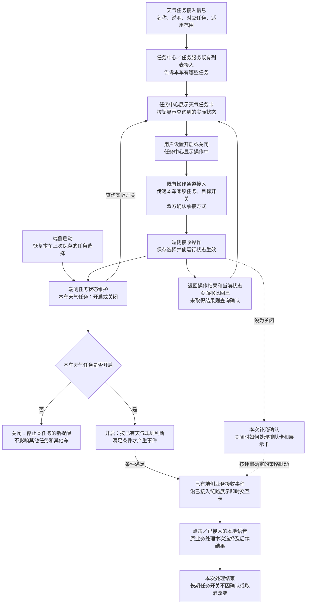

# 端侧开关评审问答稿：把刘杨的追问提前答清楚

依据：9 月 14 日《sls系统预设任务-需求外审》、9 月 15 日《系统预设任务触发器到即时交互卡链路对齐》。本稿不是新的技术方案，而是王泽民向汪帅及相关研发讲清端侧接入需求的口语稿。

“原会”是逐字稿中实际发生的讨论；“端侧可能追问”是据此推演，不代表汪帅已经问过；“建议回答”是本次产品主张，不能冒充已经落地的能力。9 月 15 日已将三个云端任务统一到主动推荐、DT 与卡片链路，天气任务仍是端侧自闭环。

证据分工：任务开关如何传递、按车维护、任务列表如何刷新，直接依据 9 月 14 日外审；9 月 15 日没有重新评清端侧开关，这份会议用于借鉴下游承接、交付内容、交互关联和联调依赖的追问方式，不能把云端结论误写成端侧已定方案。

## 一、先理解刘杨为什么连续追问

此前你多次回答“任务中心是一个容器，开关放 Trigger 维护”。这句话只解释了职责归属，没有解释一次用户操作怎样完成，所以刘杨继续问：列表谁给、点关闭怎么传、是否按车、后台是不是全关、任务是否要经过任务系统。

这次不要只说“端侧维护按钮”。请说完整：

> “任务中心显示开关、接收用户点击；端侧维护这辆车这项任务的实际启停状态，并让天气规则采用这个状态；双方接通设置、查询和结果反馈。按钮显示与端侧实际状态要一致。”

这里的三个交接不是要求研发一定新做三个接口，而是必须具备三种业务能力：设置开关、查询现状、返回结果。

### 四个容易混用的概念

| 名称 | 实际指什么 | 谁需要处理 |
|---|---|---|
| 任务列表 | 本车任务中心有哪些预设任务，名称和说明是什么 | 各任务提供接入信息，任务中心／任务服务按既有机制汇总展示 |
| 平台场景开关 | 平台是否发布／开放某个场景 | 配置与发布侧；不能被某辆车用户的操作直接关闭 |
| 本车任务开关 | 这辆车是否允许天气任务继续产生提醒 | 端侧 Trigger 侧维护，任务中心提交和回显 |
| 即时卡确认／取消 | 用户接受还是拒绝这一次建议 | 已有天气卡片接入与执行逻辑；不修改长期任务开关 |

“维护状态”不等于“只有 Trigger 做事、任务中心不用开发”。任务中心仍要完成点击转交、等待结果、读取和展示真实状态。

## 二、开场与完整链路：可以按顺序照着讲

### 1. 先讲本次增加什么

> “帅哥，这次不是重新评天气触发条件，也不是重做 Trigger 到即时交互卡。按目前进度，那段已经做了。这次补前面的任务管理：用户要能在任务中心决定这辆车是否继续使用天气路况保护，不能只是后台给所有车放一个都会运行的脚本。”

### 2. 指任务列表和开关

> “任务中心展示天气路况保护这项任务，名称、说明和它对应哪项端侧任务要对上。列表展示按任务中心现有接入机制走，不在页面里每新增一个任务就写死一张卡。列表告诉页面有哪些任务；真正开还是关，要读这辆车已经保存的选择。”

### 3. 指用户点击到端侧

> “用户点关闭，任务中心交给端侧的是‘把本车天气路况保护设为关闭’，不是关闭配置平台上全量车辆共用的场景。端侧收到以后，保存这个选择，并让这个任务下对应的规则不再产生新提醒。请双方确认中间复用什么通道，以及谁负责接收。”

### 4. 指结果回到页面

> “端侧处理生效以后，把结果回给任务中心，页面再显示已关闭。不是按钮先变灰就算成功。假如没有拿到结果，要查实际状态；下次重开页面，也读实际状态，不能重新显示默认开启。”

### 5. 指已有出卡链路

> “用户再开启，只是允许任务继续工作；天气条件满足才进入原来的出卡链路。用户在卡片点取消，只取消这一次，不把任务中心开关关掉。卡片确认以后由已有业务继续处理，不是让 Trigger 接管用户对话或调用车控。”

### 6. 讲两个最后需要定的边界

> “重启以后要记住用户之前的选择。另外，用户关闭时如果已经有卡片排队或者展示，现有卡片链路能不能取消或失效，这次一起定范围。它和停止新的触发是两件事，我不把撤卡能力当成现在已经有了。”

## 三、讲图：谁负责哪一段

图中实线为本次要评清的业务关系，不表示所有接入已经完成；虚线为本次新增的关闭边界建议。操作和查询的实际通信方式由研发确认。

条件未满足时继续等待原有检查时机，图中不展开原天气策略。开启时是否立即检查当前条件，需要结合已有脚本明确，不等于点开关立即出卡。

## 四、刘杨原会追问：你在端侧评审如何回答

### 问题 1：“开关究竟放哪里？任务系统维护还是 Trigger 维护？”

**原会：**9/14 06:02，刘杨问开关在哪里；51:47 复述“端上的所有场景都在触发器里面去维护它打开或关闭”，你确认。33:19 王梦尧说明任务系统统一汇总、输出任务，不包办各业务的创建和维护。

**他担心：**没有明确状态负责方，任务中心、任务服务、Trigger 各存一份，最后不知道哪份算数。

**你可以说：**

> “端侧这次沿用上次口径，由端侧 Trigger 侧维护本车任务的实际启停。任务中心不是运行状态的决定方，但需要读这个状态、提交操作、回显结果。存在哪个现有组件可以按端侧实现来定，产品要求是页面和规则使用同一个有效结果。”

**如果继续问为什么不是任务服务保存：**

> “上次任务服务明确的是汇总各业务任务，不是统一承接所有业务运行状态。它可以参与转发，但不能因为列表经过它，就默认它已实现端侧启停。今天需要梦尧和端侧确认中间怎样接。”

**不要说：**“任务中心只是容器，所以它什么都不用做。”

### 问题 2：“用户点关闭，Trigger 怎么知道？通过端状态上报吗？”

**原会：**9/14 52:16 刘杨询问是否通过端状态上报；你答没有端状态；52:32 他接着问“那我怎么知道他关了？”这段未定具体传递方案。

**他担心：**你描述的是用户意图，却没有操作接收和生效路径。

**你可以说：**

> “这是本次要补的实际接入。任务中心需要把用户的设置请求交给端侧状态维护方，至少说明哪项任务、要开还是关；端侧处理后把结果返给任务中心。当前并没有一个会上已确认的端状态信号，我不会写成通过端状态自动同步。请任务中心与端侧确认能复用的操作通道；缺的这段纳入本次开发。”

**如果问产品到底要提供什么：**

> “我给任务清单、每项任务控制哪些规则、开启关闭含义、默认状态和页面结果。任务中心与端侧共同确认哪项任务的操作交到哪个接收入口，不用任务名称字符串临时猜。”

**不要说：**“端侧维护一下就行”或“反正都是端侧，应该自然能知道”。

### 问题 3：“你让我做按钮，还是做一套任务管理？”

**来源：**这是根据 9/14 51:11—53:29 推演的端侧追问，不是逐字原话。刘杨当时指出天气仅预置脚本、尚无用户开关。

**你可以说：**

> “不是让 Trigger 画按钮，也不是让你做一个新的任务中心。端侧需要接入单车任务的启停控制：接收设置、保存选择、让对应规则采用、提供实际结果和查询、启动时恢复。按钮展示由任务中心做；卡片内容和后续动作沿用已有天气链路。”

**如果说脚本已经做完：**

> “我认可规则到卡片这段已有进度。新增的是用户能控制它是否继续工作。我们按这几项逐条看已有多少，只补缺的，不重做后半段。”

### 问题 4：“关掉的是这辆车，还是把后台整个场景关了？”

**原会：**9/14 50:13—50:33 由王梦尧提出，51:47—53:29 刘杨确认逐车启停要求。不要误记成全部由刘杨提问。

**你可以说：**

> “只关这辆车的天气任务。平台上发布的天气场景还是存在的，别的车不受影响。可以理解成大家使用同一套规则，但每辆车都有自己的启停选择。关闭这个用户选择，不修改全局场景开关。”

**如果问要不要在云端维护所有车的状态：**

> “产品要求按车有效，不因此要求端侧这条链路必须再建一个全量云端状态库。端侧怎么持久保存、现有系统是否还需同步，由双方给方案；不能把两边保存的冲突留给用户。”

### 问题 5：“一个开关对应一个场景，还是天气下面所有场景？”

**原会：**9/14 01:05:27—01:06:36 刘杨追问一个后视镜任务对应三个场景、是否互斥；你用天气雪／雨／雾优先级作类比。

**端侧对应：**同一任务可能包含多个天气分支；必须说明总开关控制范围。

**你可以说：**

> “如果任务中心展示的是一项天气路况保护，用户关闭的就是这整项任务，不是只关雨天、雪天还继续弹。会前我会把当前实际接入的天气分支列给你们，明确同属这一项。不同天气分支的优先级和防重复沿用已确认规则，本次不重新设计。”

**不要说：**所有视觉识别、所有端状态订阅都要关闭。那些能力可能还被其他功能使用。

### 问题 6：“任务中心这份列表谁提供？难道每加一个任务都发版？”

**原会：**9/14 47:48—48:38 刘杨反对把任务列表写死到车机；54:36—54:54 追问包括端云任务在内的列表谁给、任务中心是否感知。

**你可以说：**

> “列表和运行状态分开。各任务提供名称、说明、对应任务和适用范围，按任务中心现有列表接入机制统一展示；本车开关读端侧。已支持的能力新增任务展示或配置，不应都靠任务中心改代码发版。但如果新增端侧规则能力或卡片能力，本来就需要端侧开发，不能承诺所有新场景都零发版。”

**现场请确认：**任务服务怎样拿到端侧任务信息、如何筛选本车已支持的任务。不能页面有开关，端侧根本没有对应规则。

### 问题 7：“按车还是按账号？换账号或退出会怎样？”

**原会：**9/14 55:03—55:37 刘杨追问，你明确按车，退出账号不删除预设任务，他认可。

**你可以说：**

> “按车，不跟普通账号任务一起删除。我的产品要求是同车退出或切换账号，不重置这项任务已保存的开关；换另一辆车，就读那辆车自己的选择。需要任务中心和任务服务接入时把预设任务与按账号清理的任务区分开。”

**边界：**原会明确的是任务按车、退出不删除；开关保留的完整行为作为本次明确需求写入。恢复出厂设置是否重置另行确认，不能等同普通退出账号。

### 问题 8：“默认开启吗？下次上电刷新，那关闭也下次生效？”

**原会：**9/14 56:11 王梦尧问默认，你回答开启；59:35—01:00:57 双方同意新增任务列表懒加载、下次上电可见。

**你可以说：**

> “先沿用之前提出的首次默认开启，开启不等于自动执行车控。用户已经手动关过，就要保留关闭，不能列表刷新后又变成默认开。上次同意下次上电，是说新增任务什么时候出现在列表，不是用户这次点关闭可以延迟生效。用户操作要有本次处理结果。”

**如果问生效需要多快：**

> “产品要求本次操作内完成并反馈，不等重启。具体耗时请双方结合现有路径给出承诺，我会写进验收；没拿到结果前不显示成功。我不会在未评估前承诺某个毫秒数。”

### 问题 9：“都开启以后，资源会不会顶不住？”

**原会：**9/14 53:42—54:28 刘杨担心多车场景并发触发模型。那段说的是云端模型资源，不能把他口述的估算直接当容量指标。

**端侧对应：**检查频率、本地识别是否因任务多开而增加，以及持续满足时是否反复出卡。

**你可以说：**

> “这项天气任务仍走现有端侧链路，本次不增加云端 DT 调用。开启开关不代表不断生成新任务，也不要求新增一套摄像头采集。原来的检查节奏、连续命中处理和重复提醒策略要继续有效。我需要你们确认新增开关是否改变本地识别或执行资源；如果没有变化，就不扩大本次范围。”

**不要说：**“Trigger 挡在前面，所以资源肯定没问题。”原会的担心需要具体实现和测试支持。

### 问题 10：“谁出卡？你给哪些内容？点确认以后谁接？”

**原会：**9/14 12:15—13:53 刘杨指出 Trigger 判断之后的下游承接不清；18:33 问卡是否预先配置。9/15 07:31 他继续追问谁下发，08:49—08:54 核对文案是否标题。卡片样式由张弛在 09:00 追问。

**你可以说：**

> “端侧这次沿用已经接好的天气业务出卡链路。Trigger 判断并发出事件，卡片接入业务负责填内容、拉卡和接收选择。产品把提示文案、确认取消按钮、播报和按钮对应动作写明确。不是在流程图里写一句‘弹卡’就结束，也不是 Trigger 收到确认后去调车辆工具。”

**如果问现在后半段是否都好了：**

> “当前确认的进度是 Trigger 到即时交互卡。手动点击、语音、车辆动作和结果反馈分别做到哪一步，请现有接入方说明，我不把已经能展示卡片等同于全链路验收完。”

**可给的具体例子：**正文“当前路面湿滑，是否切换湿滑模式？”，确认对应接受本次切换建议，取消对应本次不执行；实际发布用词与已有天气需求对齐。本次不要临时引入正文与 TTS 必须不同的定制要求。

### 问题 11：“云端会不是说必须让 DT 知道吗？端侧怎么办？”

**原会：**9/15 16:46—17:39 刘杨和姜锋担心云端出卡后 DT 不知道上下文；25:21—26:06 明确天气为端侧，另外三个云端场景走主动推荐与 DT。

**你可以说：**

> “那次‘让 DT 知道’对应三个云端场景，不是把天气也改成云端。端侧这次保持既有自闭环：手动按钮回到原业务；语音按已经接入的本地能力处理。我们要说明支持哪些表达、卡片结束后旧按钮怎么失效，不因此增加动态选择工具或 DT。如果要支持更开放的云端追问，那是额外需求，不能默认算本次已经具备。”

### 问题 12：“你是不是又要让 Trigger 等确认、再检查一遍、再执行？”

**原会：**9/14 43:46—46:40 刘杨指出这不再像 Trigger，反复回流可能形成循环；双方放弃把整段后置判断回流给 Trigger 的画法。

**你可以说：**

> “没有。这次只是让任务开关控制后续是否产生新的事件，卡片后面的执行沿用原业务。关闭时如果需要让旧卡失效，是通知卡片业务结束这次询问，不是用户确认后再回 Trigger 跑一遍所有天气条件。执行层已有的车辆限制也不在这里删除。”

### 问题 13：“什么已有、什么新增，谁负责，什么时候做？”

**原会：**9/15 26:08 刘杨问依赖功能的开发时间，36:41 问 DDL；张弛说相关云端能力待联调，最终云端暂定节后。不能移用为端侧排期。

**你可以说：**

> “本次按四段拆：任务中心接点击和回显；端侧接收、保存并控制规则；重启恢复和查询；关闭事件与已有卡片的联动。我们逐项确认已有能力，只给缺口估时。端侧和任务中心都能对接后，再安排端到端联调。之前云端的节后时间不是这次端侧的交付承诺。”

## 五、原会上没定，但汪帅可能继续追问：准备短答案

下面均为补充推演，不标成刘杨原话，也不抢在核心链路前展开。

| 可能追问 | 你可回答的产品主张 | 需要确认什么 |
|---|---|---|
| 开关变灰了，是否就算关闭成功？ | 不算；端侧实际关闭后才能显示完成 | 成功反馈的具体时刻、等待与失败样式 |
| 点击时断网怎么办？ | 已存本地状态应继续有效；本次操作能否离线完成要看实际通道，不假定端侧页面一定离线可用 | 一期是否承诺离线设置与查询 |
| 重启后脚本先启动、开关还没读到怎么办？ | 建议先恢复用户选择，再允许新的提醒；不能暂时默认开造成误提醒 | 启动恢复是否已有及失败处理 |
| 用户刚开启，当前已经下雨了，会不会马上出卡？ | 开启不是直接出卡；是否立即按原规则检查一次需明确，不能漏掉或重复触发当前场景 | 现有脚本按事件还是持续状态检查 |
| 关闭时已经有卡怎么办？ | 建议未执行的提醒取消或失效；已提交动作不承诺撤回，不自动反向车控 | 当前卡片能力与本期接受范围 |
| 用户确认和关闭同时发生怎么办？ | 要有明确处理先后；不能两边分别认为自己成功却产生矛盾行为 | 哪个处理完成点决定执行／停止 |
| 一直收到雨天状态是不是一直弹？ | 沿用原任务防重复和提醒节奏；开关接入不能绕开原策略 | 既有策略及本次是否重置历史 |
| 规则更新后用户之前关闭还算不算？ | 同一任务保留选择；列表刷新不覆盖用户设置 | 任务对应关系稳定；新增任务另做初始化 |

## 六、会前给研发准备一页，不要只带箭头图

| 你要带的内容 | 天气任务至少写清什么 |
|---|---|
| 一张任务中心卡片示意 | 名称、简短说明、开关；操作中／成功／失败／状态未取到 |
| 一张任务对应表 | 页面上的天气任务，对应端侧哪些现有规则；谁接设置、谁返回状态 |
| 一条原卡片案例 | 条件命中后问什么、确认做什么、取消做什么；使用现有样式 |
| 一组状态规则 | 按车、已有用户选择优先、重启保留、退出不按普通任务清理 |
| 四段工作拆分 | 页面与操作接入、端侧保存生效、查询恢复、在途卡片联动 |
| 一个联调场景 | 关着满足条件不提醒 → 开启后符合原规则可提醒 → 卡片取消不关任务 → 任务关闭后不再新提醒 → 重启仍关闭 |

其中既有卡片样式应找当前接入方取得，不能再在会上说“目前没有样式”。没有明确研发接收人的箭头，现场落实，不只标一个模块名。

## 七、你当场卡住时，用这四种回答继续推进

**业务已经明确，具体实现尚未定：**

> “产品上我要求的是本车关闭实际生效，页面与端侧一致。具体是复用本地接口还是现有任务通道，请双方确认，我不在这里拍一个不存在的接口。”

**有人说已有能力，不能判断是否覆盖：**

> “我们用一次关闭举例：谁收到、谁保存、什么时候不再触发、谁告诉页面成功？这几步已有就直接复用，缺哪一步我们记哪一步。”

**有人问出了原 PRD 没写的产品策略：**

> “这个确实需要产品明确，不让研发自行猜。我的建议是……，理由是……。请看现有能力是否支持，我们今天定下后写入 PRD。”

**讨论偏到云端：**

> “三个云端任务已经另评了主动推荐与 DT。这次先收天气端侧：列表、用户开关、端侧生效、卡片联动。云端结论只借鉴交接方式，不复制整条运行链路。”

## 八、收尾时复述，防止又只得到“没问题”

> “我复述一下今天的结论：天气任务按车管理，由端侧维护实际启停；任务中心通过刚才确认的入口提交操作，并读取端侧结果。首次默认、重启恢复和关闭在途卡片按今天确定的策略写入 PRD。请明确四段的开发人和联调时间，最后用关闭、开启、再关闭、重启这一组例子一起验收。”

本次最应记住的一句：**不是解释“按钮归谁”，而是讲清用户点一次按钮后，谁接、谁改、谁用、谁反馈。**

## 原始材料

- [9 月 14 日外审逐字稿](/Users/bytedance/Desktop/3.23/产品/1-原始素材/会议纪要/sls系统预设任务-需求外审.md)：核心 47:48—01:01:47；补充 06:02、12:15—18:42、43:46—46:40、01:05:27—01:06:36。
- [9 月 15 日云端对齐逐字稿](/Users/bytedance/Desktop/3.23/产品/1-原始素材/会议纪要/系统预设任务触发器到即时交互卡链路对齐.md)：核心 07:15—17:39、25:21—28:55、35:45—37:49。

口语稿只用于准备本次评审，不修改既有 PRD、不替研发承诺接口或排期。
