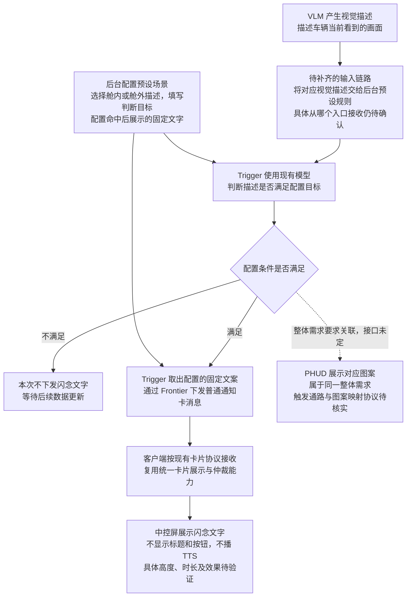

# 豆包闪念：Trigger 新增需求梳理

## 1. 会议信息与本次范围

- 时间：2026 年 10 月 14 日 13:30—14:08。
- 来源：用户提供的《豆包闪念触发器需求》会议文字记录，记录截至 00:37:33。
- 参会人：张嘉锋、王培鹤、刘杨、王泽民、徐洋、谢一鸣、丁彬、黄亚娜；仅按原文列举，不补推测职务。
- 本稿只解释新增需求，不修改 PRD。会议未定事项单独列出，等产品确认后再补进 PRD。

## 2. 这件事要做什么，为什么要放进平台

豆包闪念希望车辆感知到某个场景时，在 PHUD 显示对应图案，同时在中控屏短暂显示一句表达感知的文字。例如看到乘客睡着、看到舱外风景。文字不需要播报，也不需要用户确认。

产品希望通过触发器后台配置“什么条件下展示什么内容”，而不是每增加一个场景就写一段专用判断代码。这样运营修改条件、增加场景、修改固定文案时，可以复用平台。张嘉锋在 00:34:33—00:34:44 明确指出，专门写死的判断流程会导致不可运营、不可维护。

需要纠正会议开头的假设：不是条件全部已有、只缺一个展示动作。后台预设场景直接接收视觉描述并判断条件的这条分支，目前也没有接通（00:16:17—00:19:20）。

## 3. 一期要求 Trigger 做的事情

| 环节 | 需要做什么 | 当前状态与依据 |
|---|---|---|
| 配置视觉条件 | 在后台预设场景中选择舱内或舱外视觉描述，填写需要判断的目标；也可能组合已有端状态条件 | 00:05:15—00:07:35。具体表单与组合规则尚未评定 |
| 接入视觉描述 | 让后台配置的规则能够接收到对应 VLM 描述。VLM 是看图后输出文字描述的视觉语言模型，caption 就是这段描述 | 新增接入工作。直接读取 Context 还是接端上上报链路，会上没有最终定案 |
| 判断目标是否达成 | 根据描述判断配置的条件是否满足，而不是先抽取一套标签。满足才进入输出环节 | 已明确判断目标，00:06:27—00:07:21；一期先复用现有模型，00:23:11—00:23:31 |
| 配置固定文字展示动作 | 一个配置条件对应一段固定文字，命中后下发到车机展示 | 一期明确，00:01:53；平台目前需要新增这一执行项 |
| 对接普通通知卡通路 | Trigger 通过 Frontier 下发消息，客户端按普通通知卡协议展示正文，不显示标题、按钮，不播 TTS | 路径基本明确，00:14:36—00:15:37；具体呈现仍需试下发验证 |

一期“固定文字”不等于“不用模型”。一期模型用于判断视觉条件；二期模型用于生成不同的文案。这是两件不同的事情。

## 4. 产品链路

图中的“等待后续数据更新”表达持续监测需求，不代表会议已经确定监测频率、重试规则或重复展示策略。

## 5. 与现有链路的区别

### 5.1 为什么不能直接说现有 VLM 判断能力已经满足

现有动态任务分支：任务系统把视觉描述转给 Trigger，Trigger 判断目标是否达成。

本次后台预设分支：产品在后台提前配置场景，不依赖用户说一句话创建任务，需要预设规则自己感知视觉描述。

两者可以复用判断能力，但描述的输入入口不同。新入口还需开发。不能因为已有动态任务有任务 ID，就默认把本需求塞进动态任务系统（00:29:41—00:30:12）。

### 5.2 为什么这次不走主动推荐或 DT

一期只是判断条件后展示已配置的一句文字，不是要向用户提出建议、等待确认、执行车控。会议选择普通通知卡／三方接入卡通路，不走主动推荐或主动服务链路（00:15:25—00:15:37）。

Trigger 仍负责判断；本次新增的是命中后发送普通通知卡消息的执行能力。这不等于给 Trigger 增加通用的 DT 工具调用能力。条件判断中使用模型，也不等于已经进入 DT。

### 5.3 为什么不能说客户端已经不用开发

客户端有卡片展示能力，但本次要求没有标题、按钮和播报，并希望轻量短暂显示。需要先按协议实际下发。效果满足要求才可能不用新增客户端开发；不满足就要适配（00:15:44）。

### 5.4 为什么不能说排队策略已经具备

徐洋说明当前卡片仲裁主要是直接覆盖，排队能力在规划中。闪念可以按最低优先级复用统一策略，不在 Trigger 里另做一套卡片仲裁（00:10:55—00:13:27）。具体交付版本需要核实。

## 6. 一期、后续与未收口事项

| 类别 | 内容 |
|---|---|
| 一期 | 接通后台预设视觉条件输入；复用现有模型判断；命中后下发配置的固定文字；试下发普通通知卡并确认呈现 |
| 二期 | 配置文案生成的推理逻辑，调用模型生成动态文字；无确定排期 |
| 后续降耗 | 语义匹配、正则、小模型等方案。会上讨论过“先语义判断，判断不了再用模型”，但 00:23:31 明确一期先用现有能力，降耗另提需求 |
| 会后前置对齐 | PHUD 与闪念共用什么条件触发方式、既有 PHUD 实际实现、图案映射方式和接口 |

下列问题会影响上线，需要后续明确，不能当作会议已定需求：

1. 视觉描述从哪个实际入口接入，怎样区分舱内、舱外和当前车辆；数据缺失或过时怎样处理。
2. 持续监测多久判断一次，多个规则是否重复推理，同一场景持续命中时是否反复出卡。
3. 多个场景同时满足时怎样选择；文案排队后是否可能已经不适合当前画面。
4. 文案长度、展示时长、卡片高度及是否支持不展示标题和按钮。
5. PHUD 图案与中控文字是否需要严格同时显示。会上允许 PHUD 先变化、文字稍后显示，但没有定义最大延迟和过期规则。
6. PHUD 下发标识及图案映射由谁提供、由哪个接口执行；会上提到的任务 ID／图案 ID 只是理解，不是确认后的协议。
7. 持续调用条件模型的成本和频率上限；二期文案模型的能力与规则。
8. 后台功能、条件输入、卡片展示、PHUD 联合测试的具体排期。

## 7. 跟进事项

| 时间 | 对接人 | 具体要做什么 |
|---|---|---|
| 会上约定会后下午／群内同步，实际完成需核实 | 张嘉锋牵头，丁彬、黄亚娜及原对接人员参与 | 查清 PHUD 当前条件通路，统一后台配置触发方向，不能假设现有路径已满足 |
| 未定 | 刘杨 | 确认后台预设 VLM 输入接入点；评估模型判断复用与普通通知卡下发开发量 |
| 未定 | 姜锋、谢一鸣 | 姜锋提供或协助定位卡片协议；谢一鸣负责客户端对接，先试下发验证展示效果 |
| 未定 | 张嘉锋、徐洋 | 确认闪念使用普通通知卡的产品效果，以及统一仲裁策略对应版本 |
| 未定 | 张嘉锋及项目相关方 | 业务期望 10 月 20 日有一版，研发未承诺；与原计划 10 月 26 日提测的系统预设任务评估优先级和延期影响 |
| 未定 | 测试负责人待确认；会上提及绿坡 | 覆盖视觉条件判断、消息下发、卡片真实展示与 PHUD 整体效果；不能把消息发送成功当作最终展示成功 |

会议没有确认 10 月 20 日必交付。若闪念插入，刘杨明确提醒系统预设场景需求需要整体后延（00:22:45—00:25:30）。

## 8. 等用户确认后再补入 PRD 的重点

按两个新增能力补充，不把 PHUD 未确认实现写死：

1. **条件能力：后台预设规则接入 VLM 描述并判断配置目标。**写清数据来源、判断目标、已有能力复用与新增入口、异常和重复命中策略。
2. **执行能力：条件命中后静默展示配置的固定文字。**写清普通通知卡协议、无标题／按钮／TTS、展示结果验证、统一仲裁策略。
3. **关联依赖：PHUD 感知可视化。**写清统一配置目标与会后接口确认项。
4. **范围和排期：一期固定文案，二期动态生成，降耗另排。**单独列出现有预设任务延期风险。

本稿未修改任何 PRD 或线上配置。
