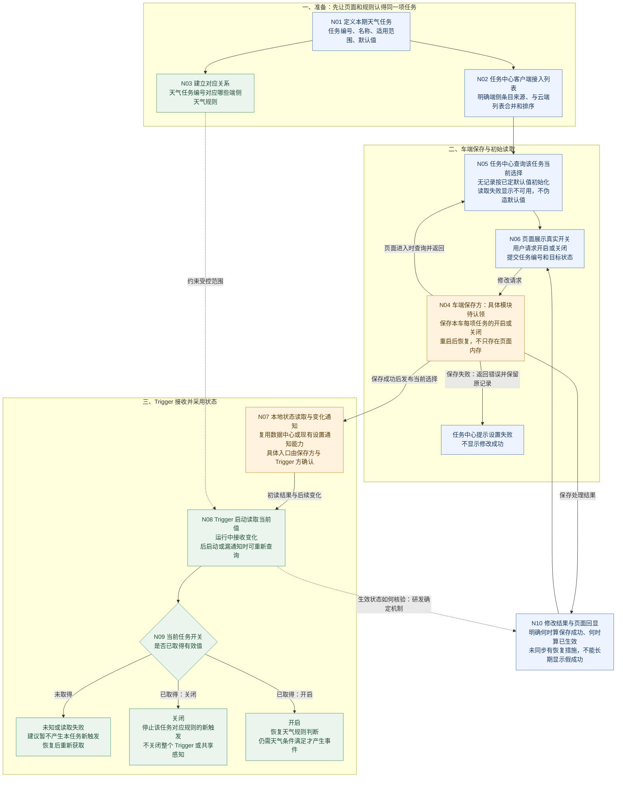

# 任务中心到端侧 Trigger：完整接入与评审推进方案

> 版本：v02，2026-09-22。只讨论任务列表、单项任务开关、车端保存、状态读取与通知、Trigger 生效。停止在 Trigger 是否允许产生新触发，不讨论卡片、DT、语音、车控。
>
> 阅读顺序：先看 7.1 总图，再按 7.4 的节点问题对齐，最后用 7.8 的结论表收口。本文是待评审方案，不是研发已经完成的实现说明。

## 1. 方案摘要

为任务中心中的“天气路况保护”接入本车长期开关。用户关闭后，该任务不再产生新触发；离开页面、重启车机后仍保留选择；重新开启后恢复天气规则判断，而不是立即触发一次天气服务。

推荐方案是：**任务中心提交选择 → 车端既有设置能力长期保存 → 通过明确的本地入口让 Trigger 读取并接收变化 → 页面显示实际处理结果。** 优先复用现有车端能力，不要求新建服务。保存模块和具体开发负责人尚未确认；数据中心不能因为名称含“数据”就被默认认定负责保存。

## 2. 参与方与需要带回的结果

下表的“找谁”是会议依据支持的沟通对象，不等于把所有开发工作提前分派给该人。每段最终实现负责人需本人确认。

| 参与方 | 这次找他解决什么 | 要带回的明确结果 |
|---|---|---|
| 王泽民，需求产品 | 定本期任务、开关语义、跟车范围、默认值和异常体验 | 完整产品规则；不让研发猜产品策略 |
| 郝晓伟，任务中心产品 | 确认场景预设入口、开关样式、暂停/关闭用词、混合列表和提示 | 页面行为与单项开关语义一致 |
| 姜锋、楷朋及任务中心实际客户端承接人 | 任务如何出现在页面、点击交给谁、页面如何读回状态 | 列表接入和读写调用的具体模块、开发负责人 |
| 李鑫及其协助找到的状态/设置能力负责人 | 已有保存、读取、通知能力各在哪里，能否复用 | 保存方与通知方分工、现有能力说明；不能只答“接数据中心” |
| 汪帅，端侧 Trigger 对接 | 初始状态读取、变化接收、天气任务与规则对应、关闭生效 | Trigger 侧接入入口和受控规则范围 |
| 王梦尧，任务中心服务端 | 云端列表与端侧列表的边界，是否真的有服务端改动 | 本期有/无服务端工作及原因；不让其凭空中转未知端侧任务 |
| 徐燃/仁杰等相关能力方 | 只有涉及 AI 设置依赖或复用范围时，补充既有约束 | 不同层级开关的约束说明；不把徐燃当作保存负责人 |
| 张荣、马绿坡等测试承接人 | 以真实天气任务验证页面、保存、重启和 Trigger 行为 | 测试负责人、验证方法、正式用例和结果 |

## 3. 背景与会议事实

此前讨论混在一起的至少有三件事：列表怎么展示、用户选择保存在哪里、Trigger 从哪里拿状态。同一个任务中心可以同时展示端侧和云端任务，但不意味着所有开关都必须走同一条云端链路。

| 来源 | 原始讨论 | 对方案的约束 |
|---|---|---|
| 9 月 21 日主评审 10:31 | 本期端侧任务是天气路况保护 | 本轮不要扩成所有任务统一改造 |
| 11:04、11:45、12:55 | 汪帅提出状态通过数据中心/事件通道给 Trigger；Trigger 读取或订阅开关 | 不把 Trigger 写成用户选择的长期保存方；需要明确状态输入 |
| 15:12 | 产品说明预设任务开关跟车，不跟账号 | 本车切换账号不能直接套用其他账号型设置的覆盖逻辑 |
| 16:23—17:18 | 李鑫提出既有开关回调可能可用；汪帅表示线下再讨论 | 通知通道并未最终确定，不能写“必须走数据中心” |
| 24:23—24:58 | 汪帅承接开关到 Trigger；任务中心相关部分需姜锋、楷朋参与 | 有分段沟通对象，但没有最终指定长期保存模块 |
| 补充会 00:36—01:54 | 王梦尧不能控制看不到的本地任务排序，也不知道端侧任务 ID 及转交对象 | 列表合并、标识和本地操作路由必须明确 |
| 补充会 02:03—02:22、04:04 | 讨论本地处理、不绕云；“数据中心保存”带有条件 | 本地优先是推荐方向，不是已验证的完整接口方案 |
| 补充会 03:21—03:33 | AI 总开关与单项任务开关不是同一层级 | 不合并两项选择；不把寻找单项保存方变成找徐燃保存 |

原始主评审：[本地逐字稿](/Users/bytedance/Desktop/3.23/产品/1-原始素材/会议纪要/聊一下任务中心到端侧自闭环任务打通.md)。补充会依据用户提供的完整转写：[对应飞书纪要](https://bytedance.larkoffice.com/docx/AsBYdXzr1oYg6YxdCjjctNuwn4e)。本轮回查主评审本地原文，未重新读取该飞书链接。

## 4. 目标与完成标准

目标不是“能点按钮”，而是用户选择、页面显示和规则采用的状态一致。

- 在正式天气任务上，关闭后不再产生该任务的新触发，开启后恢复条件判断。
- 退出任务中心、Trigger 进程重启、车机重新上电后，按最后一次成功保存的选择恢复。
- 推荐本地开关修改不依赖网络；如有既有约束冲突，须列明业务原因并另行评审，不能悄悄转成必须联网。
- 页面不虚报成功，不把读取失败当作首次使用，不因旧通知覆盖新选择。
- 开发前完成每段负责人和交接入口确认；上线前所有本范围的必测项通过。具体生效时长与超时数值由产品和研发确定后写入，不虚填秒数或排期。

## 5. 使用对象与范围

使用者是本车驾驶员；操作入口是现有任务中心“场景预设”区。本期只接入端侧天气路况保护，不新增一个独立的端侧任务中心，不重做天气识别和规则内容。

跟车保存意味着同一辆车更换账号仍采用本车选择。恢复出厂设置、清除车辆数据等特殊操作的行为另行明确，不能由“跟车”推导为任何情况下都永久保留。

## 6. 价值

对用户：关闭是一项真实可持续的选择，不会因为关了页面、重启或断网就失效。

对任务中心：页面只需使用明确的读写入口，不需要知道每条天气规则怎么判断。

对 Trigger：把“用户是否允许本任务运行”作为一个明确输入，不承担页面交互和长期保存责任。

对后续接入：复用同一套保存、查询、变化通知方式，新增任务时增加任务标识和规则对应即可；这是复用方向，不承诺本期已交付任意任务的配置平台。

## 7. 完整方案与评审方法

### 7.1 总流程图

蓝色是页面/接入，橙色是需明确实际承接模块的保存与通知职责，绿色是 Trigger。框表示职责，不代表要求研发新建同名模块。N04 与 N07 可以由同一已有组件实现，也可以分开。

图中的“生效状态如何核验”是待确定的结果机制，不要求 Trigger 一定直连页面，不强制新增逐个订阅者回执接口。研发可以复用现有机制，但需要证明用户看到的成功与实际运行不长期矛盾。

### 7.2 先用一辆车走通三个故事

**故事 A：今天关闭。** 页面当前显示开启。用户点关闭，页面提交“天气任务编号，关闭”。车端保存方记住关闭，通过选定的本地通道传给 Trigger。Trigger 停止对应任务的新触发。页面根据实际结果回显。若保存失败，记录不改，页面说明失败；若保存成功但通知异常，需要补同步，不能默认为已经完整生效。

**故事 B：明天重启。** 保存方恢复昨天的关闭记录。Trigger 在启动时读取关闭，不等页面打开，也不等下一次点击。用户之后打开任务中心，页面从同一份状态来源读到关闭。这就是为什么只有“变化通知”还不够。

**故事 C：再次开启。** 保存方改为开启，Trigger 采用开启状态并恢复天气规则判断。开启按钮不等于立即产生一次天气事件；采用开启后是马上用当前状态判断，还是等下一次天气状态更新，必须和汪帅确定，不留给不同开发各自解释。

### 7.3 放在哪里做：职责地图

| 职责 | 放在哪里 | 明确不承担什么 | 本期需要补什么 |
|---|---|---|---|
| 任务定义 | 产品任务说明及研发约定的配置来源 | 不能仅凭本地脚本存在就假定页面已有条目 | 稳定编号、展示信息、适用范围、默认值 |
| 列表合并/页面开关 | 任务中心客户端 | 不自行决定天气规则，不把页面临时值当最终保存值 | 本地条目接入、排序、读取、提交、反馈 |
| 长期保存 | 选定的车端既有设置/存储模块 | 不等于必须放数据中心，也不等于必须新建服务 | 按车记录、查询、修改、恢复、失败返回 |
| 当前状态提供/变化通知 | 数据中心或既有本地设置通知通道，二者择适合的已有能力 | 收到通知不等于已经长期保存 | 初值可读、变化可达、漏消息可恢复 |
| 状态消费/规则控制 | 端侧 Trigger | 不维护页面按钮，不作为独立用户偏好存储 | 任务与规则绑定、初读、更新、未知值处理 |
| 修改结果协调 | 客户端接入方与保存/通知方共同确定实际承接模块 | 不要求 PM 指定底层通信协议 | 成功定义、异常处理和页面一致性 |

**选保存方的判断顺序：**先问已有车端设置模块能否按车保存并供其他模块读取；满足就复用。若数据中心本身有这套能力，也可由其承接。若数据中心只有当前状态和通知，则它只做分发，由明确的保存方负责重启恢复。两者都不满足，才评估新增最小的车端保存能力，并明确工作量与负责人。

不要先决定“必须接数据中心”，再倒推它负责什么；先列清保存、查询、通知、恢复四项能力，再让现有模块逐项认领。

### 7.4 按图逐节点问：问谁、怎么追问、拿到什么

#### N01：天气任务究竟是什么

**你先准备，找郝晓伟和汪帅核对。**

开口：“本期只有天气路况保护这一项端侧任务。开关控制整个任务的新触发，不改变云端任务。请一起确认它对应哪些天气规则，页面名称和规则编号怎么对应。”

必须明确：任务稳定编号由谁提供；一个开关控制一条还是多条规则；适用车型/版本；首次默认值；是否跟车。编号是程序识别任务用的固定标记，改显示名称不应丢失原有选择。

追问：“如果天气任务有三条规则，我关闭一次，是否三条都停止新触发？有没有不属于这个任务、不能一起关闭的规则？”

拿回：一行完整任务定义和规则清单。只说“天气相关的都关”不算确定。

#### N02：任务从哪里出现在页面上

**找姜锋、楷朋或其指定的任务中心客户端承接人；云端列表问题找王梦尧；展示策略与郝晓伟确认。**

开口：“端侧规则在车里存在，不代表任务中心已经知道怎么展示。天气任务的编号、标题和说明从哪里给页面？请确认实际接入位置。”

追问：“是客户端本地配置，还是已有列表接口已经包含？谁判断本车是否支持？端云列表合并后会不会出现两张天气任务？点击时怎么知道这项走本地，不送去云端？”

排序口径：“建议本期给天气任务一个固定位置，不跟着云端返回顺序漂移；具体位置我和任务中心产品确定，客户端按统一策略合并。”固定位置是建议，不把此前随口“放第一”扩为所有未来任务的排序规则。

拿回：展示信息来源、唯一编号、合并/排序方式、点击路由及负责人。只说“云端会返回”却不能指出包含端侧天气条目，不算确定。

#### N04：谁把选择长期记住

**先找客户端承接方和李鑫共同定位实际保存模块，再请该模块开发认领。**

开口：“用户今天关闭，明天重新上电仍然关闭。这条记录最终由哪个车端模块保存？不是当前谁拿到了这个值，是哪个模块负责重启后还查得到。”

追问：“如果页面退出，记录还在吗？如果保存模块或车机重启，谁恢复？更换账号会不会被账号设置覆盖？更新应用会不会丢失？没有记录怎么初始化？保存失败谁回错误？”

若回答“数据中心”：“好的，请再确认它本身负责断电保存和恢复，还是只负责当前值和广播？如果只是广播，请把真正保存的模块一起写上。”

若回答“客户端存”：“客户端是哪一个模块、谁开发？Trigger 不等页面打开也能读吗？请给出读取入口。”

拿回：模块名称、负责人、保存范围、恢复责任、读写入口。技术实现可以另附文档，不必在会上讲数据库细节。

#### N05：打开页面怎么知道当前是开是关

**找任务中心客户端与保存方。**

开口：“页面每次进入或恢复时，从哪里拿当前开关？页面缓存旧值时，怎样纠正？”

追问：“查不到是从没设置，还是读取出错？这两个能区分吗？从没设置按哪个默认值？读取失败是否显示状态不可用并允许重试，而不是显示成关闭？”

拿回：查询入口、加载/失败行为、默认值初始化方式。‘失败默认关’如果指 Trigger 暂停触发，不等于页面或保存记录改成用户已关闭。

#### N06：用户点击后谁接收

**找任务中心客户端与保存方。**

开口：“点击后请把任务编号和目标状态交给明确入口。用户点的是设为关闭，不是一个每收到一次就翻转一次的命令。”

追问：“处理过程中按钮如何显示？建议同一项暂不重复提交；如果超时，可能已经保存，页面是否会重查？重复收到关闭请求是否仍是关闭，而不会反而打开？”

拿回：实际接收入口、必需信息、处理中的页面表现、失败和重试规则。超时不能简单当作未保存成功，因为请求可能已到达，只是结果没回来。

#### N07：保存后怎样告诉 Trigger

**找李鑫、保存方与汪帅共同确认。**

开口：“现在保存方明确了，请确认它保存以后，通过哪条本地通道把新值提供给 Trigger。之前提到数据中心和设置回调，本次到底选哪一个？”

追问：“通知带任务编号和最新状态吗？Trigger 如果当时没启动，之后到哪里读？消息漏了怎么补？如果先收到新值、后收到旧值，怎么避免旧值覆盖？”

你不用要求特定技术：“版本号、顺序控制或每次重查都可以由你们选。我的要求是最终采用最新成功选择，不能用户关了又被旧消息打开。”

拿回：一条画得出来的实际路径、发送方、接收方、恢复方法及双方负责人。只说‘注册回调’仍缺少向谁注册、谁发、初始值在哪读。

#### N08/N09：Trigger 收到以后怎么生效

**找汪帅。**

开口：“这次不是要求 Trigger 保存用户偏好。是让天气规则多读取一个本车任务开关。关闭就不产生这项任务的新事件；开启后仍按天气条件判断。”

追问：“启动读取前怎么处理？建议未知时暂不产生该任务的新触发。收到关闭时，正在进行的本轮条件判断，是否会在发事件前采用最新状态？重新开启后立即判断当前状态，还是等下一次信号更新？”

补充边界：“不要求因为天气任务关闭就关闭整个 Trigger 或共享感知。是否停止不必要的计算由实现评估，产品验收看该任务是否还产生新事件。”

拿回：受控规则、初值策略、关闭生效点、重新开启策略。已经发出的下游事件处理不在本轮展开，另列依赖，不能宣称整条端到端链路已验收。

#### N10：页面什么时候能说成功

**找客户端、保存方和汪帅一起回答。**

开口：“我们把成功说准确：保存成功是一层，Trigger 已采用是一层。请明确页面什么时候结束处理中，什么时候能告诉用户已关闭。”

追问：“如果保存了但通知失败，谁补同步？如果 Trigger 没启动，怎样保证它启动前先读状态？如果正在运行却无法采用新状态，页面如何解释？如何避免用户重复操作使状态更乱？”

不强迫某种协议：“我不指定必须从 Trigger 返回一个新接口，但需要明确一致性机制和异常表现。页面不能已成功，后台长期按旧值运行。”

拿回：成功/失败/处理中或待同步的产品语义、技术保证、超时与恢复责任。产品未确认前，研发不要自行做一个永久‘成功’提示。

### 7.5 产品策略：你先带建议，不让会场替你猜

以下除跟车范围已有产品口径外，均作为本次待确认方案提出，不伪称既有产品事实。

| 事项 | 建议/待定口径 | 谁确认 |
|---|---|---|
| 保存范围 | 本车、每项任务独立；切换账号不覆盖 | 产品与保存方 |
| 首次默认开关 | 必须产品明确；此前资料不足以替你定开或关 | 你与需求方/任务中心产品 |
| 无网络 | 本地任务的查看与修改不依赖云端 | 客户端、保存方 |
| 查询失败 | 页面显示不可用/重试，不虚构用户选择 | 产品与客户端 |
| Trigger 状态未知 | 暂不产生本任务新触发，恢复后重读；不改写保存值 | 产品与汪帅 |
| 页面退出 | 不改变任务选择，不影响状态通知 | 客户端 |
| 重复点击 | 处理时暂不重复提交；同一目标重复请求不反转状态 | 客户端、保存方 |
| 超时 | 重查实际状态再决定提示/重试，不直接假定旧值仍有效 | 客户端、保存方 |
| 重启恢复 | 先取得有效开关再允许对应规则发事件 | 保存方、汪帅 |
| 再次开启 | 恢复规则；是否立即评估当前状态必须明确 | 产品、汪帅 |
| 软件升级 | 稳定任务编号延续选择；改名不重置；编号变更需迁移策略 | 配置/保存/客户端承接人 |
| 恢复出厂/清数据 | 按明确重置策略处理，不由跟车保存自动推导 | 产品、保存方 |
| 列表排序 | 本期稳定位置；端云列表由明确合并方统一排列 | 任务中心产品、客户端 |
| AI 设置依赖 | 单项选择与全局限制分开；不擅自改变既有总开关策略 | 相关产品/能力方，另记依赖 |

### 7.6 评审开场和按图讲述

**开场直接读：**

“今天只评任务中心到端侧天气 Trigger 的开关接入，不展开后面的卡片和执行。

用户已经能看到预设任务，但如果页面关闭不能真正控制天气规则，这个开关就是不完整的。本期要做到用户关闭后停止新的天气触发，重新上电仍保留选择，重新开启后恢复规则判断。

这次不要求 Trigger 存用户设置，也不把天气开关和 AI 总开关合成一个。我推荐优先复用车端现有保存能力。我们今天按图确认任务怎么进入列表、谁保存、谁提供状态、Trigger 怎么采用、页面怎么显示结果。每一段都留下具体模块和负责人。”

**指 N01—N03：**“先认同一项任务。这里需要固定编号和规则对应。否则页面关了一个编号，Trigger 可能读的是另一个，后面接口接通也没意义。”

**指 N04：**“这里是今天最关键的认领点。不是问谁看得到开关，而是问谁负责明天重启后还能读到今天的选择。请客户端和李鑫一起确认已有保存模块。”

**指 N05—N06：**“页面从同一来源读状态，再向明确入口提交修改。第一次没记录和读取失败要区分，提交以后也要有成功或失败结果。”

**指 N07—N09：**“保存不等于 Trigger 已经知道。请这里明确启动时读哪里、运行中怎么收到变化。关闭只控制天气任务，不关整个 Trigger。”

**指 N10：**“最后把结果返回页面。请说明保存失败、通知失败和超时怎么处理。我要保证用户看到的结果和本车实际运行一致，不指定你们必须采用哪种底层通信方案。”

**结束复述：**“我复述一下：列表由谁接，状态由谁存，变化经谁通知，Trigger 从哪里读，页面按什么结果回显。没定下来的写到问题表，明确找谁补和回传时间，不把它记成已完成。”

### 7.7 遇到研发追问，怎样把讨论拉回可决定的问题

| 对方说/问 | 你可以直接回答 | 继续拿到什么 |
|---|---|---|
| “天气场景不是已经做了吗？” | “原天气规则不是本次新增点。本次补用户长期开关对规则的控制，以及保存、读取和页面反馈。” | 现有能力与新增工作清单 |
| “触发器没有状态，不能存。” | “同意，不要求 Trigger 长期存用户偏好。请确认现有读取和变化接收入口，我推动保存方对接。” | Trigger 接口及承接范围 |
| “这就是进数据中心。” | “可以，请区分它负责保存还是只负责分发。今天关闭，明天重启，哪个模块恢复这条记录？” | 保存方，不是一个名词 |
| “开关走统一设置就行。” | “请拿一个现有入口核对：是否跟车、可离线、重启可恢复、Trigger 可读取并收变化？满足就复用。” | 能力匹配，不争论命名 |
| “找徐燃。” | “天气是单项开关，徐燃不负责保存。请问要找他确认全局限制，还是确认某个可复用能力的实际负责人？我们把具体问题写清。” | 明确依赖及正确接收人 |
| “为什么不放任务中心维护？” | “任务中心客户端可以复用保存能力。我反对的只是只存在页面里。只要退出页面、重启后仍能供 Trigger 读取，就可以评估。” | 去除无意义的模块名争论 |
| “任务中心都从服务端拿。” | “云端列表可以照旧。请单独确认天气条目如何接入，以及本地开关是否有必须上云的消费者，不能把列表来源等同于状态保存位置。” | 列表与开关分开落位 |
| “你到底要控制全部还是部分？” | “只控制天气任务编号对应的规则。这张对应清单请一起核对，不影响其他任务或共享感知。” | 规则范围表 |
| “通知发出就算成功？” | “发送不等于采用。请说明如何保证采用、失败如何恢复，再确定页面成功语义。” | 一致性机制和测试证据 |
| “没有状态就默认打开吧。” | “请先区分首次无记录和读取失败。默认值只适用于初始化，失败不能覆盖用户之前保存的关闭。” | 默认值与异常分离 |
| “这些都是技术细节，线下聊。” | “底层实现可以线下定。今天至少需要明确谁牵头、交付哪条具体路径、什么时候回传；未定的段落保持未收口。” | 有负责人和截止时间的行动项 |
| “需要你给接口字段。” | “我给业务信息：哪项任务、目标开关、当前状态、修改结果。字段名和接口格式请接收发送两方一起定，我核验业务信息是否完整。” | 业务契约与技术设计分工 |

不要试图在现场回答不存在的接口名。可以明确说：“产品行为我这里确定，实际接入入口需要双方认领，我们现在把这项定下来。”

### 7.8 结论表：会后必须能填完

| 决策项 | 结论填写栏 | 对接方 | 收口标准 |
|---|---|---|---|
| 天气任务编号及规则范围 | 待填 | 产品、汪帅 | 固定标识和完整规则清单 |
| 列表来源与页面接入 | 待填 | 客户端、任务中心产品 | 来源、适用性、合并顺序明确 |
| 选择保存模块 | 待填 | 客户端、实际保存方 | 模块名、负责人、跟车和重启说明 |
| 查询/修改入口 | 待填 | 客户端、保存方 | 双方可对接的实际入口 |
| 状态通知路径 | 待填 | 保存方、李鑫、汪帅 | 谁发给谁，初读和变化都覆盖 |
| Trigger 生效范围及节点 | 待填 | 汪帅 | 关闭阻断新事件、开启评估策略 |
| 页面成功与异常语义 | 待填 | 产品、客户端、保存/Trigger 方 | 失败、超时、未同步处理一致 |
| 首次默认值/重置 | 待填 | 产品与需求方 | 首次与失败区分，清理规则明确 |
| 是否有服务端改动 | 待填 | 王梦尧及对应消费者 | 写清用途；无用途不为中转新增依赖 |
| 验收与可观察证据 | 待填 | 测试与各开发方 | 页面、保存读回、Trigger 采用均可证明 |

每项未定问题附“负责人、需补材料、回传时间、影响哪一步”。不要把没有认领的空格变成“研发自行对齐”。

### 7.9 研发任务拆分与 PRD 可直接采用的要求

| 工作包 | 具体交付 | 不应混入 |
|---|---|---|
| A 任务定义与页面接入 | 任务标识、元信息、适用范围、列表合并、开关页面 | 新天气识别能力 |
| B 状态保存与查询 | 本车选择保存、初始化、查询、修改、重启恢复 | AI 总开关重构 |
| C 状态通知 | 新值发布、Trigger 初读入口、变化订阅、恢复一致 | 强制新建数据中心 |
| D Trigger 接入 | 绑定天气规则、读初值、收变化、开启/关闭控制 | 卡片回调与车控 |
| E 页面结果与异常 | 处理中、失败、超时重查、实际状态回显 | 只改按钮颜色 |
| F 联调验收 | 真实天气任务、断网、重启、错误及顺序测试 | 用旧演示通过代替正式验证 |

可直接写入 PRD：

1. 天气路况保护使用独立任务开关，控制本车该任务对应规则是否允许产生新触发事件。关闭不删除任务，开启不等于立即触发服务。
2. 本车选择由明确认领的车端保存模块长期保存。页面、Trigger 不各自建立独立且可能冲突的用户选择来源。
3. 任务中心提供任务编号和目标状态，保存方返回处理结果；具体接口由开发双方确定。
4. Trigger 启动时取得当前选择，运行中接收变化；进程后启动、漏通知或短暂故障恢复后能够重新取得最新值。
5. 页面读取失败不得伪造默认开关；首次无记录按产品确定的默认值初始化。Trigger 未获得有效状态的处理按本次确认策略执行。
6. 同一目标的重复请求不反转状态；旧通知不得覆盖较新的成功修改。实现方式由研发决定。
7. 需明确保存成功和运行生效的关系；通知异常、修改超时等情况有恢复和页面反馈，不能长期虚报成功。
8. 仅关闭天气任务对应的新触发，不关闭整个 Trigger 或其他任务使用的共享能力。本轮不定义已发出的下游事件处理。

上述条款在评审确认后纳入正式 PRD；不要把未填的模块名替换为未经认领的人员。

## 8. 推进顺序、验收与发布

### 8.1 怎么推进，不再靠一场大会议猜方案

**第一步，你先准备一页业务输入。** 只写本期天气任务、页面位置、跟车选择、开启/关闭含义、默认值待定项、规则范围和本地优先要求。不会的接口不要编。

**第二步，先做一次小范围接口认领。** 请任务中心客户端承接人、李鑫、汪帅参加，按 N04→N07→N08 确认保存和通知；再反向补 N05/N06 页面入口。邀请语：“请带现有可复用能力及负责人，今天目标是明确实际模块，不重讲后半段业务。”

**第三步，补齐列表和产品策略。** 与郝晓伟/客户端确认 N01/N02、默认值、排序和提示；王梦尧确认是否存在必要服务端工作。若保存方案有必需的其他依赖，明确后再邀请对应人，不一开始把所有人拉进来。

**第四步，回写图再评完整链路。** 用确定的实际模块名称替换 N04/N07 的待认领文字；用今天关闭、明天重启、再次开启三个故事跑通。每条箭头都能说出谁发、谁收、发什么、失败怎么办。

**第五步，拆任务、联调、验收。** 负责人确认工作包后估期；测试在开发前检查用例。未确定负责人和入口时不要承诺上线日期。

### 8.2 评审前可直接发的邀请

> 峰哥、楷朋、李鑫、帅哥，想单独把“任务中心天气开关到端侧 Trigger”这段收口一下，不聊后面的卡片和车控。
>
> 产品目标是：用户关闭本车天气任务后停止新的触发，重新上电仍保留；重新开启后恢复规则判断。本期只接天气任务，单项开关和 AI 总开关分开。
>
> 麻烦一起确认三件事：①哪个车端模块长期保存，谁负责；②任务中心向哪里查询/修改；③Trigger 启动从哪里读，变化通过谁通知。数据中心若只做通知，需同时明确真正的保存方。
>
> 我会带任务范围和产品策略。请大家带已有可复用入口或对应负责人，会后我们把完整路径、分段负责人和异常处理写回 PRD，再排开发。

### 8.3 最小验收清单

| 用例 | 必须看到的结果 |
|---|---|
| 开启状态下关闭任务 | 页面回显真实结果；Trigger 不再产生该任务新事件 |
| 关闭后天气条件再次满足 | 仍不产生该任务新事件 |
| 重新开启 | 恢复规则判断，按约定的重新评估时机工作 |
| 退出并重进任务中心 | 显示实际保存的选择 |
| Trigger 晚于修改启动 | 主动取得最新值，不依赖错过的通知 |
| Trigger 进程重启 | 重新取得开关后再按策略运行 |
| 整车重新上电 | 保存值恢复，页面和 Trigger 一致 |
| 同车切换账号 | 本车选择不被另一账号的设置覆盖 |
| 断网修改 | 按本地方案完成，不因云端不可达阻断 |
| 保存失败 | 不覆盖原记录，不显示修改成功 |
| 读取失败 | 页面与首次无记录区分，Trigger 按未知策略处理 |
| 请求超时 | 查询真实状态后处理，不凭超时推断保存失败 |
| 通知遗漏/发送异常 | 能重新取得最新值；异常不永久遗留 |
| 重复请求/旧通知后到 | 不反转目标状态，不覆盖新值 |
| 关闭与本轮条件判断同时发生 | 按明确的生效节点阻止关闭生效后的新事件 |
| 其他任务仍开启 | 不受天气开关误影响 |
| 软件升级或任务改名 | 规则未变且编号不变时保持选择；迁移另测 |

每项验证同时看相应页面表现和运行证据，不能仅看按钮颜色。证据形式由研发/测试选用，如保存读回、Trigger 当前值和事件记录，不强行要求新建日志平台。

### 8.4 你怎样判断自己已经真正理解

你能不看稿回答下面八句话，就足够主持这次产品评审，不需要知道底层数据库实现：

1. 用户看到的天气任务由谁提供，编号是什么。
2. 一个开关具体控制哪些天气规则。
3. 用户点击后，请求交给哪个模块。
4. 哪个模块负责断电后仍记住选择，谁开发。
5. 页面和 Trigger 分别从哪里读取同一份选择。
6. 运行中修改后，谁把变化告诉 Trigger。
7. 保存、通知、读取失败时，用户看到什么，谁恢复。
8. 什么证据证明本次真的关闭，以及重启后没有重新打开。

缺哪一句，就把它作为待确认项问到实际承接人；不靠复述“统一能力”“数据中心”“回调”来假装已经了解。
