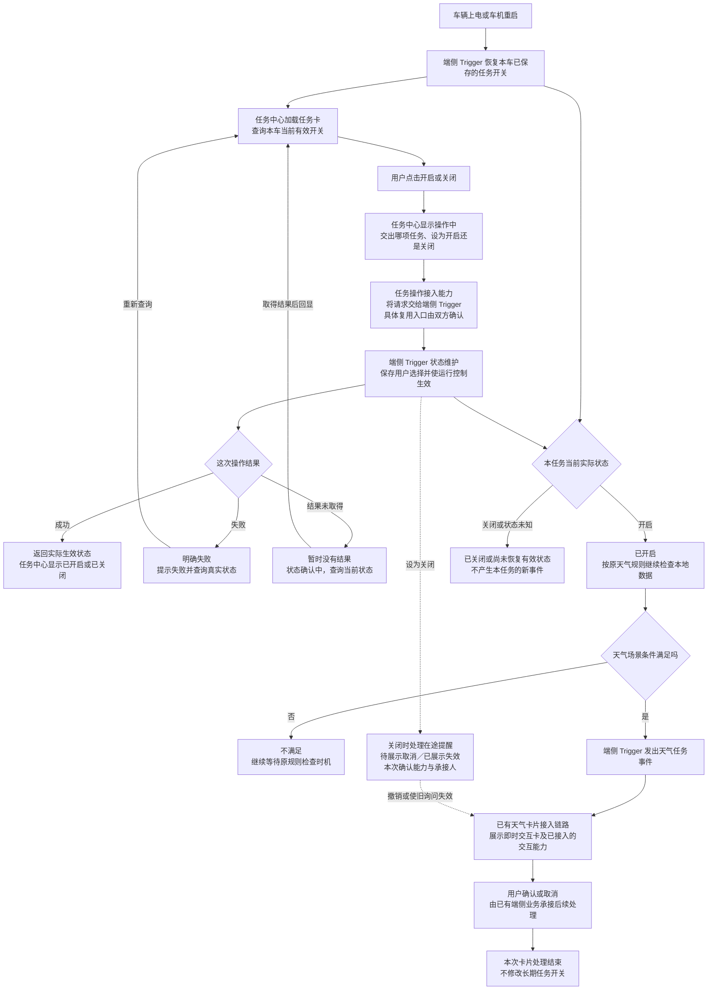

# 端侧系统预设任务：任务中心开关接入与评审稿

> 用途：评审“任务中心 → 端侧 Trigger”的任务开关接入，并连接已经做好的 Trigger 到即时交互卡链路。  
> 整理日期：2026-09-21。主要证据为 9 月 15 日云端链路评审、9 月 14 日外审逐字稿及本次用户提供的最新进度。  
> 当前进度口径：按产品负责人最新说明，端侧已做到 Trigger → 即时交互卡。本文未验证代码和实车，不将这句话扩大成“任务中心、断网、语音、车控和重启恢复均已验收”。

## 1. 本次评审要解决的问题

端侧当前能在条件满足时出即时交互卡，但用户还不能通过任务中心可靠地决定这项任务是否继续工作。本次要补上用户管理入口，让任务中心中的“天气／路况保护”开关真正控制本车端侧 Trigger，而不是只改变界面上的按钮。

本次完成的标准是：用户在任务中心开启，端侧保存这项选择并允许该任务产生提醒；用户关闭，端侧保存关闭并停止该任务的新提醒；任务中心显示端侧实际生效的状态。重开页面、重启车机或退出账号后，状态仍按已确认的产品规则保持一致。

可以在会上先这样说：

> “这次主要补天气路况保护前面的用户开关链路。现在端侧 Trigger 到即时交互卡已经做了，但用户在任务中心点开启或关闭，还需要真正控制本车的这项任务。今天希望把谁接操作、谁保存、什么时候生效、任务中心怎么回显，以及重启和关闭时如何处理确认下来。”

## 2. 先把三个概念分开

| 用户看到的东西 | 它解决什么问题 | 例子 |
|---|---|---|
| 任务中心的任务卡和开关 | 用户是否长期使用这项服务 | 天气／路况保护：开启／关闭 |
| 条件满足后出现的即时交互卡 | 用户是否接受这一次建议 | “当前路面湿滑，是否切换湿滑模式？”确认／取消 |
| 车辆实际功能状态 | 车辆动作是否发生 | 当前驾驶模式为普通模式或湿滑模式 |

开启任务不等于立刻切换驾驶模式。取消一次卡片不等于关闭长期任务。关闭任务也不自动把车辆从湿滑模式改回普通模式；已执行动作的恢复按原天气任务退出规则处理。

还要区分“平台发布了这项能力”和“本车用户开启了这项任务”。平台决定哪些车辆可使用任务，用户开关决定某辆车是否使用；用户关闭本车任务不能把所有车辆的场景关掉。

## 3. 原会议告诉了我们什么

### 3.1 可以继续沿用的结论

| 依据 | 原讨论要点 | 本次怎样使用 |
|---|---|---|
| 9/14 33:19—33:59，王梦尧 | 任务系统汇总各业务任务，提供统一结构；各业务任务怎样创建和维护，不由它全部包办 | 任务中心展示职责与实际运行状态维护职责分开；需要把任务接入，而不是只加一张任务卡 |
| 9/14 51:11，刘杨 | 当时天气任务仅有对所有车辆生效的预置脚本，没有用户启停开关 | 这是历史缺口，不能因为脚本会出卡就判定用户管理能力已完成；现在以后续实际开发进度为准 |
| 9/14 51:28—53:29 | 产品明确由 Trigger 侧维护启停，支持不同车辆不同开关 | 业务分工沿用；本次落实端侧接收、保存、运行生效和反馈 |
| 9/14 52:16—52:49 | 刘杨问开关怎么传，是否端状态上报；当时未给出已接好的路径 | 不能写“开关随端状态自动上报”并视为已实现；本次必须确认真实操作接收入口 |
| 9/14 55:26—55:37 | 产品明确按车，退出账号不删除系统预设任务 | 本车开关与普通账号临时任务区分；不应因退出账号删除本车预设任务 |
| 9/14 56:18 | 产品提出任务默认开启 | 这是已有产品口径，不能忽略或自行改成默认关闭；本次确认首次启用和升级迁移分别怎样落地 |
| 9/14 59:35—01:00:57 | 新的系统预设任务列表允许下次上电再加载 | 用于任务列表刷新，不用于拖延用户刚点的开启／关闭 |
| 9/15 25:21—26:06 | 天气保留端侧自闭环，另外三个云端任务进入主动推荐和 DT | 端侧评审不继承云端“必须经 DT 出卡”的结论 |

“Trigger 侧维护”是业务责任的确认，不等于已经确定某个数据库、某个通信接口或具体开发人。端侧可以复用已有状态存储与通信能力，但需要端侧 Trigger 负责人承诺最终运行状态正确。

### 3.2 云端会中应该借鉴的追问方式

| 云端会中的追问 | 端侧本次对应要问什么 | 希望得到的结果 |
|---|---|---|
| 07:15—08:05：端侧卡片究竟怎么拉起来、谁传信息 | 用户点开关后究竟谁收到，谁再交给端侧 Trigger | 画出实际接力关系，并指定每一段承接人 |
| 08:16—10:54：标题、正文、TTS 到底是什么，有没有样式 | 任务中心该显示什么状态，操作中、失败、未知状态是什么样 | 一张任务卡的状态示意和可实现的交互要求 |
| 14:07—15:23：能否复用主链路 | 任务中心已有任务操作能力是否能转交端侧业务 | 确认可复用入口和需要新增的部分 |
| 16:46—17:39：下游知道刚才发生了什么吗 | Trigger 真正生效后任务中心知道吗；重新打开页面会读谁 | 明确查询当前状态与操作结果回传 |
| 20:32、26:17：能力是已有还是正在联调 | “开关已做”到底指界面、接收、保存还是 Trigger 已生效 | 按步骤确认实现状态，不用“框架都有”代替验收 |
| 36:20—37:49：依赖和排期是什么 | UI、端侧接入、状态保存和关闭在途卡片分别由谁做 | 明确工作拆分和联调依赖，重新估时 |

本次不能直接照搬云端的正文与 TTS 同文、动态选择工具取舍、建议 Query 等结论。它们解决的是云端交互，本次补的是端侧任务启停。

## 4. 可直接写进 PRD 的需求正文

以下“应／不得”为本次提交评审的产品要求；未在历史会议定下的策略在对应位置标出，不能当作已有能力。

### 4.1 背景与价值

天气／路况保护已具备端侧条件判断与即时交互卡链路，需要补齐任务中心对该任务的启停管理。用户应能够控制是否接收此任务的主动建议，且任务中心显示应与本车端侧实际运行状态一致。

本次价值是：让用户的选择真实生效，避免“关了仍提醒”；让已保存的选择在日常重启后保留，避免反复设置；为后续端侧预设任务提供可复用的查询、启停及结果反馈方式。

### 4.2 本期范围

1. 任务中心接入端侧天气／路况保护任务的展示信息、当前开关与操作入口。
2. 用户开启／关闭请求到达端侧 Trigger 的状态维护能力。
3. 端侧保存本车选择，并让实际规则运行采用该状态。
4. 向任务中心返回结果，支持重新打开页面时查询当前状态。
5. 上电、车机重启、Trigger 重启后恢复已保存选择。
6. 确认关闭任务对正在排队／展示的卡片的影响，并补齐需要的接入改动。

Trigger 命中后的卡片内容、确认取消及车辆动作沿用当前端侧场景方案；本次核对关闭事件是否需要接入这些模块，不在此重建一套交互方案。

关闭任务后使旧卡片失效，是任务启停与卡片之间的状态联动，不等于要求用户确认后返回 Trigger 再跑一次场景条件。本稿不新增这种二次判断链路，也不要求 Trigger 调用车辆工具。

### 4.3 任务卡展示

| 内容 | 需求 |
|---|---|
| 名称 | 天气／路况保护，沿用最终会签名称 |
| 副标题建议 | 根据天气路况提供驾驶建议 |
| 操作 | 开关；不提供删除预设任务的操作 |
| 当前开关 | 读取本车实际有效状态，不用任务列表里的默认值反复覆盖 |
| 正在操作 | 显示“开启中／关闭中”或加载态，暂不允许反复提交 |
| 明确失败 | 提示“开启失败，请重试”或“关闭失败，请重试”；当前开关按查询到的实际状态显示 |
| 未取得结果 | 显示“状态确认中”或状态暂不可用，并重新查询；不能猜测成功或失败 |
| 能力暂不可用 | 显示不可用原因或禁用操作，具体样式由任务中心确认 |

状态文案为本次评审建议，交互形式与现有任务中心规范统一。

### 4.4 开关范围与生效含义

- 开关按车辆和任务区分。同车切换账号不自动删除系统预设任务或重置已保存开关；A 车的操作不影响 B 车。
- 任务开启表示允许本任务继续判断并产生新的提醒，不直接触发卡片或车控。
- 任务关闭表示端侧 Trigger 不再产生本任务的新触发事件。物理上是否暂停信号订阅，由研发决定，不要求停掉其他任务共用的信号。
- 任务中心只在端侧确认状态已保存、运行控制已生效后，向用户显示操作成功。若二者完成时间不同，应保持操作中或反馈真实失败原因。
- 该任务是否包含雨、雪、雾等多个子规则，必须在任务接入表列全；本任务开关覆盖所有被绑定的子规则，不能只关其中一条。

### 4.5 开启流程

1. 用户打开任务中心，系统加载天气任务卡，并读取本车端侧当前状态。
2. 用户把关闭改成开启，任务中心发出“将本车这项任务设为开启”的请求，显示开启中。
3. 端侧 Trigger 的状态维护能力接收该请求，确认任务存在且本车支持，保存用户选择，并使对应规则允许产生新事件。
4. 端侧返回实际开启结果，任务中心显示已开启。
5. 后续本地数据更新或既有检查时机到来时，Trigger 结合任务开关与场景规则判断。只有规则满足才进入已有卡片链路。

**本次需要拍板：打开开关时若场景已经满足，要不要立即检查一次？** 建议沿用当前天气规则的检查节奏和防重复规则，不把开启开关当作直接出卡事件；若既有实现依赖一次变化事件，需说明会不会漏掉当前场景，并决定是否增加一次开启后的条件检查。这是任务策略选择，不由研发默选。

### 4.6 关闭流程

1. 用户把开启改成关闭，任务中心提交“设为关闭”，显示关闭中。
2. 端侧保存关闭选择，并阻止对应任务继续产生新的提醒事件。
3. 端侧返回真实结果，任务中心据此回显。
4. 后续即使湿滑等条件仍满足，也不得产生新的天气任务提醒。
5. 已经在途的提醒按 4.7 处理。若 PRD 承诺关闭后不再接受旧卡片确认，则卡片撤销／失效也应进入关闭完成的验收范围。

**任务关闭不触发车辆动作的反向恢复。** 例如车辆已切为湿滑模式，不因为用户关闭“天气路况保护”任务就自动改回普通模式。既有天气退出规则是否还会运行，需要端侧任务研发确认并按原需求保留，不可误伤已执行任务的必要收尾。

### 4.7 关闭时已经有卡片怎么办

这一段是新增开关与已做好的出卡链路之间的接口。以下为建议提交本次拍板的产品策略，9 月 15 日云端会议未替端侧确认这些行为。

| 关闭发生的阶段 | 建议行为 | 需要谁配合 |
|---|---|---|
| 尚未命中条件 | 停止本任务后续新触发 | 端侧 Trigger |
| 已发事件、卡片还在排队 | 取消本任务这次待展示提醒，避免关闭后补弹 | 端侧事件／卡片接入方、卡片框架 |
| 确认卡已经展示，用户还未确认 | 撤下或使该询问失效；如注册了本地语音按钮，关联处理；不能再由这张旧卡开启新动作 | 端侧卡片业务、VUI／语音接入方 |
| 用户确认刚发生、动作尚未提交 | 确认与关闭相遇时，以哪个完成点决定是否执行，需要两方约定；建议在动作未提交时停止本任务新动作 | 场景执行业务、端侧 Trigger、卡片接入方 |
| 车辆动作已提交或完成 | 不宣称撤销已提交动作，不自动反向车控；后续新提醒停止，结果按已有链路收尾 | 场景执行与卡片接入方 |

若现有框架暂不能撤销旧卡，应明确这一版本实际能保证什么，供产品决定是否接受；不能只做“停止新触发”却对用户承诺“关闭后当前询问也立即失效”。

### 4.8 保存、重启与状态恢复

| 时机 | 产品要求／本次建议 |
|---|---|
| 第一次接入、此前没有用户选择 | 按最终确认的初始策略建立状态。历史产品提出默认开启，本次确认适用车辆及首次展示说明 |
| 已经存在用户选择 | 用户选择优先，不因列表刷新或规则升级覆盖 |
| 重新打开任务中心 | 查询当前实际状态；不能重新套默认开启 |
| 车机上电或端侧 Trigger 重启 | 恢复保存的状态后，再允许本任务产生新事件 |
| 状态仍在读取、读取失败或损坏 | 本次建议暂不产生新提醒，显示状态待恢复；“未知”不等于已关闭，也不等于首次未设置 |
| 账号退出／切换 | 保留本车已存开关；任务入口在未登录状态的可访问性，需任务中心确认 |
| 规则脚本升级 | 同一任务沿用用户选择；若新增任务或改变任务范围，另定义初始化，不默认覆盖 |
| 恢复出厂设置／明确清除车辆设置 | 是否重置为初始策略，本次单列确认；不与普通重启混同 |

### 4.9 弱网与离线

产品建议：对已经安装并加载的端侧任务，已保存的选择应能在本地被 Trigger 使用，不能因断网恢复成默认开启。任务中心在离线时能否进入页面、读取开关、提交启停，需要任务中心和端侧接入方分别确认。

若任务中心当前操作必须经过云端，在没有接通离线操作前，应明确反馈不可操作，不能先显示关闭再等不确定的联网同步。若一期承诺“离线可开关”，则任务中心到端侧生效这一段必须具备可验收的本地路径；实现方式由研发选定。

新任务列表在离线时是否可见，是另一项列表缓存能力。不能用“下次上电刷新任务列表”解释本地开关不能即时生效。

## 5. 完整业务链路图

实线描述拟评审的业务需求；虚线连接需要本次确认承接和实现的在途卡片处理。中间“操作接入”是职责，不是要求新建服务；研发可复用现有任务操作通道。

讲图时说明：任务开关变化控制后续能否触发；卡片回答交给已有端侧业务。用户取消一张卡，不沿箭头回头把长期任务开关关闭。运行循环由本地数据和原规则驱动，不是每次出卡都从上电重新开始。

## 6. 每一方给谁什么信息

只列产品能看懂的信息，不指定接口名称或底层格式。

| 交接 | 发出什么 | 收到什么才算交接完成 |
|---|---|---|
| 任务接入方 → 任务中心 | 任务名称、说明、图标（沿用规范）、适用范围、使用开关、当前状态查询和操作接收方；内部稳定任务标识用于区分任务 | 任务中心能显示正确任务，点击能到正确端侧任务 |
| 任务中心 → 操作接入方 → 端侧 Trigger | 本车哪项任务、用户希望开启还是关闭、是哪次操作 | 请求已交到端侧且有明确处理结果；请求已发送不代表开启成功 |
| 端侧 Trigger → 任务中心 | 实际状态、这次操作是否完成、失败／不可用原因；对应哪次操作 | 界面与实际状态一致；旧操作结果不覆盖更新的选择 |
| 任务中心 → 端侧状态维护 | 读取本车某任务当前状态 | 返回开启、关闭，或尚未确定；不能只读列表默认值 |
| 状态维护 → 规则运行 | 这项任务当前允许还是不允许产生事件 | 所有绑定规则采用该状态；不是仅存下一个值 |
| 端侧关闭处理 → 已有卡片业务 | 哪个任务已关闭、哪些待展示／待回答询问需结束 | 卡片侧按本次确认的能力完成撤销／失效；执行已提交则反馈实际阶段 |

技术上经过几个服务、是否经过 Task Service、状态保存在哪个组件，交给研发说明。产品要求这几次交接不能丢，并能回到用户看见的结果。

## 7. 用天气任务逐步讲一个完整例子

例子只用于解释开关行为：已保存开关为关闭；后来本地给出“路面湿滑、车速高于原规则阈值、当前非湿滑模式”。具体阈值沿用已会签天气任务，本文不新增数值。

| 步骤 | 谁做什么 | 用户看到什么／为什么 |
|---|---|---|
| 1 | 上电后端侧读取上次保存的关闭 | 即使已经满足湿滑规则，也不出天气提醒 |
| 2 | 用户打开任务中心，查询同一份实际状态 | 天气任务开关显示关闭 |
| 3 | 用户开启；任务中心交出设置请求 | 显示开启中，不能提前说已经成功 |
| 4 | 端侧保存开启并允许天气规则产生事件，返回完成 | 显示已开启；此时不代表已经切换驾驶模式 |
| 5 | 在本次确认的检查时机，Trigger 读本地数据，天气条件满足 | 沿已有链路出现“是否切换湿滑模式”的卡片 |
| 6 | 用户在卡片点击取消 | 本次不切模式；任务中心开关仍然开启 |
| 7 | 用户回任务中心关闭天气任务 | 端侧保存关闭并停止新事件；在途卡片按会签策略处理 |
| 8 | 本地再次上报同样湿滑条件 | 不能再产生此任务的新提醒 |
| 9 | 用户重启车机，再进入任务中心 | 仍显示关闭；端侧仍不因湿滑条件出新提醒 |
| 10 | 用户换账号或退出登录 | 按车保存的任务状态不被普通账号任务清理逻辑删掉 |

失败例子：第 4 步实际上成功，但任务中心没收到结果。页面应显示正在确认状态，查询端侧后显示已开启；不能一超时就把页面恢复为关闭，造成“页面关、实际开”。如果端侧明确没有生效，再显示失败和实际关闭。

## 8. 本次还缺哪些信息

| 优先级 | 问题 | 为什么会卡住 | 当前状态 |
|---|---|---|---|
| 本次必须定 | 任务中心操作由哪个已有入口接收，怎样交给端侧 Trigger | 没接收方，用户开关只有 UI | 旧会未确定，本次补 |
| 本次必须定 | 端侧谁负责保存且让规则采用新状态 | 只保存不生效，任务仍会提醒 | 业务归属明确，具体研发认领待补 |
| 本次必须定 | 开启／关闭何时向用户报成功 | 页面和运行可能不一致 | 本文提出保存并实际生效作为标准 |
| 本次必须定 | 关闭对排队卡、已展示卡、已提交动作各有什么影响 | 关闭后仍弹卡或执行，用户难理解 | 新的开关与已有卡片接口需确认 |
| 本次必须定 | 初始默认、老版本升级、已有选择分别怎样处理 | 默认开启可能覆盖用户已经关闭的选择 | 历史提出默认开启，迁移策略未定 |
| 联调前定 | 状态未读取／暂不可用／操作超时的显示与重查 | 不能只准备成功截图 | 任务中心交互需补 |
| 联调前定 | 上电／Trigger 重启是否恢复之前选择 | 重启后可能重新提醒 | 不能从现有脚本能力推导已支持 |
| 联调前定 | 离线读状态、离线操作是否一期支持 | 端侧运行不等于任务中心离线可操作 | 分别核对能力 |
| 联调前定 | 总任务与雨雪雾子规则如何绑定 | 可能只关一条，其余还弹卡 | 端侧任务清单需补 |
| 联调前定 | 用户开启时要否立即检查已有场景 | 决定是否漏提醒或刚开就重复弹 | 本次选定一次，不留给运行时随意判断 |
| 联调前定 | 任务中心按车状态与现有按车用户任务兼容 | 退出账号可能误删预设状态 | 业务按车已明确，接入要验证 |

## 9. 找谁、指哪里、说什么

以下名字是已有材料中的对接线索，不代替本次开发认领。尤其不能因为刘杨参加云端会就把所有端侧开发直接分给他。

### 9.1 找郝晓伟／任务中心产品与车机实现方

指任务中心任务卡及“开启中／关闭中”节点：

> “晓伟，我需要在任务中心接天气路况保护这项端侧任务。任务中心负责显示和转发用户操作，实际启停由端侧 Trigger 承接。请确认现在的任务操作入口能不能接到端侧业务；我会给任务名称、说明和操作含义。页面需要读取实际状态，操作成功后再回显，没拿到结果时显示状态确认中。请一起确认 UI 和操作转发分别由谁开发。”

要拿到：任务卡信息清单、操作接收方式、当前状态查询方式、操作中／失败／未知态样式、车机联调人。不要仅拿到“任务中心有个开关组件”。

### 9.2 找端侧 Trigger 实际研发，必要时请汪帅协调

指“保存用户选择并使运行控制生效”节点：

> “这次是在现有天气 Trigger 前面接用户开关。请端侧维护本车这项任务的启停选择，让它对任务下所有天气规则生效，并在重启后恢复。任务中心需要查询当前状态，也需要拿到设置结果。保存和实际停止触发可能不是同一步，请说明什么时候能回报成功，以及哪个同学负责这一段。”

要拿到：接收人、保存与生效负责人、任务和子规则绑定、重启恢复机制的产品效果、结果返回、预计联调时间。

### 9.3 找王梦尧／任务服务对接方

指“加载任务卡”与“任务操作接入”之间：

> “上次说任务服务汇总各业务任务，预设任务按车保留。想确认端侧天气任务的列表是否仍经你们汇总，开关操作是否也经过你们，还是由车机现有通道交给端侧。列表可以下次上电更新，但用户这次点关闭要及时反映到端侧运行，不能等下次上电。”

要拿到：任务列表、用户操作、当前状态查询三件事各自是否经过 Task Service；按车的预设任务是否会被账号清理误删。

### 9.4 找当前天气卡片接入研发；VUI 行为请徐洋／姜锋协助

指“关闭时处理在途提醒”节点：

> “现在出卡链路已经做了，这次加任务中心开关，需要补一个关闭通知。用户关闭后，排队卡能否取消？已显示的询问能否失效？如果还有语音按钮关联，谁一起清理？已经发出的车辆动作按现有链路收尾，不自动反向执行。请确认现有能力能做到哪些，缺哪一段。”

此前截图提及曹增辉参与卡片接入，应由现项目确认实际承接人；不将截图中的协调线索写成已经承诺的排期。

要拿到：排队取消和展示失效能力、接收关闭通知的人、用户点击与关闭同时发生时的规则、测试方法。

### 9.5 找测试同学组织真正的验收

> “这次不能只测开关能点击，也不能只测 Trigger 能出卡。请用同一套满足天气条件的数据，先关闭验证不出卡，再开启验证能进入原出卡链路，再关闭验证不再出新卡，最后重启确认仍关闭。还需要补操作结果丢失、退出账号和卡片已展示时关闭。”

要拿到：跨任务中心、Trigger、卡片三方的测试环境和责任人，以及每一步的观察结果。

## 10. 逐步评审话术

### 第一句：说明现状和本次目标

> “我先说一下这次补什么。端侧天气任务现在从 Trigger 到即时交互卡已经做了。这次补的是用户在任务中心开启关闭，怎么真正控制这项任务。最后我要达到的是，用户关了就不再产生新天气提醒，重新上电后也记住之前的选择。”

### 指任务中心到 Trigger 的箭头

> “这里的开关代表整项天气任务是否工作，不是这一张提醒卡的确认取消。任务中心把用户想设成开启还是关闭交出来，端侧 Trigger 负责维护实际状态。请任务中心和端侧同学一起把中间实际经过谁说清楚，复用现有入口即可。”

### 指保存与反馈节点

> “我这里关注两个结果：选择有没有保存，Trigger 有没有真正采用。不能页面显示关了，Trigger 还在触发。双方确认一下什么时刻返回成功，失败或暂时没返回时页面怎么显示。”

### 指开启后的规则判断

> “开启只代表允许天气任务继续工作，满足原条件才出卡，不是点击开关就切驾驶模式。还有一个产品问题需要定：当前天气条件已经满足时，是开启后检查一次，还是等原检查时机。我们把这个写成明确策略。”

### 指关闭与在途卡片

> “关闭后新的事件要停。已经排队或者已经弹出来的卡怎么处理也需要一起说清楚，我建议没执行的提醒撤销或失效。车辆动作如果已经提交，不承诺撤销，也不因为关闭任务就自动切回驾驶模式。请卡片和端侧同学确认当前能支持的范围。”

### 指重启与列表加载

> “此前讨论下次上电刷新，是说新增预设任务列表。用户现在点关闭不能等到下次上电。重启后还要恢复这辆车已经保存的选择。退出账号也不应该把预设任务按普通用户任务删除。”

### 收尾：现场落到交付

> “这次请确认四段的负责人：任务中心发操作、端侧接收保存并生效、结果回显、关闭时卡片处理。默认状态、开启后的检查时机和离线能力如果还有分歧，现在明确一下。会后我把它们写进 PRD 和验收表，按这四段安排联调。”

## 11. 验收用例

以下含本次建议策略，需按评审拍板结果冻结；不将未确认的离线和撤卡能力标成当前已有。

| 编号 | 操作／前提 | 预期 |
|---|---|---|
| E01 | 用户已存关闭，天气条件满足 | Trigger 不产生新提醒 |
| E02 | 用户开启但天气条件不满足 | 开关开启；不出卡，不操作车辆 |
| E03 | 用户开启且到达约定检查时机，天气条件满足 | 沿原端侧链路产生一次提醒；不借此重测云端 DT |
| E04 | 用户在即时卡取消 | 本次不执行；长期任务仍开启 |
| E05 | 已开启后关闭，再重复发送满足条件的数据 | 关闭完成后无新提醒 |
| E06 | 端侧明确设置失败 | 页面提示失败，显示查询到的实际状态 |
| E07 | 端侧已设置成功，返回丢失 | 页面不误判失败；查询后显示真实状态 |
| E08 | 用户连续点击开关 | 操作中不重复提交或按双方会签顺序处理；最终状态清楚且旧结果不覆盖新结果 |
| E09 | 已关闭后重开页面、重启车机、重启 Trigger | 已存关闭保留；无恢复期间误触发 |
| E10 | 查询或恢复状态失败 | 显示未知／待恢复；不擅自用默认开启覆盖 |
| E11 | 任务列表刷新／规则升级 | 同一任务的用户选择保留 |
| E12 | 同车退出／切换账号；两辆车分别设置 | 本车选择按车保留；两车互不影响 |
| E13 | 已安装任务断网运行 | 已保存状态仍供端侧使用；离线开关操作按本次承诺能力验证 |
| E14 | 有排队／已显示的天气卡时关闭 | 按拍板的撤销或失效策略处理；旧卡不绕过关闭约束 |
| E15 | 车辆动作已提交后关闭 | 不谎称撤销完成；不自动反向车控；新提醒停止 |
| E16 | 任务包含多个天气子规则，关闭总开关 | 所有绑定子规则停止新触发，其他任务不受影响 |
| E17 | 首次没有选择、已有关闭选择、状态读取失败分别启动 | 三种情况分别处理，不一律恢复默认开启 |

## 12. 会前准备和会后交付

会前由王泽民准备：本稿业务图、任务卡状态示意、天气任务与子规则范围、默认和离线产品主张、上述验收表。带一个“用户关闭后仍湿滑”的具体场景演示，避免只讨论模块名称。

| 交付 | 产品提供 | 研发／协作方补齐 | 完成时机 |
|---|---|---|---|
| 接入表 | 任务名称、说明、按车开关、操作含义 | 任务列表／状态查询／操作接收的真实入口与负责人 | 本次评审明确 |
| 开关交互 | 操作中、成功、失败、未知态要求 | 任务中心设计与实现确认 | 联调前 |
| 端侧行为 | 任务范围、启停含义、恢复规则 | 保存、生效、恢复、结果反馈的研发认领 | 开发拆分前 |
| 关闭边界 | 排队卡、显示卡、已提交动作的处理主张 | 框架现有支持与缺口、实现工作量 | 本次评审拍板范围 |
| 联调用例 | 端到端用例与判定标准 | 测试环境、模拟信号、观察方式、协作人 | 联调排期前 |

本稿只新增端侧接入的评审要求。云端会的“节后”排期不能直接当成端侧本次交付日期，需要任务中心、端侧 Trigger 和卡片接入方按新增工作重新评估。

## 附：证据位置

- 云端原稿：`/Users/bytedance/Desktop/3.23/产品/1-原始素材/会议纪要/系统预设任务触发器到即时交互卡链路对齐.md`，重点 07:15—17:39、25:21—26:06。
- 前次外审：`/Users/bytedance/Desktop/3.23/产品/1-原始素材/会议纪要/sls系统预设任务-需求外审.md`，重点 33:19、51:11—53:29、55:26—56:18、59:35—01:00:57。
- 最新进度：本次用户明确说明“端侧只做了触发器到即时交互卡的链路”，比 9 月 14 日“仅有预置脚本”的历史描述更新。
