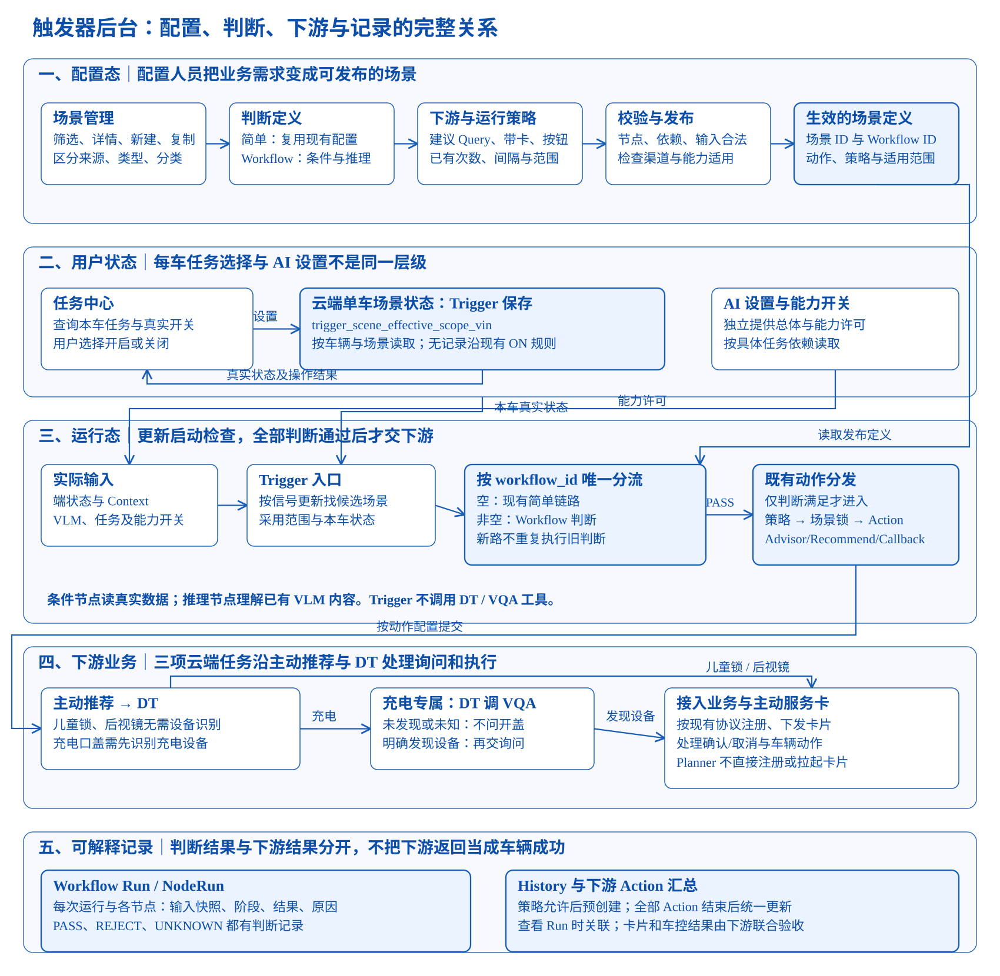
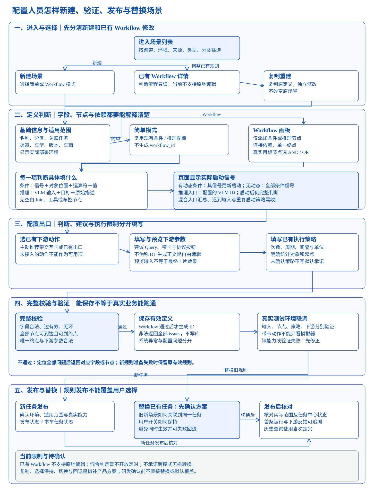
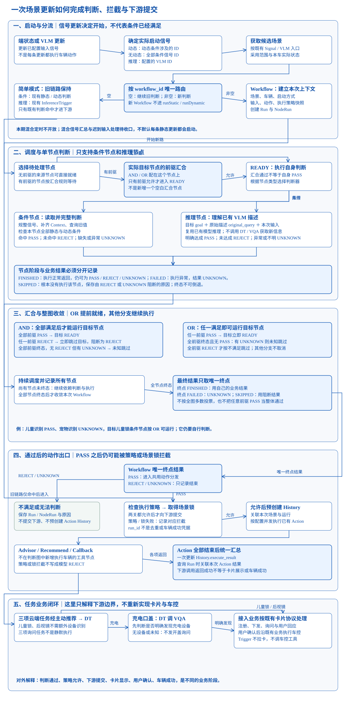
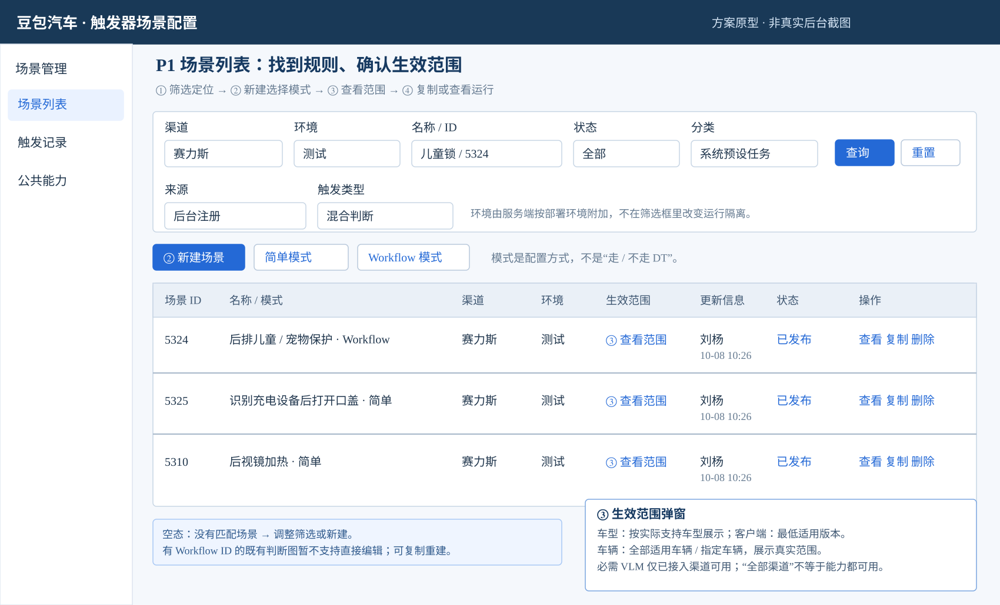
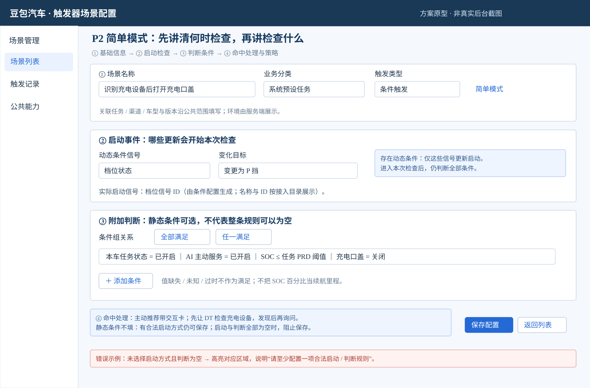
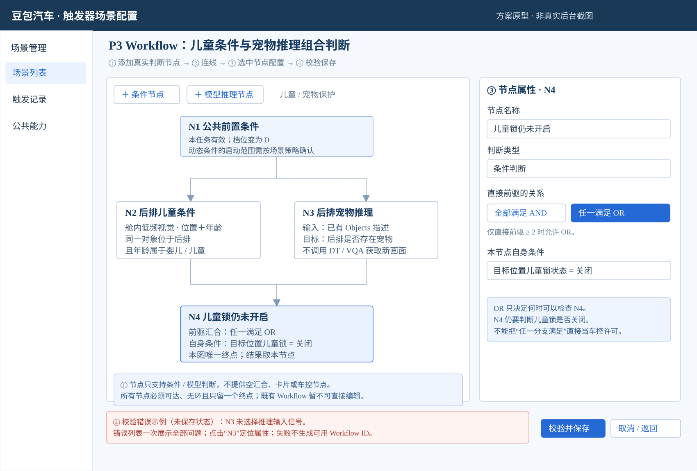
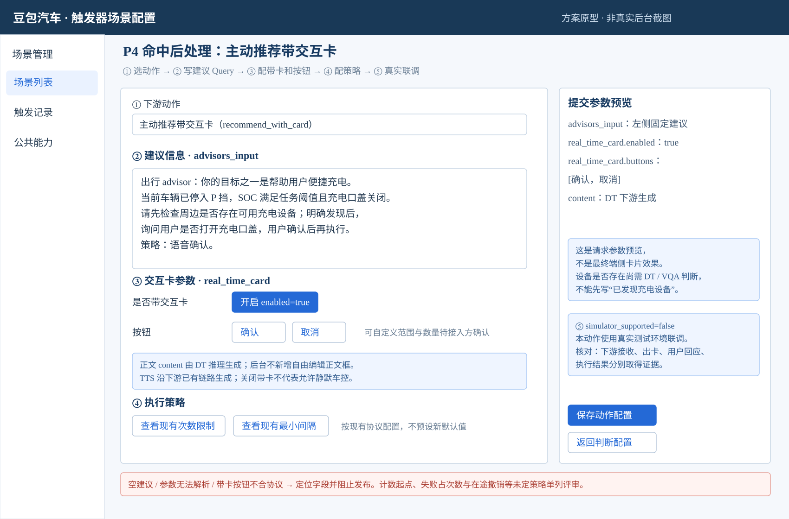
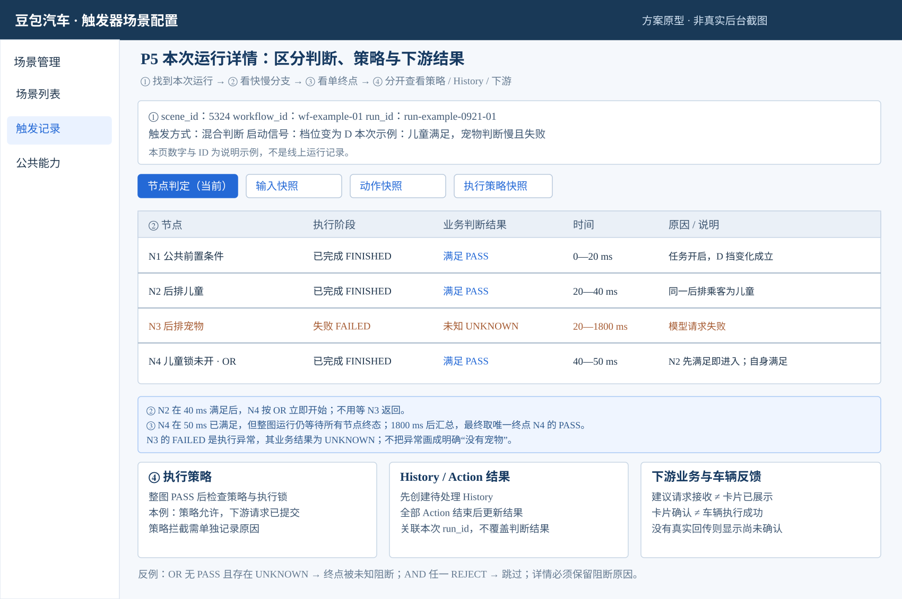

# 触发器后台优化：完整图文评审 PRD

版本：v05｜核对日期：2026 年 10 月 8 日｜文档状态：产品评审稿

本版保留原四项后台需求和八章结构，补齐系统预设场景的配置页面、判断 Workflow、运行分支、卡片参数、真实任务案例及验收。图示和页面原型用于评审，不代表线上界面或已完成开发。

依据分为两类：**技术已设计**指《【触发器支持系统预设场景】技术方案》已明确的内容；**产品补充要求**指本次新增的页面交互与业务约束，需纳入评审。技术设计、需求评审通过、功能实现和上线验收分别核对。

技术依据：[本轮技术方案](https://bytedance.larkoffice.com/docx/F7uVdVMqGoSE1rxInuucFbUynbf)。原需求依据：[触发器后台优化点](https://bytedance.larkoffice.com/wiki/N2ETwfkdNiM4p2k2gFhcF6iBnvd)、[系统预设任务 PRD](https://bytedance.larkoffice.com/wiki/R1OLwyfpTijHw7kQtnbcoZB4nff)。历史会议链路要求保留，但技术稿、AI 整理稿均不替代原始逐字稿。

## 一、背景与目标

### 1.1 配置人员遇到什么问题

配置人员需要把业务需求写成规则：收到什么更新时开始检查、还要满足什么、满足后交给哪个业务、多久允许再次提醒。目前平铺条件难以表达“车辆条件成立，而且儿童或宠物至少存在一种”的关系；配置页面也容易把启动信号、当前状态、任务开关和卡片内容混在一起。结果是页面能够保存，但规则可能不检查该检查的变化、误拼不同乘客的信息，或者向下游提交不完整建议。

新增 Workflow（判断工作流，即把不同判断按依赖关系连接起来）解决的是条件判断与模型理解已有视觉描述的组合。它不等于将 DT 工具调用、用户回答、卡片生命周期与车辆动作拖入同一张触发器画布。Trigger（触发器）决定这一次是否应该提出业务建议；下游业务继续处理询问、工具调用和执行。

### 1.2 原四项需求完整保留

| 原需求 | 用户实际需要 | 产品要求与边界 |
| --- | --- | --- |
| 去掉静态条件必填限制 | 有合法启动规则但无需附加当前状态时，不为保存而凑条件 | 静态条件非必填；存在合法启动与判定语义时允许保存。启动与判定全部为空的无约束规则仍拦截；不能用此要求绕过 Workflow 节点配置校验 |
| 支持场景复制 | 相似场景复用主要配置，减少重复填写 | 复制生成独立场景，保留所需条件、动作和运行策略；名称与标识需避免冲突。运行记录、计数、发布状态、单车用户选择不按普通配置复制 |
| 指定泳道生效 | 联调或灰度只作用于指定运行环境 | 页面新增实际泳道范围；未命中泳道不生效。明确空泳道含义和运行侧消费方式，保护默认线上行为，不能仅增加显示标签 |
| 按测试／正式标签筛选 | 找到待验证场景，区分测试与正式 | 支持单独与组合筛选，分页保留筛选条件，列表标签与服务端实际环境一致；筛选和修改标签不能改变实际部署范围 |

### 1.3 本期目标与衡量方式

本期评审同时覆盖配置效率与系统预设任务接入：场景分类与范围、简单／Workflow 两种模式、当前所需条件和模型节点、主动推荐带交互卡、执行策略边界与节点运行记录。产品要能够按一套页面流程配置儿童锁、充电口盖和后视镜加热的可接入分支；测试要能够说明何时检查、哪一步通过或失败、是否向下游发送。

验收看原四需求和真实场景正反例是否跑通，不以新增字段、节点数量或图示是否漂亮衡量。配置步骤与耗时可在改造前后实际记录，不预设下降百分比。后视镜缺少信号的分支先明确阻塞条件，不能为凑齐三项任务而宣称全部可发布。

### 1.4 用户与任务

主要用户是配置规则的产品／业务人员、接入研发与联调测试。车主通过任务中心选择本车是否使用某项任务；后台人员发布或停用规则，是另一项操作。

配置人员需要完成新建／复制、查看依赖、填参数、检查错误、在目标环境验证。测试需要查看本次运行和对照预期。研发需要核对哪些技术已设计、哪些实际已支持、哪些缺页面或运行能力；本文不为每个业务另建一条专用链路。

## 二、整体方案与职责

### 2.1 总体架构与产品边界

阅读重点：后台定义规则与范围；端状态和 VLM 提供判断依据；账号配置提供相应能力开关；任务中心修改单车场景状态。Trigger 把这些依据用于本次判断，满足后通过既有动作出口交给主动推荐／DT。DT（下游模型处理与工具调用链路）继续处理业务建议；VQA（视觉问答能力）按需获取新视觉信息。

| 模块 | 谁做什么 | 本次边界 |
| --- | --- | --- |
| 配置后台 | 定义场景、判断图、动作参数、策略及适用范围；展示校验和记录 | 不直接执行车辆动作，不自行持有用户单次确认结果 |
| 信号与 Context | 提供端状态、已接入视觉内容及补齐所需当前信息 | 页面选择必须匹配真实信号、值域和渠道；Context 是业务当前信息，不能当成无限时效的缓存 |
| Trigger／Workflow | 根据启动信号开始检查，运行条件或模型节点，得到最终 PASS／REJECT／UNKNOWN | 模型节点理解已有 VLM 描述，不编排 DT 调 VQA；图内只有条件与推理两种判断节点 |
| 账号／车辆开关配置 | 提供 AI、主动服务等开关目录与真实值 | 目录默认值与实际查询结果分开，查询失败不冒充开启 |
| 任务中心与单车场景状态 | 展示预设任务，设置某车某场景开启或关闭 | 云端状态持久化与默认值已有技术设计；多场景对应一任务的同步关系单列评审 |
| 动作分发 | 在最终 PASS 后检查现有策略、取得场景执行锁并调用既有出口 | Action 成功仅证明对应出口返回的调用／受理结果，不证明下游业务或车辆执行完成 |
| 主动推荐／DT 与接入业务 | 接收建议、生成交互内容、承接询问和既有执行链路 | 云端无需新增 VQA 的任务仍走 DT；端侧天气按原业务本地闭环 |
| 运行与动作记录 | 保存本次判断、节点结果、快照和动作汇总 | 仅展示实际保存或回传内容，无回传不虚构卡片展示或车控成功 |

儿童锁的结构化儿童分支可以直接比较位置和年龄，宠物分支仍需模型理解物体描述。二者都属于命中前判断。儿童锁或后视镜无需新增设备 VQA，不等于命中后绕开主动推荐／DT。充电口盖则在命中后由 DT 调 VQA 检查充电设备，明确发现后才询问。

### 2.2 配置与发布流程

用户先找已有场景或新建，选择模式、分类和范围，配置判断并查看实际启动信号，再填写动作与现有策略。页面校验帮助定位错误；服务端完整定义校验决定是否生成可用 Workflow。目标环境真实验证后，按平台发布机制生效。

技术已设计：定义非法时一次返回全部问题，不生成 workflow_id、不写定义；合法时生成独立 workflow_id 并提交不可变定义。产品补充要求：前端保留失败时的输入，定位字段／节点／连线，并展示“定义保存”“场景关联”“发布”“实际生效”各自结果。草稿、审批、回退的具体入口沿平台现状收口，不在图中虚构已存在的能力。

### 2.3 运行与异常流程

收到指定信号更新后，先获取候选场景，再按 workflow_id 分流。没有 workflow_id 继续原简单逻辑；有 workflow_id 由 Workflow 节点统一判定，不再次进入旧静态／动态判断链路。整图取唯一终点的有效结果。REJECT（不满足）或 UNKNOWN（无法判断）保留本次运行记录并结束；PASS（满足）才进入动作策略与执行锁检查。

OR 任一前驱通过，可以让目标节点立即开始自己的判断，但不会因此取消其他正在运行的分支。整图等待全部节点终态后归档并返回；首个分支通过不等于已经发送建议。该区别会影响提醒时机，画图与验收都必须保留。

技术来源：3.7.1、3.7.6、3.7.8、3.7.8.1。本文为业务说明，不展开数据库事务或调度代码教程。

## 三、场景管理页：找得到、分得清、能复用

### 3.1 列表原型与字段

P1 从筛选找到目标规则，范围用弹窗显示车型、客户端版本和车辆，避免全部挤进列表。页面原型属于产品补充方案；技术 3.8.1 已设计主要列、筛选、简单／Workflow 新建和已有流程只读限制。

| 字段编号 | 控件／字段 | 操作与数据规则 | 成功、失败与空态 |
| --- | --- | --- | --- |
| F01 | 渠道筛选 | 使用真实渠道清单；与能力和部署范围分别解释 | 无匹配展示空态；查询失败显示失败，不冒充零条 |
| F02 | 环境筛选 | 测试／正式支持单选与组合，读取服务端 tag | 筛选不修改环境；保持分页条件 |
| F03 | 名称／ID 查询 | 名称和准确 ID 提供清晰查询方式，不混作同一字段含义 | 非法 ID 定位输入；清空恢复当前其他筛选 |
| F04 | 发布状态筛选 | 展示规则生效、失效或删除的对应平台语义 | 不显示为本车任务开关 |
| F05 | 来源筛选 | source 表示注册来源，如 aidv_backend、aidv_task_service | 非预设不全部称为用户创建 |
| F06 | 类型筛选 | vehicle_resource、vlm_inference、timer、mix | 能力未开放的类型不能只靠筛选项宣布支持 |
| F07 | 业务分类筛选 | 全部／普通／系统预设，用 scene_category | 后台创建普通规则不自动进入预设列表 |
| F08 | 列表信息 | ID、名称、模式、渠道、环境、范围、更新人／时间及状态 | 模式由是否有关联 workflow_id 判断；详情补来源、任务关联 |
| F09 | 生效范围弹窗 | 点击范围查看车型、客户端版本、车辆范围 | 详情范围读取失败显示未取得；不能用空值冒充全车适用 |

筛选项平铺，多个筛选共同生效。刷新和翻页保留当前条件；无结果引导调整筛选或新建。查询失败允许重试并保留筛选。列表“开启”必须指明是规则状态，查看某车状态时另设明确区域，不能把两者叠成一个灯。

### 3.2 分类、类型与环境

source 是创建来源；scene_category 才表示 normal 普通或 preset 系统预设。存量默认 normal，不能用 source=aidv_backend 推导全部是预设任务。任务中心通过预设分类查询对应任务，技术正文写 scene_category=preset，接口当前列出的查询参数名为 category；页面文案与正式接口适配，避免把两个名称做成重复控件。

scene_type 表示条件、推理、定时或混合类型；简单／Workflow 是配置模式，两者不互相替代。mix 组合条件与推理，本期页面按技术前述范围不开放混合定时。技术后文 Timer 入口适配与前述范围的冲突集中在 8.2，不据接口预留增加可拖拽定时节点。

tag 由服务端按部署环境附加 test／formal，页面展示真实环境。泳道控制实际隔离运行，标签用于环境识别与筛选；改变标签不改变泳道。预设发布默认全渠道生效是技术设计，但场景仍必须满足真实能力及适用范围；所需 VLM 当前仅赛力斯接入，不能把其他渠道视为天然可运行。

### 3.3 新建与复制

新建入口先说明两种模式：简单模式复用现有规则；Workflow 模式适合组合条件与已有描述推理。取消模式选择不创建半成品。产品补充要求：复制打开为未发布的新配置，显示“来自哪个场景”的提示，要求核对名称、分类与目标范围后再生效；平台是否具备正式草稿实体见 8.2。

复制保留可复用条件、模型目标、动作参数、运行策略和范围输入，生成独立场景。跨渠道复制立即重新读取目标渠道能力，标出不可用字段，不能隐藏旧参数后继续发布。不复制运行记录、运行计数、原发布状态或单车关闭记录；复制对象的默认状态不能代替原任务的用户选择。

技术 QueryWorkflow 支持回显不可变定义和复制创建。复制成功分别展示新场景 ID 与新 workflow_id；定义创建成功而场景关联失败时，页面不得报“复制全部成功”，保留可重试信息并阻止发布未完整关联的场景。无需为此替研发决定孤立定义的清理机制。

### 3.4 只读 Workflow 的修改与替换

已有 workflow_id 对应的判断定义不可变，当前不支持原地修改。详情显示“判断流程只读”，可查看、复制；新建画布的编辑能力不能套到已有定义。基础信息、动作和范围是否可以单独改动，按 8.2 的正式范围开放相应入口。

业务需要修改判断时，复制原定义并创建独立新流程，重新校验与测试。替换必须避免同任务新旧规则同时有效，也不能在新规则准备失败时先关闭旧规则。任务／场景 ID 对应、原用户关闭如何保持、切换失败恢复集中在 8.2；未完成该规则前，不以“复制按钮存在”宣称线上替换已解决。

删除或停用前展示任务关联和影响，使用平台既有权限与操作机制。产品补充要求：历史仍能追溯当时定义，删除配置不自动删除用户选择。动态任务注册规则另显示注册方及注册／更新／停止／注销状态，编辑和停止遵守注册协议，不直接套人工规则权限。

## 四、场景编辑页：按一次配置的顺序组织

### 4.1 基础信息与范围

| 字段编号 | 字段 | 产品规则 |
| --- | --- | --- |
| F10 | 配置模式 | 简单／Workflow；模式切换先说明不能转换的内容，取消保留输入，无确定转换能力前不承诺无损双向转换 |
| F11 | 场景名称 | 必填，复制需核对；冲突按平台命名规则定位，不吞掉用户输入 |
| F12 | 业务分类 | normal／preset 独立配置，不从 source 自动推导；修改关联任务时解释影响 |
| F13 | 场景类型 | 按真实开放能力选择条件／推理／定时／混合；本期混合不开放定时节点 |
| F14 | 注册来源 | 显示实际 source，由注册入口与协议提供，不让用户借改来源冒充预设 |
| F15 | 所属任务／外部关联 | 说明任务 ID、场景 ID 和外部关联字段；一任务多规则应共享用户选择，而非重复创建多张任务卡 |
| F16 | 环境 | 只展示服务端实际 test／formal；发布目标入口与平台机制一致 |
| F17 | 渠道 | 渠道变化重新取能力清单，校验已有条件、单位、模型输入和下游出口 |
| F18 | 车型／客户端版本／车辆 | 使用平台既有范围定义；发布前展示实际范围，不把无权限读取冒充不限范围 |
| F19 | 生效泳道 | 目标泳道外不运行；空值默认范围与后端消费协议统一，见 8.2 |
| F20 | 运行位置 | 云端／端侧采用真实接入能力；不支持端侧下发时仅管理定义，不出现无效发布按钮 |

任务名称、副标题、排序与展示初始信息由任务定义统一提供，已有任务管理入口时本页关联并展示，不再维护第二份。新版规则不能覆盖用户关闭选择；单车场景状态已有保存设计，不把保存责任全部重新留作未知。

### 4.2 简单模式：启动与检查分别展示

页面依次显示基础信息、启动／动态条件、附加当前条件、动作与策略。例子“挡位从非 P 变为 P”描述一次变化；“当前挡位等于 P”描述当前状态，不能把持续上报 P 当成多次停车。

| 字段编号 | 字段 | 交互、校验与结果 |
| --- | --- | --- |
| F21 | 启动类型 | 条件变化、合法定时、已有 VLM 推理输入分别展示对应参数；不可配置不存在的组合能力 |
| F22 | 动态信号与变化规则 | 从目录选信号、对象及变化范围；缺旧值或无法判断的变化不冒充已发生 |
| F23 | 当前条件信号 | 选已接入信号，联动对象位置、运算符、取值与单位 |
| F24 | 运算符 | 使用该字段合法运算符；布尔、枚举、数值不共用任意文本比较 |
| F25 | 比较值与单位 | 值域／单位从目录读取；非法枚举或单位定位本项，保留其他配置 |
| F26 | 条件组关系 | 明示全部／任一及组间括号；保存前后可读摘要含义一致 |
| F27 | 实际启动信号清单 | 显示中文名、ID 和选取依据，由运行规则生成，不另维护第二份手工启动列表 |

技术 3.6 已设计启动规则：有动态条件时只用动态条件涉及的信号 ID 唤醒，进入后仍检查全部条件；无动态条件时用当前条件全部信号 ID；推理触发用推理配置指定的 VLM ID。这里的唤醒是启动本场景检查，不是一个场景调用另一场景。

静态条件允许为空，但需有合法启动和判断语义。条件、启动全部为空时拦截；Workflow 每个节点也必须存在合法配置，不能用“静态非必填”保存空节点。多个变化条件全部满足不代表已经支持先后顺序，持续时长、首次发生等仅按运行侧真实能力开放。

若儿童锁只由挡位变为 D 启动，车辆已在 D 后才识别到儿童，按该启动设计不会自动因静态年龄更新重跑。是否覆盖这一场景以及混合全图如何汇总启动信号，是具体业务选择，见 8.2；不能只写“满足就触发”掩盖漏提醒。

### 4.3 条件选择器：视觉、开关与输入有效性

#### 4.3.1 结构化视觉字段

技术 3.2 当前仅赛力斯接入：vlm_inside_001 为舱内低频，位置、性别、年龄支持结构条件；其余文字描述用推理。vlm_inside_002 为舱内高频描述，vlm_outside 为舱外描述，当前技术范围用推理判定。不能因 WeatherDesc 的内容类似枚举，就直接向条件控件开放未设计的舱外比较。

| 字段编号 | 字段 | 可选值与运算符 | 使用要求 |
| --- | --- | --- | --- |
| F28 | 视觉信号 ID | 条件选择器当前为 vlm_inside_001 | 其他描述转模型节点，不伪造宠物=true |
| F29 | 位置 position | 主驾、副驾、左后、二排中、右后、中控扶手区域；等于 | 位置是对象主键，和同一乘客的其他属性一起判断 |
| F30 | 性别 sex | 男、女、未知；等于、不等于、包含 | 未知作为真实枚举，不变成男或女；业务无需求不强迫添加 |
| F31 | 年龄 age | 婴儿、儿童、青中年、老年；等于、不等于、包含 | 年龄与位置来自同一 PassengerInfos 对象，不能跨乘客拼接 |

页面选择信号后读取目录元数据，再选位置和属性；包含比较可多选合法枚举。选主驾儿童年龄与后排成人位置不得拼成后排儿童命中。Context 中主驾区域映射为主驾、主驾后方为左后、副驾后方为右后、后方正中为二排中；原始示例年龄描述与规范年龄枚举分别展示，以归一化值判定。

技术已设计前端元数据与服务端字段／位置／年龄归一化。产品补充要求：字段旁解释对象关系，能力缺失时说明缺什么；保存失败定位非法枚举和运算符，详情与记录使用同一含义。更多位置组合按真实支持开放，不从主键单值示例推定所有跨对象组合。

#### 4.3.2 开关目录与单车任务状态

| 字段编号 | 字段 | 产品规则 |
| --- | --- | --- |
| F32 | 开关配置键 | 目录提供 config_key 和中文名称，例如 use_ai、use_static_advisor、use_always_on，不靠用户手写键 |
| F33 | 车／账号维度 | 按真实 data_type 语义和查询接口选择对应对象，不自行发明数字映射 |
| F34 | 开关运算符与值 | 读取 value_type、value_options 与合法 operator；当前示例布尔等于 true／false |
| F35 | 单车场景状态 | 通过 scene_id＋vehicle_id 查询／更新真实状态，界面区别规则全局发布与本车开启 |

技术 3.3 提供目录和按车／账号查询真实值的设计，示例 use_ai、use_static_advisor 默认 true，use_always_on 默认 false。目录默认值不能在查询失败时当作实际值；某场景究竟依赖哪些许可，按业务需要配置，不把所有任务默认绑上全部开关。

**云端单车状态已有确定设计。**任务中心调用 UpdateSceneStatusForVehicleRequest 更新某车某场景；技术 3.9.2 复用 trigger_scene_effective_scope_vin 持久保存状态，1 开启、2 关闭，无记录时默认开启。本文写这个存储名是为了明确已有保存方与默认语义，不要求配置人员理解表结构。首次读取成功且确无记录应显示开启，不能再列为完全未知。

“确无记录”与“没读到”不同：查询失败时显示状态未取得，不能套用无记录默认开启；更新失败不能显示假关闭。产品补充要求：点击开关时显示处理中，成功回读再展示真实状态，失败保留原值并提示重试；关闭成功后该场景不产生新触发。重新查询、重启或规则普通更新不能把已保存 OFF 抹成无记录 ON。

全局规则发布、全渠道范围、单车场景状态、AI 总开关、主动服务许可与单次用户确认分层处理。单车无记录默认 ON 不等于用户同意本次开盖或开儿童锁，仍按下游确认策略询问。云端状态已有持久化方案，端侧天气的本地保存与通知协议仍单独接入；不能把云端结论直接套到端侧。

#### 4.3.3 缺失、未知、过时

0 是数值，关闭是布尔或枚举，未知／未收到／过时是有效性问题，四者分别表示。未知不满足业务前置，不允许默认改成正常。条件执行器对规则明确未命中返回 REJECT；配置解析失败、Context 查询失败、信号缺失或超时返回 UNKNOWN。过时阈值与采集范围按协议收口，不自行给全部信号设统一秒数。

单位沿现有上报协议展示原始单位、配置单位及必要转换。5 km 与 5000 m 应判断一致，多座位与多车窗按对象区分，局部更新不能清空其他对象。时间条件解释时区、统计范围和重置条件；地理条件解释地点来源、距离单位及导航距离／坐标距离。

### 4.4 模型推理节点与判断画布

#### 4.4.1 节点填写与结果

| 字段编号 | 字段 | 输入与校验 |
| --- | --- | --- |
| F36 | 节点名称 | 用户可读名称，便于详情和记录定位；节点 ID 由系统维护 |
| F37 | VLM 输入 | 选已接入信号 ID，展示低频／高频／舱外及内容范围；空或不可用阻止保存 |
| F38 | 判定目标 goal | 描述这一步要判断什么，例如后排物体描述是否包含宠物 |
| F39 | 原始判断描述 original_query | 填判断所需业务描述；不把提示词当作缺信号替代方案 |
| F40 | 结果与依据预览 | 展示输入用途和结果三态说明；运行后查真实摘要，不用配置预览伪造模型结果 |

技术 3.7.7.2 将 goal、original_query 与本次已有 VLM 内容组合后调用现有推理能力。该模型节点不获取新画面、不调 DT/VQA。明确达成返回 PASS，明确未达成返回 REJECT；推理配置／VLM 输入缺失、调用失败、流读取失败、响应无法解析或超时返回 UNKNOWN。

产品补充要求：结果必须互斥无歧义，验收“未达成”“无法判断”不会因含某关键词被判 PASS。技术文字有“响应包含达成”的表达，不能仅凭这句话判定实现已有 bug，也不能跳过负向解析验收。没有湿度、温差或洗车退出输入时，提示词不能凭空补出这些事实。

#### 4.4.2 画布操作与定义校验

| 字段编号 | 控件／字段 | 操作与约束 |
| --- | --- | --- |
| F50 | 添加节点 | 仅条件 condition／推理 inference；每节点必须且只能有一种判断配置 |
| F51 | 节点属性区 | 选中节点显示对应参数；类型变化提示不兼容输入，不隐藏后继续提交旧值 |
| F52 | 连线 | 表示前驱判定依赖；删除节点时同步处理相关连线并提示影响 |
| F53 | 前驱汇合 join_type | 配在目标真实判断节点，默认 AND；至少两个直接前驱才开放 OR；起点按 AND |
| F54 | 错误清单与定位 | 一次展示全部服务端 issues，点击定位节点／连线／属性；失败保留输入 |

连线不是端信号先后发生的时序能力。画布不能添加空白汇合节点、Timer、卡片确认或车辆动作判断节点。单终点必须是有真实条件或推理配置的节点，不能用“结束框”替代执行器；展示型终点标识不作为额外运行节点。

技术 3.7.4 定义校验：node_id 非空且唯一，配置二选一；join_type 只允许 AND／OR，未传默认 AND，OR 至少两个前驱；连线两端存在，无自环、重复边和循环；只能一个终点，所有节点从至少一个起点可达且能够到达终点。失败返回全部问题，不生成 workflow_id，不写定义。

产品补充要求：未保存离开提示保存或放弃，取消离开保留输入；服务端系统错误与业务校验错误分开显示，不把网络／数据库错误标成图结构非法。新建保存成功展示独立 workflow_id，并确认场景关联结果；已有定义只读规则见 3.4。

#### 4.4.3 AND／OR 与三态：按已设计规则验收

| 汇合 | 前驱情况 | 目标节点怎样处理 |
| --- | --- | --- |
| AND | 全部直接前驱 PASS | 进入 READY，可开始自身判断 |
| AND | 任一前驱 REJECT | 立即 SKIPPED，阻断结果 REJECT |
| AND | 全部前驱终态、无 REJECT、存在 UNKNOWN | SKIPPED，阻断结果 UNKNOWN |
| OR | 任一直接前驱 PASS | 立即 READY，不等其他前驱才放行；随后仍判断自身配置 |
| OR | 全部前驱终态、无 PASS、存在 UNKNOWN | SKIPPED，阻断结果 UNKNOWN |
| OR | 全部前驱 REJECT | SKIPPED，阻断结果 REJECT |

上述为技术 3.7.6.1 明确设计，不再列作三态建议。FINISHED 表示执行器正常返回，结果仍可 PASS／REJECT／UNKNOWN；FAILED 表示执行异常，结果固定 UNKNOWN；SKIPPED 表示未执行，需展示 REJECT／UNKNOWN 的阻断依据。失败不等于明确无儿童或无宠物。

目标被允许运行／阻断不等于取消其他在跑分支。技术 3.7.6.2 调度直到全部节点终态，再归档整图。最终取唯一终点的有效结果：完成取其结果，失败取 UNKNOWN，跳过取阻断结果；不按通过数量投票。终点 PASS 时，另一分支 UNKNOWN 不自动改写整图结果。

整图超时时技术将运行节点收敛为 FAILED，等待／可运行节点收敛为 SKIPPED，并按 UNKNOWN 解释异常；迟到完成事件不能覆盖已经形成的终态。最终记录写入重试不重新运行节点。超时时长和业务是否需重试集中在 8.2，不能从归档重试推出模型无限重试。

#### 4.4.4 儿童与宠物：可表达的具体图

P3 使用四个真实判断节点：N1 公共条件 → N2 后排儿童条件／N3 后排宠物推理 → N4 目标儿童锁未开启。OR 配在 N4，N4 的两条直接前驱允许儿童或宠物任一满足后开始锁状态判定。N4 不是空白汇合，也不是开锁动作；锁状态自身仍必须满足。

该拓扑为产品示例：N1 先检查任务许可和合法挡位变化，避免公共条件不满足仍启动宠物推理；N2 检查同一后排对象的位置与年龄；N3 使用 Objects[].Desc。实际启动信号汇总、目标锁与座位映射按正式目录和 8.2 收口，不把示例拓扑当技术已经完整覆盖的每个业务配置。

### 4.5 命中后处理与带卡动作

选择已接入动作后，只显示该动作所需字段。主动推荐传业务建议；业务事件传已定义事件与接收参数；事件日志传事件 ID、来源、模板及信号／位置。切换类型提示不兼容配置，缺接收方或必填参数阻止发布。三种出口保留场景与本次命中关联，不向所有动作开放同一套模型／卡片字段。

| 字段编号 | 页面字段 | 正式参数／规则 | 校验与反馈 |
| --- | --- | --- | --- |
| F41 | 动作类型 | 新增 recommend_with_card，保留已接入原动作 | 动作不受当前渠道支持时禁用并解释；不自行新编车辆执行 |
| F42 | 建议信息 | advisors_input，固定建议 Query | 非空，明确目标、已知依据和下一步；不能把未识别设备写成已发现 |
| F43 | 是否带交互卡 | real_time_card.enabled | 显式配置；关闭带卡不代表允许静默车控，三项询问任务按现有确认策略 |
| F44 | 按钮 | real_time_card.buttons，技术示例确认／取消 | 显示协议允许按钮；非法参数定位本项，数量与可定制范围见 8.2 |
| F45 | 卡片正文及请求预览 | content 由 DT 推理；预览本次请求参数 | 无新增正文／TTS 自由编辑控件；请求预览不等于最终端侧卡效果 |

技术 3.4 的 real_time_card 为字符串参数，包含 enabled 与 buttons。产品补充要求：用控件生成准确序列化内容，不要求配置人员手写 JSON；空建议、解析失败、带卡缺必需按钮均阻止发布。动作切换或 enabled 变化提示受影响配置，按正式协议保留／清理；不能静默携带隐藏旧值。

固定 Query 沿既有链路表达：“[类别]advisor：你的目标之一是[业务目标]，[当前依据与建议]。策略：语音确认。”传入 advisors_input，不为相同语义另虚构必有独立策略字段。儿童锁和后视镜可以提交已知依据下的开启建议；充电应先建议检查设备，明确发现后再询问开盖。

recommend_with_card 的 simulator_supported=false。页面显示“需真实测试环境联调”，配置预览只能验证提交结构；卡片正文由 DT 生成，按钮／语音回应和执行结果依既有接入链路分别取证。端侧天气由业务接事件并处理即时卡回应，不经过 DT；无端侧规则下发能力时只管理定义和交付版本，不出现假发布。

事件日志说明哪个对象发生什么变化，不把歌曲变化写成用户点击下一首。合并按事件定义，不设统一 30 秒窗口；事件日志说明业务发生了什么，运行记录解释规则为何命中，两者分开。

### 4.6 执行策略：判定通过后仍可能不发送

| 字段编号 | 字段 | 产品规则 |
| --- | --- | --- |
| F46 | 次数与统计范围 | 显示平台真实支持周期、统计对象及重置方式，不预设统一次数 |
| F47 | 最小间隔 | 数值带单位、起点说明；失败是否计数按已核验现有策略，变化项见 8.2 |
| F48 | 重复与并发处理 | 区分重复输入、同任务多规则与不同任务；执行锁是场景锁，不推定已有跨任务去重 |
| F49 | 关闭及反馈策略 | 关闭停止新触发；已排队／已展示／已下发由承接业务处理；单次取消不自动关长期任务 |

技术 3.7.8.1 已明确 PASS 后共用动作分发：检查策略、获取场景执行锁、预创建 History，执行 Advisor／Recommend／Callback 等既有出口，全部动作结束后一次更新 execute_result。REJECT／UNKNOWN 不进入动作出口，仍有 WorkflowRun。

技术 3.9.4 允许重复请求产生新的 run_id。运行次数不等于提醒次数，验收不能要求相同更新永远只有一条 Run；应检查现有策略／锁是否拦截重复下游请求。多规则共用一个任务是否合并、失败计数、模型重试等是具体策略缺口，见 8.2，不默认全平台只执行最高优先级一条。

分别解释采样周期、条件持续时长、触发间隔、提醒频控及日志合并窗口，不能一个“间隔”控制所有环节。拒绝或超时是否抑制后续需真实反馈和周期，不默认拒绝三次自动关闭。

### 4.7 三项任务的配置方案与正反例

#### 4.7.1 儿童锁

业务目标是在合法挡位变化和许可成立时，对后排儿童或宠物提出目标儿童锁开启建议。技术 3.1.1 列挡位变为 D、后排儿童／宠物、锁未开启；本次后台不能自行新增目标锁或把所有锁一律开启。位置映射与任务许可进入公共条件或真实终点。

儿童分支用舱内低频的同一乘客位置与年龄；宠物分支对 Objects[].Desc 做推理。通过后向主动推荐／DT 提交：“当前合法行驶变化后识别到目标后排儿童／宠物，相关儿童锁未开启，建议询问是否开启对应儿童锁。策略：语音确认。”具体对象、位置和事实只能引用真实本次结果。

正例：N1 公共条件满足；N2 右后儿童满足；N3 宠物推理失败为 UNKNOWN；N4 右后对应儿童锁未开启为 PASS。N4 在 N2 通过后可运行，整图待 N3 结束归档，最终为 N4 PASS；策略允许才提交建议。无需为此新增 VQA，不等于不走 DT。

反例：主驾年龄儿童而右后乘客成人，不满足后排儿童；两分支 REJECT 时不下发；无 PASS 且一分支 UNKNOWN 时不误认为存在对象。目标锁已开启，N4 REJECT；任务 OFF 时不发新建议。先进入 D 后才识别到儿童的补提醒需合法启动设计，不把静态条件变化暗称已有入口。

#### 4.7.2 充电口盖

技术案例：挡位变为 P、主动服务开启、SOC 不高于 20%、口盖关闭。SOC 使用电量百分比，不等于剩余里程；20% 为案例阈值，最终沿场景 PRD 口径。单车任务状态作为有效任务约束，不能仅以账号主动服务开关代替。

Trigger 通过前置后提交：“当前停车，SOC 为本次真实百分比，充电口盖关闭，请先判断周边是否有充电设备，明确发现后询问是否打开口盖。策略：语音确认。”设备尚未识别不能写“已发现充电设备”。DT 调 VQA 进行设备判断；这段在下游，画布不增加 VQA／确认／开盖节点。

正例：进入 P、真实许可及任务状态允许、电量低于已确认阈值、口盖关闭，Trigger 提交正确建议；DT/VQA 明确发现设备后询问；用户确认才沿既有链路执行。证据分别覆盖 Trigger 判断、设备判定、卡片／语音询问与真实回应。

反例：电量高于阈值、口盖已开、任务 OFF 不提交；SOC 缺失不能当 0；无设备或 UNKNOWN 不进入开盖询问，用户取消不执行。询问期间离开 P 等变化由下游安全处理，不把安全要求删除，也不让 Trigger 回收 VQA 后重新编排。

#### 4.7.3 后视镜加热

技术案例雨天分支用当前 P、车速＜70 km/h 与舱外 WeatherDesc 下雨描述；通过模型节点判断天气，目标加热应未开启。技术明确加热状态需核对；P 与速度组合究竟对应停车还是行驶雨天，必须回场景需求收口，不能在后台另定。

产品配置方案是在真正有加热状态及合法启动、范围、天气输入后，提出“当前场景雨天、后视镜加热未开启，建议询问是否开启加热。策略：语音确认。”雨天 VLM 推理是 Trigger 的已有描述判断，无新增设备 VQA，但提交后仍走主动推荐／DT。

正例按已确认业务范围构造：真实加热状态 OFF、许可允许、有效舱外描述明确下雨，节点与终点 PASS，策略允许后询问。反例：无雨 REJECT、不知道天气 UNKNOWN、加热已 ON 不重复建议。缺状态输入时不能把未读到解释为 OFF。

退出传送带洗车未找到信号；湿度＞60%和温差＞5°无对应数据。这些分支保持不可发布，明确在 5.1 中记录缺口。没有真实输入不能借模型“估算”达成；P／速度关系未收口前，不宣称整个雨天分支已完成正式任务验收。

## 五、公共能力：页面选择与真实支持一致

### 5.1 当前依赖与阻塞分支

| 能力／分支 | 已知依据 | 页面与发布约束 |
| --- | --- | --- |
| 舱内结构条件 | vlm_inside_001 位置、性别、年龄及合法元数据 | 仅真实渠道可选；同对象关联；非法枚举与运算符拦截 |
| 宠物文字判断 | Objects[].Desc，需模型推理 | 不新增宠物布尔字段；输入缺失、调用失败为 UNKNOWN |
| 舱内高频／舱外 | 已有描述供推理；目前仅赛力斯接入 | 不凭表格字段样子开放未设计静态比较 |
| AI／主动服务开关 | 目录与真实值查询设计 | 配置键、维度、值域统一；查询失败不能用目录默认值代替 |
| 云端单车状态 | 持久状态 1 ON／2 OFF，无记录默认 ON | 成功无记录与读取失败分开；已有 OFF 保持，发布不重置 |
| 充电 SOC | 电量百分比案例 | 不混续航里程；阈值沿任务 PRD，输入缺失不当 0 |
| 后视镜加热状态 | 技术案例明确需核对 | 未具备真实状态前不发布依赖 OFF 的分支 |
| 退出洗车 | 技术未找到退出传送带洗车信号 | 信号接入前不画成可运行分支 |
| 湿度与温差 | 技术无相应数据 | 不凭提示词补事实；输入接入或需求调整后独立验收 |

### 5.2 同源目录与能力状态

页面读取同一能力目录，展示中文含义、来源、渠道／车型版本、对象位置、类型、值域、单位、比较方式、更新及有效性。先选渠道再取可用能力，缺少能力明确说明而非选择后静默失效。

分别展示协议已定义、运行侧已接入、后台可配置、场景已验证。字段出现在技术稿不是已经接入，页面能选也不是场景验收通过。能力调整提示受影响场景，删除或改值检查兼容，不使旧配置无声改变含义。

本期先补任务必需元数据、查询与页面引用。完整能力管理、导出和动态任务同源查询留作后续独立评审；AND／OR 不替代时间先后，持续 10 秒不等于间隔 10 秒。原子能力只列真实可复用项，不承诺本次建设整个端云管理平台。

## 六、测试、发布与运行记录

### 6.1 保存与发布的成功／失败

保存前检查名称、范围、合法启动、条件值域／单位、模型配置、图结构、动作必填与策略。前端帮助定位，服务端校验为最终依据；前端通过不意味着已生成可发布定义。

| 阶段 | 成功反馈 | 失败反馈与处理 |
| --- | --- | --- |
| 定义校验 | 全部图与节点配置合法 | 一次显示所有 issues，定位字段／节点／边；不生成 workflow_id、不写定义 |
| 定义提交 | 展示新 workflow_id，可查询同一定义 | 系统异常与业务非法分开；保留输入，不显示已完成 |
| 场景关联 | 展示 scene_id、模式及关联 workflow_id | 未关联完整不得发布；不拿定义成功冒充场景创建成功 |
| 参数与范围校验 | 展示实际环境、泳道、能力范围、最终动作参数 | 缺接收／按钮参数、目标能力不支持、范围不清晰阻止发布 |
| 平台发布 | 按真实机制返回发布结果与目标 | 不虚构审批或回滚；错误解释哪个阶段失败，沿已支持方式重试 |
| 实际生效核验 | 目标环境运行证据与非目标反例 | 保存／发布回执不替代运行证据；未取得生效证据明确未核验 |

配置试算只作为后续工具，真实带卡动作不支持模拟器，需实际接入环境联合验收。简单规则继续原链路，新增 Workflow 不自动迁移所有旧场景；候选后按 workflow_id 单路分流，回归旧行为和下游调用次数。高级脚本沿独立审查与测试，不因 AI 生成跳过检查。

### 6.2 记录入口与查询

简单场景保持原记录展示；Workflow 记录新增查看判断流程入口。技术 QueryWorkflowRun 已设计列表和按 run_id 精确查询节点，查询字段包括 run_id、workflow_id、scene_id、vehicle_id、结果、时间范围与分页。页面按授权提供相应查询，不把接口存在当所有输入已可向所有人员展示。

没有启动记录不能直接断言端侧没上报，需要结合接收证据；记录读取失败显示未取得记录，不虚构未命中原因。动态任务记录区分停止请求已发出与已完成，任务结束后定时残留可查；事件日志和规则运行原因仍分开。

### 6.3 本次运行详情原型

scene_id 对应业务场景，workflow_id 对应不可变判断定义，run_id 对应这一次运行。每次 Run 有独立 ID；重复请求可以新增 Run。历史打开当时的定义，结合本次输入、动作和策略快照，不使用当前最新配置改写过去结果。

| 区域 | 已设计或要求展示的内容 | 怎样读与边界 |
| --- | --- | --- |
| 运行摘要 | scene_id、workflow_id、run_id、时间、实际唤醒信号、最终结果 | 解释为何开始；不是每条接收信号都必有运行 |
| 输入快照 | 技术已设计 input_snapshot；业务要展示已实际保存的字段、来源及时间 | 0／关闭／未知分开，采集时间等具体内容以真实保存为准 |
| 动作快照 | 已设计 action_snapshot | 对照当次实际提交参数，不用当前修改后动作覆盖 |
| 策略快照 | 已设计 execute_policy_snapshot | 说明当次规则；策略放行／拦截证据按真实记录展示 |
| 节点图与表 | 节点类型、执行阶段、结果、reason、开始／结束时间 | PENDING 等待，READY 可运行，RUNNING 运行；FINISHED／FAILED／SKIPPED 与三态分开 |
| 阻断原因 | REJECT 或 UNKNOWN 的前置阻断说明 | 跳过节点没执行，不显示成自身明确不满足；接口不虚构已有独立 BlockedBy 字段 |
| 动作 History | run_id 关联及 history_execute_result | PASS 且策略允许后预创建；全部 Action 结束后一次更新汇总 |
| 下游展示／车辆结果 | 仅真实回传或联合验收证据 | 下游已接收不能显示卡片已展示或车辆已执行，无回传标不可追踪 |

P5 示例：儿童节点 40 ms PASS，OR 目标锁节点 50 ms PASS，宠物到 1800 ms 才异常 UNKNOWN。目标锁可先运行，整图仍等待宠物终态后归档；最终取锁节点 PASS。这个例子说明“一个分支可以早放行”与“系统什么时候下发”有区别，实际时长为示例，不是性能承诺。

技术已设计快照结构、节点记录和 History 关联；尚需收口的是实际快照内的具体内容、采集时效、摘要解释、保留时长与权限。策略拦截不冒充模型不满足；没有 History 不自动代表动作失败，可能本次未通过或策略不允许，须结合真实证据解释。

## 七、验收标准

### 7.1 整体门槛

列表能准确找场景；合法启动可不填静态条件而全空被拦截；复制独立且不带运行数据和用户选择；指定泳道实际隔离；节点、单位、位置和条件保存前后一致。当前正式任务必须具备可运行信号及合法下游，不把未接入后视镜分支作为完成范围。

模型结果与规则三态不误判；AND／OR 按已设计时机与终点有效结果运行；同场景不重复走新旧链路。云端任务保持确认口径，端侧不误走云端。每车真实 OFF 和无记录默认 ON 分开验证，保存失败不假关。

完成证据分配置保存、场景发布、生效、规则运行、下游接收、卡片展示与车辆执行。验收按实际能力分段提供，不能拿前一阶段替代后一阶段；真实带卡联合联调不以模拟器或请求预览替代。

### 7.2 40 个具体验收 case

| Case | 操作或输入 | 预期与取证 |
| --- | --- | --- |
| C01 | aidv_backend 创建 normal 场景 | 来源正确、分类普通，不仅因来自后台进入预设列表；查字段、列表及任务查询 |
| C02 | 渠道、类型、分类、测试／正式联合筛选后翻页 | 条件共同生效且分页保留；查询失败不是空结果，列表环境来自服务端 |
| C03 | 打开范围弹窗，读取车型／版本／车辆 | 正确显示详情；查询失败不变成不限车辆；与发布目标核对 |
| C04 | 合法动态启动、静态条件为空 | 允许保存并按合法变化运行；启动和判定全空仍拦截，前后端含义一致 |
| C05 | 有动态条件，仅静态信号更新 | 按既定启动清单不自动重跑；结合信号接收与 Run 查询证明 |
| C06 | 合法动态信号更新，但附加锁／电量条件不满足 | 开始检查且完整判定附加条件，不提交下游；不能只看动态通过 |
| C07 | 无动态条件，当前条件之一更新 | 使用全部条件信号启动并完整判定；实际 wake_signal_ids 可追溯 |
| C08 | 推理入口收到指定 VLM 更新 | 按配置 ID 判定；其他非启动输入不借此默认全图重跑 |
| C09 | 切模式后取消，或未保存离开后取消 | 保留原输入；无损转换未实现前不宣传支持；核验实际交互 |
| C10 | 循环、重复边、自连、无效端点、多个终点 | 保存失败一次定位全部错误，无 workflow_id、无定义写入 |
| C11 | 空 node_id、重复 ID、双配置 union、单前驱选 OR | 全部拦截；默认 AND、起点 AND；错误定位对应节点属性 |
| C12 | 定义校验成功，随后场景关联失败 | 不显示全部保存成功，不发布半成品；保留正确阶段与可恢复输入 |
| C13 | 打开已有 Workflow 并尝试改节点 | 判断图只读，无原地编辑入口；复制创建新定义，原定义保持 |
| C14 | 跨渠道复制到无必需视觉能力范围 | 标出不可用依赖并阻止该分支发布，不暗带旧信号继续运行 |
| C15 | 任务旧场景 OFF，复制重建并替换 | 不把新场景无记录 ON 当作用户选择；避免双重提醒，验证 ID／状态及替换恢复规则 |
| C16 | 单车真实查询成功，确认无记录 | 按技术设计显示 ON；可运行仍需许可、范围、条件与单次确认，不等于自动执行 |
| C17 | 单车已有 OFF，刷新／重启／普通规则更新 | 仍 OFF，不清空或用目录默认覆盖；查持久状态及新触发结果 |
| C18 | 状态查询失败；关闭更新失败 | 查询失败显示未取得，更新失败保留真实原值，不显示假关闭；不能套无记录 ON |
| C19 | 关闭更新成功后再次出现合法启动 | 无新触发；已在途请求按约定下游策略，不能凭新触发停止证明撤回成功 |
| C20 | 同次候选重复请求，均判 PASS | 可有多个不同 run_id；策略／场景锁按既有能力拦重复请求，不能要求只留一条 Run |
| C21 | AND 一前驱 REJECT，另一仍运行 | 目标立即 SKIPPED，阻断原因解释为 REJECT，不要求接口新增 BlockedBy 字段；另一前驱真实收敛，整图最终取终点 |
| C22 | AND 前驱 PASS＋UNKNOWN，无 REJECT | 待全部前驱终态后目标按 UNKNOWN 跳过；无误下发 |
| C23 | OR 前驱 PASS，另一慢或 UNKNOWN | 目标立即 READY并执行自身条件，不取消另一分支；整图待全部终态，结果取终点 |
| C24 | OR 全 REJECT；或 REJECT＋UNKNOWN | 全 REJECT 按 REJECT 跳过；含 UNKNOWN 且无 PASS 按 UNKNOWN 跳过；可查阻断 |
| C25 | 模型缺输入、调用失败、未达成／无法判断或不可解析 | 明确未达成 REJECT；缺失／失败／不可解析 UNKNOWN；负向文本不误 PASS，节点与请求证据一致 |
| C26 | 整图超时，之后收到迟到完成事件 | 按既定状态收敛，迟到事件不覆盖终态；记录写重试不重新运行节点；按实际时长配置测试 |
| C27 | 儿童在右后且年龄儿童，合法 D 变化，锁 OFF | 同对象儿童条件及目标锁通过；策略允许后正确建议与确认，不直接开锁 |
| C28 | 主驾儿童年龄、右后成人位置；或两分支均无对象 | 不跨对象拼接，明确不满足不下发；核验对象依据与终点结果 |
| C29 | 儿童 PASS、宠物失败 UNKNOWN、目标锁 OFF | OR 目标继续，终点 PASS，待所有节点结束后按策略提交；宠物失败不解释成没有宠物 |
| C30 | 已在 D 后才识别儿童 | 当前仅 D 动态启动设计下不自动再查；若业务选择补提醒，依据最终启动清单验收，不能假称已支持 |
| C31 | 后排对象满足但目标锁已 ON 或本车任务 OFF | 锁 ON 条件不满足；任务 OFF 不产生新建议；下游无重复请求 |
| C32 | 进入 P、真实开关许可、SOC不高于最终阈值、盖关闭，覆盖恰好等于阈值 | Trigger 只交已知依据与设备检查建议；DT/VQA 发现设备后询问，用户确认才沿既有链路执行 |
| C33 | SOC缺失／超过阈值／口盖已开 | 缺失不当 0，明确不满足不提交；百分比不混剩余里程 |
| C34 | Trigger通过，DT/VQA 无设备／UNKNOWN，或用户取消 | 不误进入开盖执行；设备不确定不写已发现；下游确认和动作证据分别取 |
| C35 | 后视镜正式收口的雨天范围、加热 OFF、有效下雨输入 | 模型／终点 PASS且策略允许后语音确认；无额外 VQA仍经过主动推荐／DT |
| C36 | 无雨、天气缺失／模型失败、加热 ON或状态缺失 | REJECT／UNKNOWN分别记录，无错误建议；未读到加热状态不当 OFF |
| C37 | 发布洗车退出、湿度／温差分支但没有输入来源 | 缺真实能力阻止发布或明确不进入本期；不以提示词估算补出事实 |
| C38 | recommend_with_card 保存与实际测试环境联调 | advisors_input、enabled、buttons准确透传，content由DT生成；参数预览非最终卡；询问回应分段验收 |
| C39 | 带卡建议为空／参数不合法／按钮缺必填；关闭带卡 | 定位字段并阻止非法发布；enabled=false不自动变静默执行；不提供错误模拟器验收 |
| C40 | 流程PASS但策略拦截；允许回合再查历史与回归简单场景 | 拦截无下游且不写成模型失败；允许回合History全部动作结束更新；回读当次快照，新旧路由单次判定，卡片／车控无回传不虚构成功 |

尚未决定的业务选择先按 8.2 收口，再补对应最终预期，不把“待确认”判成通过。上述技术设计 case 在真实实现中核验，表格不是已经执行的测试报告。

## 八、实施范围与评审待定项

### 8.1 范围与实施方式

本次评审保留四项基础需求，并纳入系统预设任务判断能力：分类／范围、简单与 Workflow 模式、条件／推理及结构校验、实际启动信号、视觉与开关元数据、单车真实状态、主动推荐带卡、现有策略边界和必要运行详情。先核对实际已支持、只缺页面和运行侧也缺三类，再分批排期，不默认全部同期上线。

技术已明确的 AND／OR 三态、只读定义、云端持久状态与无记录默认 ON、快照和 History 关联不重复列作完全未知。实现验收仍需真实环境回读。后视镜缺少信号分支独立标阻塞，不使已接入儿童／充电能力因为长清单而失去可验收边界。

后续独立评审：完整能力管理平台、动态任务同源导出、条件试算、更多版本差异与观测，端云统一配置、端侧脚本下发／热更新、DT 全工具编排和全车控看板。无损模式转换、已有 Workflow 原地编辑、混合定时也不作为本期已有支持承诺。

### 8.2 仅保留真正未决事项

| 未决项 | 已知结论，不再重问 | 本次应带回的具体决定 |
| --- | --- | --- |
| 范围与实际交付 | 已有Workflow设计、simple／Workflow模式及只读限制 | 哪些实际实现、仅缺页面、缺运行能力；本期分批范围与正式研发负责人，不以技术接口人自动认领 |
| 定时范围与模式对应 | 技术1.3混合暂不支持定时；3.7.8有Timer适配；无定时判断节点 | Timer适配是预留还是本期可用；简单／Workflow可创建类型；无损模式转换是否不开放 |
| 混合启动与数据时效 | 单条件／推理启动规则及候选后单路分流已明确 | 全图从哪些节点汇总信号、D后才识别儿童的业务选择；补齐来源、各字段采集时刻与过时阈值 |
| 三任务信号与业务定义 | 位置／年龄同对象、宠物caption推理、SOC百分比、后视镜缺信号 | 目标锁位置映射、SOC最终阈值；后视镜P与车速业务含义、加热状态、洗车退出、湿度与温差的来源或延期 |
| 多规则任务关系 | 云端按scene_id＋vehicle_id持久更新，1ON／2OFF／无记录ON | 一任务多场景状态同步、首次列表回读入口、复制替换时ID映射与OFF保持；端侧天气状态链路单独对齐 |
| 替换与平台发布 | 原判断定义不可编辑、查询与复制已设计 | 基础信息／动作／范围可改范围；新旧规则切换、失败恢复、草稿／回退实际支持、删除权限及历史追溯 |
| 环境与适用范围 | 服务端附加tag，预设默认全渠道，VLM仅赛力斯接入 | 泳道空值及运行消费；无能力渠道任务展示／发布拦截／车辆限制的具体方式 |
| 卡片页面与协议 | recommend_with_card、advisors_input、enabled/buttons、DT生成content、模拟器不支持 | 按钮数量／自定义范围、enabled=false呈现、回应回传范围与真实联调入口；三项确认口径统一 |
| 执行策略与时限 | PASS后策略／场景锁／History路径已设计；重复可建新Run；AND/OR放行阻断时机已明确 | 次数对象周期起点、失败计数、同任务多规则去重、模型重试、整图／节点时限、关闭在途处置；慢分支耗时对提醒时机的取舍 |
| 数据展示与验收 | Run／NodeRun、输入／动作／策略快照和History精确关联已设计 | 实际输入与摘要内容、采集时间覆盖、保留／权限、阻断原因如何完整展示，下游真实反馈到哪一环 |

AND／OR、节点终态、单车状态保存和快照结构按已设计方案验收。上表仅保留尚影响业务范围、页面操作或联调结果的决定，评审后同步更新配置、图示与对应 Case。

### 8.3 图文与评审交付物

评审按三张架构／流程图说明职责与分支，再用 P1—P5 走列表、简单配置、Workflow、动作策略和运行详情。重点核对每页输入从哪里来、怎样联动、哪些错误会阻止保存、成功证明到哪一阶段。40个case覆盖原需求、三任务与异常，实际执行记录另行附上。

图文目录为相对资源，SVG是方案源图，不代表已实现界面。页面原型说明见[原型操作说明](图文PRD-v05/页面原型/原型操作说明.md)。技术、主任务PRD和后台要求出现口径差异时，集中在8.2收口，再更新字段、示例、图示与预期，不在未读到新证据时擅定默认值或分派工作。

### 8.4 依据与证据边界

本版技术字段及规则来自《【触发器支持系统预设场景】技术方案》：3.1任务案例、3.2视觉字段、3.3开关、3.4带卡动作、3.5分类、3.6启动、3.7调度与动作边界、3.8页面、3.9.2单车状态、3.9.4运行快照和3.10接口。主链路确认及端侧天气边界保留原PRD中的既有会议口径；本版不新增未核验会议结论。

本地文档与方案图用于可评审交付。线上页面是否可操作、配置是否生效、用户状态是否回读成功、卡片与车辆结果是否有真实回执，需要分别核验，不以“文档已补充”代替“功能已完成”。
