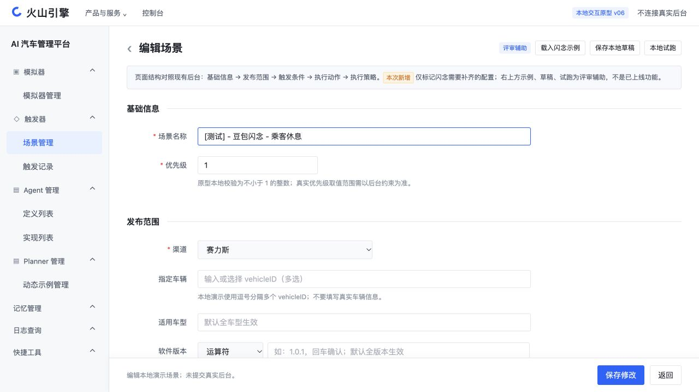
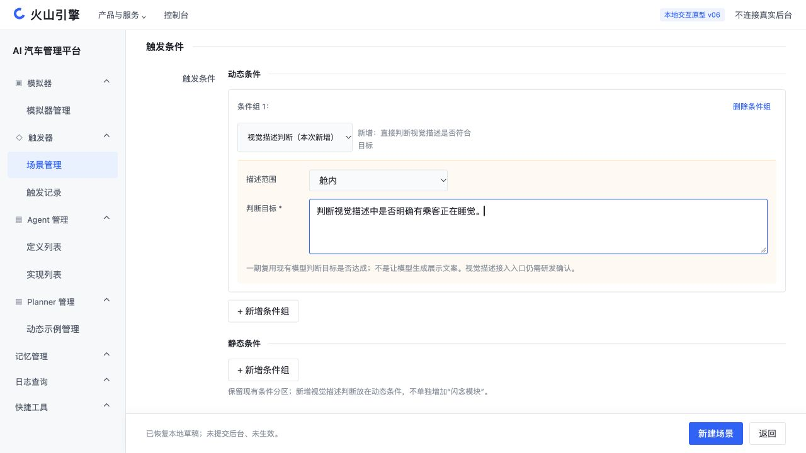
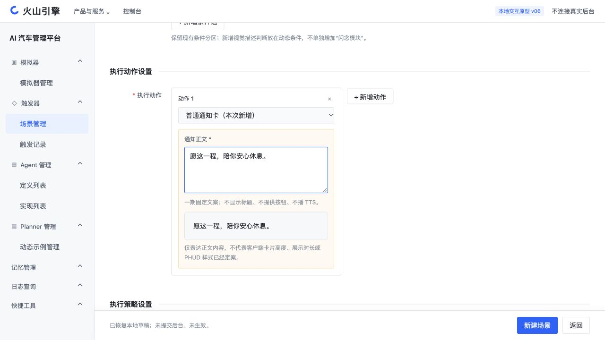

# 触发器配置平台交互原型 v06

## 这版改在哪里

本版依据当前火山引擎「AI 汽车管理平台」的场景管理、新建场景、触发记录页面调整。没有新增独立的闪念模块。没有提交或修改真实后台场景，也没有修改飞书 PRD。

交互文件：`/Users/bytedance/Desktop/3.23/产品/codex/HTML/02-已交付/触发器配置平台-交互原型-v06.html`。

## 1. 基础信息与发布范围

保留实际表单的场景名称、优先级、渠道、指定车辆、适用车型、软件版本。渠道选项按实页保留 AIDV主线、上汽DNA、赛力斯。原型中的车辆输入以逗号模拟多选；未核验的版本运算符及信号字典标为演示，不作为平台实际支持范围。

## 2. 触发条件：新增视觉描述判断

保留动态条件和静态条件的两块入口。动态条件类型下增加「视觉描述判断（本次新增）」，配置描述范围（舱内／舱外）和判断目标，例如“是否明确有乘客正在睡觉”。一期复用现有模型判断，不是使用模型生成通知文字。

实际条件组之间已见“且／或”选择，本版保留；它不表示事件先后。当前账号的赛力斯 VLM 信号菜单显示暂无数据，不据此推断全部渠道或模型没有能力。视觉描述的实际输入入口仍待研发确认。

## 3. 执行动作：新增固定文字通知

保留现有动作选择框，在现有选项之外增加「普通通知卡（本次新增）」。填写固定正文；不增加标题、确认／取消按钮和 TTS。命中后通过 Frontier 下发，不走主动推荐或 DT。正文预览只验证文案，不代表客户端高度、展示时长和 PHUD 视觉样式已经定案。

## 4. 执行策略

保留执行总次数、单次上电周期内次数、自然日内总次数、最小执行间隔。空次数表示不限。0 分钟 30 秒是本次观察到的后台默认值，不是会上已定的闪念间隔策略。

## 5. 怎么点击演示

1. 打开文件，点击右上角「载入闪念示例」。这些辅助按钮有明确标签，不冒充线上已有功能。
2. 修改判断目标和通知正文；点击「保存本地草稿」，刷新后可恢复。
3. 点击「本地试跑」，填写一段视觉描述，人工选择满足、不满足或无法判断。原型不调用真实模型。
4. 满足后分别模拟消息发送、端接收、实际展示。三者不能合并为一个成功结果。
5. 修改视觉描述后，旧试跑结果清除。失败、不满足、无法判断均不会直接标记展示成功。
6. 「新建场景」仅创建本地演示记录；「触发记录」选择赛力斯和虚拟车辆 DEMO-VEHICLE 后可查看人工模拟结果，不产生真实 LogID。

## 核验结果

内置浏览器实际点击验证了：未选渠道不可新增条件；示例配置载入；本地草稿刷新恢复；负数间隔拦截；本地场景创建与编辑；人工判断后发送、接收、展示分层；输入变化清空结果；本地模拟记录筛选。

实际表单截图保存在 `实页依据/当前新建场景.jpg`，仅作为布局核验依据。旧版本保留不覆盖。

## 尚未定案，不伪造配置项

- 视觉描述输入入口、数据时效和持续判断频率。
- PHUD 的触发接口和图案映射。
- 客户端具体展示样式、时长和实际回执能力。
- 同场景重复展示策略、多场景仲裁与排队交付版本。

这些需在方案评审中确认后再形成可开发字段，不把推测写成平台现状。
