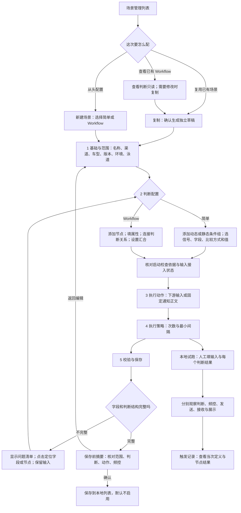
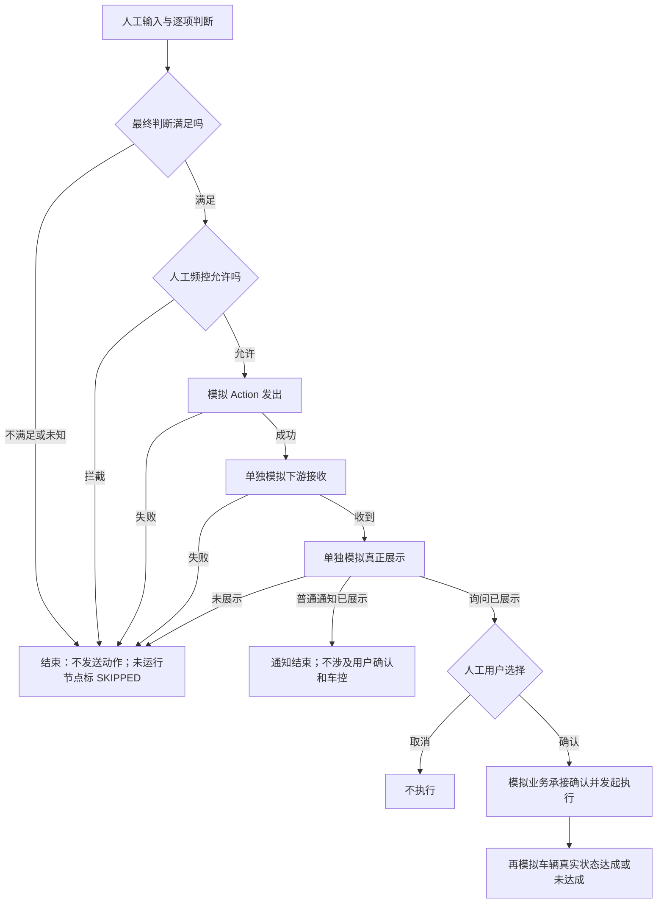

# 触发器配置平台：v08 页面说明与交互流程

## 1. 本次解决什么问题

v07 有页面和判断图，但填写、修改、保存、出错后的操作不够连贯。v08 保留实际平台的导航、基础表单、动态与静态条件、动作和执行策略，在这些位置补交互，不另造一套后台。

打开 HTML 后，顶部的“操作演示”提供简单、Workflow、闪念三条引导。它只告诉你点哪里、填什么，不会自动替换你的配置。五步导航显示“已填／待填”，只表示本地字段完整，不代表接入能力已经通过验收。

文件另存为 v08，未覆盖 v07，未修改线上平台或飞书 PRD。所有场景、车辆、保存和运行记录都是本机演示。

## 2. 从列表到保存，完整操作怎么走

“后台场景生效”不是“用户在任务中心开启任务”。原型中的列表开关只改变本地演示标记，不保存真实车辆的用户选择。

## 3. 简单模式：字段如何联动

先选择渠道，再添加条件组。选类别后选信号；选信号后才开放字段；选字段后才开放比较方式；选比较方式后才开放值。改信号会清空旧字段、比较方式和值，避免把“车速 > 30”中的 30 留给挡位。

数字字段使用数值输入，并显示演示单位。枚举字段使用选项，例如挡位选 P、R、N、D；“in”表示属于所选集合，可多选。儿童年龄范围是“婴儿／儿童”等枚举，不是年龄数字阈值。

动态条件与静态条件分开：动态输入更新可以开始检查，开始后仍要检查完整条件；启动检查不等于条件命中。当前依赖清单会随输入选择更新。正式信号 ID、订阅、采样和唤醒方式仍需接入核验；Workflow 全图如何汇总启动输入没有在原型里自行定案。

当前账号实际菜单中的“vlm 信号暂无数据”保留原样；技术方案里的结构化视觉字段放在标明演示的选项中，不把演示字典冒充线上菜单。

演示顺序：载入“简单：车速条件示例” → 点“2 判断配置” → 把信号改为挡位 → 观察下级字段清空 → 选 Gear、等于、D → 看启动依赖 → 配动作 → 校验。

## 4. Workflow：加节点、编辑、连线与修改

Workflow 只组织“条件判断”和“模型理解已有输入的判断”。DT 调工具、VQA 获取新视觉信息、出卡、用户确认、车控都不放进判断画布；唯一终点满足后才进入画布下方的共用动作。

1. 点“+ 条件节点”或“+ 推理节点”，选中节点后在右侧填写完整属性。
2. 条件节点用相同的字段级联；推理节点选择已有输入并写清判断目标。输入入口未接通时会提示依赖，不宣称能在真实车辆运行。
3. 选连线起点、终点，点“添加连线”；自连、重复连接和循环连接被阻止。
4. 至少两个前驱才能选择 AND／OR。它回答“前面的判断怎样汇合”；本节点内部的且／或回答“本节点的条件怎样组合”，两者不是一回事。汇合通过后仍要判断本节点自己的内容。
5. 点节点编辑，拖动节点调整位置；用放大、缩小、适应画布和展开画布查看多分支。位置会随本地草稿保存。
6. 点连线，右侧显示它连接哪两个节点，可以删除。删到只剩一个前驱时汇合恢复 AND；撤销可以恢复原连线和 OR。图结构操作支持撤销／重做，不承诺所有文字输入都支持图级撤销。
7. 点“校验判断图”，按问题清单逐项修复。未接入的洗车分支、多个终点、孤立节点和缺少判断内容不能当完整可用规则保存。

“从选中节点接续”只新增一个后继条件节点并连接，不会自动填判断内容。已有保存的 Workflow 判断只读；点击复制并确认后，独立副本恢复编辑，不继承生效状态、运行记录或用户选择。原型还清空指定演示车辆，要求重新核对范围。

推荐演示“儿童／宠物 OR 判断”：先看公共前置，再看两个分支，最后看 OR 汇合节点。儿童的 Position 与 AgeRange 应约束同一个乘客对象，不能拿一个人的位置和另一个人的年龄拼接。

## 5. 动作、策略与保护

普通通知配置固定正文，可即时预览。闪念一期例子不配置标题、按钮或 TTS，不进入 DT。主动推荐带交互卡配置建议信息、是否启用卡片和确认／取消按钮；内容沿既有 DT 链路生成，不在 Trigger 页面自由编辑卡片正文和 TTS。

切动作类型前弹窗说明旧参数会被清空；取消保留。改变渠道前说明会清空哪些判断，取消保留原渠道及内容；确认后重新配置目标渠道判断，并核验动作能力。

次数可留空，最小间隔有页面默认值。0 分 30 秒只是现有页面默认，不代表会议已经确定每个场景的最终产品策略。频控何时计数、多个场景如何仲裁仍需研发确认，原型不会替运行系统做真实计数。

离开未保存表单、新建另一条场景、载入示例、删除节点都提供页内保护。保存草稿能在同一文件、同一浏览器环境刷新后恢复；不同浏览器或文件地址不承诺共享草稿。列表删除仅针对本地数据，可恢复最近删除的一条。

## 6. 本地试跑：不能把前一层成功当成后一层成功

试跑初始所有判断都“未指定”。你填写人工输入、每个判断的满足／不满足／无法判断，以及人工频控允许／拦截，再计算结果。它不会自动识别真实信号或调用模型，也不是带卡推荐的线上模拟器。

Workflow 试跑用完整人工结果演示依赖传播，不模拟实际并发、等待、短路和重试调度。上游阻断后，后继节点显示“未运行”，没有自身 PASS／REJECT 结果。

发送失败、接收失败或未展示会清掉后续旧状态。询问没有明确确认时，执行与车辆结果按钮不可用；普通通知没有这些步骤。车辆结果是额外的人工证据示例，不表示 Trigger 会调车控。

触发记录选择赛力斯和 DEMO-VEHICLE 后刷新，可打开当次判断详情。点击历史节点看当次配置、输入和结果；没有填写的输入显示未提供，不编造真实输入或耗时。

## 7. 截图与页面对照

| 截图 | 讲什么 |
| --- | --- |
| 01-简单模式-闪念完整表单.png | 简单模式的基础、范围、视觉目标、固定正文、策略与依赖说明 |
| 02-Workflow-画布与节点属性.png | 条件／推理节点、多分支连线、节点属性与画布工具 |
| 03-保存前配置摘要.png | 保存之前核对范围、规模、动作、策略；只本地保存、不启用 |
| 04-闪念-分步试跑.png | 普通通知的判断、频控、发送、接收、展示，不涉及 DT／车控 |
| 05-历史运行-定义与分层结果.png | 当次配置快照、人工输入、逐层结果与操作记录 |
| 06-操作演示-Workflow.png | 上一步／下一步指引原页面位置，不偷偷替换用户输入 |

## 8. 本次实际验证范围

已在内置浏览器验证：简单字段切换清空依赖与枚举选择；渠道取消保留；保存摘要及本地默认未启用；Workflow 节点编辑不被示例改写；画布缩放适应、点边删除与撤销、单前驱恢复 AND；保存草稿刷新恢复；已有 Workflow 只读和确认复制后恢复编辑；洗车缺口阻止保存；UNKNOWN 阻止下游；儿童拒绝、宠物满足时 OR 通过；人工频控拦截；用户取消禁止执行；接收失败清空旧确认与车辆成功；普通通知不进入确认和车控；历史使用当次定义及三条操作向导。

这些验证证明本地交互可演示，不证明生产信号、模型、后台发布、客户端卡片或车辆执行已接通。未确认的输入接入、具体阈值、Workflow 启动与调度策略、频控计数时点、按钮协议和正式权限，仍应在 PRD 中保留待收口项。
