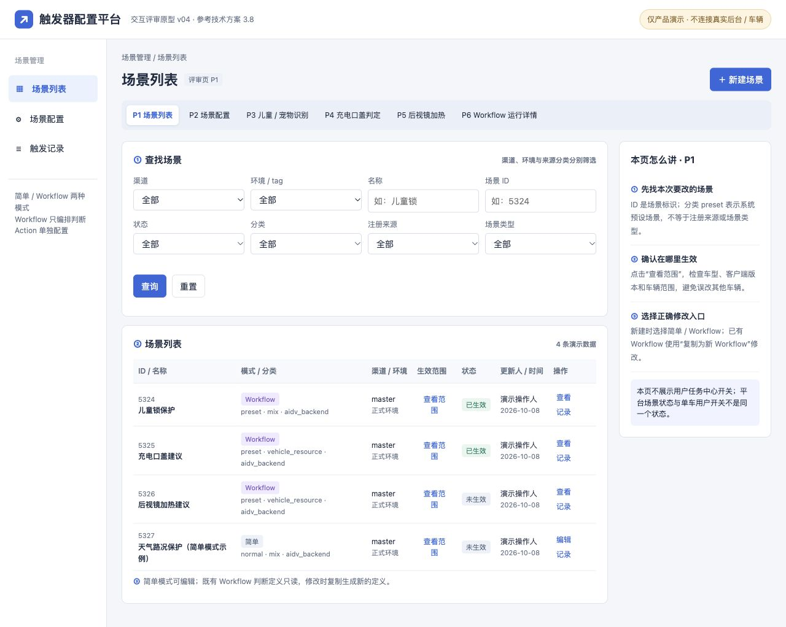
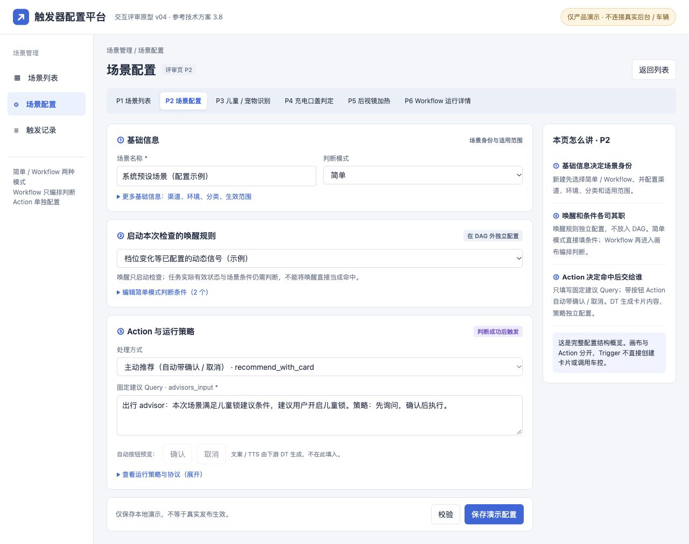
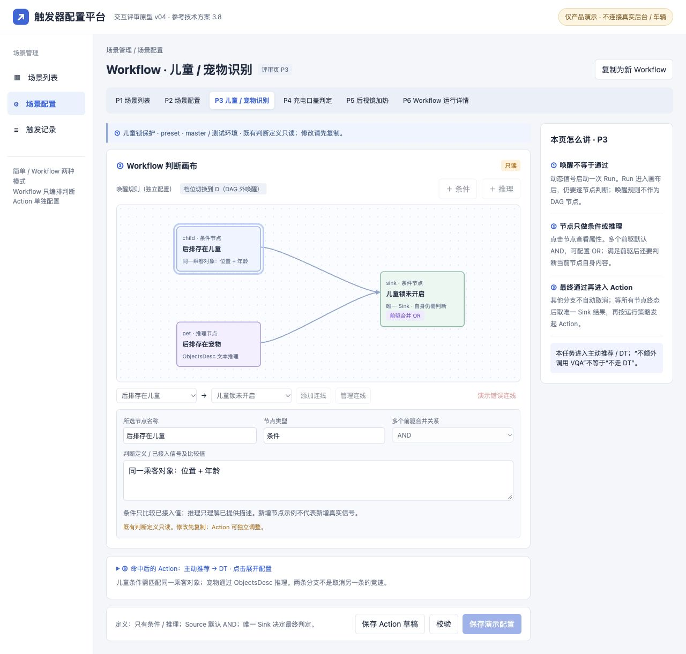
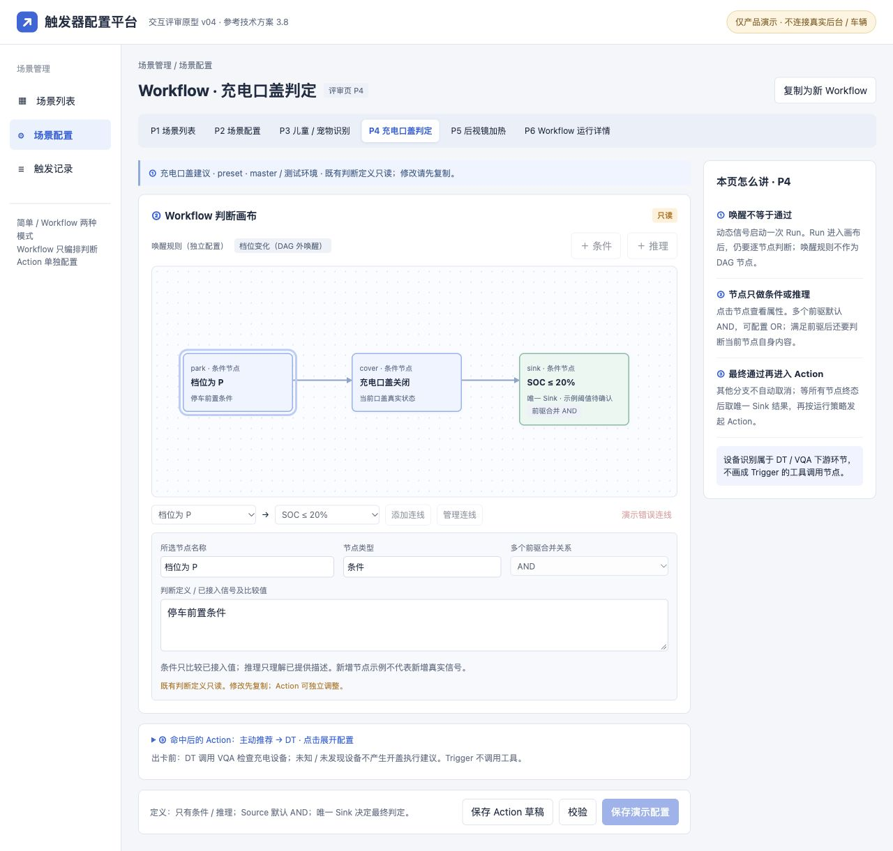
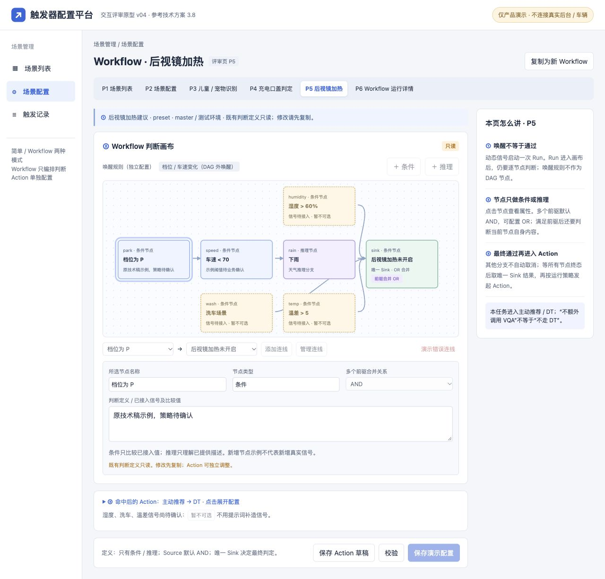
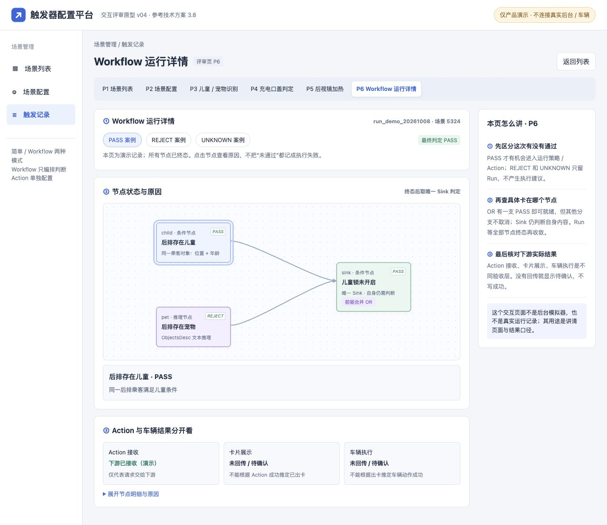

# 触发器配置平台改造：精简评审稿与原型讲解

版本：v06｜日期：2026 年 10 月 9 日｜状态：待评审

本稿用于讲清本期要改什么、页面怎样配置、配置后怎样判断。截图和可点击 HTML 使用同一套 P1—P6 编号；HTML 是产品交互演示，不连接真实后台，不发布规则、不控制车辆。

[打开交互原型 v04](/Users/bytedance/Desktop/3.23/产品/codex/HTML/02-已交付/触发器配置平台-交互原型-v04.html)。保存仅作用于当前浏览器页面内存，刷新恢复初始演示；所有示例输入和阈值均需正式需求确认。运行详情提供儿童锁三态案例，其余场景尚无真实运行数据。

## 1. 背景：为什么要改

当前条件表可以配置单项判断，但难以清楚表达“公共条件成立，并且儿童或宠物至少存在一种”。配置人员也不容易看出哪个信号启动检查、哪一步需要模型、为何没有发出建议。新增场景时容易另写一套逻辑，后续修改和排查成本高。

本次增加判断 Workflow（把判断步骤和依赖关系画出来），并补齐场景管理、带按钮建议 Action（命中后提交给下游的动作）和运行详情。后台负责配置、判断和提交建议，不把卡片交互与车控塞进判断图。

## 2. 目标与价值

产品和业务人员能用同一套页面表达儿童锁、充电口盖、后视镜加热的可接入分支；研发能明确哪些判断复用现有能力、哪些依赖缺失；测试能看到每次检查依据、节点结果和下游调用结果。

验收以真实场景正反例为准：合法配置能保存、规则按预期启动、错误条件不发送、缺失输入不误判、运行原因可追溯。不用新增字段数量衡量完成度，也不以原型可点击代替功能实现。

## 3. 本期范围与边界

保留原四项需求：静态条件非必填但全空规则禁止保存；复制生成独立场景；指定泳道在运行侧真正生效；测试／正式标签可筛选且不改变部署范围。

补充场景分类和适用范围、简单／Workflow 两种配置模式、条件／推理节点、启动信号说明、带按钮建议 Action、现有运行策略和节点记录。已有 Workflow 定义只读，修改判断须复制新建。缺少信号的后视镜分支不列作已完成范围。

本期不做端云统一配置、端侧脚本热更新、全工具编排或全车控看板。发布、审批、灰度和回退沿实际平台能力，不新增一个看似可用的假入口。

## 4. 整体逻辑：配置什么，运行什么

配置人员从 P1 找到场景，在 P2 填基础信息和范围，选择简单或 Workflow。简单模式填写已有条件；Workflow 进入 P3—P5 配置判断步骤。再回到场景的 Action 区填写固定建议 Query，校验并按现有机制保存、生效。P6 查看这一次实际运行。

收到启动信号更新后，Trigger（触发器）开始检查本次条件。有 workflow_id 只走 Workflow；没有则继续原简单逻辑，不重复判断或发送。Workflow 只含条件与推理节点：条件比较已有值，推理理解已有视觉描述，不负责调用 VQA 获取新画面。

页面要显示实际启动信号：有动态条件，用其涉及的信号更新启动；没有动态条件，用全部条件信号；推理使用配置的视觉信号。开始后仍检查全部条件，不是哪个信号启动就只检查它。混合全图怎样汇总启动信号，需研发收口，不靠原型擅定。

各节点返回满足、不满足或无法判断。图中只能有一个真实判断终点；所有节点结束后，取终点有效结果。满足后再检查次数、间隔和执行锁，允许才提交 Action。Action 位于判断图之外，不能连接成“开儿童锁”“弹卡”“等确认”节点。

云端三项任务命中后都走主动推荐／DT（承接建议、理解和调用工具的下游链路）。儿童锁与后视镜不额外调用 VQA；充电由 DT 调 VQA 检查设备。带按钮 Action 只要求配置人员填写建议信息，系统自动带确认／取消按钮；卡片正文和 TTS 由下游生成，不新增手填正文、TTS 或按钮协议的必填表单。

## 5. 原型页面与讲解

以下截图必须由同版 HTML 直接截取，热点编号、页面标题和操作入口一一对应。技术依据为《技术方案》3.8 的列表、场景配置与触发记录页面；P3—P5 是同一 Workflow 配置区域的三个任务示例，不是新增三个后台菜单。

### P1 场景列表

**解决什么：**找到目标场景，分清普通／预设、配置模式及实际适用范围。

**操作顺序：**选筛选条件 → 找场景 → 查看、复制或打开记录；新场景由“新建”进入 P2。

**关键规则：**注册来源不等于业务分类；测试／正式来自实际环境。复制不复制运行计数、记录或单车用户选择。范围读取失败不能显示为不限车辆。

**截图热点：**① 筛选区：找规则，不修改部署；② 场景列表：确认模式、分类和范围，行内打开配置或记录；③ 修改说明：既有 Workflow 判断定义只读，先复制再修改。

### P2 场景配置

**解决什么：**在一页明确场景身份、适用对象、判断方式和命中后的建议。

**操作顺序：**填基础信息与范围 → 选择配置模式 → 配条件或打开 Workflow → 填 Action 建议 Query → 校验与保存。

**关键规则：**已有 Workflow 判断定义不可原地修改。Action 独立在图外；带按钮建议自动带确认／取消，正文与 TTS 下游生成。协议结构可只读查看，不要求配置人员手写 JSON。

**截图热点：**① 基础信息与范围：区分分类、来源、环境；② 判断配置：简单条件或 Workflow 入口；③ Action：只填本任务要提出的建议，自动按钮只读显示。

### P3 儿童锁 Workflow

**解决什么：**档位变化启动检查后，判断后排儿童或宠物任一存在，且目标锁尚未开启。

**操作顺序：**查看图外启动规则 → 配儿童结构条件和宠物推理两分支 → 在目标锁判断节点设置“任一前驱满足” → 查看图外建议并校验。

**关键规则：**位置与年龄必须来自同一个乘客，不能拼接主驾儿童年龄与后排成人位置。宠物根据物体文字描述推理，不伪造“宠物=true”字段。终点仍须检查锁状态，不是空白汇合框。

**截图热点：**① 图外启动规则：档位切换到 D 只启动检查；② 判断画布：儿童与宠物分支汇合到真实的锁状态节点，OR 放行后仍执行自身判断；③ 图外 Action：提交确认建议，不在判断图里直接开锁。

### P4 充电前置 Workflow

**解决什么：**在请求下游检查充电设备前，筛出真正适用的一次停车场景。

**操作顺序：**配合法进入 P 的启动 → 检查任务状态、电量和口盖 → 查看最终结果 → 通过后提交设备检查建议。

**关键规则：**这里不放 VQA 或开盖工具节点。Trigger 通过不等于发现设备；DT 调 VQA，明确有设备后才询问，用户确认后继续既有执行链路。电量缺失不当 0；技术示例 SOC≤20% 不是已确认产品阈值。

**截图热点：**① 停车变化：不是持续上报 P 就不断提醒；② 前置条件：电量百分比不混剩余里程；③ 图外建议：交给 DT 检查设备，不宣称已发现。

### P5 后视镜 Workflow

**解决什么：**组合当前车况与已有下雨描述，判断是否提出加热建议。

**操作顺序：**检查已确认的许可与车况 → 使用已接入视觉描述判断下雨 → 检查真实加热状态 → 通过后发送确认建议。

**关键规则：**不额外调用 VQA，但仍走 DT。P 挡与车速限制的业务含义、加热状态来源需收口；洗车退出、湿度和温差缺少来源，置灰说明，不画成可运行节点。

**截图热点：**① 图外启动规则：说明什么更新会开始检查；② 判断画布：下雨使用已有描述，湿度、洗车和温差以待接入示意展示，不视为可运行节点；③ 图外 Action：通过后提出加热建议，不直接执行车控。

### P6 运行详情

**解决什么：**回答这次为何开始、哪一步不通过、是否提交下游。

**操作顺序：**从场景记录打开一次运行 → 看输入与当时定义 → 选节点查结果和原因 → 查看策略及 Action 结果。

**关键规则：**未执行、明确不满足和无法判断分别展示；缺输入或模型异常不是“没有儿童／没有下雨”。历史使用当时定义与快照。下游受理成功不显示为卡片已展示或车辆已执行。

**截图热点：**① 运行摘要：一次运行对应一个 run_id；② 节点与依据：解释终点结果；③ 动作结果：区分策略拦截、下游受理和未取得反馈。

## 6. 三项任务怎样验收

| 任务 | 正向案例 | 反向与未知案例 |
| --- | --- | --- |
| 儿童锁 | 合法启动、同一后排对象为儿童、锁未开；或宠物分支满足。终点满足且策略允许后提交确认建议 | 主驾儿童不能与后排成人拼接。儿童满足、宠物异常时，OR 可以放行目标锁节点；仍等整图结束。锁已开不重复建议 |
| 充电口盖 | 合法进入 P、电量符合最终阈值、盖关闭，提交检查设备建议；下游明确有设备后询问 | 电量缺失为无法判断，超过阈值不发送。VQA 无设备／未知不询问开盖；取消不执行。恰好等于阈值必须覆盖 |
| 后视镜 | 已确认车况范围、加热未开、已有描述明确下雨，提出确认建议 | 无雨不满足；描述缺失或模型异常无法判断。缺加热状态不得当未开；缺洗车等输入的分支不发布 |

车型、阈值、目标锁和启动范围以正式任务定义为准。表内演示不替需求收口。

## 7. 核心异常与完成标准

保存失败一次列出全部错误，定位字段、节点或连线，保留输入；非法图不生成可用定义。图只能包含条件／推理，禁止循环、无效边、多个终点和空判断节点。多个前驱默认全部满足；任一满足仅在至少两个前驱时可选。

AND 遇明确不满足即阻断；无不满足但存在无法判断时，等前驱结束后按无法判断阻断。OR 任一满足即可放行自身判断，不取消其他分支；无满足时，有未知则未知，否则不满足。整图仍等全部节点结束，不能首个分支通过就发送建议。

单车任务状态、AI 设置、全局规则发布是不同层级。云端已有按车与场景持久保存的设计；成功查询无记录默认开启，读取失败不当开启。已关闭不因复制替换或普通更新变开启；单次取消不改变长期任务开关。端侧保存链路另行对齐。

分别验收后台保存、规则实际生效、下游接收、卡片展示、车辆实际执行。带卡 Action 当前模拟器不支持，必须真实测试环境联合联调；本 HTML 仅验证页面交互与产品规则。没有反馈的环节明确“未取得”，不补画成功。

## 8. 评审要收口什么

1. **业务与输入：**儿童已在 D 后才识别是否补提醒；目标锁映射；充电最终电量阈值；后视镜适用车况及缺失信号。业务产品与信号接入方共同确认。
2. **运行与替换：**混合全图如何汇总启动信号；次数、间隔、重试和关闭在途的规则；复制新定义如何避免新旧同时生效并保持用户关闭。Trigger 与后台研发确认。
3. **范围与联调：**泳道空值、能力不支持的渠道如何拦截；实际发布机制和下游反馈范围；联调环境、保留与权限。相关接入研发和测试确认，负责人现场认领，不按接口人姓名猜分工。

带按钮 Action 的配置口径按本轮确认收敛：配置人员只填建议信息，确认／取消自动带上。按钮自定义不再作为本期必填或未决事项；若未来需扩展，另提需求。

详细字段、三态矩阵和完整验收列表保留在 v05 作为技术评审参考，不在主稿重复铺开；其中带卡动作及原型编号以本版和最新技术确认替换。

技术依据：[【触发器支持系统预设场景】技术方案](https://bytedance.larkoffice.com/docx/F7uVdVMqGoSE1rxInuucFbUynbf)。需求依据：[触发器配置平台改造](https://bytedance.larkoffice.com/wiki/TW0pwbGmyit1KGkVPazcX6mSnYb)。
