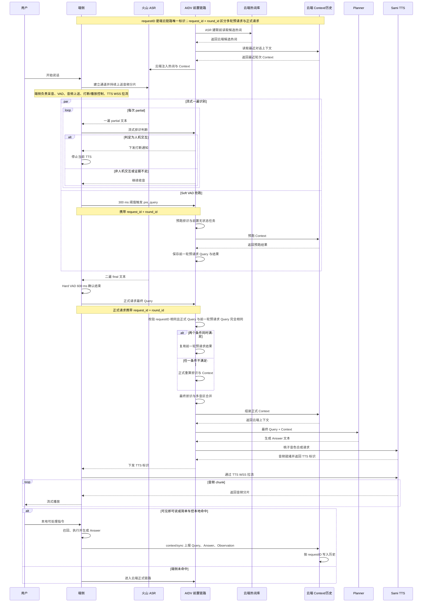
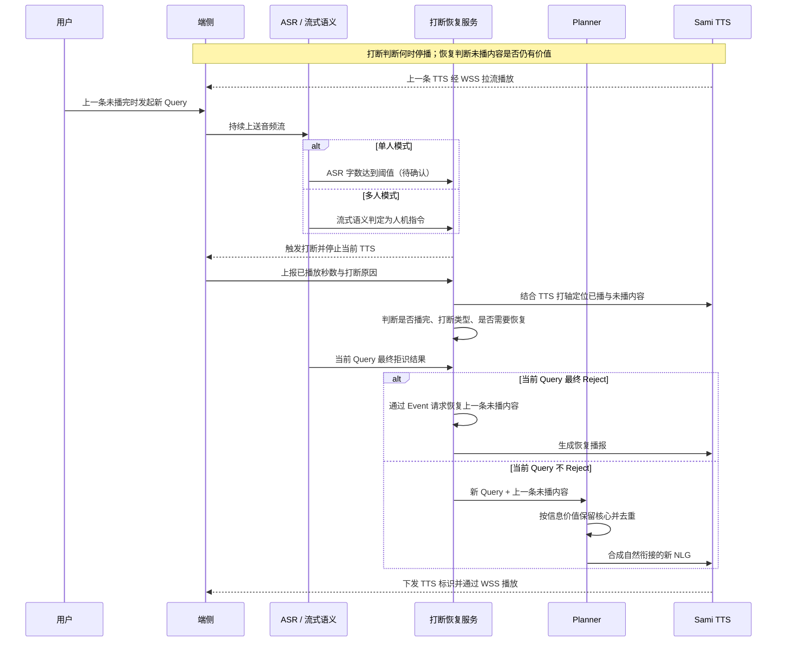

# AI汽车语音基础体验链路OnePager

## 简要介绍

**这条链路解决四个基础体验问题：**

**听得准：**

1. 用户开始说话后，端侧持续采集音频，以200ms一帧发送云端。
2. 端侧仅上送音频并控制 VAD，端侧收到流式ASR结果，以 Soft VAD 触发本轮预请求、以 Hard VAD 600 ms 结束 ASR 并发起正式请求。
3. 热词与对话上下文由云端维护，云端在 ASR 请求建联时以及 ASR 链路上行信息中读取并注入ASR热词提高识别准确率。
4. 端侧上传流式ASR请求云端基于流式文本先做拒识判断，确认用户在和车机交互时可立即打断正在播放的 TTS。

**回得快：**

1. 通过 Soft VAD 判断用户是否可能说完话，来用已经生成的Query文本预跑部分模块，正式链路时若能命中缓存数据，则可以缩短正式链路耗时。
2. 云端TTS提前合成，端侧通过TTS标识来拉取音频。

**端云上下文一致：**

1. 端侧召回的处理，需要将执行结果、回复话术等信息回传同步给云端，以保证端云对话历史一致性。

**打断恢复**

1. 当TTS正在语音播报时，用户开始说话，部分场景下触发了TTS打断，当前Query上云后云端考虑是否需要恢复被打断的TTS。

---

## 链路名词表

<table><colgroup><col/><col/><col/><col/></colgroup><thead><tr><th vertical-align="top">术语</th><th vertical-align="top">定义</th><th vertical-align="top">出现位置</th><th vertical-align="top">关键信息</th></tr></thead><tbody><tr><td vertical-align="top">流式 ASR</td><td vertical-align="top">低延迟返回 ASR 文本。</td><td vertical-align="top">说话过程中持续返回。</td><td vertical-align="top">用于实时判断，不代表最终文本。</td></tr><tr><td vertical-align="top">流式二遍 ASR</td><td vertical-align="top">分句后以非流式模型重识别音频并给出 final。</td><td vertical-align="top">正式 Query 生成，用于请求云端正式语音链路</td><td vertical-align="top"></td></tr><tr><td vertical-align="top">Soft VAD</td><td vertical-align="top">客户端快速停顿判断。</td><td vertical-align="top">300 ms 阈值触发 pre_query。</td><td vertical-align="top">可多次触发，不结束 ASR。</td></tr><tr><td vertical-align="top">Hard VAD</td><td vertical-align="top">客户端确认用户说完。</td><td vertical-align="top">600 ms 阈值触发音频分段。</td><td vertical-align="top"></td></tr><tr><td vertical-align="top">流式拒识</td><td vertical-align="top">基于 partial 判断是否为人机交互</td><td vertical-align="top">决定是否提前打断当前 TTS。</td><td vertical-align="top">触发流式拒识的前提：<ol><li seq="1">多人场景</li><li>ASR大于两个字</li><li>ASR前缀不包含“豆包”</li><li>TTS正在播放</li></ol></td></tr><tr><td vertical-align="top">最终拒识</td><td vertical-align="top">基于 final Query 的判断是否为人机交互。</td><td vertical-align="top">正式链路与打断恢复。</td><td vertical-align="top"></td></tr><tr><td vertical-align="top">request_id</td><td vertical-align="top">端云链路请求唯一标识。</td><td vertical-align="top">预请求、正式请求、历史同步。</td><td vertical-align="top"></td></tr><tr><td vertical-align="top">round_id</td><td vertical-align="top">同一 request_id 内的请求轮次。</td><td vertical-align="top">每次预请求递增，正式请求继续递增。</td><td vertical-align="top">与 request_id 共同区分多次请求。</td></tr><tr><td vertical-align="top">预请求</td><td vertical-align="top">Soft VAD 后抢跑的前置无状态任务。</td><td vertical-align="top">走 /aidv/v1/pre_query接口。</td><td vertical-align="top">不进入正式对话历史。</td></tr><tr><td vertical-align="top">正式请求</td><td vertical-align="top">Hard VAD 与 final query 后进入的主请求。</td><td vertical-align="top">正式query 请求云端正式链路：拒识、Context、Planner等模块。</td><td vertical-align="top"></td></tr><tr><td vertical-align="top">预请求缓存复用</td><td vertical-align="top">复用相关request_id下前一轮round_id预请求结果。</td><td vertical-align="top">正式链路中支持使用预请求的模块（如：拒识、Context）</td><td vertical-align="top">当前Query与前一轮预请求query完全相同才会复用</td></tr><tr><td vertical-align="top">热词</td><td vertical-align="top">人名、地点、媒体、车控等热词。</td><td vertical-align="top">云端 ASR 建联或请求链路内注入。</td><td vertical-align="top">热词不会100%生效</td></tr><tr><td vertical-align="top">多音区合并</td><td vertical-align="top">结合 sound_zone 处理同车多说话人输入。</td><td vertical-align="top">当前query拒识通过后如果前一个前一个请求未出任何有效信息，则打断前一轮，使用前一轮query与当前轮合并</td><td vertical-align="top"></td></tr><tr><td vertical-align="top">planner</td><td vertical-align="top">基于最终 Query 与 Context 规划回复。</td><td vertical-align="top"></td><td vertical-align="top"></td></tr><tr><td vertical-align="top">tts_audio_id</td><td vertical-align="top"> TTS 音频流标识</td><td vertical-align="top">云端生成回复文本携带下发供端侧拉流的TTS标识。</td><td vertical-align="top"></td></tr><tr><td vertical-align="top">TTS WSS接口</td><td vertical-align="top">端侧拉取音频流、或通过文本合成音频</td><td vertical-align="top">端侧拉取音频或合成音频时</td><td vertical-align="top"></td></tr><tr><td vertical-align="top">TTS 打轴</td><td vertical-align="top">Sami TTS 合成时，音频数据与文本数据对应关系</td><td vertical-align="top"></td><td vertical-align="top"></td></tr><tr><td vertical-align="top">打断恢复</td><td vertical-align="top">停播后判断并恢复仍有价值的信息。</td><td vertical-align="top">新 Query 请求时上一条 TTS 还未播报完。</td><td vertical-align="top">目标是自然衔接，不重复整段播报。</td></tr></tbody></table>

---

## 当前使用资源

<callout emoji="🏆">
并发量计算方式：从接口建联开始，这个流式请求没有结束都占用一个并发量。
举例：
一次tts合成或者一次asr识别过程都是占用一个并发。
请求时刻算1 qps，整个过程算 1 并发。
</callout>

| 资源 | 相关信息 | 资源申请量 | 服务配置地址 | 备注 |
|-|-|-|-|-|
| 火山ASR | 火山账号：2109706047  <br/>应用名称：doubaoInCar  <br/>资源类型：豆包流式语音识别模型2.0-小时版  <br/>APPID： 2117182170 | 并发量：400 | https://console.volcengine.com/speech/service/10038?AppID=2117182170 | s\*\*c项目单独使用车企账号资源 |
| SAMI TTS | 类型：BigTTS   <br/>Speaker：zh_female_wenroutaozi_uranus_bigtts   <br/>App Key：jY2ghtW7SIW7XxqU   <br/>请求URL：[https://sami.bytedance.com/internal/api/v1/ws](https://sami.bytedance.com/internal/api/v1/ws) | QPS：50  <br/>并发量：300 | [https://speech.bytedance.net/](https://speech.bytedance.net/) |  |

---

## 端到端流程

###  主链路



云端处理：

1. 请求准备：AIDV 前置链路在 ASR 建联前，先从云端热词库读取候选热词，再读取最近对话上下文，并把热词与 Context 一并注入云端 ASR。
2. 语音采集：用户开始说话，端侧与 ASR 建立通道、持续上送音频分片。端侧负责采音、VAD、音频上送、打断 / 播放控制、TTS WSS 拉流。
3. TTS打断与预请求处理： 

   - 流式一遍识别：ASR 每次返回 partial 文本，端侧做流式拒识判断 —— 若判定为人机交互，则下发打断通知、停止当前 TTS。
   - Soft VAD 抢跑：达到 300ms 阈值即触发 pre_query（携带 request_id + round_id），预跑拒识与前置无状态任务、预跑 Context，并保存前一轮预请求的 Query 与结果。
4. 正式请求：端侧以 Hard VAD 600ms 确认说话结束，ASR 返回二遍 final 文本，发送正式最终 Query。云端校验「requestID 相同」且「正式 Query 与前一轮预请求 Query 完全一致」—— 两个条件同时满足则直接复用预请求结果，否则正式重算拒识与 Context；随后做最终拒识与多音区合并、组装正式 Context。
5. 生成与播报：最终 Query + Context 交给 Planner 生成 Answer 文本与工具调用，云端以桃子音色请求 TTS 合成，下发 TTS 标识，端侧经 TTS WSS 拉流、流式播放音频分片。


端侧处理：

若为「可见即可说」或简单车控且本地命中，端侧直接召回、执行并生成 Answer，并将 Query、Answer、Observation 经 context/sync 上报写入历史；端侧未命中则进入云端正式链路。

### 打断恢复链路



**恢复分流**：当前 Query 最终 Reject 时通过 Event 触发新 Query恢复上一条；Recall 时由 Planner 融合新 Query 与未播内容，生成自然且不重复的新 NLG。

---

## 模块介绍

### ASR热词处理

<blockquote><p>用于增强ASR识别准确率</p><p><cite doc-id="IMpVw1X28iDRUnkb7gUc70JYnEc" file-type="wiki" title="热词数据回流管理技术方案" type="doc"></cite></p></blockquote>

1. 涉及的热词

<table><colgroup><col/><col/><col/><col/><col/></colgroup><tbody><tr><td>类型</td><td>含义</td><td>数据来源</td><td>支持数量</td><td>需要做数据冷热处理</td></tr><tr><td>人名类</td><td>人名信息</td><td><ol><li seq="1">用户通讯录信息(bluetooth_contact_name) contact_name 字段</li><li>（端状态）车辆当前人脸对应名称信息<ul><li>乘客身份信息（system_control_0003）名称 name</li></ul></li></ol></td><td>1000</td><td></td></tr><tr><td>导航地点类</td><td>用户发起的导航目的地或途径点信息</td><td>从端状态获取数据<ul><li>目的地位置（navigation_0004）poi_name 字段</li><li>途经点位置（navigation_0007）poi_name 字段</li></ul></td><td>500</td><td>✅</td></tr><tr><td>媒体类</td><td>用户播放的歌曲信息</td><td>从端状态获取数据<ul><li>当前播放音频（media_0001）音频名称（audio_name）</li></ul></td><td>1000</td><td>✅</td></tr><tr><td>可见即可说类</td><td>车企针对每个页面注册一些常用热词，命中可直接指向匹配动作</td><td>可见即可说系统注册的词，端侧页面切换时可获取</td><td>500</td><td></td></tr><tr><td>车控类</td><td>车载场景专有名词</td><td>固定配置（可针对车企车型调整）</td><td>1000</td><td></td></tr><tr><td>对话历史</td><td>最近几轮用户对话历史</td><td>用户与车机进行的语音交互对话</td><td>5轮</td><td></td></tr><tr><td>车机位置</td><td>当前车辆所处的位置信息（增强导航地点类通用实体效果）</td><td>从端状态获取数据<ul><li>当前位置（navigation_0002） address 字段</li></ul></td><td></td><td></td></tr></tbody></table>

1. 处理流程图

<whiteboard token="KdFEwwqvgh5BfbbapCgcJOgQn2c"></whiteboard>

### 预请求介绍

<blockquote><p>通过Soft VAD + 语义VAD 标识多次预请求前置模型请求来换取正式请求耗时</p><p><cite doc-id="PJMUwwRCNiC2A8kjXCjcs4Bun7Y" file-type="wiki" title="服务端技术评审-多级VAD策略" type="doc"></cite></p></blockquote>

步骤一：基于的 Soft VAD + 语义 VAD 得到的预请求 Query 做一些前置**无状态任务**处理。比如：拒识、Context

步骤二：当 Hard VAD + 语义 VAD 确认最终 Query 时，若与预请求query完全相同，通过直接获取前置已经处理的预请求任务结果来加速当前正式请求的速度，从而降低链路耗时。

<whiteboard token="I93VwyQk3h9tXwbKjqKcEvvknJc"></whiteboard>

### TTS 处理

> 描述解析Planner输出结构，构建多情绪数据TTS合成，同时保证TTS下发顺序

Planner 输出结构：

```JSON
{
    "talk_or_not": "yes",
    "talk_content": "[高兴的说]好嘞，给右后放首中文歌。",
    "emoji_id": "listen_music",
    "action_list": [
        {
            "action_id": "1",
            "tool_name": "music_search",
            "params": {
                "query": "播放中文流行歌曲"
            }
        }
    ]
}
```

1. 解析talk_content字段[xxx]作为多个不同情绪的TTS要求，内容作为情感化信息，若无[]则使用用户query作为情绪信息
2. 当前[xxx]中包含“唱”时，认为是唱歌的场景，积攒需要唱的文本信息调用s2s唱歌

<table><colgroup><col/><col/><col/><col/><col/></colgroup><tbody><tr><td>场景</td><td>talk_content</td><td>情绪信息</td><td>SAMI TTS合成文本</td><td>s2s query</td></tr><tr><td>1</td><td>[高兴的说]好嘞，给右后放首中文歌。</td><td>高兴的说</td><td>好嘞，给右后放首中文歌。</td><td></td></tr><tr><td>2</td><td>好嘞，给右后放首中文歌。</td><td>{用户query}</td><td>好嘞，给右后放首中文歌。</td><td></td></tr><tr><td rowspan="2">3</td><td rowspan="2">[大声说]好嘞，给右后放首中文歌。[小声说] 你真帅啊</td><td>大声说</td><td>好嘞，给右后放首中文歌。</td><td></td></tr><tr><td>小声说</td><td>你真帅啊</td><td></td></tr><tr><td>4</td><td>[唱]丑八怪xxxx</td><td colspan="2"></td><td>唱：丑八怪xxxx</td></tr><tr><td rowspan="2">5</td><td rowspan="2">[大声说]好嘞，马上给你唱首中文歌。[唱]</td><td>大声说</td><td>马上给你唱首中文歌</td><td></td></tr><tr><td colspan="2"></td><td>丑八怪xxxx</td></tr></tbody></table>

<whiteboard token="OPrDwP216hJO7wb4rRYcpGlvnoe"></whiteboard>

### 打断恢复

1. 恢复方式

   1. 拒识后恢复TTS Event Query示例

   ```JSON
   “event”:“副驾（小王）和其他人说话，打断了你正在说的话，你已经说了：“好的，先调成彩虹的第一个颜色，红色”然后被打断了没说完的话是：“同时搜一下川菜馆”
   ```

   1. 未拒识恢复TTS Planner User Prompt 示例

   ```JSON
   [
       {
           "last_talk_content": "上海天气晴，但是（这里被用户打断了，后面没说完：下午可能下雨哦）",
           "query": "好无聊",
           "speaker_name": "xxx",
           "speaker_position": "副驾",
           "timestamp": "2026-09-10T11:10:29+08:00"
       }
   ]
   ```
2. 打断恢复场景

| **打断场景** | **打断原因** | **备注** | 是否要恢复 |
|-|-|-|-|
| ComeNewPlay | come a new play  | 当前已有 TTS 正在播放，又来了新的TTS 播放请求，并且新请求优先级不低于当前播放。SDK 会取消当前 request，并回调当前 request 被新播放打断。 | 否 |
| OnServiceSuspend | 车机进入低功耗模式，服务挂起的时候 |  | 否 |
| ThirdPartyStopById | 第三方调用stopTTSById 停止指定请求的播放 |  | 否 |
| ThirdPartyStopAll | 第三方调用停止所有的播放 |  | 否 |
| NotRejectQuery | is not reject query | 收到云端未拒识消息，打断当前播放的内容 | 是 |
| PlayOfflineVehicleControl | play offline content | 播放离线车控的执行结果 | 否 |
| VoiceSilence | voice is not active | 豆包退到静默态 | 否 |
| StreamNotRefusal | stream not refusal pause | 流式结果为非拒识，停止当前播报的 TTS | 是 |
| MultiPersonSayStartWithDoubao | contain doubao interrupt | 车内多人的时候，一句话以豆包两个字开头开头 立即打断 | 是 |
| SingleInterrupt | single interrupt | 车内单人的时候，当ASR字数大于2个字时，直接打断当前TTS播报 | 否 |

1. 处理流程图

<whiteboard token="LeQpwYCMXhGIfqb1wqzctXhvnok"></whiteboard>