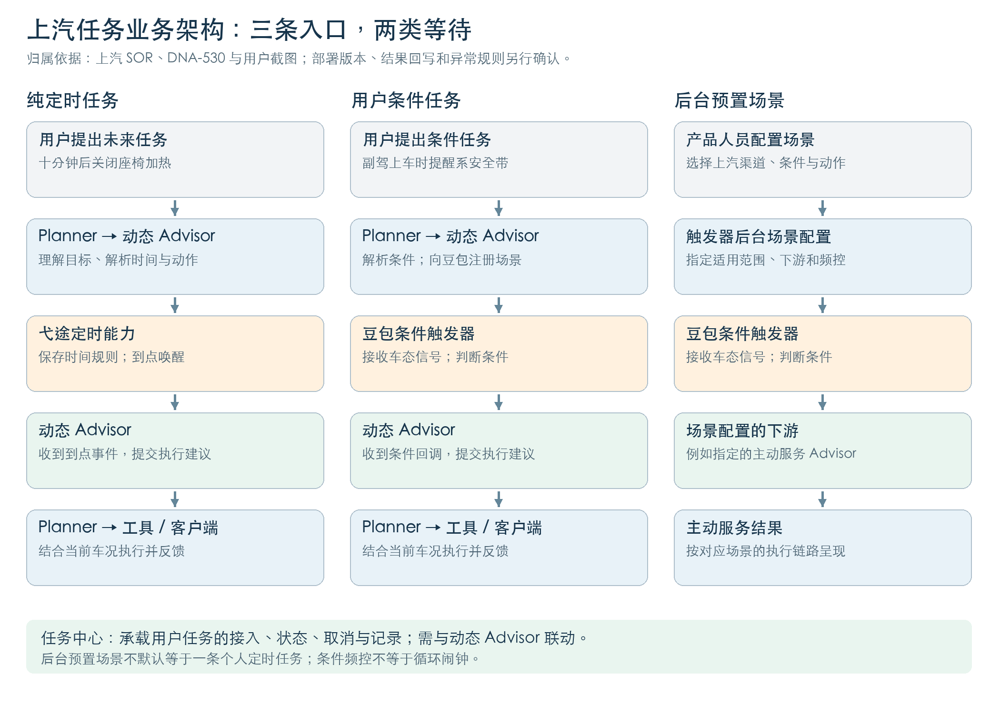
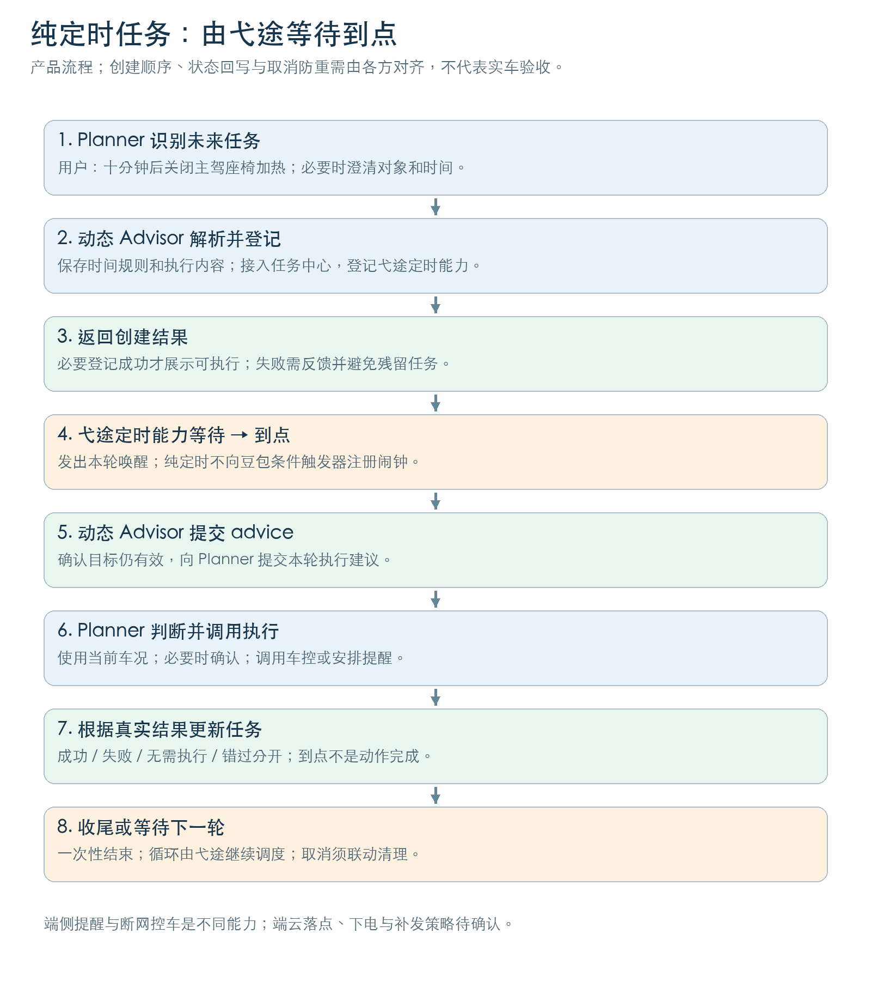
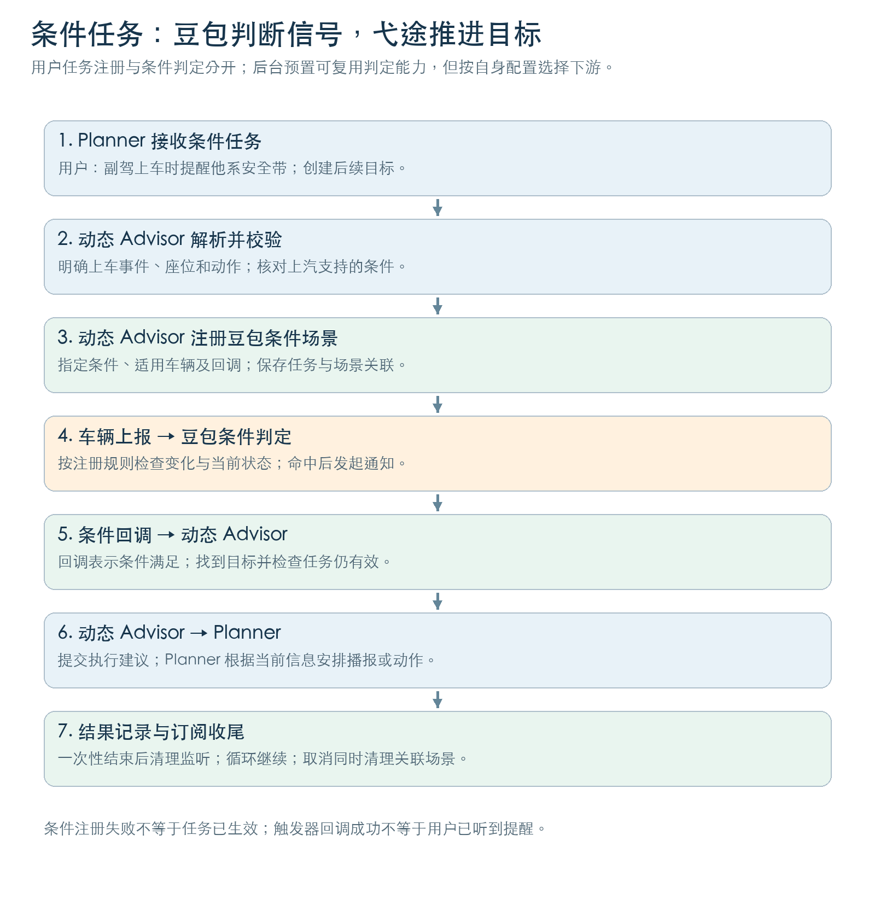

# 上汽定时任务与触发器整体流程及产品定义

版本：v01｜整理日期：2026-10-13｜用途：上汽定时任务 / 触发器产品定义评审

本文沿用赛力斯参考文档的结构：背景与目标 → 定义与范围（时间形态、业务流程、Case、定时器任务范围）→ 定时器状态变化 → 任务变更策略。新增资料依据与评审确认项作为附录。

**核心定义：上汽的定时任务由弋途动态 Advisor 及其定时能力承接；豆包 / 火山触发器负责接收条件场景、判断车辆信号条件并通知下游，也支持后台预置场景。纯定时任务不需要向豆包触发器注册一个“闹钟”。条件任务由动态 Advisor 注册场景，条件满足后，触发器回调动态 Advisor，再由动态 Advisor 向 Planner 提交执行建议。** [S1][S2][S3]

资料状态说明：“已有依据”表示本次读到的截图或正式文档明确写明；“产品规则”表示上汽 PRD / SOR 的要求，不能直接等同于所有车型已上线；“建议 / 待确认”表示为补齐评审闭环提出的口径。本文未进行实车验收。

## 背景与目标

用户说“十分钟后关闭座椅加热”时，需要系统先记住这件事，十分钟后再执行。用户说“副驾上车时提醒他系安全带”时，需要系统等到副驾上车这一条件发生，再执行。两者都是需要系统后续跟进的任务，但等待的东西不同：一个等时间，一个等车内状态。

如果把这两类任务都称为“触发器任务”，评审时容易出现三个问题：纯定时任务是否也需要豆包新增定时能力；同一任务是否由两边同时计时；用户取消后，任务卡片、定时器和条件场景是否一起停止。上汽与赛力斯的定时器归属不同，因此必须先把产品职责说清，再讨论接口和异常处理。

本方案的目标是建立一条能解释、能管理、能验收的链路：用户提出未来任务 → 系统解析并创建 → 对应模块等待时间或条件 → 到点 / 条件满足后唤醒动态 Advisor → Planner 结合当时车况执行 → 任务中心展示结果 → 一次性任务收尾或循环任务继续等待。

赛力斯参考稿提出“在云端触发器新增定时任务能力”；上汽已有资料则将定时能力放在弋途侧。本稿复用章节和案例写法，按上汽职责重写流程。赛力斯的相对延时 24 小时、绝对时间 7 天等建议上限，不作为上汽规则。[S0][S2][S3]

## 定义与范围

### 定时任务定义

**定时任务是用户发起后，由系统保存执行内容和时间规则，在未来的指定时间或周期唤醒执行的一次性或循环任务。** 创建时记录的是“什么时候做、给谁做、做什么”；到点时还需要检查当前是否能够执行。计时结束、用户听到提醒、车辆完成动作，是三个不同的结果。

例如“十分钟后关闭主驾座椅加热”：系统保存主驾座椅、关闭加热、十分钟后这三个要素。十分钟后弋途定时能力唤醒动态 Advisor；动态 Advisor 向 Planner 提交该任务的执行建议；Planner 再根据最新车辆状态安排车控。不能把“定时器响了”记录为“座椅加热已经关闭”。[S1][S5]

### 相关模块与职责

| 模块 / 概念 | 产品定义与负责的事 | 主要输入 → 输出 | 依据与限制 |
| --- | --- | --- | --- |
| Planner / Director | 对话推理引擎，负责与用户交互、理解需求、创建目标，以及任务被唤醒后的执行安排 | 用户请求或 advice → 目标创建请求、执行动作、用户反馈 | SOR 使用 Planner；较新 PRD 使用 Director。本文合称 Planner，避免把它们画成两级独立大脑。[S1][S5] |
| 动态 Advisor | 为用户托管未来任务的模块，负责解析时间 / 信号条件、生成与管理目标，触发后向 Planner 提交建议 | 用户目标、到点事件、条件回调 → 任务、场景注册请求、advice | 弋途侧负责；advice 指交给 Planner 的任务执行建议。[S1][S2] |
| 弋途定时能力 | 保存时间规则，等待到点，并按循环规则安排下一轮 | 执行时间 / 周期 → 到点事件 | 归属由截图和一期文档确认；云端与端侧的具体部署版本需核对。[S2][S3][S4] |
| 豆包 / 火山条件触发器 | 判断注册场景中的车辆信号条件，满足时执行配置的通知或其他动作 | 场景规则、车辆信号 → 条件命中及下游通知 | 动态任务链路配置回调动态 Advisor；不是完整任务执行系统。[S1][S2][S6] |
| 后台预置场景 | 产品人员预先配置的条件和触发后动作，面向指定渠道 / 车型 / 车辆生效 | 后台规则 → 生效的预置场景 | 与用户临时创建任务是两种来源；下游按该场景配置决定。[S3][S6] |
| 任务中心 | 用户查看、管理任务的入口，并承载任务接入、状态、记录与操作回调 | 任务信息、状态、用户取消操作 → 任务卡片、历史记录、业务事件 | SOR 明确生命周期与手动取消回调；具体界面、按钮与状态需按交互版本核对。[S1] |
| Context | 系统当前掌握的车、人和环境信息，供条件判断及执行决策使用 | 车辆状态等信息 → 可查询的最新状态 | 创建时的车况不等于执行时的车况。[S1][S5] |

### 时间形态与产品规则

参考稿虽然标题写“四种时间形态”，实际列了五类。本稿保留这五类，并增加上汽已明确的模糊时间处理，避免把不同业务都塞进定时器。

| 形态 | 用户表达 | 谁等待 / 唤醒 | 上汽定义与边界 |
| --- | --- | --- | --- |
| 相对延时 · 一次性 | 十分钟后关闭主驾座椅加热 | 弋途定时能力 | 从约定基准时刻计算未来时间；建议以用户请求被接受时为基准，避免异步创建耗时顺延提醒。实际基准及登记时已经到点的处理待确认。[S1] |
| 绝对时间 · 一次性 | 明天 9 点提醒我出发 | 弋途定时能力 | 保存完整日期和时间；按分钟粒度服务。超过 365 天不创建。[S4] |
| 固定间隔 · 循环 | 每小时提醒我活动一下 | 弋途定时能力 | 每隔固定时间唤醒，最小循环间隔 1 分钟；循环锚点、跳过后的下一轮算法待确认。[S4] |
| 定时采样 + 视觉判断 · 循环 | 每分钟看看后排宝宝是否睡着 | 弋途侧定时唤醒并获取视觉信息，动态 Advisor 判断 | 到点只意味着进行观察，不意味着条件已经满足。具体感知能力、采样方式和最大持续时间需核对；不承诺哭声识别能力。[S2] |
| 每日固定时刻 · 循环 | 每天 9 点提醒我喝水 | 弋途定时能力 | 属于循环时间需求；日期推进由弋途侧承接，不能改写成豆包触发器自动续期。跨下电保留策略待确认。[S1][S3] |
| 只有日期 / 日期加时段 | 明天提醒我拿快递；明天下午提醒我 | 动态 Advisor 转为条件任务，再由条件触发链路处理 | 仅日期：目标日期首次上车；日期加时段：对应时段首次上车或在车上。时间与上车状态如何组合监听需确认。[S4] |

上汽二期 PRD 还给出了三个解析口径：指定“下周 / 下个月 / 某月”需澄清具体哪一天；没有上下午的钟点按最近的未来时间解释，例如当前 19:00 说“8 点”对应今天 20:00、说“6 点”对应明天 06:00；多个提醒按分钟粒度合并，不承诺秒级播报。产品上应把最终时间展示清楚，避免系统解释正确、用户理解错误。[S4]

**频控间隔与循环定时不同。** 触发器配置“最短执行间隔 60 秒”，表示两次条件命中之间至少隔 60 秒；它不会因此每隔 60 秒主动唤醒任务。循环定时任务仍由弋途定时能力安排。[S6]

### 整体业务架构

架构按三条路径理解：纯定时任务进入弋途定时能力；用户条件任务由动态 Advisor 向豆包触发器注册；系统主动服务由产品人员在后台预置场景。前两条最终由动态 Advisor 向 Planner 提交建议，后台预置则通知该场景配置的下游，不能一律画成动态 Advisor。[S1][S2][S3]

### 业务流程图

以下为按上汽职责整理的预期业务闭环。模块分工有资料依据；成功回写、状态展示和异常补偿中的新增要求需评审确认。

#### 流程一：用户创建纯定时任务

1. 用户提出未来任务。Planner 识别这是需要系统后续执行的需求，检查执行内容是否合理；必要时澄清时间、座位或对象。
2. Planner 把目标交给动态 Advisor。动态 Advisor 解析时间、一次性 / 循环、执行内容和对象，并完成合法性校验。任务中心接入任务，弋途定时能力登记时间规则；这两项的先后顺序及失败回滚以接入实现为准。
3. 创建结果返回。产品应在实际登记成功后展示可执行的任务状态；仅发出创建请求时，使用“正在创建”等中性反馈。二期 PRD 提出成功 / 失败反馈优化，但部分交互章节标注“616 off”，当前版本是否采用需核对。[S4]
4. 弋途定时能力等待到点，并向动态 Advisor 发出本轮唤醒事件。纯定时任务无需向豆包条件触发器登记时间规则。
5. 动态 Advisor 检查目标仍然有效，结合当前信息形成 advice，交给 Planner。旧流程在触发时推理生成策略，二期方案提出提前生成策略以减少延迟；本文不假设当前已全部切换。[S4]
6. Planner 结合当前车况和用户状态决定具体执行。需要车控时调用下游车控工具；需要提醒时通过交互链路播报。需要确认的动作先确认，不能由定时器直接绕过执行判断。[S1][S5]
7. 下游返回实际结果。产品闭环要求按结果更新任务中心：成功、失败、已无需执行或错过；结果回写接口由各方确认。一次性任务结束，循环任务记录本轮后等待下一轮。

#### 流程二：用户创建条件任务

1. 用户说“副驾上车时提醒他系安全带”。Planner 将目标交给动态 Advisor。
2. 动态 Advisor 把自然语言拆成条件和执行内容，并查询上汽渠道可用条件。这里的“上车”应明确是占座由未占用变为已占用，还是其他经过确认的事件，不能自行用“车门打开”替代。
3. 动态 Advisor 向豆包触发器注册场景：条件规则、适用车辆 / 渠道、命中后回调动态 Advisor 的动作。注册成功后保存任务与场景的关联。[S2][S6]
4. 车辆上报相关信号，触发器按已注册规则判断场景。二期技术方案提出同时校验状态变更条件与当前状态条件；上汽目标版本是否采用该机制需确认。产品上必须区分“持续有人”和“本次刚上车”，避免反复提醒。[S7]
5. 条件满足后，触发器调用已登记的回调，通知动态 Advisor。callback 在这里是“条件到了，继续处理这个任务”，不代表车辆动作已经完成。[S1][S2]
6. 动态 Advisor 找到对应目标，向 Planner 提交执行建议；Planner 安排提醒 / 工具执行，并根据结果反馈。
7. 一次性任务完成后停止后续监听；循环任务按定义继续。取消、达到结束条件或失效时，由任务业务方联动清理场景；清理失败须可追踪，不能只把卡片移走。[S5]

#### 流程三：后台预置主动场景

产品人员在后台选择上汽渠道，配置支持的条件、适用范围、触发后动作和频控 → 场景生效 → 车辆上报信号 → 豆包触发器判断 → 命中后通知配置的下游 → 下游完成推荐或交互。

这条路径不要求用户先说一句话，也不默认生成一个用户定时任务。例如“有人上车时触发情感 Advisor”是预置主动服务；“明天 9 点提醒我出发”是用户定时任务。截图确认的是后台预置能力，并未确认赛力斯端云一体任务框架的所有能力都适用于上汽。[S3][S6]

#### 时间和状态一起出现时，怎么分流

“十分钟后关座椅加热，执行前看座椅加热是否还开着”是定时任务加执行前检查：十分钟到点才唤醒，不需要一直监听座椅加热。

“十分钟后开始，等副驾上车再提醒”是两阶段任务：先等时间，再等上车。第一阶段由弋途计时；第二阶段才注册 / 激活豆包条件场景。该组合是建议的职责划分，当前通用编排能力与支持范围待确认。

“明天提醒我拿快递”没有具体钟点，上汽 PRD 要求转为目标日期首次上车的条件任务。文档给出了业务规则，但不能由此推断豆包触发器已支持纯时间到达事件；尤其用户跨午夜一直在车内时，谁发起重新判断需要评审确认。[S4]

### Case

#### Case 1：十分钟后关闭主驾座椅加热

**用户描述：**“十分钟后帮我关闭主驾座椅加热。”

**任务类型：**相对延时 · 一次性。

**定时器 / 触发器：**动态 Advisor 解析为未来十分钟的执行机会，由弋途定时能力登记。豆包条件触发器不承担这次倒计时。[S1][S3]

**执行动作：**到点 → 动态 Advisor 提交建议 → Planner 查询 / 使用最新状态 → 座椅加热仍开启且能够执行时调用车控 → 收到结果后反馈用户并更新任务记录。

**生命周期 / 结束条件：**成功执行、取消或确认错过后，本次任务收尾；错过进入任务记录是 SOR 要求。车辆下电是否终止、是否跨下电继续保留，不能直接沿用赛力斯口径。[S1]

**异常处理 / 冲突策略（建议）：**用户提前关掉加热，到点记录“已无需执行”，避免重复控车；创建失败不能承诺十分钟后执行；执行失败记录失败原因。座椅无人是否必然跳过“关闭加热”需按动作规则确认，不能机械照搬参考稿 Guard 条件。

#### Case 2：明天 9 点提醒我出发

**用户描述：**“明天 9 点提醒我去万达。”

**任务类型：**绝对时间 · 一次性。

**定时器 / 触发器：**动态 Advisor 将“明天 9 点”转为明确日期与时间，交给弋途定时能力。按 2026-10-13 创建示例，目标为 2026-10-14 09:00；具体日期随创建时刻计算。[S1][S4]

**执行动作：**到点 → 动态 Advisor 生成出发提醒建议 → Planner 安排提醒。提醒出发不等于已启动导航，是否进一步导航由用户诉求和执行判断决定。

**生命周期 / 结束条件：**成功提醒或错过后进入记录。SOR 要求错过触发时间直接进入任务记录；跨端提醒、是否存在允许补发的时间窗，当前资料不足。[S1]

**异常处理 / 冲突策略：**登记完整日期、时区及对象；显式过去时间 / 无效日期需校验；到点车辆无法触达时不得写成“已提醒”。没有证据支持车辆下电时唤醒整车或自动转手机通知。

#### Case 3：每小时开一次座椅按摩

**用户描述：**“每小时帮主驾开一次座椅按摩。”

**任务类型：**固定间隔 · 循环；本例保留参考稿结构，是否支持该车型按摩功能需另行校验。

**定时器 / 触发器：**弋途侧按周期唤醒，不能把豆包触发器的 execute_interval 当作每小时闹钟。[S3][S6]

**执行动作：**每轮到点 → 动态 Advisor 提交本轮任务 → Planner 检查功能与状态 → 能执行则调用车控 → 保存本轮结果 → 弋途侧等待下一轮。

**生命周期 / 结束条件：**用户取消时停止后续轮次。最大持续时间、次数和跨下电规则待确认。二期 PRD 中“循环最多执行 30 次”已删除线标记，不采用为现行限制。[S4]

**异常处理 / 冲突策略（建议）：**本轮无人或功能不可用时跳过 / 失败应有区分；跳过本轮不等于取消整个循环。下一轮是按最初时间序列还是从本轮结束重新计时，需要统一，避免模型耗时让循环越跑越晚。用户关闭按摩是本轮手动操作，是否也取消未来任务需明确。

#### Case 4：每分钟看后排宝宝是否睡着

**用户描述：**“每分钟看看后排宝宝有没有睡着，睡着了提醒我。”

**任务类型：**定时采样 + 视觉判断 · 循环。

**定时器 / 触发器：**一期文档提供“需要视觉配合的，定时触发前获取视觉信息”的思路；定时与视觉任务由动态 Advisor 侧组织，不需要把每分钟观察直接解释为豆包定时触发器。[S2]

**执行动作：**弋途定时唤醒 → 获取本轮可用的视觉信息 → 动态 Advisor 判断是否睡着 → 满足通知条件时向 Planner 给出建议 → Planner 提醒 → 保存本轮观察与通知状态。

**生命周期 / 结束条件：**取消后停止采样和提醒；采样最长时长、下电处理以及目标用户变化的处理待确认。此例用于解释链路，不作为已验收功能清单。

**异常处理 / 冲突策略（建议）：**看不清应记录未知，不能当“没睡着”；使用旧画面时应明确新鲜度要求；同一睡眠状态连续命中是否只提醒一次、首次观察就睡着是否提醒，需要单独定义。“每分钟看看”不等于支持每分钟一次提醒。原参考稿“宝宝哭了”不能仅凭视觉资料承诺哭声识别。

#### Case 5：每天早上 9 点提醒我喝水

**用户描述：**“每天早上 9 点提醒我喝水。”

**任务类型：**每日固定时刻 · 循环。

**定时器 / 触发器：**动态 Advisor 保存循环时间规则，弋途定时能力按日推进下一次时间；豆包条件触发器无需自动更新明天的闹钟。[S1][S3]

**执行动作：**每天 9 点 → 动态 Advisor 接收本轮到点事件 → Planner 判断提醒是否可触达并安排播报 → 保存本轮结果 → 继续等待下次时间。

**生命周期 / 结束条件：**取消整个循环时清理后续调度。今日错过与整个任务取消必须区分；循环任务错过一轮后是否继续、车辆下电后的保留与恢复待确认。

**异常处理 / 冲突策略（建议）：**不把前几天错过的提醒堆到今天播报；将取消“今天这次”和取消“每天提醒”区分。到点时被其他交互占用，由交互策略决定延迟 / 合并 / 跳过，不由定时器自行插播。[S5]

#### Case 6：明天提醒我拿快递

**用户描述：**“明天提醒我拿快递。”

**任务类型：**没有明确钟点，按上汽规则转为目标日期首次上车的条件任务。[S4]

**定时器 / 触发器：**动态 Advisor 解析日期窗口和上车条件，向条件触发链路登记所需场景。日期窗口的可表达方式、有效期和“首次”记录归属需明确；不自行把它改成明天 9 点定时。

**执行动作：**预期业务结果是目标日期首次上车时提醒拿快递，完成后停止本次任务。日期判断、首次上车识别和动态 Advisor 唤醒由哪一侧组合完成，需确认后再固化具体回调链路。[S4]

**异常处理 / 冲突策略：**今天上车不触发；明天第二次上车不应重复触发一次性提醒。明天整天未上车如何过期、跨午夜已经在车内如何判断，需补充规则。

### 定时器任务范围

| 能力 / 工作 | 上汽责任归属 | 本稿使用口径 |
| --- | --- | --- |
| 用户诉求理解、必要澄清 | Planner，动态 Advisor 配合 | 已有分工依据。[S1] |
| 时间 / 条件解析、任务生成 | 弋途动态 Advisor | 已有分工依据。[S1] |
| 保存时间、倒计时、到点唤醒、循环推进 | 弋途定时能力 / 任务中心接入 | 定时归属已确认；云端 / 端侧当前落点待确认。[S2][S3][S4] |
| 获取可用条件、场景注册 / 更新 / 删除 | 豆包触发器提供能力，动态 Advisor 发起用户任务注册 | 外部接口文档支持自定义回调和场景管理。[S6] |
| 车态条件判断及命中通知 | 豆包 / 火山条件触发器 | 车辆信号满足时推进动态 Advisor 任务。[S1] |
| 后台预置场景 | 产品配置，触发器运行 | 按配置的下游动作处理。[S3][S6] |
| 任务触发后执行动作 / 用户交互 | Planner + 下游工具 + 客户端 | 到点不等于执行成功。[S1][S5] |
| 查询、取消、记录与展示 | 任务中心与动态 Advisor 联动 | SOR 有定义，具体联动协议需核对。[S1] |

端云边界需要分开描述：一期 / 530 节点文档记载云端定时任务已完成；616 文档提出端侧定时器、倒计时展示和不依赖网络的端侧任务提醒。它们是版本演进依据，不能据此宣称目前所有定时任务在断网时都能完成车控。端侧推出提醒、云端模型生成建议、车端完成动作，依赖不同链路。[S4]

## 定时器状态变化

### 任务状态：用户看到这件事进行到哪里

下表是根据 SOR 状态管理要求整理的评审业务口径，具体后台状态字段与 UI 名称待任务中心确认。[S1]

| 阶段 | 进入条件 | 用户可见结果 / 产品要求 | 谁推进 |
| --- | --- | --- | --- |
| 创建中 | 收到任务请求，尚未完成登记 | 中性反馈，不承诺已能触发 | Planner、动态 Advisor、任务中心 |
| 待触发 | 必要任务信息及定时 / 条件登记成功 | 展示做什么、时间 / 条件、对象与取消入口 | 动态 Advisor 联动任务中心 |
| 执行中 | 收到有效到点 / 条件命中，执行已启动 | 按交互设计展示执行进度 | 动态 Advisor、Planner |
| 完成 | 本轮实际执行达到预期 | 一次性进记录；循环保存本轮结果后继续 | 执行链路反馈，任务业务回写 |
| 失败 | 创建或实际执行失败 | 展示原因；区分登记失败与控车失败 | 失败发生方提供信息 |
| 已无需执行 | 到点时目标已经满足 | 建议记录跳过原因，例如加热已关闭 | Planner 判断，业务回写 |
| 错过 | 满足约定的错过条件，本轮未获得执行机会 | SOR 要求进入任务记录；判定时点、允许延迟窗口及与失败 / 排队的区别待确认，不能刚到点就判错过 | 任务业务 / 任务中心 |
| 已取消 | 用户取消已被业务方接受 | 停止未来执行，清理定时 / 场景 | 任务中心发事件，动态 Advisor 清理 |

### 定时器状态：是否还会在未来发出到点事件

弋途定时能力的业务状态可表述为“未登记 → 已登记等待 → 本轮到点”。本轮到点后，一次性结束；循环继续安排下一轮；用户取消后停止后续调度。暂停 / 恢复、重启恢复、下电保留、恢复后是否补发，当前不能写成已确认能力，需要弋途提供实际状态与接口说明。

### 条件场景状态：是否还在监听车态

触发器接口文档定义场景有效、失效和删除，并支持场景更新。建议将一次性完成 / 用户取消与场景失效或删除联动，将任务记录与场景清理结果分别留痕。场景失效不必然等于用户任务取消：后台运营停用一个预置场景，与用户取消一条个人任务，是不同操作。[S6]

### 正常闭环与异常闭环

正常闭环：任务登记成功 → 到点 / 条件命中 → 动态 Advisor 接收 → Planner 安排执行 → 收到真实结果 → 任务中心更新 → 监听 / 调度完成收尾。

取消闭环（建议）：用户取消 → 任务业务先将目标标记不可再执行 → 清理弋途定时器及该任务关联的条件场景 → 回读状态 / 返回结果 → 更新卡片。取消时已在途的回调必须再次检查任务有效性；已经下发的车辆动作能否撤回属于另一项能力，不能承诺取消可回滚所有动作。

## 任务变更策略

赛力斯参考稿对修改统一采用“删除旧任务 + 创建新任务”。上汽较新 Director PRD 写的是“按需更新触发器注册内容或动作”，触发器接口也提供更新能力，因此本稿不要求所有变更都更换任务 ID。[S0][S5][S6]

| 变更场景 | 上汽处理口径 | 需要停止 / 更新的内容 | ID 口径与待确认项 |
| --- | --- | --- | --- |
| 用户重复说同一任务 | 建议识别重复，确认是替换还是新增 | 防止出现两条相同提醒或两个闹钟 | 相同条件是否代表同一任务、ID 是否复用待确认 |
| 修改时间 | 动态 Advisor 更新定时安排和展示 | 旧到点事件必须失效，新时间登记成功后反馈 | 定时更新接口、失败回滚与 ID 规则待确认 |
| 修改循环方式 | 重新生成对应时间规则 | 停止旧循环，登记新循环；不继续旧轮次 | 可更新还是需重建以弋途实现为准 |
| 修改执行内容 | task_agent / 动态 Advisor 按需更新内容 | 例如提醒喝水改为提醒拿快递；同步任务展示 | Director PRD 支持按需更新，未规定统一换 ID。[S5] |
| 修改信号条件 | 更新或重建条件场景 | 更新条件 / 生效范围 / 回调关联；防止旧条件继续命中 | 触发器支持场景更新，task_id 与 scene_id 的关联策略待确认。[S6] |
| 定时任务改为条件任务 | 切换等待路径 | 移除旧定时安排，再登记条件场景；反向转换同理 | 切换成功前后的状态与失败补偿待确认 |
| 循环任务自动进入下一轮 | 弋途侧推进时间安排 | 更新下一次时间及本轮记录 | 不需要豆包触发器自动续期；业务任务标识建议保持稳定 |
| 用户取消任务 | 动态 Advisor / task_agent 清理业务与订阅 | 停止定时；关联条件场景解注册；任务中心记录取消 | 定时任务支持按 ID 删除；条件任务取消含触发器解注册。[S1][S5] |
| 关闭任务开关后重新打开 | 暂停、恢复还是重建需先定义 | 不能直接把“关闭”解释成“取消”或“暂停” | 未找到足够的上汽依据，不沿用参考稿的自动恢复规则 |

task_id 是用户任务的身份，scene_id 是触发器条件场景的身份；一个任务还可能关联弋途定时登记。建议各方保存关联关系以及本轮标识，才能回答“这个回调属于哪条任务、哪一轮、哪一版”。这些关联要求是产品闭环建议，不是本文虚构的现行接口字段。

## 附录 A：评审需要确认的业务决定

| 待确认问题 | 为什么影响用户体验 | 建议向谁确认 |
| --- | --- | --- |
| 上汽当前云端 / 端侧定时各覆盖哪些任务，客户端版本是什么 | 决定断网时能提醒还是还能执行车控，不能只用“定时器在端”概括 | 弋途动态 Advisor、任务中心、客户端 |
| 一次性 / 循环任务是否跨下电保留，到点车离线如何处理 | 决定“明天 9 点”是否还存在，错过一轮是否继续 | 弋途、任务中心、上汽产品 |
| 目标日期首次上车 / 日期加时段“或在车上”怎么触发判断 | 没有新信号变化时，纯条件触发器不一定主动醒来判断 | 弋途动态 Advisor、触发器、端状态 |
| 循环锚点、最大时长 / 次数、跳过一轮后的下一次时间 | 决定间隔稳定性与何时结束，已删除的 30 次不能当规则 | 弋途、Planner 产品 |
| 单次错过、执行失败、已无需执行如何展示 | 决定用户是否误以为已提醒或已控车 | 任务中心、Planner、交互 |
| 取消 / 修改与到点同时发生，如何挡住旧回调 | 决定已取消任务是否还会讲话或控车 | 动态 Advisor、触发器、Planner |
| 创建与清理失败怎样回滚 / 重试，谁保存关联关系 | 决定是否出现“卡片有任务但不会触发”或“卡片没了却仍触发” | 弋途、触发器、任务中心 |
| 上汽外部接口的来源枚举、回调格式、生效范围如何填写 | 内部文档写 extour，对外写 extour_dynamic_advisor；默认范围过大可能误覆盖其他车辆 | 触发器研发与弋途接入方 |

评审开场可直接这样说：“我先对齐上汽这次的职责：定时任务由弋途计时；涉及车态条件时，动态 Advisor 向我们注册场景，我们判断条件后回调；后续建议和执行分别由动态 Advisor、Planner 承接。今天需要补齐的是到点离线、跨下电、修改取消和任务中心状态回写，让用户看到的结果与实际执行一致。”

### 联合验收建议

| 场景 | 必须观察到的结果 |
| --- | --- |
| 十分钟后关加热 | 弋途定时登记成功；到点事件与任务对应；Planner 实际调用车控；结果与车辆状态一致 |
| 副驾上车提醒 | 上汽条件注册成功；正确座位变化命中；回调对应目标；Planner 提醒；一次性场景停止 |
| 高频 / 远期任务 | 每 5 秒循环、超过 365 天按 PRD 拒绝；不残留有效登记 |
| 修改时间 / 内容 | 原时间不再触发；新规则展示正确；任务不会双执行 |
| 取消后遇到旧回调 | 旧回调不再推动新的播报 / 控车；卡片与业务状态一致 |
| 到点离线 / 下电 | 按已确认的策略显示错过 / 保留 / 结束，不显示假成功 |
| 循环本轮跳过 | 本轮记录清楚；下一轮是否继续与评审规则一致 |
| 后台预置场景 | 上汽范围生效；正确条件通知正确下游；停用后不再触发 |

## 附录 B：资料依据与读取边界

本次在飞书检索了上汽定时任务、动态 Advisor、任务中心、云端触发器、注册和回调相关资料，并按原文链接继续读取。搜索返回命中总量与展开正文数量不同，本稿依据以下实际读到的正文，不声称已扫描全部相关文档或完成所有线上能力验证。

| 编号 | 文档 / 材料 | 本稿使用内容与证据性质 |
| --- | --- | --- |
| S0 | [定时任务云端触发器需求文档（用户指定赛力斯参考）](https://bytedance.larkoffice.com/wiki/Ha0LwvsK3iSfB9kJ7pXccouxnGd) | 已读正文。用于章节与案例结构，不用它替代上汽职责和限制 |
| S1 | [上汽 AI 汽车功能需求 SOR-外采需求](https://bytedance.larkoffice.com/docx/K1GldxiWWouPauxhX1ZcdMsqnYI) | 已读正文，主要使用第三章：动态 Advisor、任务中心、火山触发器与 Planner 分工，时间解析、状态、取消、错过 |
| S2 | [【DNA-530】动态 advisor 一期需求文档 OnePage](https://pq3b44yw2t9.feishu.cn/wiki/Ud8XwmI0IiQQfkkYpeZcYkTanwd) | 已读正文。定时器 yt 自闭环、订阅触发、条件达成回调、advice 推 Planner；历史笔记与长期 Preview 不当作现行规则 |
| S3 | 用户提供的两张飞书聊天截图 | 当前沟通证据：定时器归属弋途；豆包支持条件触发和后台预置；弋途动态 Advisor 注册场景。截图未显示完整日期，不从“明天”推断会议安排 |
| S4 | [【DNA-616】动态 advisor 二期需求文档 OnePage](https://pq3b44yw2t9.feishu.cn/wiki/X6PdwAR4ziIklekuJKLclwcjnqf) | 已读正文。530 已完成记载、端侧定时演进、分钟粒度、1 分钟最小间隔、365 天限制、模糊日期转条件任务；迭代需求不等于当前已上线 |
| S5 | [Director（对话推理引擎）PRD](https://bytedance.larkoffice.com/wiki/XRuKwJ0VPisdUhkxH0ecY1rRn9g) | 已读正文。用户 / advice / 工具反馈闭环；task_agent 按需更新、取消解注册；任务示例中的通用“触发器”名称需按上汽实际归属拆分 |
| S6 | [触发器接口文档【对外】](https://bytedance.larkoffice.com/docx/KhxTdbvzioV8djxl9qpcnB1SnVc)；[触发器接口文档](https://bytedance.larkoffice.com/wiki/N6HowddaNiWIC9kYzElcc7XNnLg)；[触发器 DSL 定义【对外】](https://bytedance.larkoffice.com/docx/TuDldeM72o3ksNxtbLzc8q2tnBg) | 已读正文。场景注册 / 更新 / 删除、生效范围、来源与频控；对外文档列出自定义回调。文档示例含 seres，不据此套用上汽渠道或信号 |
| S7 | [触发器二期功能服务端技术方案](https://bytedance.larkoffice.com/wiki/HDEywdWzti9u71kF7XBcLJyNnjf)；[触发器 MVP 版服务端技术方案](https://bytedance.larkoffice.com/wiki/IASgwLRY2igLTUk4cOzc50hYnEc) | 已读正文。二期区分变化与静态条件；MVP 是历史范围，明确不支持时间信号且当期未打通条件任务，不能用其旧接入限制覆盖后续上汽分工 |

本次读取的上汽需求依据优先于原始聊天中的推测和赛力斯参考方案。外部接口有列举 custom_callback，内部与外部来源枚举有差异，需研发确认当前接入契约；本稿不提供可直接运行的注册参数。

以下相关材料存在读取缺口：

| 材料 | 实际读取状态 | 对本稿的影响 |
| --- | --- | --- |
| [任务系统](https://bytedance.larkoffice.com/wiki/QGR0wJ7JUivK1qkivu1chbrln6e) | 飞书返回无读取权限 | 无法核对详细任务系统状态与协议，保留为评审项 |
| [动态 advisor-感知订阅【技术设计】](https://pq3b44yw2t9.feishu.cn/wiki/BwJHwYMODi5sajk353wcMquDnBI) | 当前飞书链接无读取权限；本地旧原件可查 | 不以本地旧稿宣称当前实现，主要链路用可读 SOR / 一期 PRD 支撑 |
| [DNA-SOP 动态 advisor 必过集](https://pq3b44yw2t9.feishu.cn/base/N0ypb1KWzaSubcs0pDkcXTjrnig) | 可读表结构，记录行因授权范围不足未读到 | 不能据字段选项推断具体用例通过或功能已验收 |
| 上汽 DNA 量产事项跟进、动态 advisor Bug 回归跟踪 | 搜索命中，展开内容截断 | 只作线索，不用截断的记录判断当前全链路通过率 |
| 上汽项目量产前触发器需求清单 | 搜索命中，展开正文仅标题 | 不以搜索摘要定义定时器职责或上线状态 |
| 消息搜索“上汽 定时器” | 返回被截断，且混入 AIVA 走查内容 | 不将赛力斯走查状态推断为上汽现状；分工使用用户截图和正式资料 |

文档中的业务图是依据上述正文重新绘制的产品流程，不是对飞书原图的截图复刻。未用未核验的会议 AI 纪要作为评审已达成结论。
