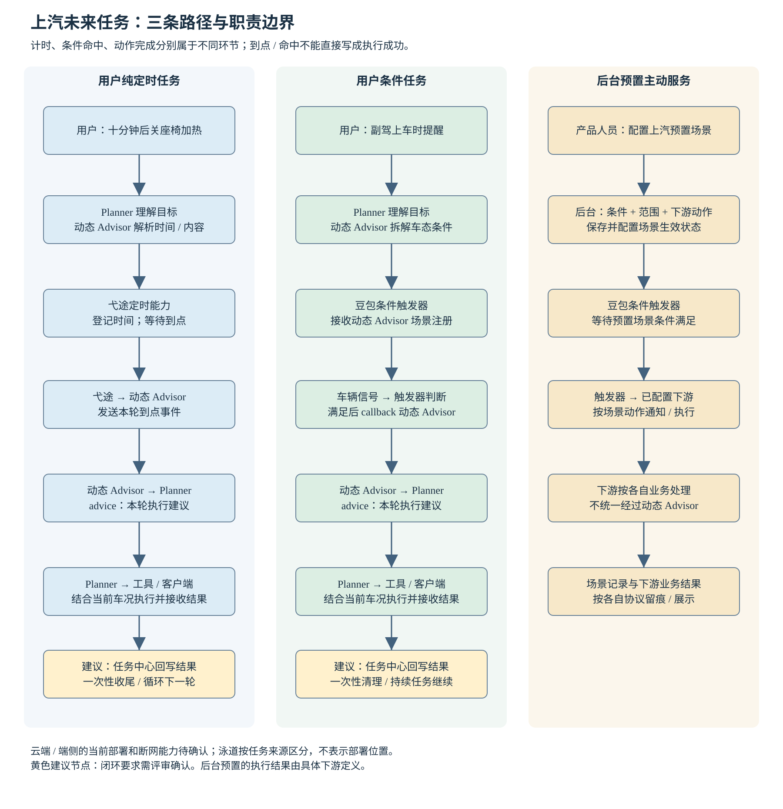
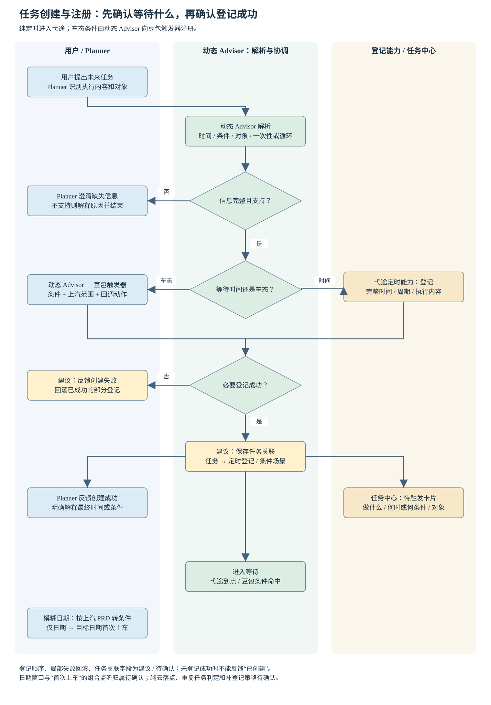
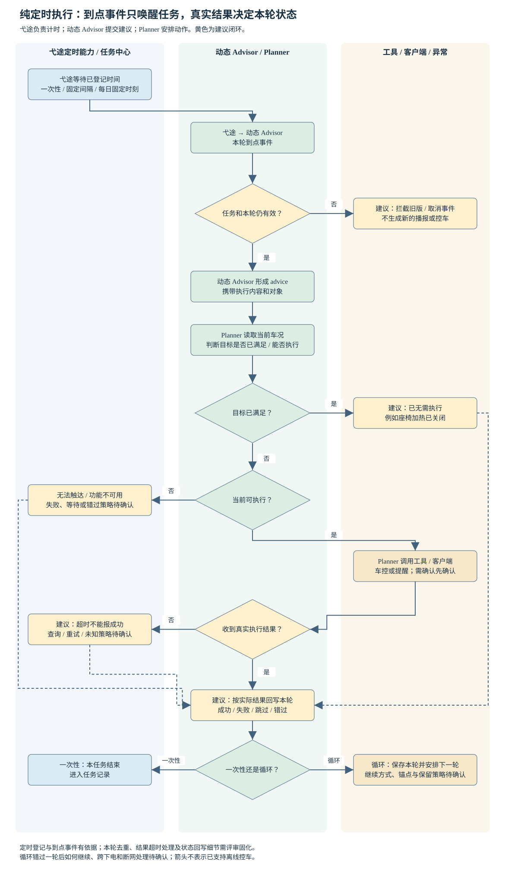
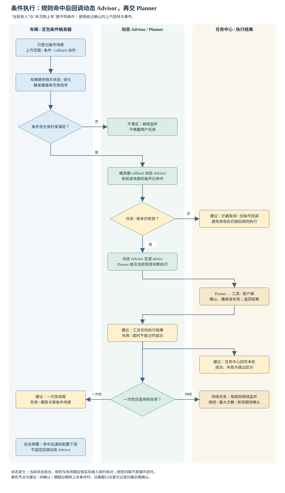
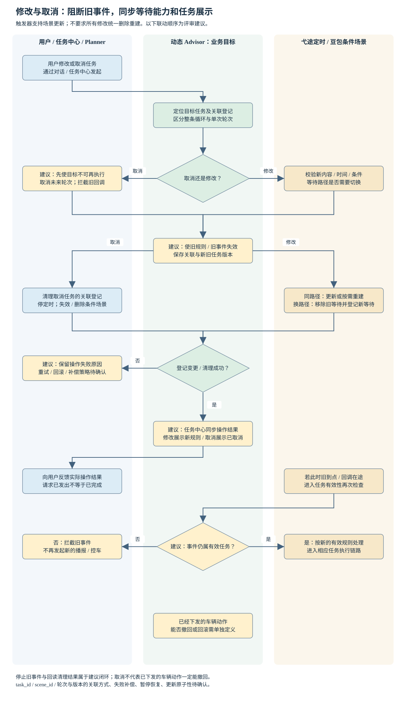
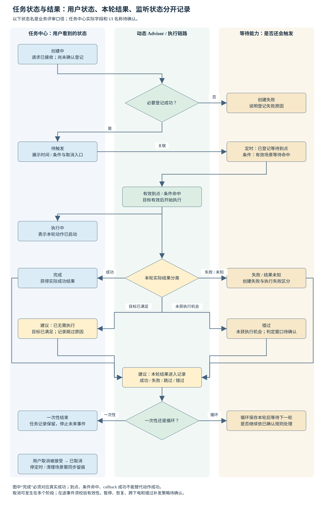

# PRD｜上汽定时任务与触发器整体流程

版本：v02 评审稿｜整理日期：2026-10-13｜适用项目：上汽 DNA 豆包上车｜文档状态：待跨团队确认与联合验收

本次更新：采用标准 PRD 的 8 章结构，细化 6 张流程图；补齐功能编号、任务卡片、执行结果、修改取消、异常处理和验收矩阵。保留赛力斯参考文档中的背景、定义、案例、状态和变更议题，并按上汽职责重新编排。

**核心结论：上汽由弋途负责定时能力；豆包 / 火山触发器负责接收条件场景、判断车辆信号条件和通知下游，并支持后台预置场景。用户条件任务由弋途动态 Advisor 注册，条件满足后触发器通知动态 Advisor，动态 Advisor 再向 Planner 提交执行建议。纯定时任务进入弋途的定时链路。** [S1][S2][S3]

本文的证据标签：**产品规则**指原始 SOR / PRD 明确提出的要求；**分工依据**指正式文档或用户提供截图明确描述的职责；**建议**指本次为补齐产品闭环新增的方案；**待确认**指尚缺少明确资料或当前版本验证。产品规则与历史文档中的“完成”记载，均不代表本稿已确认所有车型当前上线。文中流程图将建议和待确认节点单独标示，不能将整张图当作现行实现截图。

## 1. 需求概述

用户需要把“现在做”延伸为“到点做”“条件满足再做”和“按周期重复做”。本需求定义上汽定时任务与条件触发的整体产品链路，让系统能够理解用户的未来诉求、保存任务、等待正确的唤醒机会、结合当时状态执行，并让用户看到真实结果。

本次评审需要对齐三件事：谁负责等待，谁负责执行，谁负责把结果与取消状态同步给用户。只有这三件事连成闭环，系统才能兑现“十分钟后帮我关加热”，避免出现答应了却未登记、取消了却仍提醒、已到点却显示执行成功等问题。

文档覆盖用户定时任务、用户条件任务、后台预置主动场景以及三者涉及的创建、触发、执行、状态、修改和取消。长期目标任务、生态订单、清单助手等持续任务只用于说明相邻模块边界，本次不补写其完整 PRD。

## 2. 协作方

| 协作角色 | 负责确认的产品决定 | 需提供的评审产物 |
| --- | --- | --- |
| 上汽业务产品 | 车型范围、用户场景、动作权限、跨下电与错过策略 | 本次支持清单及业务规则确认 |
| 豆包汽车产品 | Planner 执行与交互边界、条件触发范围、整体体验 | 用户流程、条件能力与交互规则确认 |
| 弋途动态 Advisor 产品 / 研发 | 时间与条件解析、任务托管、执行建议、变更取消 | 任务生命周期、支持范围与处理回执 |
| 弋途定时能力负责人 | 时间登记、到点通知、循环推进、部署与恢复 | 当前端云能力、时间规则与联调证据 |
| 豆包 / 火山触发器产品 / 研发 | 条件能力、场景注册与管理、车辆范围、命中通知 | 上汽信号清单、场景回读与命中证据 |
| Planner / Director 产品 / 研发 | 用户需求理解、澄清、任务触发后的执行安排 | 动作序列、工具结果与用户反馈 |
| 任务中心 / 客户端产品与研发 | 卡片、查询、状态记录、取消回调、倒计时 | 交互稿、字段映射与车端展示证据 |
| 车端信号与车控负责人 | 信号含义、变化时序、工具执行、状态回读 | 车型能力表、信号与实车动作证据 |
| 交互设计与测试 | 反馈话术、并发交互、验收用例与问题定位 | 最终交互稿、必过集与失败记录 |

本稿不指定未经核实的人名。评审后由各角色补齐实际负责人、目标版本与承诺范围。后台预置场景的下游还需按场景补充接收方，例如指定 Advisor 或推荐服务。

## 3. 背景

用户说“十分钟后关闭座椅加热”，系统需要等时间；用户说“副驾上车时提醒他系安全带”，系统需要等状态变化。两者都属于未来任务，但如果在讨论中笼统称为“触发器任务”，就容易把计时、条件判断、任务管理和执行混成一个模块。

这种混淆会直接影响产品结果。例如两边同时登记倒计时，会到点重复提醒；只在任务中心生成卡片而未登记时间，用户会以为任务已经可以执行；取消只移走卡片而未停止定时或条件监听，用户仍可能收到提醒。因此本次先用业务职责解释整体流程，再让各方确认对应的接入和异常处理。

用户提供的截图明确了上汽当前沟通口径：定时器由弋途承担；豆包支持条件触发和后台预置；动态 Advisor 会注册场景。上汽 SOR 进一步明确：动态 Advisor 解析并托管时间 / 信号条件，火山触发器感知条件并通知动态 Advisor，Planner 在任务触发时根据建议完成实际执行。[S1][S3]

用户提供的赛力斯文档提出在云端触发器新增定时任务能力。本稿沿用它的定义、业务流程、案例、状态变化与任务变更议题，但使用上汽原始资料确定责任和规则。赛力斯的相对延时 24 小时、绝对时间 7 天、下电即结束或一律删旧建新等口径，不自动成为上汽规则。[S0]

一期与二期材料还体现了演进：一期记载弋途定时自闭环，二期提出端侧定时、动态倒计时、弱网触达及提前生成执行策略。部分交互章节标有“616 off”，部分限制已有删除线。这些资料可以解释方案方向，发布范围必须以当前版本清单及实车验收为准。[S2][S4]

## 4. 目标与验收指标

### 4.1 产品目标

目标一：用户能把需要未来跟进的事情交给系统，并知道系统理解的具体时间、条件、对象与内容。

目标二：各模块各自负责一段清楚的业务过程。弋途等时间，豆包触发器等车辆条件，动态 Advisor 管理目标并提出建议，Planner 安排执行，任务中心呈现状态和结果。

目标三：修改、取消、错过和执行失败都有明确结果。系统不能把“已经接收”“条件命中”“工具请求发出”展示成“车辆动作完成”。

### 4.2 验收指标

以下为本稿建议的验收口径，数值性门槛由产品和测试评审后确认。本次没有线上统计基线，不虚构当前成功率、时延或覆盖率。

| 指标 | 统计对象与计算方法 | 本次建议准出要求 | 数据来源 |
| --- | --- | --- | --- |
| 任务分流正确 | 已确认必过集中，实际等待路径与预期一致的用例数 / 总用例数 | 第 8 章纳入本次发布范围的必过集全部通过 | 创建记录、定时登记或条件场景 |
| 时间规则一致 | 解析结果、最终反馈、卡片、登记时间是否相同 | 不得出现一个任务多套时间口径 | 解析记录、卡片回读、登记回读 |
| 假成功次数 | 未取得真实结果却展示完成 / 已提醒 / 已控车的次数 | 必过集为 0 次 | 下游回执、车端 UI、实际车辆状态 |
| 修改取消后旧任务执行 | 修改成功或取消生效后，旧规则继续推动新的执行的次数 | 必过集为 0 次 | 旧回调、业务状态、实际播报 / 控车 |
| 一次性重复执行 | 同一有效任务重复产生同一轮动作的次数 | 必过集为 0 次；防重方案需评审 | 任务标识、触发记录、执行回执 |
| 任务状态一致 | 卡片、任务业务状态与真实结果的逐项核对 | 所有必过场景一致，未决结果有明确展示 | 任务中心、业务回读、车端展示 |
| 触发到结果时延 | 从有效到点 / 条件命中，到用户可见结果的时间 | 联调采样后确认门槛；不承诺秒级 | 关键事件时间与实际交互记录 |

验收周期按相对里程碑推进：范围与规则确认完成后，冻结必过集；联调完成后检查所有必过场景；灰度阶段观察误触发、漏触发、重复执行与状态不一致。目标版本、样本量和观察周期由协作方补充。

## 5. 用户与场景

### 5.1 面向谁、解决什么事

| 用户 / 使用方 | 遇到的问题 | 典型诉求 | 产品需要保存的内容 |
| --- | --- | --- | --- |
| 车内用户 | 现在不能执行，希望稍后处理 | 十分钟后关闭主驾座椅加热 | 时间、动作、座位、一次性 |
| 有明确日程的用户 | 容易忘记指定时刻的事情 | 明天 9 点提醒我出发 | 完整日期与时间、提醒内容 |
| 需要周期陪伴的用户 | 希望系统持续跟进 | 每小时提醒我活动一下 | 周期、下一轮时间、结束方式 |
| 提出条件任务的用户 | 不知道条件何时发生 | 副驾上车时提醒他系安全带 | 条件含义、对象、内容、次数 |
| 使用模糊日期的用户 | 只记得某一天，没有具体钟点 | 明天提醒我拿快递 | 日期窗口、首次上车、一次性 |
| 后台配置人员 | 需要让指定车型 / 车辆主动服务 | 上汽渠道的占座变化主动场景 | 适用范围、条件、下游动作、频控 |

### 5.2 场景边界

用户创建任务需要能够识别、能够登记、能够执行。任一环节不支持，都应说明具体限制。例如“等宝宝哭了提醒我”需要核对实际感知能力，不能因为有摄像头就承诺能识别哭声；“每 5 秒提醒一次”触及上汽分钟粒度限制，不能通过改用条件频控绕过。[S1][S4]

用户请求涉及座位、车辆动作或提醒对象时，系统需要保留对应信息。任务创建时车况只能帮助理解请求；真正执行时还要使用当时的信息，例如加热是否仍开启、功能是否可用、用户是否处于适合提醒的场景。

## 6. 用户价值

用户把未来任务托管给系统后，能继续开车或做其他事，减少记时间和反复检查条件的负担。任务中心让用户知道系统等什么、下一次什么时候做、是否完成，以及怎样停止后续服务。

对跨团队协作，这份定义让问题能落到具体环节：时间解释错误找解析与澄清；到点没通知查定时链路；条件未命中查条件规则和信号；已通知但未执行查动态 Advisor 与 Planner；车辆已经执行但卡片未更新查结果回写。评审可以围绕证据讨论，减少只用“触发器有问题”概括整条链路。

本稿未开展竞品对比，不声明优于其他车企。价值判断集中在上汽本次体验是否可托管、可理解、可管理和可验证。[S1]

## 7. 产品方案

### 7.1 产品定义与范围

**定时任务**：系统保存用户指定的执行内容与时间规则，在未来时间或周期到达时唤醒后续执行。它包括相对延时、绝对时间、固定周期和每日固定时刻。定时到点提供一次执行机会，实际能否完成由后续链路判断。

**条件任务**：系统保存用户指定的条件和执行内容，等受支持的状态变化或条件成立后继续处理。动态 Advisor 把自然语言转成可执行条件，向豆包触发器注册场景；触发器命中后通知动态 Advisor。[S1][S2]

**后台预置场景**：产品人员预先配置适用范围、条件和命中后的动作，由触发器运行。它不要求用户先发起任务，也不默认生成一条用户定时任务，接收方以该场景配置为准。[S3][S6]

**任务与本轮执行**：任务是用户托管的一件事；本轮执行是某次到点或条件命中后的处理。例如“每天 9 点提醒喝水”是一条任务，每天是一个轮次。今天失败或错过，不能直接推断整条循环任务已取消；循环是否继续要按已确认规则处理。

| 本次定义范围 | 处理口径 |
| --- | --- |
| 明确时间的一次性与循环任务 | 弋途定时能力登记与推进 |
| 用户车辆条件任务 | 动态 Advisor 注册，豆包触发器判断与通知 |
| 后台预置主动场景 | 后台配置，按已配置下游承接 |
| 定时采样后再做视觉判断 | 说明业务分工；列入能力验证后才能发布 |
| 模糊日期转首次上车条件任务 | 按 SOR / 二期 PRD 规则解释，组合判断落点待确认 |
| 任务查询、卡片、修改与取消 | 任务中心与业务方联动 |
| 通用时间 + 条件多阶段编排 | 本稿提出职责建议，通用支持能力待确认 |
| 跨下电保留、离线车控、跨端补发、整车唤醒 | 当前证据不足，作为待确认事项 |
| 长程生态订单 / 通用日程管理 | 仅说明边界，本次不扩展功能范围 |

### 7.2 模块职责与整体架构

图 1 先区分任务来源，再区分等待路径。用户未来请求由 Planner 理解并交给动态 Advisor；明确时间交给弋途定时能力，车辆条件交给豆包触发器。后台预置直接进入配置的条件场景。前两类用户任务唤醒后由动态 Advisor 提出执行建议；后台场景命中后由其配置下游承接。执行结果回写与用户展示构成收尾，建议节点需要联调确认。

| 模块 | 必须负责的业务过程 | 不可混淆的边界 | 依据 |
| --- | --- | --- | --- |
| Planner / Director | 理解用户、澄清必要信息、创建目标；唤醒后安排执行并根据工具结果反馈 | SOR 称 Planner，较新 PRD 称 Director，本稿合称 Planner，不画成两层独立决策系统 | S1、S5 |
| 动态 Advisor | 解析时间 / 条件、生成并托管任务、管理目标；被唤醒后提出执行建议 | advice 就是交给 Planner 的建议，不是车辆完成回执 | S1、S2 |
| 弋途定时能力 | 保存时间规则、等待到点、安排循环的下一轮 | 端侧 / 云端覆盖以当前版本确认；倒计时显示不等于离线车控 | S2、S3、S4 |
| 豆包 / 火山触发器 | 校验并运行条件场景，判断车辆信号，命中后通知登记下游 | 条件频控不是固定周期定时；触发成功不是任务完成 | S1、S3、S6 |
| 任务中心 | 接入治理、状态管理、查询、卡片与任务记录；取消时回传业务事件 | 只移除卡片不足以停止后续调度和监听 | S1 |
| 车端信号与 Context | 提供车辆、人和环境状态 | Context 指当前信息；旧状态不能当作执行时最新状态 | S1、S5 |
| 下游工具与客户端 | 执行车控或交互，提供实际结果与用户可见反馈 | 发起调用、工具成功、车辆状态一致需分别检查 | S1、S5 |

### 7.3 功能需求总表

P0 / P1 表示本稿建议的评审优先级，发布时还需核对现有实现。编号用于跨团队追踪，不代表新增接口编号。

| 编号 | 功能要求 | 优先级 | 证据性质 / 验收入口 |
| --- | --- | --- | --- |
| FR-01 | 识别未来任务，确认内容、时间 / 条件、对象、次数，必要时澄清 | P0 | 产品规则 S1；检查解析和用户反馈 |
| FR-02 | 明确时间走弋途定时，车辆条件走注册场景，后台预置走配置下游 | P0 | 分工依据 S1–S3；检查实际等待路径 |
| FR-03 | 校验过去时间、无效日期、模糊时间、循环频率和远期上限 | P0 | 产品规则 S1、S4；检查拒绝 / 澄清且无残留 |
| FR-04 | 用户条件按上汽可用能力注册，保存对应任务关系 | P0 | 注册规则 S1、S6；关联关系为建议 |
| FR-05 | 任务中心完成授权、容量与元数据校验，返回创建结果 | P0 | 产品规则 S1；核对业务接入和卡片 |
| FR-06 | 到点或条件命中后通知动态 Advisor，由其向 Planner 提交建议 | P0 | 分工依据 S1、S2；核对唤醒与接收 |
| FR-07 | Planner 根据当前状态安排实际执行，并结合工具反馈反馈用户 | P0 | 产品规则 S1、S5；检查实际执行结果 |
| FR-08 | 展示内容、时间 / 条件、对象、状态；相对时间按分钟更新 | P0 | 状态和倒计时有 S1、S4 依据；细化卡片字段为建议 |
| FR-09 | 支持按任务精准取消，终止后续执行并回传业务事件 | P0 | 产品规则 S1、S5；检查调度 / 监听清理 |
| FR-10 | 修改后同步新规则与卡片，旧规则不继续执行 | P0 | 按需更新有 S5、S6 依据；切换与回滚为建议 |
| FR-11 | 区分触发、执行中、完成、失败、错过与已无需执行 | P0 | 完成 / 失败 / 错过有 S1 依据；扩展展示为建议 |
| FR-12 | 循环任务保存本轮结果并按约定进入下一轮 | P0 | 循环有 S1 依据；锚点、跳过续跑与结束限制待确认 |
| FR-13 | 后台配置明确上汽范围、受支持条件、下游动作与频控 | P0 | 分工依据 S3、S6；检查范围和停用 |
| FR-14 | 对重复回调、取消在途回调和半成功创建进行处理与留痕 | P0 | 本稿建议；故障注入验收 |
| FR-15 | 支持视觉采样任务时明确新鲜度、未知结果和重复提醒规则 | P1 | 思路依据 S2；实际范围与体验规则待确认 |

### 7.4 时间解析与任务分流

| 用户表达 | 解析结果与等待方式 | 产品规则 / 待确认 |
| --- | --- | --- |
| 十分钟后关闭主驾座椅加热 | 相对延时一次性；转为明确未来时间，弋途等待 | 支持相对时间 S1；基准时刻建议用请求被接受时，具体待确认 |
| 明天 9 点提醒我出发 | 完整日期 + 时刻，一次性；弋途等待 | 按分钟服务，超过 365 天拒绝 S4 |
| 每小时提醒我活动 | 固定间隔循环；弋途逐轮唤醒 | 最小循环间隔 1 分钟 S4；锚点与跳过算法待确认 |
| 每天早上 9 点提醒喝水 | 每日固定时刻循环；弋途推进下一次 | 循环需求有 S1 依据；跨下电规则待确认 |
| 每分钟看看宝宝是否睡着 | 周期观察，观察结果满足条件才提出提醒建议 | 一期提供定时结合视觉思路 S2；能力先验证 |
| 明天提醒拿快递 | 目标日期首次有人上车的一次性条件任务 | 产品规则 S1、S4；日期窗口与首次记录归属待确认 |
| 明天下午提醒我 | 对应日期时段首次上车或在车上，转条件任务 | 产品规则 S4；时段边界与在车上唤醒机制待确认 |
| 下周 / 下个月 / 某月提醒我 | 先询问具体哪一天 | 产品规则 S4；不能自行填一个日期 |
| 当前 19:00，用户说 8 点 | 按最近未来时间映射为今天 20:00 | 产品规则 S4；反馈最终日期与时间 |
| 当前 19:00，用户说 6 点 | 映射为明天 06:00 | 产品规则 S4；不能理解为已过去的今天 06:00 |
| 每 5 秒提醒一次 | 拒绝当前频率，说明按分钟服务 | 产品规则 S4；不得静默改成 1 分钟后承诺成功 |

时间校验先解决无效日期、显式过去时间与歧义，再检查频率和远期边界。用户同意调整后才按新规则创建；对于 PRD 明确的默认映射，应把结果呈现给用户。多个提醒按分钟粒度合并，不承诺在 9:01:05 准时播报；合并触达也不能导致各任务的结果记录丢失。[S1][S4]

二期“循环最多执行 30 次”已有删除线，不采用为现行规则。一期旧笔记中的 10 秒 review、固定最大任务数和长期 Preview，也不覆盖二期分钟粒度及任务中心按类型 / 业务配置容量的要求。[S2][S4]

**三个容易误分流的例子：**“十分钟后关加热，执行前看看是否还开着”是定时加执行检查；“十分钟后开始，等副驾上车再提醒”是两阶段组合，建议先等时间再启用条件监听，通用编排能力待确认；“明天提醒拿快递”按上汽规则走首次上车条件，不能自行改成明天 9 点。日期窗口如何与上车信号一起判断，需要单独确认。

### 7.5 任务创建与注册

图 2 从用户请求开始，细化信息是否齐全、规则是否合法、条件是否受支持、该走哪条登记路径，以及任务中心和等待模块的成功 / 失败反馈。它把“系统理解了”与“任务已经登记”分开，避免只生成卡片就答应用户未来会执行。

1. **理解请求。** Planner 判断现在执行还是未来执行。未来任务交给动态 Advisor；时间、对象或动作不明确时先澄清。例如“十分钟后关掉它”需要确认“它”是什么。
2. **解析与校验。** 动态 Advisor 提取内容、对象、时间 / 条件、一次性 / 循环。时间校验按 7.4 处理；条件先查询上汽可用能力。无效日期、不支持动作或条件不明时，澄清或拒绝。[S1][S4]
3. **选择等待路径。** 明确时间登记弋途定时；车辆条件由动态 Advisor 注册豆包条件场景；模糊日期按规则转换。定时登记、场景登记和任务接入的先后顺序由接入方案确认。
4. **接入与登记。** 任务中心校验授权、容量与元数据，写入任务并返回结果；等待模块登记规则。建议只有必需登记均成功才进入有效待触发，保存任务与登记关联。[S1]
5. **反馈与补偿。** 建议成功后反馈最终规则并展示一致卡片；创建中只反馈处理中。任务中心失败应避免孤立登记，等待登记失败应避免有效卡片，补偿清理失败留痕追踪。部分二期交互章节有 off 标记，话术与交互按目标版本确认。[S4]

### 7.6 流程一：纯定时到点执行

图 3 从弋途到点开始，经过任务有效性、是否已执行、当前是否可执行等判断，再进入动态 Advisor 建议、Planner 执行和真实结果。循环是否进入下一轮与一次性收尾分开；到点、发起调用、完成动作不能合并成一个成功状态。

1. **等待到点。** 弋途定时能力发出对应任务本轮到点事件。用户取消 / 修改后不应按旧规则新发起执行；在途事件仍需业务校验，这是本稿建议。
2. **提出执行建议。** 动态 Advisor 接收有效事件，向 Planner 提交任务原文、当前规则与执行建议。二期提出提前生成策略降低延迟，但执行前仍需校验最新情况，当前覆盖待确认。[S1][S4]
3. **实际执行。** Planner 检查目标是否已经满足、动作是否能做、是否需要确认及交互时机，再调用车控或提醒链路。收到工具反馈后继续判断，必要时修正后续动作。[S5]
4. **记录与收尾。** 完成、失败、已无需执行或错过分别进入对应记录。一次性任务结束；循环任务保留本轮结果并等待下一次。循环错过后的续跑和最大持续范围需要先确认。

### 7.7 流程二：条件触发执行

图 4 细化车辆信号是否满足条件、场景是否有效、频控是否满足、下游是否接收、任务是否仍有效和最终执行。注册成功只表示系统开始等待，不表示用户条件已经发生；命中通知只表示条件到了，不表示提醒或车控完成。

1. Planner 理解“副驾上车时提醒他系安全带”，动态 Advisor 拆出副驾上车条件、提醒内容、对象和一次性需求。
2. 动态 Advisor 获取上汽可用条件并校验。无法识别、不支持或条件不明确时，由 Planner 澄清或拒绝并说明原因。不能把“上车”悄悄改成“车门打开”，两者业务含义不同。[S1]
3. 动态 Advisor 向豆包触发器注册场景，明确条件、适用上汽渠道 / 车辆、命中后回调动态 Advisor 的动作。任务中心接入与场景登记的关联关系建议留存，注册失败不得反馈可触发。[S2][S6]
4. 车辆提供相关信号，触发器根据登记规则判断。二期技术方案区分状态变化与当前状态；当前上汽版本覆盖需确认。产品必须说清“当前有人”还是“本次由无人变有人”，避免持续占座反复提醒。[S7]
5. 不满足时继续等待；满足且符合有效性与频控要求时，触发器通知登记下游。动态 Advisor 找到对应目标，检查是否仍有效，再向 Planner 提交建议。防重复与旧事件校验为本稿建议。[S1][S2]
6. Planner 按当前状态安排执行，收到实际结果后反馈和回写。一次性任务结束后停止后续监听；循环条件任务按已确认的再次命中规则继续。[S1][S5]
7. 用户取消、目标达成或失效时，业务方联动清理条件场景。场景停用 / 删除结果应可追踪；不能仅靠卡片隐藏表示监听已经停止。

对“明天首次上车”还需确定目标日期窗口、首次记录和期限：今天上车不触发，明天首次上车才触发，明天第二次不重复。用户跨午夜已在车内、目标日期一直未上车，以及“下午在车上”没有新信号变化时谁发起判断，均需补齐。

**频控与定时不同。** 场景最短执行间隔 60 秒，只表示两次符合条件的执行至少间隔 60 秒；它不会每 60 秒主动醒来。不能据此替代“每分钟观察一次”的定时能力。[S6]

### 7.8 流程三：后台预置主动场景

后台预置与图 1 的独立来源、图 4 的条件判断路径衔接：配置人员选择上汽范围、条件、动作与频控 → 校验并发布生效 → 接收车辆信号 → 判断有效性、条件与频控 → 命中后通知配置下游 → 检查下游响应与用户可见体验。停用后需验证不再产生新的有效触发；下游不默认经过动态 Advisor。

配置人员应先回答“针对谁、什么变化、做什么、多久能再做”。例如某个上汽占座变化场景，必须核对该渠道支持的占座信号、适用车辆和下游 Advisor。不能照搬接口示例里的 seres 渠道、座位名称或生效范围。[S6]

后台规则保存、规则生效、条件命中、下游接收、卡片展示和车辆执行是不同验收层级。场景保存成功仍可能选错渠道；条件命中仍可能下游未响应。建议配置发布后回读生效范围，并进行命中与停用测试，具体后台交互与权限按当前能力确认。

### 7.9 任务中心与卡片信息

任务中心原始要求包括授权业务接入、按类型和业务配置容量、校验标题 / 描述 / 图标 / 来源 / 组件，创建时返回结果，管理待办 / 进行中 / 任务记录，更新展示内容，支持定时动态时间显示和取消事件回传。[S1]

通用《任务中心 PRD》v0.3（2026-09-15）采用待执行、运行中、暂停中、已关闭等状态；首阶段中心只展示运行中与暂停中，首阶段“我的任务”提供删除、“预设任务”提供暂停，第二阶段增加循环定时 / 循环条件暂停。上汽当前适用版本与映射未确认，因此本文不把通用状态直接当作上汽现行界面。[S8]

通用 PRD 规定删除交互需二次确认；如果上汽采用该版本，应纳入最终交互与验收。通用容量“我的任务 46 条 = 定时 20 + 条件 20 + 长期 6”暂列适用待确认，不作为本稿上汽当前上限。[S8]

以下细化字段是本稿建议，最终以交互稿与任务中心支持项确认。任务卡片要帮助用户判断“系统理解得对不对”和“这件事现在进行到哪一步”。

| 信息 | 示例 | 展示目的与规则 |
| --- | --- | --- |
| 标题 / 执行内容 | 关闭主驾座椅加热 | 描述具体动作；不只写“定时任务” |
| 时间 / 条件 | 明天 09:00；副驾首次上车 | 显示系统最终解释，模糊表达转化后说明实际条件 |
| 对象 / 位置 | 主驾座椅；提醒当前用户 | 避免错位执行与误解 |
| 次数 / 周期 | 一次；每天；每小时 | 让用户知道是否仍有未来轮次 |
| 动态时间 | 还剩 5 分钟 | 相对时间按分钟更新；时间已过时不能保留旧倒计时 |
| 任务状态 | 待触发、进行中、任务记录 | 与实际业务进度一致，映射需任务中心确认 |
| 本轮结果 | 今日已提醒；本轮执行失败 | 循环任务分开表达本轮结果与未来是否继续 |
| 原因与限制 | 加热已关闭；未取得执行结果 | 不把跳过、失败和未知全部显示为完成 |
| 操作入口 | 查看、取消；可支持的修改入口 | 按目标版本提供，不虚构暂停开关 |
| 下一次信息 | 下一次：明天 09:00 | 循环推进后同步，下一轮不可确定时明确反馈 |

建议创建、修改、取消反馈使用真实阶段话术：“正在创建”“已设为明天 9 点”“未能设置成功”“已取消后续提醒”。如果动作已下发才收到取消，需反馈后续任务已停止及本轮实际状态，不能承诺撤回已执行动作。

### 7.10 修改、取消与异常处理

图 5 先找到准确任务，再区分修改与取消；修改更新等待规则、执行内容和展示，取消阻止未来推进并清理调度 / 场景。图中旧事件拦截、失败补偿和清理追踪均为本稿建议；当前更新接口与状态切换顺序需各方确认。

Director PRD 提出 task_agent 按需更新触发器注册内容或动作，触发器接口也支持更新。因此上汽不统一要求“删除旧任务 + 创建新任务”；具体可更新还是需要重建，按弋途定时与条件场景能力确定。[S5][S6]

| 用户操作 | 业务处理 | 建议 / 待确认边界 |
| --- | --- | --- |
| 重复创建同一请求 | 判断是新增一条还是替换已有任务 | 重复识别规则待确认；不能仅凭文本相同自动删任务 |
| 修改时间 / 周期 | 更新未来安排，同步卡片与下一次信息 | 旧事件失效、更新失败恢复策略需确认 |
| 修改执行内容 / 对象 | 动态 Advisor 按需更新目标内容，必要时同步登记 | 保证旧建议不会执行新任务的错误版本 |
| 修改条件 | 更新 / 重建场景，保留正确回调和适用范围 | 防止旧条件与新条件同时有效 |
| 定时改条件或反向转换 | 切换等待路径并清理旧登记 | 切换顺序、失败补偿与任务标识待确认 |
| 取消一次性任务 | 按任务精准取消，停止对应等待并记录 | 晚到事件再次检查有效性 |
| 取消循环任务 | 停止未来所有轮次，处理在途本轮 | 已下发动作能否撤回另行确认 |
| 仅取消今天这一轮 | 与取消整条循环分开理解 | 当前是否提供该能力需确认后再展示 |
| 关闭再打开任务开关 | 先确定暂停、取消还是重建语义 | 未找到足够依据，不承诺自动恢复 |

建议取消闭环：任务中心回传取消事件 → 动态 Advisor 将目标置为不可继续推进 → 清理弋途定时与关联条件场景 → 接收清理结果 → 回写任务记录与卡片。清理失败时继续追踪，后续到点 / 命中不能绕过业务有效性检查。已执行的车控无法仅靠删除任务回滚。[S1][S5]

task_id 指用户任务身份，scene_id 指条件场景身份；定时登记还可能有自己的身份。建议保存关联关系、本轮与规则版本，才能核对一个回调属于哪条任务、哪一轮、哪次修改。这是追踪要求，不是本稿规定现行接口字段。

| 异常 | 用户可能遇到的问题 | 产品处理口径 | 性质 |
| --- | --- | --- | --- |
| 任务中心成功、等待登记失败 | 卡片有任务但不会触发 | 不显示有效待触发；反馈失败，清理半成功内容 | 建议 |
| 等待登记成功、任务接入失败 | 用户找不到任务却被提醒 | 撤销孤立登记，清理失败留痕 | 建议 |
| 条件 / 时间已触发，通知失败 | 用户没有得到服务 | 区分命中与接收，重试范围和错过窗口待确认 | 待确认 |
| 重复到点 / 重复回调 | 同一轮重复提醒或控车 | 同一有效轮次只推进一次，重复留痕 | 建议 |
| 取消与到点同时发生 | 已取消还收到新执行 | 执行前检查任务有效性与版本，确认生效边界 | 建议 |
| 状态已满足 | 手动关闭加热后又收到控车 | 记录已无需执行，不机械重复动作 | 建议 |
| 工具结果超时 | 不知道是否真正执行 | 展示结果未确认，查询 / 等待，禁止假成功 | 建议 |
| 到点下电 / 离线 | 任务是否丢失、是否补发不清楚 | 按已确认策略处理，不承诺唤醒车辆或手机通知 | 待确认 |
| 循环某一轮失败 / 错过 | 用户不知道以后是否还会继续 | 分开记录本轮与整条循环，续跑策略先确认 | 待确认 |
| 视觉不可用或看不清 | 系统误判宝宝状态 | 标为未知，不当作未睡着；新鲜度与结束策略确认 | 建议 |
| 多个任务同分钟到点 | 插播过密、结果记录混乱 | 按分钟合并原则和交互策略处理，各任务分别留结果 | S4；具体策略待确认 |

### 7.11 任务状态、真实结果与循环收尾

图 6 区分创建结果、等待状态、本轮执行结果和循环任务去向。有效登记进入待触发；有效唤醒才进入后续处理；取得实际结果才判定完成 / 失败。本轮终止后，一次性进入记录，循环按规则继续。错过的判定时点和清理中的显示是待确认 / 建议节点。

| 业务状态 | 进入条件 | 用户展示与收尾 | 依据性质 |
| --- | --- | --- | --- |
| 创建中 | 任务请求已接收，登记未完成 | 展示处理状态，不承诺未来能执行 | 建议 |
| 待触发 | 必需的任务与定时 / 场景登记已成功 | 展示内容与规则，等待有效唤醒 | 任务中心待办有 S1 依据；细化条件为建议 |
| 执行中 | 有效唤醒后实际处理已启动 | 根据交互安排呈现进度，不提前报完成 | 进行中有 S1 依据 |
| 完成 | 实际动作或交互达到目标并取得结果 | 一次性归记录；循环保存本轮结果 | S1；具体回写链路待确认 |
| 失败 | 登记或执行失败，已获得失败信息 | 区分创建失败、执行失败及原因 | S1 |
| 已无需执行 | 执行前发现目标已达成 | 如加热已关闭，记录未重复控车及原因 | 建议 |
| 结果未确认 | 已发起执行，尚无可靠结果 | 不显示完成，继续等待 / 查询；期限待确认 | 建议 |
| 错过 | 满足已确认的错过条件，未获得本轮执行机会 | 定时任务错过触发时间进入任务记录 | S1；判定窗口、循环后续待确认 |
| 已取消 | 业务取消生效，未来任务不再推进 | 同步卡片与记录，追踪调度 / 场景清理 | S1、S5；清理留痕为建议 |

定时能力另有自己的“登记等待 → 本轮到点 → 一次性结束 / 下轮等待 / 取消停止”；条件场景另有“有效 / 失效 / 删除”。用户任务状态与这些内部状态不能机械一一对应。一次性任务已经完成而场景仍有效，需要清理；后台场景被运营停用，也不能直接显示成用户取消任务。[S6]

提醒成功至少需要实际交互链路的结果；车控成功需要工具结果，必要时核对车辆状态。任务中心的“完成”不能仅根据到点事件或条件命中设置。若状态矛盾，需保留未知或失败原因并查明，不能用一句成功话术覆盖。

### 7.12 六个业务案例

#### Case 1：十分钟后关闭主驾座椅加热

用户请求：“十分钟后帮我关闭主驾座椅加热。”类型是相对延时一次性。动态 Advisor 确认主驾、关闭加热与十分钟后，弋途登记未来时间，任务中心展示内容和倒计时。到点后动态 Advisor 提出建议，Planner 检查当前加热状态并安排车控，再根据真实结果反馈。[S1][S3]

验收应看到登记成功、对应到点事件、Planner 动作、工具结果和车辆状态。建议提前已关闭时记录已无需执行；创建失败不能承诺十分钟后关闭。任务取消后停止未来推进。车辆下电是否保留、无人时关闭动作如何处理，需按上汽动作规则确认，不能直接套赛力斯结束条件。

#### Case 2：明天 9 点提醒我出发

用户请求：“明天 9 点提醒我去万达。”类型是绝对时间一次性。动态 Advisor 解析完整日期与时刻；若在 2026-10-13 创建，例子对应 2026-10-14 09:00，实际按创建时刻计算。弋途等待到点，动态 Advisor 向 Planner 提出提醒建议，实际提醒后记录结果。[S1][S4]

提醒出发不等于自动启动导航，后续导航按用户意图与执行判断决定。SOR 要求错过触发时间进入任务记录，但允许延迟窗口、离线判定、跨端通知和补发尚需确认。到点无法触达不能显示已提醒。

#### Case 3：每小时开一次主驾座椅按摩

用户请求：“每小时帮主驾开一次座椅按摩。”类型是固定间隔循环，车型是否支持按摩须先校验。弋途逐轮唤醒，动态 Advisor 提建议，Planner 检查当前能力与状态，调用车控并保存本轮结果，再等待下一轮。[S1][S3]

建议跳过本轮与取消整个任务分开记录。循环按首次锚点还是本轮结束重新计时，必须统一，避免执行耗时让下一次越来越晚。最大时长、结束条件、用户手动关按摩是否取消未来任务均待确认；已删除的 30 次上限不采用。

#### Case 4：每分钟看后排宝宝是否睡着

用户请求：“每分钟看看后排宝宝有没有睡着，睡着了提醒我。”类型是循环观察，定时到点先获取本轮视觉信息，再判断是否满足提醒条件，满足后动态 Advisor 提建议，Planner 安排提醒。定时与观察由弋途动态 Advisor 链路组织，一期资料支持这个处理思路，实际能力先验收。[S2]

看不清应视为未知；不能用旧图判断当前状态，也不能把没取得图解释为没睡着。连续睡着是否只提醒一次、首次观察即睡着怎样处理、最长观察时长及取消后的采样清理为待确认规则。“每分钟看看”不等于每分钟提醒一次。此例不承诺哭声识别。

#### Case 5：每天早上 9 点提醒我喝水

用户请求：“每天早上 9 点提醒我喝水。”类型是每日固定时刻循环。弋途管理每天的到点安排；每轮由动态 Advisor 唤醒 Planner，实际提醒后记录本轮结果并推进下一次，豆包触发器无需续订明天的闹钟。[S1][S3]

取消整条任务要停止所有未来轮次；取消今天这一轮是否支持需单独确认。建议不堆积前几天错过提醒。今天被交互占用时，按交互策略决定合并、延后或跳过；今日错过后是否继续与跨下电保留需评审。

#### Case 6：明天提醒我拿快递

用户请求：“明天提醒我拿快递。”没有具体钟点，按上汽规则转为目标日期首次有人上车的一次性条件任务，不自行设成明天 9 点。动态 Advisor 解析日期窗口与上车条件，并通过条件触发链路登记和推进。[S1][S4]

验收正例是明天首次上车提醒，反例是今天上车不提醒、明天第二次不重复。日期与上车条件由谁组合判断、如何记录首次、目标日未上车怎样过期，以及跨午夜已在车内怎样处理，均需确认后固化。

### 7.13 评审待确认问题

| 编号 | 必须确定的决定 | 为什么影响业务结果 | 确认角色 |
| --- | --- | --- | --- |
| Q-01 | 当前端 / 云定时分别覆盖哪些任务及客户端版本 | 端侧能提醒不等于断网可完成云端规划与车控 | 弋途、任务中心、客户端 |
| Q-02 | 一次性 / 循环跨下电保留、恢复与错过策略 | 决定明天任务是否存在、离线一轮后是否继续 | 上汽产品、弋途、任务中心 |
| Q-03 | 日期窗口、时段边界、首次上车及在车上的唤醒落点 | 没有新信号变化时，条件系统不一定主动重新判断 | 动态 Advisor、触发器、车端 |
| Q-04 | 循环锚点、最大持续时间、次数与跳过后下一轮 | 决定周期稳定性和何时停止 | 弋途、Planner 产品 |
| Q-05 | 创建顺序、半成功处理与清理失败追踪 | 避免卡片有任务却不能触发，或无卡片仍触发 | 弋途、任务中心、触发器 |
| Q-06 | 取消 / 修改生效时点及在途事件拦截 | 避免旧规则推动新的提醒 / 车控 | 动态 Advisor、Planner、触发器 |
| Q-07 | 错过窗口、未知结果期限及各状态 UI 映射 | 避免到点即判错过，或没有结果即写完成 | 任务中心、客户端、交互 |
| Q-08 | 上汽当前信号、变化条件与静态条件能力 | 决定上车、导航等自然语言是否真能注册 | 触发器、车端信号 |
| Q-09 | 接入来源、回调契约和车辆生效范围 | 内外文档枚举不同，默认范围可能过大 | 触发器研发、弋途接入 |
| Q-10 | 视觉采样能力、新鲜度、未知、重复提醒与结束策略 | 防止过期图误判和同状态反复提醒 | 感知、动态 Advisor、产品 |
| Q-11 | 通用任务中心版本是否适用上汽，状态、展示、容量、二次确认与暂停入口如何映射 | 防止把通用第二阶段能力和容量写成上汽现行规则 | 任务中心、交互、客户端 |
| Q-12 | 条件任务与后台预置的各自下游和验收边界 | 防止所有场景都错误进入动态 Advisor | 豆包产品、触发器、下游 |
| Q-13 | 上电同步与账号退出时哪些任务保留 / 清理 | 通用 PRD 说明上电拉取同步及退出清理长期 / 条件任务，未说明定时；上汽适用待确认 | 任务中心、弋途、客户端 |

评审可以这样开场：“先对齐上汽分工：弋途等时间，豆包触发器判断车辆条件，动态 Advisor 管目标并提出建议，Planner 执行，任务中心呈现结果。接下来需要各方确认跨下电、错过、修改取消和结果回写，确保用户看到的状态与真实行为一致。”

### 7.14 资料依据与读取边界

| 编号 | 原始材料 | 用途与证据边界 |
| --- | --- | --- |
| S0 | [定时任务云端触发器需求文档（赛力斯参考）](https://bytedance.larkoffice.com/wiki/Ha0LwvsK3iSfB9kJ7pXccouxnGd) | 已读正文；用于结构与案例，不替代上汽分工 |
| S1 | [上汽 AI 汽车功能需求 SOR-外采需求](https://bytedance.larkoffice.com/docx/K1GldxiWWouPauxhX1ZcdMsqnYI) | 已读第三章等正文；动态 Advisor、任务中心、触发器与 Planner 分工及时间、状态、取消要求 |
| S2 | [【DNA-530】动态 advisor 一期需求文档 OnePage](https://pq3b44yw2t9.feishu.cn/wiki/Ud8XwmI0IiQQfkkYpeZcYkTanwd) | 已读；弋途定时自闭环、条件回调、advice 推送；旧笔记与长期 Preview 不作现行规则 |
| S3 | 用户提供的两张飞书聊天截图 | 定时器归属弋途，豆包支持条件触发 / 后台预置，动态 Advisor 注册场景；截图缺少完整日期，不据“明天”排会议 |
| S4 | [【DNA-616】动态 advisor 二期需求文档 OnePage](https://pq3b44yw2t9.feishu.cn/wiki/X6PdwAR4ziIklekuJKLclwcjnqf) | 已读；端侧定时演进、分钟粒度、1 分钟下限、365 天上限、模糊时间规则；不把删除线 / off 内容当已交付 |
| S5 | [Director（对话推理引擎）PRD](https://bytedance.larkoffice.com/wiki/XRuKwJ0VPisdUhkxH0ecY1rRn9g) | 已读；用户、执行建议、工具反馈闭环，按需更新、取消解注册；通用“触发器”按上汽拆分 |
| S6 | [触发器接口文档【对外】](https://bytedance.larkoffice.com/docx/KhxTdbvzioV8djxl9qpcnB1SnVc)、[触发器接口文档](https://bytedance.larkoffice.com/wiki/N6HowddaNiWIC9kYzElcc7XNnLg)、[触发器 DSL 定义【对外】](https://bytedance.larkoffice.com/docx/TuDldeM72o3ksNxtbLzc8q2tnBg) | 已读；场景注册 / 更新 / 删除、范围、来源、频控与自定义回调；不套用示例 seres 参数 |
| S7 | [触发器二期功能服务端技术方案](https://bytedance.larkoffice.com/wiki/HDEywdWzti9u71kF7XBcLJyNnjf)、[触发器 MVP 版服务端技术方案](https://bytedance.larkoffice.com/wiki/IASgwLRY2igLTUk4cOzc50hYnEc) | 已读；变化 / 静态条件思路；MVP 的历史不支持时间及未打通条件任务，不覆盖后续上汽接入 |
| S8 | [任务中心 PRD](https://bytedance.larkoffice.com/wiki/LUKKwMTNaiAd53kdmpkc5oILn5e) | 本次补充读取，通用 v0.3，2026-09-15；阶段状态、展示、删除二次确认与容量；上汽适用版本待确认 |

此前已在飞书检索上汽定时任务、动态 Advisor、任务中心、触发器注册与回调并读取上述正文。v02 基于原始正文和截图重构，并补充通用任务中心 PRD。搜索命中数量不等于完整正文覆盖量，本稿不宣称扫描全部资料或完成线上验证。流程图为重新绘制的产品逻辑，不是飞书原图的实现证明。

| 有缺口的材料 | 实际状态 | 对本稿的影响 |
| --- | --- | --- |
| [任务系统](https://bytedance.larkoffice.com/wiki/QGR0wJ7JUivK1qkivu1chbrln6e) | 飞书无读取权限 | 详细状态协议与取消联动保留待确认 |
| [动态 advisor-感知订阅【技术设计】](https://pq3b44yw2t9.feishu.cn/wiki/BwJHwYMODi5sajk353wcMquDnBI) | 当前链接无读取权限，本地旧稿可查 | 不以旧稿确认当前实现，用 SOR / 可读 PRD 支撑 |
| [DNA-SOP 动态 advisor 必过集](https://pq3b44yw2t9.feishu.cn/base/N0ypb1KWzaSubcs0pDkcXTjrnig) | 可读表结构，记录授权不足 | 不凭字段选项宣称功能已通过 |
| 上汽 DNA 量产事项跟进、动态 Advisor Bug 回归跟踪 | 搜索命中，展开截断 | 只作线索，不判断当前闭环通过率 |
| 上汽项目量产前触发器需求清单 | 展开正文仅标题 | 不用摘要定义当前职责或上线状态 |
| “上汽 定时器”消息搜索 | 返回截断，混入 AIVA 走查 | 不将赛力斯走查状态推断为上汽现状 |

## 8. 发布与验收

### 8.1 发布推进与准出条件

| 阶段 | 应完成的事 | 可进入下一阶段的证据 |
| --- | --- | --- |
| 规则评审 | 确认支持范围、模块职责、Q-01 至 Q-13 的发布相关决定 | 目标版本清单、角色结论、未决项处理方案 |
| 方案与交互确认 | 明确卡片与状态、创建顺序、结果回写、修改取消生效边界 | 交互稿、状态映射、接入与异常处理说明 |
| 跨模块联调 | 打通真实定时 / 条件 / 后台场景及失败路径 | 登记 / 回调 / 执行 / 状态更新的完整证据 |
| 联合验收 | 按必过集验证正例、反例和边界，完成车端回读 | 测试记录、真实 UI 与车辆结果一致 |
| 范围灰度 | 在已确认车型与版本内观察重复、漏触发和状态偏差 | 观察记录与阻塞问题关闭 |
| 发布与回收 | 确认开放范围、停用 / 回退方式和问题承接 | 发布清单、监测与反馈入口 |

首个评审范围优先收敛明确时间、受支持单条件、任务中心真实状态与精准取消。视觉采样、通用多阶段组合、暂停恢复、跨端提醒等能力在范围、版本和验收明确后纳入后续发布。此处是建议的推进顺序，不是已经获得排期承诺。

### 8.2 联合验收矩阵

本表为联合验收候选集。发布前按已确认范围冻结必过项；未纳入发布的视觉等能力保留后续验收，不宣称当前已支持。

| 编号 | 场景与输入 | 必须观察到的正例 | 必须防止的反例 / 边界 |
| --- | --- | --- | --- |
| AT-01 | 十分钟后关闭主驾加热 | 弋途正确登记，到点对应任务，车控结果与状态一致 | 不注册豆包闹钟，不把到点写完成 |
| AT-02 | 明天 9 点出发提醒 | 日期 / 时间 / 卡片一致，实际触达后记录 | 不自动导航，不承诺离线整车唤醒 |
| AT-03 | 当前 19:00，说 8 点 / 6 点 | 分别解析今天 20:00 / 明天 06:00 | 反馈模糊或登记过去时间 |
| AT-04 | 下周提醒、无效日期、显式过去时间 | 正确澄清 / 拒绝，无有效残留登记 | 系统自行猜日期或直接答成功 |
| AT-05 | 每 5 秒循环、超过 365 天 | 按 PRD 边界拒绝并说明限制 | 静默改频率或仍创建有效任务 |
| AT-06 | 副驾上车提醒 | 上汽正确条件注册，正确座位命中，下游实际提醒 | 车门打开替代占座、其他座位误触发 |
| AT-07 | 明天首次上车拿快递 | 目标日期首次满足才提醒，完成后停止 | 今天触发、第二次重复；跨午夜按确认策略 |
| AT-08 | 每小时按摩 / 每天喝水 | 本轮真实结果、下一次时间及任务存续正确 | 跳过本轮直接取消整体；旧 30 次限制生效 |
| AT-09 | 主驾加热提前已关闭 | 到点按规则记已无需执行 | 重复控车并写完成 |
| AT-10 | 修改明天 9 点为 10 点 | 新规则与卡片一致，旧规则无新执行 | 新旧双触发、修改失败却显示成功 |
| AT-11 | 取消后注入旧到点 / 条件回调 | 按适用交互二次确认后取消生效；不推进新执行，清理可追踪 | 用户撤回删除却被取消；卡片消失但仍提醒 / 控车 |
| AT-12 | 创建一环成功、一环失败 | 明确失败或处理中，按方案补偿 | 孤立有效定时、假待触发卡片 |
| AT-13 | 工具失败 / 超时、触达失败 | 显示失败或未确认，不伪报完成 | 只有请求成功即显示车辆成功 |
| AT-14 | 下电 / 断网、重启恢复 | 按确认版本策略保留、结束或错过 | 以端侧定时推断所有离线车控通过 |
| AT-15 | 多任务同一分钟、交互占用 | 合并 / 延后 / 跳过符合最终交互规则 | 连续插播、某任务没有独立记录 |
| AT-16 | 后台上汽预置命中及停用 | 生效范围正确，指定下游接收，停用不再推进 | 套用 seres 渠道或默认通知动态 Advisor |
| AT-17 | 视觉看不清 / 旧画面 / 连续睡着（纳入发布时） | 未知、新鲜度与重复提醒按确认规则 | 将未知当未睡着或每分钟重复提醒 |

### 8.3 验收证据与问题归因

每条验收至少保留：用户原话与解析结果、最终任务规则、创建 / 登记回执、到点或信号命中、动态 Advisor 接收与建议、Planner 执行动作、实际结果、任务中心与车端展示。取消 / 修改场景还要保留旧登记处理与晚到事件行为。证据按链路层级判断，后台成功不能替代车端结果。

| 问题表现 | 优先检查的根因类别 | 需要什么证据才能判断 |
| --- | --- | --- |
| 正常信号到达，但规则仍不命中或重复命中 | 规则设计缺陷 | 用户条件、登记规则、变化 / 静态条件、频控、信号值 |
| 视觉采样失败、端侧任务不运行、资源不可用 | 端侧资源或能力限制 | 设备能力、运行状态、采样回执、版本与约束 |
| 相同明确请求被解析成不同时间 / 座位，建议与诉求偏离 | 大模型输出不稳定 | 原话、上下文、解析输出、多次复现结果 |
| 取消和到点竞争、状态上报晚于执行、旧事件晚到 | 软硬件或跨模块时序冲突 | 事件时间、任务版本、生效时点、在途回调和状态回读 |

上述分类是排查入口。看到“没触发”不能直接判定模型或触发器有问题；必须先定位漏在哪一段，再选择修复归属。准出时应说明已通过的范围、尚未覆盖的能力、待确认决定和相关资料权限缺口。
