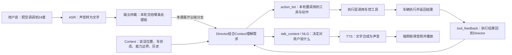

# 从“听成文字”到“事情办完”：Planner / Director、工具与播报课堂

咱们先把这一段要解决的问题说清楚。ASR 把声音变成“把空调调到 24 度”这行文字，只代表系统听出了这句话。用户想要的结果是车里的空调真的调到 24℃，而且豆包能准确告诉他结果。这中间还缺理解需求、判断能不能做、调用车辆能力、拿到执行结果和反馈给用户几步。我们现在就沿着这句话，把每一步怎么接起来讲完。

这里先说明课堂边界：简单高频车控可能在端侧快速完成，不一定都经过云端。下面为了讲清 Director 这条分支，假设这轮经过端云仲裁后交给云端。这个假设是教学安排，不代表当前车型每一句空调控制都这样走。

## 第一段：为什么一句清楚的指令，还要带 Context？

大家先看“把空调调到 24 度”。它虽然明确说了温度，但不一定包含做决定需要的所有信息：谁说的？坐在哪个位置？这辆车是否支持分区温控？当前空调状态是什么？有没有权限限制？Context 就是给这次判断配套的背景资料，中文可以理解为“当前上下文”。它让模型知道自己是在什么车、什么状态、什么对话里办这件事。

这里要区分两种输入。用户这句话是本轮要处理的请求；Context 是帮助处理请求的背景。不能把它们混在一起理解成“模型只看一句话，然后凭经验猜”。Director PRD 明确把端状态、车辆信息、工具能力、用户记忆、历史对话等列为上下文内容，但具体每一轮会注入哪些字段，要以项目方案和当次日志为准。资料缺少当前温度时，课堂不能自己补一个数值，模型也不应该把猜测当事实。

## 第二段：Director / Planner 在这里到底做什么？

Director 在这份 PRD 里叫“对话推理引擎”，负责结合上下文理解需求、安排动作，并决定要不要对用户说话。有些材料和模块名称用 Planner，我们按来源保留名称，在这堂课里解释的是这类规划和对话决策职责，不把它们画成两位必然前后串联的独立角色。

在本例里，它要把“调到 24 度”整理成明确可执行的要求。它不是自己控制空调电机，而是决定调用哪个工具、给工具什么要求。原文有一个参数叫 action_list，第一次看可以读成“本轮动作清单”。清单中说明要调用的工具，以及交给它处理的动作内容。具体车控参数、工具名和字段格式要看当前项目提示词及工具协议，课堂的“设置空调温度为 24℃”是业务意思，不是可以直接复制上线的接口报文。

为什么还要有动作清单？因为“我知道你想调空调”和“车辆收到一条正确的控制请求”是两件事。Director 先决定做什么，执行层再解析清单、调用车控工具，工具连接下游车辆能力。这样下一步才从“模型的判断”进入“真实的操作”。

## 第三段：工具调用以后，为什么还要回到 Director？

空调工具发出去以后，事情还没有结束。车辆可能执行成功，也可能因当前条件不允许、能力不支持或执行异常而失败。工具需要把实际结果带回来。tool_feedback 就是“工具执行后返回的结果信息”，它让 Director 看见这一步究竟发生了什么。

这里是整条链路最重要的一次回流：用户请求让 Director 决定先做什么；工具结果让 Director 决定接下来怎么办。假设返回结果确实确认空调已设置为 24℃，Director 才有依据生成成功反馈。不能在工具刚下发、还没拿到结果时，就说“已经调好了”。请求已接收、请求已下发和车辆执行成功，是三个不同状态。

如果一个任务需要多步操作，这个回流还会继续。先拿上一步结果，再决定下一步动作。原文要求同轮动作同时下发，所以有前后依赖的两步不能随意塞进同一个 action_list。例如需要先查到一个地点，才能对该地点发起导航，就应先查询、拿到结果，再继续规划导航。这是为什么用户只说一次话，后台可能经历多轮“判断—行动—看结果—再判断”。这里的“多轮”可以是系统内部循环，不一定要求用户再说一句。

## 第四段：NLG、TTS 和播放，分别在哪？

现在工具成功了，系统需要告诉用户“空调已调到 24 度”。把结果组织成人能听懂的句子，这件事叫 NLG，也就是自然语言生成。它解决的是“说什么”。在 Director 输出中可以看到 talk_content，可以理解为待说的文字内容。不要为了画图方便，强行把 NLG 画成每次都存在的另一个独立大模型；Director 可以生成话术，简单车控也可能使用端侧固定模板。

接下来才到 TTS，英文是 Text to Speech，中文叫语音合成。它接到文字以及适用的音色、语气等要求，把它们变成音频。TTS 解决的是“这些字怎么变成声音”，它不负责证明空调已经成功，更不会通过播报完成车控。

音频合成出来后，还需要端侧取得音频并实际播放，用户才真正听到。你评审时可以顺着这三问检查：结果文字生成了吗？音频合成好了吗？车端开始播放并播完了吗？上一个节点成功，不自动代表下一个节点成功。具体拉流、播放回执和异常恢复字段，需要继续核对端云协议，当前课堂不虚构接口名。

离在线 TTS 服务 PRD 还定义了网络、账号和场景下的选择策略，以及播报抢占规则。这意味着“文字由云端产生”和“最终一定用在线 TTS”不能简单画等号。车控 TTS 策略与 Director 统一播报口径也存在项目边界：简单车控有端侧模板分支，复杂车控有云端生成分支。我们讲的是职责关系，实际验收要先确认车型、版本和本轮走的分支。

## 第五段：把指令换成“有点热”，为什么链路一样，判断却不同？

现在用户不再说温度，只说“有点热”。ASR 仍然负责把声音识别成这几个字，但它没有替用户决定要开空调、降温还是调风量。这一步需要 Director 结合 Context 判断：当前空调开了吗？是不是已经在制冷？当前车内环境怎样？有什么可用功能？

如果缺少重要信息，下一步可能是查询状态或向用户确认；如果信息充分，可能生成合适的车控动作。但不能把“有点热”固定解释成“24℃”，更不能不看状态就说必须开窗。上面提到的数字和动作都只是帮助理解的课堂例子，实际策略以资料和项目要求为准。它的产品价值是用户可以表达感受，系统帮他把感受衔接到合适行动，而不是让用户先背会全部按钮名称。

## 第六段：工具失败时，这一圈怎么继续？

假设空调控制返回失败。我们先不要写“请稍后重试”，先看实际回来的原因。明确是不支持，就解释能力限制；明确是临时执行异常，才评估重试或替代路径；如果只有超时，就只能说这次结果尚未确认，不能把超时直接写成空调坏了。

Director 接到失败 feedback 后，再结合上下文决定是否继续行动、询问还是说明失败。多意图任务更要分清楚：如果空调成功、音乐失败，不能统称“全部搞定”，也不能说“都没成功”。Director PRD 要求同轮多工具结果统一推理和播报；车控 TTS 文档也要求按执行明细组织反馈。至于具体重试次数和超时阈值，已读材料没有统一确定，不能在课堂里替研发承诺。

## 第七段：用户中途说“别调了”，到底打断了什么？

最后看最容易混淆的地方。用户在过程中改口“别调了”，可能发生在三种时刻：Director 还在想、工具已经发出但未完成、空调已经调好只是豆包还没播完。这三种状态要分别看。

如果只是正在播报，停止播放能让豆包先闭嘴，但不会因此把已经调到 24℃ 的空调自动恢复。当前动作已完成后，用户到底要求停止解释还是要求撤回车控，需要理解新请求，再按可用能力处理。资料没有证明所有车控支持自动撤销，所以不能讲“用户一打断，动作全部取消”。

如果旧推理还在进行或工具已经发出，是否取消、迟到结果如何处理、会不会出现旧请求覆盖新请求，需要工程协议支持。当前已读正文不足以给出统一答案，图上应该标待核验，不能用“打断”两个字把这些问题盖过去。

Director PRD 明确的部分是：播报被打断后，工程把已说和未说内容、新输入或事件交回 Director，由它决定是否补说、合并新旧话题或跳过。比如用户说“不用讲了”，不应机械把剩余话术补完；用户追问刚才的话题，可以合在一次自然回答里。旧实验文档还存在不同停止时机与恢复办法，不能把不同版本的阈值拼到一起。

讲到这里，大家再看全图：ASR 交出文字，Context 提供判断背景，Director / Planner 决定说什么和做什么，工具把动作落下去，tool_feedback 把真实结果带回来，NLG 组织反馈，TTS 合成声音，播放端让用户听到。产品验收就是沿着这条链核对每一次交接，特别检查“系统想做”“已经下发”“实际做成”“用户听到”四件事有没有被混成同一个成功。

## 供原 v06 第三讲替换：AIVA 本地与云端谁说了算

咱们不要把“本地在跑”理解成“本地结果一定马上执行”。按 AIVA 9 月 30 日更新，这里要分清两类本地能力。第一类是配置好的确定性缓存规则：比如某类指令已经明确配好对应动作，命中后可以抢在云端前执行。第二类是本地 LLM，也就是车机上的语言模型，它的输出常规情况下不抢跑云端，而在断网或云端超过 3 秒没结果时承担兜底。云端超时后才晚到的结果，不再触发执行，避免同一句话执行两次。所以不能把课程写成“本地 LLM 永远不采纳”，也不能写成“本地一出 functioncall 就直接执行”。这里讲的是 AIVA PRD 的版本规则，不直接套到所有项目。

## 供原 v06 主案例衔接：去昨天那家游泳馆

大家再看“去昨天那家游泳馆”。这句话没有给出完整地址，ASR 即使每个字都听对，系统也还不知道该把哪个地点交给导航。Director 要结合当前上下文和可用记忆，先把“昨天那家”指向具体对象。如果所需信息不在当前上下文里，就需要使用可用的记忆检索能力，拿回结果后再判断。

这次检索的 tool_feedback 可能有一个明确地点，也可能有多个候选，或者根本没有记录。有唯一可靠地点，才继续衔接地点解析和导航能力；有多个候选，就先让用户确认；没查到，应该请用户补充，不能编一个馆名直接导航。这是教学分支，具体用哪个记忆工具、地点工具和导航工具，以项目工具协议为准。

为什么这里不能把“查记忆”和“去那个地点”同时丢给工具？因为第二步的目标依赖第一步结果。在第一轮 action_list 里先检索，结果回到 Director；第二轮才用已确认的地点组织导航动作。导航工具返回后，还要区分只是找到了地点、规划出了路线，还是已实际启动导航，再据此组织 NLG、交给 TTS 和播放端。这样用户才不会听到“已经开始导航”，但屏幕上其实还停在候选地点列表。
