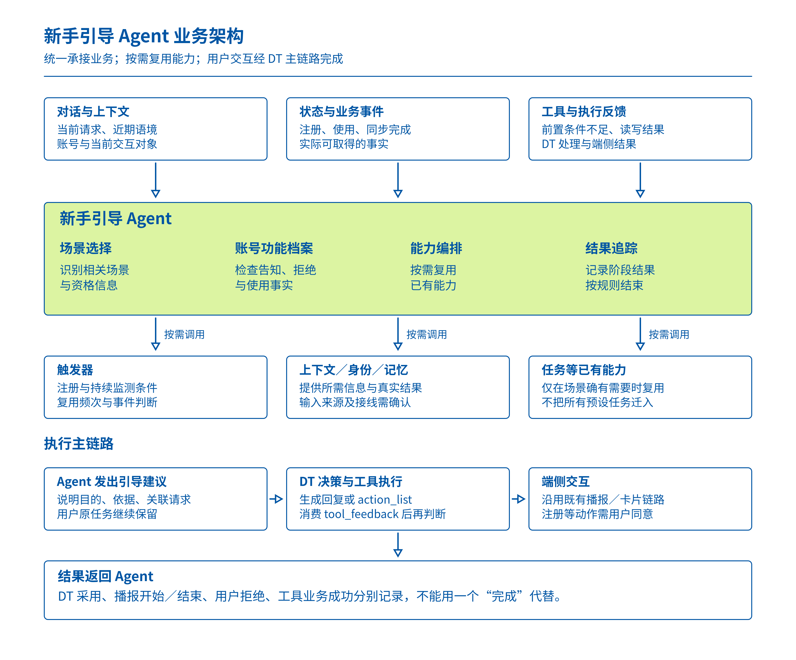
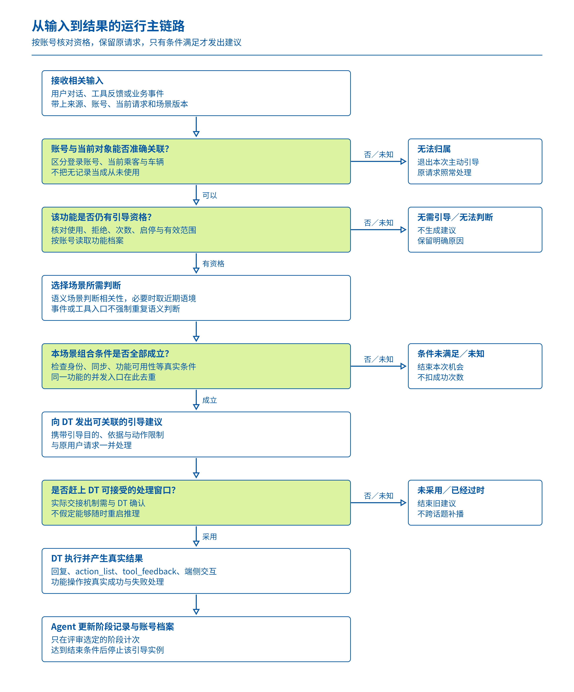
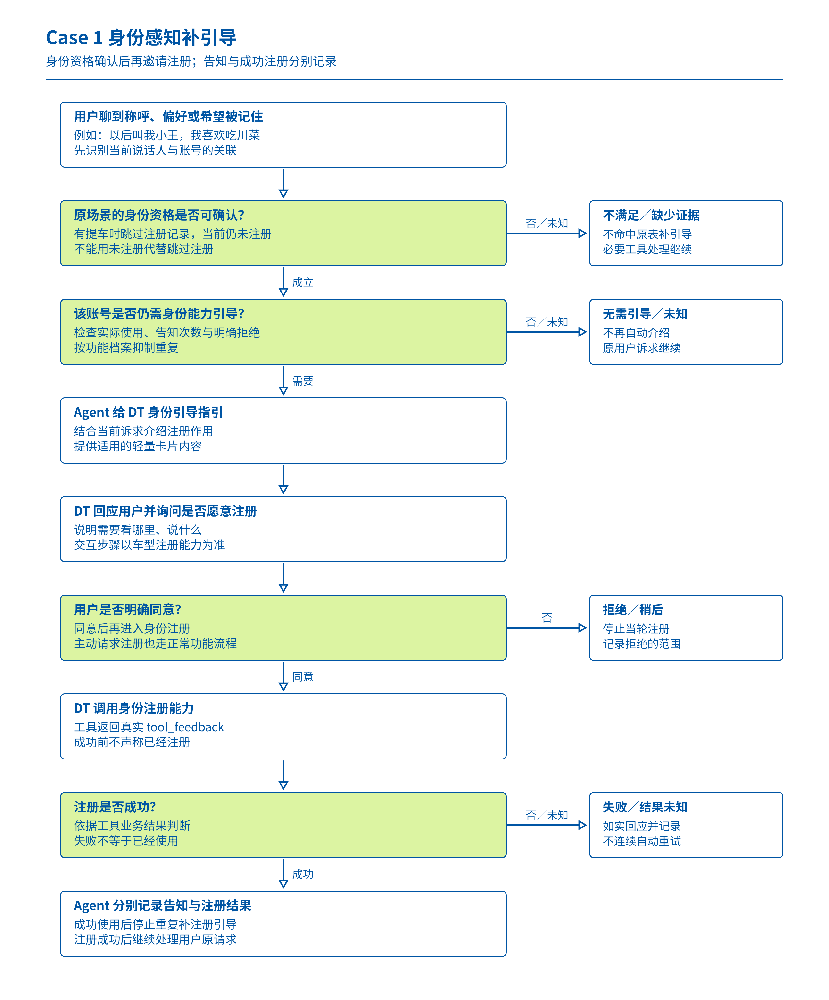
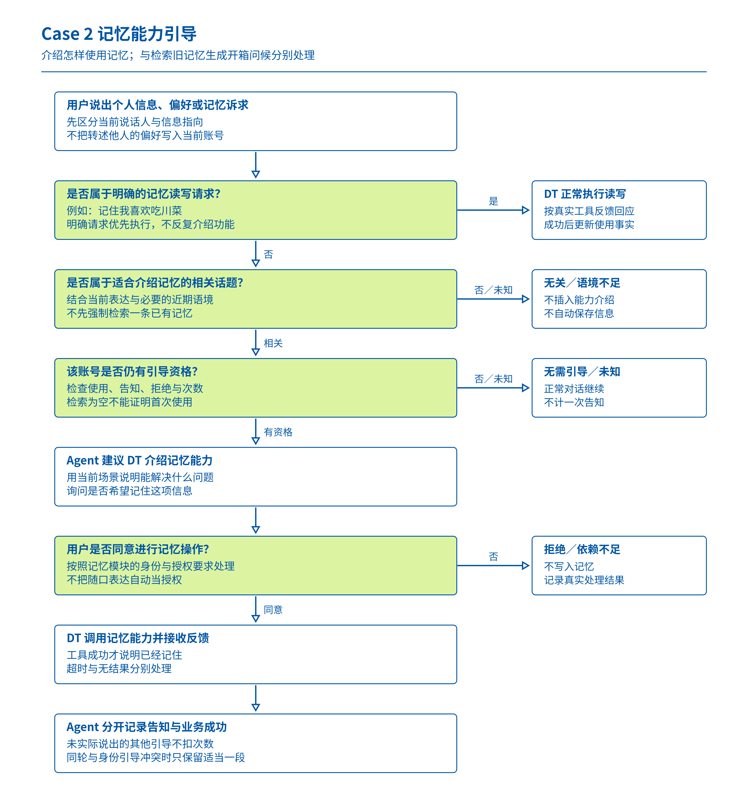
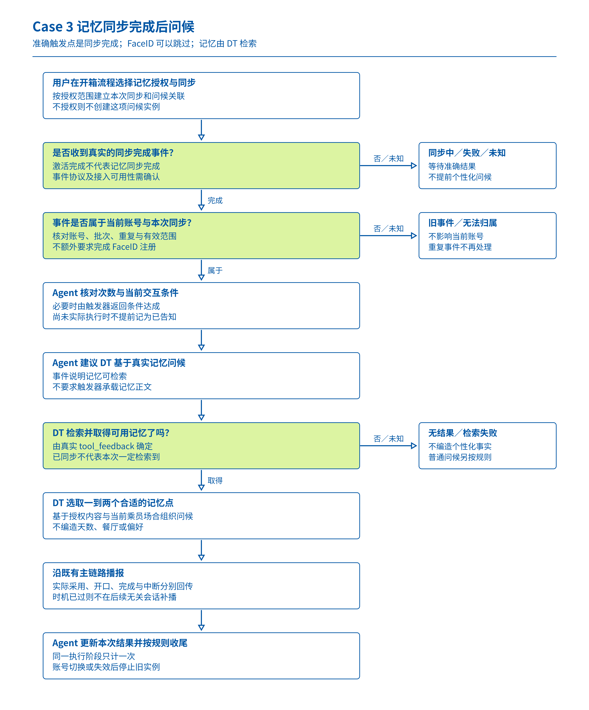
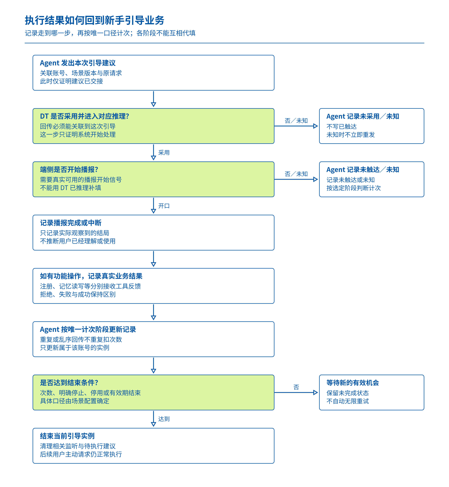
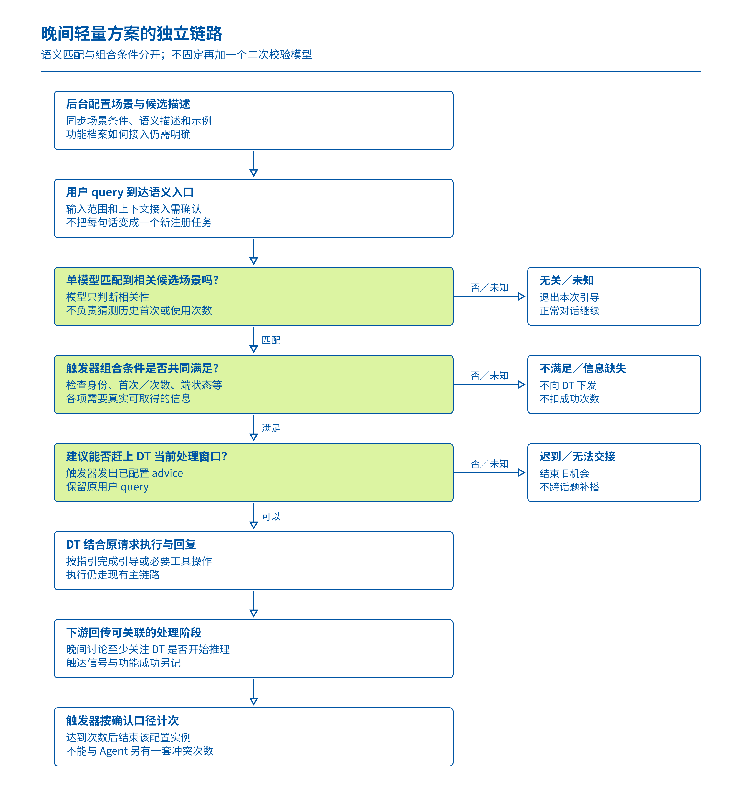

# 新手引导 Agent 产品需求文档

> 版本：v1.0｜2026-11-05｜状态：待评审  
> 本稿单独输出，保留原有策略文档。适用范围为本次 AIVA 新手引导讨论，不能直接套用到其他车企或车型。

## 1. 概要与评审口径

用户在车内聊到称呼、个人偏好或需要记住的信息时，系统应在合适的时机介绍相关能力；用户已经用过、已经被告知或明确拒绝后，系统应按规则停止重复引导。开箱时的记忆问候则由“记忆同步完成”触发，不能用“激活完成”代替。

本稿按 11 月 4 日下午刘杨提出的框架，细化一个统一承接新手引导业务的 Agent：它接收相关输入，管理账号下的功能引导记录，按场景调用触发器、上下文、记忆等已有能力，向 DT 发出引导建议，再跟踪执行结果。DT 是主对话决策模块，负责结合用户原请求生成回复、调用工具，并通过现有端侧链路执行。

**这是一份方案评审稿。**11 月 4 日晚间又讨论了“语义匹配 → 触发器组合条件 → DT”的轻量方案，末尾明确还需与刘杨对齐。本文将 Agent 作为主方案展开，并在 7.8 单列轻量方案。两者没有拼接成一条已定架构，本文也不证明相关新增能力已经上线。[下午逐字稿](https://bytedance.larkoffice.com/docx/LIvdd9KvIoSYlGx2V9Ic6L4cn1d)，[晚间逐字稿](https://bytedance.larkoffice.com/docx/Vz57dXaeYoHHECxEuytcsDROn9b)。

**本次重点写三条具体链路。**前两条保留原表第 2 行“身份感知”和第 4 行“记忆体系与策略”；第三条为晚间重点讨论、确实需要检索记忆的第 14 行“记忆同步后对话”。第三条是独立补充案例，不替换原表的记忆能力引导。

本文对信息状态采用三种标记：

- **资料已确认**：能在逐字稿、源表或群消息中直接找到的业务意图、当时状态。
- **本稿需求建议**：为形成完整产品闭环提出的规则，供本次评审选择。
- **待确认**：材料存在分歧，或尚缺接口、负责人、联调和验收证据。

## 2. 相关方与职责

下表根据参会发言列出相关方，不代表各人已经承诺承接全部开发工作。具体负责人、工作量和排期在评审后认领。

| 责任范围 | 相关方 | 本次需输出的结果 |
| --- | --- | --- |
| 场景、引导内容与产品边界 | 单如水、王泽民 | 明确每条场景的对象、条件、内容、次数及退出方式 |
| Agent 与轻量方案的取舍 | 刘杨、张嘉锋、王泽民及产品相关方 | 统一业务入口、能力边界及本期落地方案 |
| 触发器与规则配置 | 刘杨、王泽民；正式负责人待认领 | 确认可复用的注册、条件判断、频次、事件和回传能力 |
| DT 执行与反馈 | 郝晓伟、向超然；正式负责人待认领 | 确认 advice 接收时点、工具反馈与执行阶段回传 |
| 账号、身份、记忆与同步 | 对应模块负责人待认领 | 确认状态和事件的提供方、账号归属及读取边界 |
| 车企信号与端侧交互 | 吴仁杰及端侧相关方；正式负责人待认领 | 确认真实可用的身份、同步、手点使用、播报信号 |
| 联调与验收 | 产品、各链路负责人、测试 | 用同一条场景记录串起输入、判断、执行和最终结果 |

## 3. 背景与当前问题

### 3.1 用户遇到的问题

用户可能已经在车内表达过“以后叫我小王”“我喜欢吃川菜”，却不知道豆包可以识别自己、记住偏好。系统需要把能力介绍放在相关的用车对话中，避免用户离开当前任务去寻找功能说明。

相反，用户已经使用过某项能力时，再反复介绍会打扰当前任务。仅记录“系统发出过一条建议”，又可能把未被 DT 采用、未播出来的建议算作已经告知，导致该用户后续永远收不到有效引导。

### 3.2 当前缺口

1. **语义判断入口未统一。**11 月 2 日触发器主要消费端状态、视觉等信号；11 月 4 日晚间仍明确说当前触发器拿不到历史对话。用户说到相关话题后，谁取得这些信息、谁做判断，需要补齐。
2. **一次性限制已有，结果闭环不足。**11 月 2 日明确条件任务支持只推一次，缺的是下发之后继续感知下游结果。不能把整个频控能力写成从零建设。
3. **功能引导状态需要明确归属。**11 月 4 日下午确认按账号管理，而不是只按车辆判断。账号、人脸身份和车辆分别代表不同对象。
4. **引导与原请求可能争抢时机。**语义引导需要赶上当前回复；后台推理结束时，DT 可能已经执行了原请求。必须明确晚到建议如何处理。
5. **同一批材料混有不同记忆场景。**“向用户介绍记忆能力”与“读取已有记忆生成问候”不是同一链路。

### 3.3 会议讨论的演变

| 时间与材料 | 可确认内容 | 对新版的影响 |
| --- | --- | --- |
| 11 月 2 日，05:09、05:33 | 预设任务当时开发完，计划联调提测，当时尚未上线 | 作为当时状态，不推断 11 月 5 日已上线 |
| 11 月 2 日，27:08、27:41 | 原始方向是复用条件任务承接该批引导 | 记录为旧方案，不继续当作所有新方案的强制前提 |
| 11 月 2 日，51:51–52:05 | 原表记忆案例是能力引导，不是检索已有记忆 | 第 4 行案例保持原意 |
| 11 月 2 日，01:02:48 | 只推一次支持，但缺少下游结果关注 | 新增重点为结果关联和成功计次 |
| 11 月 4 日下午，17:46–19:50 | 按账号管理；提出新手引导 Agent 与功能档案 | 主方案采用统一业务入口和账号档案 |
| 11 月 4 日下午，30:23、31:21–32:23 | Agent 编排已有模块，用户交互仍走 DT 主链路 | Agent 不另建一套直接控制车辆或播报的链路 |
| 11 月 4 日下午，41:19–46:48 | 简单场景也可由 Agent 统一承接；并非所有场景必经触发器 | 按场景复用能力，不能把 Agent 画成触发器下游的一种动作 |
| 11 月 4 日晚间，26:31、28:45–28:54 | 记忆同步完成后，由触发器建议 DT 检索记忆并问候 | 补充事件触发型记忆案例 |
| 11 月 4 日晚间，34:07、36:00–37:04 | 轻量讨论趋向一次语义匹配，再检查组合条件，不再固定加二次校验模型 | 单列轻量备选，不沿用旧稿双模型固定架构 |
| 11 月 4 日晚间，40:14–40:29 | 讨论将结果向 DT 是否开始推理延伸；还需与刘杨对齐 | 成功口径和方案选择继续列为评审阻塞项 |

依据：[11 月 2 日逐字稿](https://bytedance.larkoffice.com/docx/JwhXddfUmoaiQNxOi6scAevUncb)、[11 月 4 日下午逐字稿](https://bytedance.larkoffice.com/docx/LIvdd9KvIoSYlGx2V9Ic6L4cn1d)、[11 月 4 日晚间逐字稿](https://bytedance.larkoffice.com/docx/Vz57dXaeYoHHECxEuytcsDROn9b)。

## 4. 目标与效果衡量

### 4.1 本期目标

在本期联调验收前，跑通本文三条案例的正常、条件不满足、信息未知、重复输入和中断路径；让每一次引导都能说明“为什么判断、为什么发出、交给了谁、走到了哪一步”。

用户侧目标是及时了解能力，同时正常完成原请求。系统侧目标是将场景管理、账号记录和下游反馈串成闭环，避免靠“没有再收到消息”推断成功。

### 4.2 衡量方式

以下为本稿建议的验收指标。生产比例目标需先取得样本和基线，再由产品与技术评审确认，不使用旧稿中的假设阈值。

| 指标 | 统计口径 | 本期验收要求 |
| --- | --- | --- |
| 链路可追踪 | 同一次引导能关联场景、账号、输入、DT 处理及结果 | 本文验收用例可逐条回放，不出现无法归属的结果 |
| 语义命中质量 | 将正例、反例、依赖多轮语境的表达分别评估 | 输出分场景结果；不以单一总体命中率遮盖误引导 |
| 重复引导 | 同一账号、同一功能在约定次数后再次触发 | 重复事件、重复回传、并发入口均不得重复计次或重复播报 |
| 正常请求完成 | 引导出现后，用户原请求是否仍被正确处理 | 不得因能力介绍自动切换用户明确选择的功能 |
| 系统处理成功 | DT 是否采用这条 advice 并进入对应推理 | 与“已发出”分开统计，不直接等同用户已知晓 |
| 用户触达 | 端侧是否开始播报、是否完成、是否被打断 | 有信号才记录；无信号标未知，不用 DT 推理结果代填 |
| 功能实际使用 | 注册或记忆读写等真实业务结果 | 与告知、工具被调用分开记录 |
| 增量时延 | 新手引导给当前回复增加的等待时间 | 先实测分流、取数、判断、交接各段，再确定可接受上限 |

**时延说明：**晚间逐字稿中出现的整体与分段毫秒数口径不一致，本文不把它们写成确定性能承诺。是否需要在 DT 推理前留出干预窗口，必须与实测一起评审。

## 5. 用户场景、定义与范围

### 5.1 三条案例的来源和目标

| 案例 | 源表位置 | 触发意图 | 用户得到的结果 |
| --- | --- | --- | --- |
| Case 1：身份感知补引导 | final version 第 2 行，P0 | 提车时跳过 FaceID 注册的乘客，后续聊到偏好、称呼或希望被记住的信息 | 了解注册身份的作用，愿意时进入注册 |
| Case 2：记忆能力引导 | final version 第 4 行，P0 | 用户聊到个人偏好、称呼或希望记住的信息 | 了解豆包可以记忆，以及怎样使用这项能力 |
| Case 3：记忆同步后问候 | final version 第 14 行，P0；晚间会议详细讨论 | 开箱过程中，在授权的记忆同步完成后 | DT 基于真实检索到的一到两个记忆点生成问候 |

源表：[新手引导场景集 · final version](https://bytedance.larkoffice.com/sheets/Ys68ssuYGhhlCGtQwlIc2BdMnvg?sheet=6fwfTF)。本次读取版本为 revision 1300。表格仍将这些场景写为“条件任务”；本文 Agent 框架是新增方案，不能描述为源表已经完成更新。

### 5.2 本期覆盖

- 三条案例的业务条件、建议内容、执行交接、结果记录与重复抑制。
- 简单端状态、业务事件、工具反馈、用户对话等入口的统一管理。
- 账号下的功能引导档案，以及场景启停、规则版本和次数等配置要求。
- 对已有触发器、DT、身份和记忆能力的复用边界。

### 5.3 本期不纳入

- 跨多天静默挖掘用户操作习惯，并自动归纳新的动态任务。
- 将所有系统预设服务、长期推荐或原有 Advisor 全部迁移进新手引导 Agent。
- 自动替用户注册人脸、默认授权同步、未经确认写入偏好。
- 为全部语义表达承诺完整召回，或预先指定必须存在两个模型。
- 其他车企的信号协议、车型能力及场景直接套用。

### 5.4 几个需要分别定义的对象

**账号**承载功能引导档案；**当前说话人或乘客身份**用于判断这条引导是否适合对当前人说；**车辆与车型**决定功能是否可用。三者不能互相代替。

“第一次调用工具”是一个调用事实；“首次成功使用功能”是一个业务结果；“之前是否告知过用户”是一个引导记录。产品可以组合它们作为条件，但不能把三者默认设成相同含义。

## 6. 用户价值与成功口径

### 6.1 产品价值

用户不需要先认识功能名称，系统就能在相关诉求中介绍能力。已使用或拒绝的账号减少重复介绍；新接入的车型或功能，通过配置和能力接入扩展同一套业务管理，减少散落在各个工具和模块里的独立判断。

本稿不引入竞品优劣结论；本次材料没有提供支持这种比较的调研。

### 6.2 分层记录结果

| 发生的事情 | 能证明什么 | 不能据此认定什么 |
| --- | --- | --- |
| 规则命中 | 当时满足了配置的判断 | DT 已采用建议 |
| Agent 发出 advice | 建议已交给下游 | 已执行或已播报 |
| DT 采用并开始对应推理 | DT 开始处理这条建议 | 用户听到了，或工具成功 |
| 端侧开始播报 | 至少开始触达用户 | 用户完整听完、理解或认可 |
| 播报完成／中断 | 一次播报的可观测结局 | 功能已被使用 |
| 工具调用完成 | 获得该工具的返回结果 | 注册、写入等业务一定成功 |
| 注册成功／记忆写入成功 | 相应功能确实完成业务动作 | 所有其他功能均已知晓 |

**待统一的核心决定：引导次数在哪一步扣减。**11 月 2 日讨论过“开始播报”；11 月 4 日晚间讨论过“DT 开始推理”。两者代表不同保证。若本期只能拿到 DT 处理回传，最多证明系统处理过这条建议，应单列触达未知；不能自动写成“用户已知晓”。

**本稿建议：**保留分阶段结果，以场景配置明确唯一计次阶段。面向“已告知一次”的业务目标，优先用可关联的播报开始信号；若为交付选择 DT 采用作为临时计次口径，需在评审中接受漏触达风险，并将档案记为“DT 已处理”，而非“已告知”。未统一前不把任一口径固化为发布标准。

## 7. 功能方案与完整链路

本节除标明“资料已确认”的内容外，均为供评审的产品需求建议。下列信息名称表示业务上必须表达的含义，不是已经存在的接口字段、协议枚举或数据库设计。

### 7.1 Agent 定位与模块关系

新手引导 Agent 是该业务的统一入口，负责把“该不该引导、引导什么、结果怎样”管理起来。它不承担所有底层判断，也不另行控制车辆或直接播报。

| 模块 | 接收什么 | 负责什么 | 输出给谁 |
| --- | --- | --- | --- |
| 新手引导 Agent | 场景配置、账号状态、相关对话、业务事件、工具及执行反馈 | 选择场景、补齐资格信息、编排需要的能力、去重、追踪结果 | 给 DT 建议；向已有模块发起必要请求 |
| 触发器 | Agent 注册的条件，以及可用端状态／业务事件 | 按已配置条件持续监测；提供已有频控和条件判断 | 向 Agent 返回哪条条件达成；Agent 方案下由业务统一承接 |
| 上下文提供方 | 当前对话与当前交互信息 | 提供判断所需的近期语境、身份关联及状态 | 给 Agent 或其判断能力；新增接线待确认 |
| 身份与记忆模块 | 合法的身份、同步、检索或写入请求 | 提供真实状态与业务结果 | 给调用方明确返回，失败和无结果分别表达 |
| DT（Director／Planner） | 原用户请求与可关联的引导建议 | 决定回复、生成 action_list，调用现有工具，消费 tool_feedback 后继续判断 | 给端侧执行；向 Agent 回传相关处理结果 |
| 端侧 | 既有主链路下发的语音、卡片或业务动作 | 完成播放／展示／交互，提供实际可观测的结果 | 经现有链路反馈；新增信号需确认 |

下午 31:21–32:23 明确用户交互继续走 DT；44:20–46:48 明确 Agent 可以调用触发器、任务和上下文等能力，并非所有案例必经触发器。后台增加一个“调用新手引导”的动作类型，不能单独满足这一统一入口定义。

### 7.2 配置、注册与启停链路

场景先配置和生效，用户后续输入才用于判断是否命中。**用户每说一句相关话，不等于创建一个新的条件任务。**

| 顺序 | 谁做什么 | 形成的结果 | 未满足时如何处理 |
| --- | --- | --- | --- |
| 1 | 产品配置功能、对象、触发来源、资格条件、引导指引和计次口径 | 一条可评审的场景定义 | 条件或成功口径缺失，不进入发布 |
| 2 | 能力负责人核对所需状态、事件和 DT 交接是否可用 | 形成依赖清单与接入方式 | 缺信号明确阻塞，不把不存在的字段填为默认满足 |
| 3 | Agent 加载已生效版本，建立相应账号下的引导实例 | 有版本、对象和有效范围的实例 | 账号不明时不建立错误归属 |
| 4 | 需要持续监测的场景，由 Agent 使用触发器注册对应条件；直接工具反馈可直接接入 Agent | 监听关系或反馈关系建立 | 注册失败保留失败结果，不假定已监听 |
| 5 | 语义场景的描述和示例同步进入候选集合；事件场景接入准确事件 | 判断集合与配置一致 | 更新失败时不使用不完整新版本 |
| 6 | 用户输入或事件到达后，执行 7.3 的运行链路 | 命中、未命中或未知 | 未命中不影响正常对话 |
| 7 | 停用、有效期结束、账号切换或达到约定结束条件时，停止旧实例并清理监听 | 旧实例不再下发新建议 | 晚到结果只归档原实例，不作用于新账号 |

**配置建议：**至少表达功能与场景、适用车型、账号归属、输入来源、资格条件、语义描述及正反例、引导内容、次数与有效范围、计次阶段、拒绝后的处理、启停与版本。具体控件、接口和存储位置由评审后设计，不沿用旧稿的假定字段契约。

配置“启动新手引导实例”与用户“完成豆包激活”是两种动作。本文不用同一个“激活”状态表示二者。

### 7.3 运行时主链路

| 步骤 | 责任方与输入 | 判断或动作 | 输出与后续 |
| --- | --- | --- | --- |
| 1. 接收输入 | Agent 获得 query、工具反馈或业务事件 | 关联当前账号、车型、场景版本及当前请求／事件 | 关联不上账号或输入来源时，记未知并退出本次主动引导 |
| 2. 检查资格 | Agent 读取功能档案与当前可用状态 | 是否已实际使用、已达到约定次数、明确拒绝、超期或停用 | 已无资格则结束；未知不当作首次 |
| 3. 选择判断入口 | 根据场景配置选择语义、事件或工具反馈入口 | 事件／工具结果明确的，不强制再做全量语义推理 | 进入对应场景判断 |
| 4. 判断相关性 | 语义入口取得当前 query，必要时取得已授权的近期上下文 | 是否与某条已配置引导场景相关 | 无关退出；语境不足返回未知；不直接决定功能已使用 |
| 5. 核对组合条件 | 使用触发器或对应状态提供方 | 将话题相关性与身份、同步、次数、功能可用性等组合 | 条件满足继续；不满足与未知分别记录 |
| 6. 处理冲突 | Agent 检查同一功能的并发入口和同轮多场景 | 同一功能只产生一条本次待处理建议 | 不允许工具反馈和后台监听同时重复播报 |
| 7. 交给 DT | 发送与原请求关联的引导目标、必要依据及允许动作 | DT 仍保留原用户请求；引导不默默替换明确任务 | 等待 DT 的采用／未采用结果 |
| 8. DT 执行 | DT 结合原请求与建议生成回复或 action_list | 调用所需工具，消费 tool_feedback，继续决定下一步 | 得到真实工具结果与回复／卡片／业务动作 |
| 9. 收集结果 | Agent 接收可关联的 DT、工具和端侧结果 | 识别执行走到哪一阶段，是否失败／中断／被拒绝 | 进入 7.7 的状态处理 |
| 10. 更新档案 | 按配置的唯一计次阶段记次 | 处理重复回传，区分告知、使用和拒绝 | 达到结束条件则停止该实例，未完成则按规则等待新机会 |

**同轮语义干预的时间要求：**晚间 36:49 要求建议赶在 DT 讲话前。主方案仍需确认 DT 接受建议的实际窗口：是在推理前合并输入，还是已有机制支持推理过程中的受控合并。本文不假设可以随时重启 DT。建议晚到且原回复已无法安全合并时，结束本次主动引导，保留原任务结果，不在下一轮突然补播旧话题。

**Agent 对工具反馈的处理：**工具反馈入口天然发生在 DT 已选过工具之后，应在 DT 生成本轮最终答复前决定是否追加必要引导。这与后台语义入口的前置干预是两个时点，不能画成同一个“打断 DT”步骤。

**每次交接需要表达的业务信息：**归属账号与场景、关联哪次输入、当前引导目的、可用条件证据、希望 DT 做什么、有哪些限制、结果应回到哪里。线上的字段名称、回调方式和幂等标识由接口设计确认。

### 7.4 Case 1：身份感知补引导

#### 用户场景

某位乘客提车当天跳过 FaceID 注册，后续说：“以后叫我小王，我喜欢吃川菜。”系统在介绍个性化能力前，需要知道这条原始场景的资格是否成立，不能把“当前没有识别人脸”直接当成“提车时跳过注册”。

源表要求是向这位乘客再提示一次，可采用语音与轻量即时卡片；卡片需说明“看哪里、说什么”。具体摄像头方向、步骤和交互文案由车型与注册模块确认。

#### 输入与资格

| 输入 | 用途 | 证据缺失时 |
| --- | --- | --- |
| 当前账号与当前说话人／座位的关联 | 避免将账号主人与临时乘客混为同一人 | 不向无法归属的乘客自动下发个性化补引导 |
| 提车时跳过注册的记录 | 判断是否满足原表第 2 行的对象要求 | 原场景资格未知，不使用“未注册”代替 |
| 当前注册状态 | 判断现在是否还需介绍注册 | 已注册则不再走补注册引导 |
| 当前 query 或相关工具反馈 | 判断是否处于合适的话题／是否存在功能前置阻碍 | 无相关依据时不插入引导 |
| 该账号该功能的引导与使用记录 | 判断次数、拒绝和实际使用 | 记录未知不能当成从未用过 |

#### 执行动作

1. Agent 识别当前输入与身份个性化有关，检查原场景资格及功能档案。
2. 符合时，给 DT 一条建议：在回应用户称呼／偏好诉求时，简洁介绍身份注册的价值，询问是否愿意注册；不直接开始采集。
3. DT 先正确回应当前诉求，按可用交互展示语音或卡片。用户同意后，再调用身份注册能力。
4. 注册工具返回 tool_feedback。DT 根据真实结果告知成功、失败或需要补充操作；不能在工具成功前说“已经认识你了”。若注册是原请求的前置条件，成功后继续原来的记忆等请求，不能用“完成注册”代替完成用户原任务。
5. Agent 分别记录告知阶段与注册结果。注册成功后，后续不再对该账号重复补注册引导。

工具可对应当前产品资料中的 face_id_register，具体参数与返回状态需要 DT／身份模块核验，不在本稿创造协议值。

#### 工具反馈入口的特别处理

11 月 4 日下午 03:32–06:54 说明，有身份前置依赖的部分场景可利用工具返回进行引导。该入口用于“当前请求需要身份能力，而工具返回了相应前置限制”的情况。

**它不自动证明提车时跳过注册。**若无法取得跳过记录，仍可按现有工具流程解释完成当前请求所需的身份步骤；这属于当前任务的必要处理，不能冒充原表补引导已命中。是否扩展原场景资格，由产品明确调整后再配置。

#### 生命周期与异常

- 条件不满足：已注册、已使用或达到约定次数，结束本次补引导。
- 条件未知：身份关联或跳过记录缺失，退出自动补引导；保留原请求的正常处理。
- 用户拒绝：停止当轮推荐，记录拒绝范围；“本次不做”与“以后别提醒”不共用同一长期禁用含义。
- 用户稍后主动要求注册：正常进入功能流程，不受停止主动推荐的限制。
- 注册失败：返回失败，不能记为已成功使用；不得自动连续发起注册。
- 乘客或账号切换：使旧请求失效，避免将注册结果归给新对象。

### 7.5 Case 2：记忆能力引导

#### 用户场景

用户在对话中提到个人信息或偏好，例如“我最近比较喜欢吃川菜”，但未必知道豆包可以长期记住。该场景要介绍记忆能力；它本身不要求先检索一条已有记忆来证明用户的偏好。

用户若已经明确说“记住我喜欢川菜”，则首先是一条记忆写入请求，应正常执行并反馈；不能先反复介绍功能，阻碍用户完成正在请求的动作。

#### 执行动作

1. Agent 区分“明确要求记忆操作”与“仅表达偏好、适合介绍能力”。无法判断时不强行写入。
2. 对明确的读写请求，DT 按记忆模块规则执行，工具结果用于更新相关使用事实；是否需要身份或授权，由模块真实反馈决定。
3. 对能力介绍机会，Agent 检查账号下是否已介绍、已成功使用或明确拒绝，再判断话题是否相关。
4. 满足时给 DT 指引：结合当前对话说明记忆能解决什么问题，询问用户是否希望记住；不把用户随口表达自动升级为长期记忆授权。
5. 用户同意后，DT 通过记忆写入能力执行。只有成功反馈到达，才说明“已记住”。
6. Agent 记录能力告知与实际使用两个结果；后续相同功能按档案抑制重复介绍。

记忆读写可参照已有 search_user_memory、operate_user_memory 工具名称；本案例不规定每次都必须调用检索，也不将“返回空且首次调用”设为唯一引导条件。11 月 2 日群聊中的工具返回路径是一条候选接入思路，不是全部案例的充分条件。

#### 关键分支

| 情况 | 应有行为 | 记录 |
| --- | --- | --- |
| 用户明确说“帮我记住” | 直接执行所需读写流程，按反馈回应 | 真实写入成功／失败 |
| 用户只聊偏好，具备介绍资格 | 自然介绍能力并询问 | 记录实际到达的告知阶段 |
| 用户只是在转述他人的偏好 | 不写入当前账号；信息不足不主动引导个人记忆 | 未命中或未知 |
| 已有记忆但未介绍过 | 不因“已有记忆”自动推出必须再讲一次 | 按功能使用与告知规则共同判断 |
| 检索为空 | 可作为业务信息，不等于用户从未使用记忆 | 保留“检索无结果”，不伪造首次 |
| 用户拒绝保存 | 不写入，不把拒绝当写入成功 | 拒绝及其范围 |
| 身份／授权不足 | 按模块反馈解释完成当前请求需要什么 | 依赖不足，不能声称已记住 |

#### 与身份场景的冲突处理

同一句“以后叫我小王”可能同时关联身份与记忆。建议同一轮只生成一段与当前诉求直接相关的引导；如果身份是当前操作的真实前置条件，先处理该前置条件。不能因为两个场景有相似语义，就将两个场景的资格合并。

哪条内容最终说出，由 Agent 提供目的、DT 结合原请求生成。另一条未实际出现的引导不扣次数，也不默认标成已经告知。

### 7.6 Case 3：记忆同步完成后问候

#### 用户场景与独立触发点

开箱过程中，用户选择将已有记忆同步到车内豆包。同步完成后，系统希望利用真实记忆中的一到两个点生成问候，让用户感受到个性化延续。

**触发点是记忆同步完成，不是豆包激活完成，也不是 FaceID 注册完成。**晚间 25:22 说明 FaceID 环节可跳过；26:31 明确激活完成时记忆不一定同步完；28:45–28:54 讨论由 DT 检索记忆并问候。

#### 端到端执行链路

| 顺序 | 谁做什么 | 本步输出 | 不能省略的检查 |
| --- | --- | --- | --- |
| 1 | 用户在开箱流程选择记忆授权／同步 | 是否继续该项同步 | 不授权则不创建该记忆问候实例 |
| 2 | 同步模块执行同步 | 完成、失败或尚在进行的真实结果 | 激活完成不能代替同步完成 |
| 3 | 事件提供方封装同步完成信息 | 能关联账号与本次同步的事件 | 具体事件协议与可用性待确认，不假定已上线 |
| 4 | Agent 接入事件，或通过已注册的触发器条件收到结果 | 确认当前账号的本次同步已完成 | 不能把其他账号、旧批次或重复事件用于当前问候 |
| 5 | Agent 检查有效期、功能可用性、次数和当前可交互状态 | 是否进入本次问候 | 未满足／未知分别退出，不提前计次 |
| 6 | Agent 给 DT 指引 | 请基于授权范围内、实际可读取的记忆做简短问候 | 事件只需说明可检索，不要求将记忆正文塞进触发器 |
| 7 | DT 检索记忆，取得 tool_feedback 后再决定内容 | 真实可用的记忆点或无结果／失败 | 已同步不等于本次检索一定有结果 |
| 8 | DT 选择一到两个适合当前场合的点生成问候，走原有播报链路 | 个性化问候 | 不编造认识天数、餐厅或偏好；不强行播出不适合当前乘员场合的信息 |
| 9 | Agent 接收处理与触达结果，按配置记次并结束或保留未完成状态 | 本次问候的明确结局 | DT 开始推理、播报和实际检索结果分别记录 |

DT 检索到“偏好川菜”后，可据此生成问候；未检索到相关信息时，不得使用源表示例中“认识了多少天”“最爱餐厅”等占位内容冒充用户事实。

#### 生命周期与异常

- 未授权：没有该项记忆问候任务，不靠轮询猜测何时同步。
- 同步中：继续等待准确完成事件，不因激活已结束而提前问候。
- 同步失败：不触发个性化问候；失败提示是否由开箱流程承担，需与该流程对齐。
- 同步完成但检索为空：不生成假记忆。是否使用普通问候，由开箱交互确定；普通问候不计为已完成个性化记忆问候。
- 检索超时／失败：按失败处理，不把超时当“用户没有记忆”。
- 重复同步事件：同一实例只处理一次；用户重新发起的另一批同步是否再问候，按独立配置决定。
- 账号切换、下电或超过约定交互窗口：结束当前待播机会，不在不合适的下一次会话突然补播。
- 用户跳过 FaceID：只要此场景所需的账号、授权与同步条件成立，不额外增加 FaceID 门槛。

**与源表备注的修订建议：**第 14 行当前备注为“记忆内容封装成事件给到触发器”。根据晚间讨论，建议进一步明确为“同步完成状态封装为事件；记忆内容由 DT 按权限检索”。这是待与记忆／事件负责人确认的需求建议，本文没有修改源表。

### 7.7 结果回传、账号档案与重复抑制

#### 需要维护的三类记录

**功能档案**回答“该账号是否还需要这项能力介绍”；**本次执行记录**回答“这条建议现在走到哪一步”；**具体功能结果**回答“注册或记忆操作是否成功”。三类记录各有依据，不能只用一个“已完成”覆盖。

| 可观察结果 | 对本次执行的处理 | 对功能档案的影响 |
| --- | --- | --- |
| 条件不满足／信息未知 | 结束本次判断，不下发 | 不写“已告知” |
| 建议发出，尚无下游结果 | 保留待确认，防止同一实例并发重复发出 | 不直接写已使用或已知晓 |
| DT 未采用／建议已过时 | 结束本次机会，记录原因 | 不写已告知；是否等待下次机会由规则决定 |
| DT 采用并推理 | 记录系统处理成功 | 仅当计次阶段选定为此时才扣次数；不冒充播报 |
| 端侧开始播报 | 记录已开始触达 | 可按评审确认口径记一次告知尝试 |
| 播报中断／失败 | 保留实际结果及阶段 | 是否允许下次再引导取决于计次口径，不自动无限重试 |
| 用户明确拒绝 | 停止当前动作，记录拒绝语义与范围 | 按“本次”或“以后不再”分别处理 |
| 注册／读写成功 | 记录真实业务成功 | 可更新该功能已使用事实，后续抑制重复介绍 |
| 反馈无法关联／来自旧账号 | 归档为无效或待核对结果 | 不更新当前账号的档案 |

#### 次数与对象

资料已确认按账号管理引导。建议同时保留车型／功能适用范围：账号在另一辆车上已经用过的能力，不能简单重复介绍；另一车型存在新能力或不同操作方式时，也不能只因同名就永久压制。跨车型复用粒度仍需产品定义。

用户在同一车上更换账号，应加载新账号的功能档案。没有稳定账号时，本稿建议暂停需要长期记次的自动引导；当前必要功能处理仍走原链路。不得退回车辆计数后对外仍宣称按账号管理。

#### 去重与重试建议

- 同一次输入、同一功能，通过多个入口命中时，只保留一次待处理建议。
- 同一执行阶段重复回传，不重复计次；后到的旧阶段不能覆盖已确认的较后阶段。
- 已明确达到计次阶段后，不因另一条通道丢失回执重新生成同一引导。
- 仅收到发出结果、下游状态未知时，不立即重发。先核对是否已被 DT 采用，再决定是否留到新的相关机会。
- 本稿不设固定秒数的丢弃或补发阈值；旧稿中的 30 秒、1.5 秒、8 秒等未得到本次材料确认。

### 7.8 晚间轻量方案：单独评审的备选链路

这条方案将本期能力限制在“预设场景的相关性判断＋已有组合条件＋DT 执行”。它减少额外业务编排，适合优先验证有限场景，但仍需补齐账号状态、输入分流、DT 交接和反馈关联。

运行主干为：**后台配置场景 → 模型判断当前 query 对应哪个候选场景 → 触发器检查身份、首次／次数和端状态等组合条件 → 条件共同成立后给 DT advice → DT 执行并回传 → 触发器按成功口径记次。**

模型的任务是判断“与哪个已配置场景相关”，不是凭一句话判断账号历史上是否用过功能。后台增加候选场景时，需要同步描述和示例；模型名称、部署位置、输出格式尚未确认，不根据转写中的不同拼写固定名称。

| 对比项 | Agent 主方案 | 晚间轻量方案 |
| --- | --- | --- |
| 业务入口 | 新手引导统一由 Agent 承接 | 语义入口接触发器组合条件 |
| 规则判断 | 按场景复用触发器，直接反馈也可由 Agent 承接 | 触发器为组合条件判断主体 |
| 状态与结果 | Agent 统一管理业务档案和结果，底层能力提供事实 | 触发器继续负责成功次数；账号档案怎样接入仍需补齐 |
| 记忆同步问候 | Agent 接准确事件，建议 DT 检索 | 同步事件触发配置，触发器建议 DT 检索 |
| 多轮语境 | 按需取上下文并做场景判断；新增成本需评估 | 晚间后段简化为单模型相关性，需验证语境不足的表达 |
| 触发与执行时机 | 后台判断仍须赶上 DT 可接受窗口 | 更强调 DT 回复前的同轮干预 |
| 后续扩展 | 目标是统一接入不同功能和车型 | 新复杂业务可能继续改造触发链路 |
| 当前状态 | 下午要求产品细化后再评审 | 晚间会内倾向，尚需与刘杨统一 |

**评审建议：**先用本文三条案例验证主方案。若完整 Agent 不能满足本期交付，应明确将轻量方案作为阶段选择，并单独确定其状态归属；不能同时让 Agent 与触发器各自给同一功能维护一套互不一致的成功次数。

无论选哪条，语义创建动态任务仍是独立通用需求，不因为本次引导方案改变而自动取消，也不能将其全部塞入新手引导业务。

### 7.9 边界、异常与问题定位

| 现象 | 应有处理 | 优先检查什么 |
| --- | --- | --- |
| 同一句话触发身份和记忆两段介绍 | 按当前诉求合并为一段，未实际出现的内容不计次 | 规则设计：场景是否重复、资格是否混用 |
| 已经注册仍介绍注册 | 停止该引导，核对真实身份和档案关联 | 规则或状态归属：账号与乘客是否混淆 |
| 只因“没有查到记忆”就判用户第一次用 | 不按首次处理 | 规则设计：无结果是否被误当未使用 |
| 语义相关但用户并无该诉求 | 本次不引导，补充反例和语境 | 模型判断：转述、否定、多轮指代是否识别正确 |
| 需要判断的信息未到达 | 标未知，保留原任务 | 链路输入：上下文、工具事实、同步事件是否缺失 |
| 端侧繁忙或网络不可用 | 不承诺引导已播出，记录实际状态 | 端侧资源／连接能力及回传是否可用 |
| DT 已经回复，旧引导才到达 | 结束旧机会，不跨话题补播 | 时序冲突：干预窗口与迟到处理是否明确 |
| 下发成功但没有实际声音 | 不能直接算用户触达 | DT 是否采用、端侧播放、打断和反馈关联 |
| 换账号后旧结果覆盖新用户 | 丢弃对新账号的更新 | 时序与归属：请求、账号、场景版本是否一致 |
| 同一结果使次数增加两次 | 只记一次 | 重复信号和结果处理，而非先归因模型 |

### 7.10 Agent 每轮判断与反馈后的下一步

Agent 不是必须把每条输入都交给大模型再判断。账号、次数、启停和明确业务事件优先使用真实状态；只有配置需要理解自然语言时才调用相应判断能力。模型不能因为记录缺失而猜测身份、授权、首次使用或同步完成。

| 每轮需要形成的结果 | 业务含义 | 后续处理 |
| --- | --- | --- |
| 当前命中的场景 | 这次是在介绍身份、介绍记忆，还是处理同步后问候 | 限定本轮目标，避免顺带介绍其他功能 |
| 判断依据 | 哪条当前表达、业务事件或真实工具结果支持本次判断 | 没有证据则不生成看似确定的结论 |
| 已知与缺失的信息 | 账号、资格、功能使用、上下文、授权或同步结果是否齐全 | 有可用能力则按需补取；不可取得则明确未知 |
| 本轮动作 | 不引导、等待事实、发一条建议，或记录结果并结束 | 不产生缺少依据的多余动作 |
| 需要等待的反馈 | 等同步完成、DT 采用、播报结果或工具业务成功中的哪一种 | 明确下一次唤起依据，避免无变化反复推理 |
| 结束理由 | 已无资格、已达到次数、拒绝、停用、失效或本次机会结束 | 停止对应监听与待处理建议 |

例如，身份补引导已经发给 DT 后，Agent 下一轮收到“DT 未采用”，应回到“本次机会结束、未证明告知”的状态，而不是再次询问模型要不要原样重发。收到“注册成功”后，则更新实际使用事实，停止重复补注册；用户原来的记忆请求由 DT 继续完成。

语义判断能力的候选范围、输入样例和约束应与场景配置一致。是否复用已有提示词、采用哪一个模型、是否需要独立推理服务，由技术评估确认；不将“Agent”这一产品模块名称直接等同于某个固定部署方式。

## 8. 发布、待办与验收

### 8.1 分阶段交付

| 阶段 | 交付物 | 进入下一阶段的条件 |
| --- | --- | --- |
| 第一阶段：方案对齐 | 三条案例、两种架构对比、成功口径、输入与反馈清单 | 统一主方案和职责，不保留互相冲突的状态归属 |
| 第二阶段：最小闭环 | 账号关联、场景配置、一条语义入口、一条工具反馈入口、一条同步事件入口、DT 回传 | 三条案例可完整走通；缺接口有明确阻塞项 |
| 第三阶段：联调验收 | 正反例、未知分支、重复／晚到／中断／换账号验证、阶段结果报表 | 下表用例通过，计次与触达口径一致 |
| 后续扩展 | 更多功能与车型、手点使用事件、多轮判断优化 | 基于验证结果排期，不预先承诺所有能力已支持 |

晚间提出过月底交付压力，但没有逐项工作量和团队承诺。本稿不沿用旧稿的“若干人日／几周”估算；评审后按实际新增接口和能力拆解排期。

### 8.2 现在需要做什么

下列为建议拆解，负责人需在评审中认领。优先级是本稿建议，P0 表示不确认就无法闭合这次链路。

| 优先级 | 工作项 | 建议对齐对象 | 验收产物 |
| --- | --- | --- | --- |
| P0 | 统一 Agent 主方案与晚间轻量备选的取舍 | 刘杨、张嘉锋、王泽民、产品 | 一张确认的职责与链路图 |
| P0 | 确认按账号管理的功能档案，以及乘客与账号关联规则 | 产品、账号／身份负责人 | 身份不明、换账号、跨车型处理表 |
| P0 | 明确计次阶段：DT 采用还是端侧开始播报 | DT、端侧、触发器／Agent 负责人 | 阶段定义及真实可取得的回传样例 |
| P0 | 确认 DT 接受同轮建议的时点和晚到策略 | DT、语义入口负责人 | 同轮正常、晚到、未采用三条时序记录 |
| P0 | 核实跳过 FaceID、当前注册状态、工具前置失败的可用信息 | 身份、记忆、DT 负责人 | 每类输入的提供方及成功／未知样例 |
| P0 | 确认同步完成事件的准确时点与账号归属 | 开箱、记忆、事件负责人 | 同步中／成功／失败／重复事件样例 |
| P0 | 确认反馈关联与去重 | Agent 或轻量方案状态负责人 | 同一结果不会重复记次的联调证据 |
| P1 | 配置三条案例的描述、正反例、指引与退出方式 | 产品、模型／配置平台负责人 | 可直接用于联调的场景配置 |
| P1 | 核实端侧手点使用事件是否接入本期 | 端侧、对应功能负责人 | 可用事件清单；不可用则明确重复引导风险 |
| P1 | 评估上下文、候选匹配和时延 | 上下文、模型、DT 负责人 | 分段时延及多轮语义评估结果 |
| P1 | 修订源表和关联方案的表述 | 产品 | 评审通过后回写，不在本稿生成时先改原表 |

### 8.3 端到端验收用例

| 用例 | 输入与条件 | 预期结果 |
| --- | --- | --- |
| 1 | 已确认跳过注册、当前未注册，用户聊称呼 | 出一段适当引导，用户同意后才启动注册 |
| 2 | 当前未注册，但没有跳过记录 | 不伪称原补引导条件满足；必要工具处理照常进行 |
| 3 | 账号主人和当前乘客不能对应 | 不向错误对象发个性化补引导 |
| 4 | 用户明确要求注册，已拒绝过主动推荐 | 正常执行用户请求，不因推荐禁用而拦截 |
| 5 | 同轮身份和记忆语义均命中 | 一段与当前诉求相关的内容；未说出的另一项不计次 |
| 6 | 用户明确要求记住偏好 | 正常写入，成功后才说明已记住 |
| 7 | 用户转述他人偏好或否定“我不喜欢川菜” | 不错误写入当前账号的正向偏好 |
| 8 | 记忆工具返回空或超时 | 分别处理无结果与失败，不认定首次或写入成功 |
| 9 | 已激活，但记忆尚未同步完成 | 不触发个性化记忆问候 |
| 10 | 同步完成、跳过 FaceID，账号授权有效 | 可以进入问候判断，不凭空增加 FaceID 门槛 |
| 11 | 同步完成事件重复或来自旧账号 | 同实例不重复；旧账号结果不影响当前账号 |
| 12 | 同步完成但检索为空 | 不编造认识天数、餐厅或偏好 |
| 13 | advice 发出但 DT 未采用 | 不记作已触达；记录真实结局 |
| 14 | DT 已推理，端侧尚未开口就中断 | 两阶段分别记录，按已确认计次口径处理 |
| 15 | 同一阶段回传两次或先后乱序 | 不重复计次，不让旧阶段覆盖新结果 |
| 16 | 原请求已完成后，语义引导晚到 | 不在后续无关对话补播 |
| 17 | 达到次数、场景停用、账号切换或实例失效 | 旧实例不再产生新建议 |
| 18 | 用户从屏幕主动使用功能 | 有真实事件则更新使用事实；没有接入不能假装已观测 |

### 8.4 评审必须明确的决定

1. 本期是否采用统一 Agent 入口；若采用轻量方案，哪些职责与状态改由触发器承接。
2. 功能档案的账号粒度、当前乘客归属，以及跨车型适用范围。
3. 引导次数扣减阶段与功能档案名称，是否接受“DT 已处理但触达未知”的阶段方案。
4. 原回复与引导建议如何在同轮交接，允许的等待时间及晚到处理。
5. 三条案例所需的真实输入、反馈是否已具备，哪些需要新增接入。
6. 用户拒绝、信息未知、无记忆、重复事件、启停与版本变更的规则。
7. 各依赖的正式负责人、联调顺序和验收证据。

## 附录：资料与改稿依据

| 资料 | 本稿使用范围 | 证据边界 |
| --- | --- | --- |
| [11 月 2 日文字记录](https://bytedance.larkoffice.com/docx/JwhXddfUmoaiQNxOi6scAevUncb) | 业务定义、一次性能力、原表记忆引导、当时链路缺口 | 前置沟通，非方案已评审通过 |
| [11 月 4 日下午文字记录](https://bytedance.larkoffice.com/docx/LIvdd9KvIoSYlGx2V9Ic6L4cn1d) | 账号维度、Agent 统一入口、复用边界与 DT 主链路 | 刘杨与相关方提出的框架，要求产品细化后再评审 |
| [11 月 4 日晚间文字记录](https://bytedance.larkoffice.com/docx/Vz57dXaeYoHHECxEuytcsDROn9b) | 轻量方案、单模型讨论、同步后问候、处理结果口径 | 会末仍需与刘杨对齐 |
| 用户提供的两份 11 月 4 日逐字稿附件 | 对照下午与晚间原文及时间点 | 与云端文字记录交叉读取，转写不清的模型名不推定 |
| [新手引导场景集](https://bytedance.larkoffice.com/sheets/Ys68ssuYGhhlCGtQwlIc2BdMnvg?sheet=6fwfTF) | 第 2、4、14 行的原始目标和范围 | 读取 revision 1300，未修改源表 |
| 群“对一下新手引导配置条件的依赖项”，11 月 2–4 日 | 工具反馈、话题分流、消费回传、晚间方案补充 | 已读取近 7 天可访问消息；未据此声称读到全部私聊 |
| [定时任务云端触发器需求文档](https://bytedance.larkoffice.com/wiki/Ha0LwvsK3iSfB9kJ7pXccouxnGd) | 参考“背景／定义／案例／动作／生命周期／异常”的产品写法 | 只参考表达结构，不继承其定时参数、生命周期或技术事实 |
| [旧策略稿](https://bytedance.larkoffice.com/docx/SwWkdbpXKoLsixxmkv5cSxPMnle) | 确认需要纠正的旧结论 | AI 产出，不作为新链路事实来源；原文保留 |

**本次相对旧稿的实质修订：**按账号管理；将主方案改为 Agent 统一入口；将晚间轻量链路独立列为备选；区分两类记忆业务；保留已有一次性能力；分开记录 DT 处理、播报与功能成功；删除没有依据的固定阈值、必经双模型、固定接口与工作量承诺。

